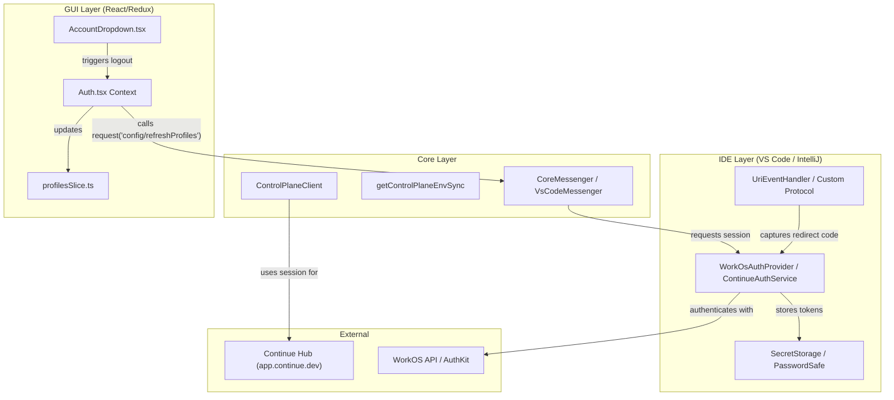

# Authentication System

Relevant source files

The following files were used as context for generating this wiki page:

- [extensions/cli/src/CLIPlatformClient.test.ts](extensions/cli/src/CLIPlatformClient.test.ts)
- [extensions/cli/src/CLIPlatformClient.ts](extensions/cli/src/CLIPlatformClient.ts)
- [extensions/cli/src/args.test.ts](extensions/cli/src/args.test.ts)
- [extensions/cli/src/auth/workos.ts](extensions/cli/src/auth/workos.ts)
- [extensions/cli/src/commands/review/resolveReviews.test.ts](extensions/cli/src/commands/review/resolveReviews.test.ts)
- [extensions/cli/src/commands/review/resolveReviews.ts](extensions/cli/src/commands/review/resolveReviews.ts)
- [extensions/cli/src/config.test.ts](extensions/cli/src/config.test.ts)
- [extensions/cli/src/config.ts](extensions/cli/src/config.ts)
- [extensions/cli/src/hubLoader.ts](extensions/cli/src/hubLoader.ts)
- [extensions/cli/src/integration/rule-duplication.test.ts](extensions/cli/src/integration/rule-duplication.test.ts)
- [extensions/cli/src/onboarding.test.ts](extensions/cli/src/onboarding.test.ts)
- [extensions/cli/src/services/AuthService.ts](extensions/cli/src/services/AuthService.ts)
- [extensions/cli/src/services/ModelService.test.ts](extensions/cli/src/services/ModelService.test.ts)
- [extensions/cli/src/services/ModelService.workflow-priority.test.ts](extensions/cli/src/services/ModelService.workflow-priority.test.ts)
- [extensions/cli/src/services/agent-file-integration.test.ts](extensions/cli/src/services/agent-file-integration.test.ts)
- [gui/src/components/PageHeader.tsx](gui/src/components/PageHeader.tsx)
- [gui/src/context/Auth.tsx](gui/src/context/Auth.tsx)
- [gui/src/pages/config/configTabs.tsx](gui/src/pages/config/configTabs.tsx)
- [gui/src/pages/config/index.tsx](gui/src/pages/config/index.tsx)
- [gui/src/pages/history/index.tsx](gui/src/pages/history/index.tsx)
- [packages/config-yaml/src/load/injectBlocks.test.ts](packages/config-yaml/src/load/injectBlocks.test.ts)
- [packages/openai-adapters/src/apis/AiSdk.ts](packages/openai-adapters/src/apis/AiSdk.ts)

## Purpose and Scope

This document describes the authentication system used by Continue's IDE extensions and CLI to authenticate users with the Continue Control Plane (Continue Hub). The authentication system enables features such as organization management, background agents, remote configuration sync, and shared assistants. It explains the OAuth flow, token management, and session propagation across the Core, IDE, GUI, and CLI components.

## Overview

Continue uses WorkOS-based authentication to provide single sign-on (SSO) capabilities across VS Code and IntelliJ extensions. The system manages OAuth tokens, refresh tokens, and session information to maintain authenticated connections with the Continue Control Plane API. While the CLI currently has Hub authentication features removed in recent versions, the core architecture remains designed for multi-platform session synchronization.

Sources: [extensions/cli/src/auth/workos.ts:4-7](), [gui/src/context/Auth.tsx:1-15]()

## Authentication Architecture

The authentication architecture bridges the IDE's secure storage with the Core's Control Plane client and the GUI's state management.

### System Data Flow

Sources: [gui/src/context/Auth.tsx:29-45](), [gui/src/pages/config/index.tsx:61](), [extensions/cli/src/config.ts:90-99]()

## GUI Integration and Profile Management

The GUI manages authentication state primarily through the `AuthProvider` context and Redux.

### AuthProvider
The `AuthProvider` component in `gui/src/context/Auth.tsx` provides the mechanism to refresh profiles and access the currently selected profile. It uses the `IdeMessenger` to communicate with the Core/IDE to trigger profile refreshes.

- **`refreshProfiles`**: Sends a `config/refreshProfiles` request to the IDE messenger [gui/src/context/Auth.tsx:29-35]().
- **State Selection**: Pulls profile data from the Redux store using `selectProfiles` and `selectSelectedProfile` [gui/src/context/Auth.tsx:26-27]().

### Account Management UI
The `AccountDropdown` component, located within the `ConfigPage` sidebar, serves as the primary entry point for user authentication actions (Login/Logout) in the GUI [gui/src/pages/config/index.tsx:61]().

Sources: [gui/src/context/Auth.tsx:17-58](), [gui/src/pages/config/index.tsx:28-63]()

## CLI Authentication and API Client

The CLI manages authentication through a specialized client and environment-based configuration.

### CLIPlatformClient
The `CLIPlatformClient` handles secret resolution and synchronization with the Control Plane. It prioritizes local environment variables over API-provided secrets.

- **`resolveFQSNs`**: Resolves Fully Qualified Secret Names. It first checks `process.env` for keys like `ANTHROPIC_API_KEY` before falling back to `syncSecrets` via the API client [extensions/cli/src/CLIPlatformClient.test.ts:43-69]().
- **Secret Types**: Supports various secret locations including `LocalEnv`, `User`, and `ModelsAddOn` [extensions/cli/src/CLIPlatformClient.test.ts:84-93]().

### API Client Initialization
The `getApiClient` function creates a `DefaultApi` instance (from the Continue SDK) configured with an access token and base path [extensions/cli/src/config.ts:90-99]().

Sources: [extensions/cli/src/config.ts:90-99](), [extensions/cli/src/CLIPlatformClient.test.ts:35-69]()

## LLM Integration with Auth

Authentication tokens are propagated to LLM API instances to enable managed model access.

### createLlmApi
The `createLlmApi` function takes a `ModelConfig` and an `AuthConfig`. It constructs the `LLMConfig` which includes the `apiKey` and `apiBase` required for the `BaseLlmApi` instance [extensions/cli/src/config.ts:44-58]().

### Model Prioritization
The `ModelService` in the CLI demonstrates how authentication and configuration interact to select the active model:
1.  **Agent File Model**: Highest priority if specified in an agent file [extensions/cli/src/services/ModelService.workflow-priority.test.ts:57-72]().
2.  **Persisted Model**: Fallback to the model name stored in the user's local auth config [extensions/cli/src/services/ModelService.workflow-priority.test.ts:104-119]().
3.  **Default Model**: Final fallback from the assistant configuration [extensions/cli/src/services/ModelService.workflow-priority.test.ts:149-164]().

Sources: [extensions/cli/src/config.ts:44-88](), [extensions/cli/src/services/ModelService.workflow-priority.test.ts:32-55]()

## Hub Feature Deprecation (CLI)

In the current CLI implementation, several Hub-related features have been moved to a "no-op" or "stub" state:
- **`loadAuthConfig`**: Always returns `null` [extensions/cli/src/auth/workos.ts:82-84]().
- **`login`**: Throws an error stating Hub authentication has been removed [extensions/cli/src/auth/workos.ts:127-131]().
- **`loadPackageFromHub`**: Always throws an error, as remote package loading is disabled in favor of local file-based rules [extensions/cli/src/hubLoader.ts:54-61]().

Sources: [extensions/cli/src/auth/workos.ts:1-7](), [extensions/cli/src/hubLoader.ts:54-61]()

## Summary of Authentication Components

| Component | Role | Key Entity |
| :--- | :--- | :--- |
| **GUI Context** | Manages UI auth state | `AuthProvider` [gui/src/context/Auth.tsx:19]() |
| **CLI Client** | Resolves secrets and API calls | `CLIPlatformClient` [extensions/cli/src/CLIPlatformClient.test.ts:6]() |
| **CLI Auth Stubs** | Legacy auth interface | `extensions/cli/src/auth/workos.ts` |
| **Redux Slices** | Persistent GUI auth state | `profilesSlice` [gui/src/context/Auth.tsx:5-8]() |

Sources: [gui/src/context/Auth.tsx:1-20](), [extensions/cli/src/auth/workos.ts:1-20](), [extensions/cli/src/config.ts:90-99]()