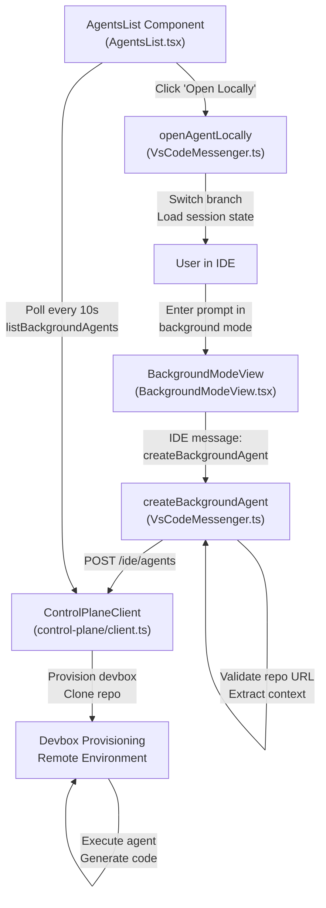
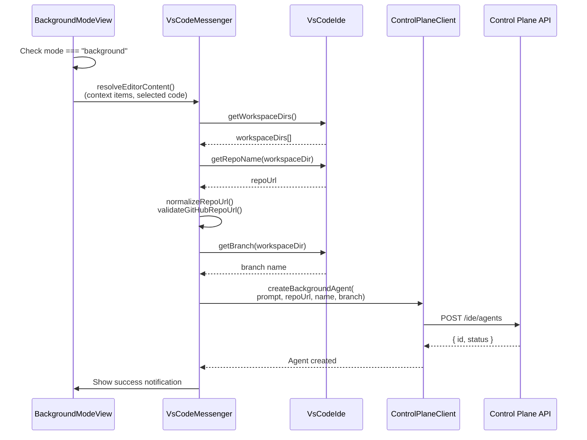
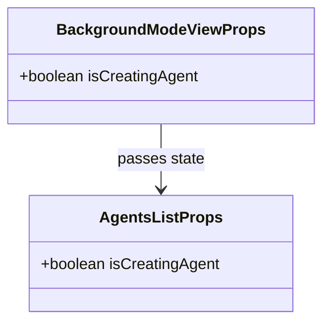

# Background Agents

<details>
<summary>Relevant source files</summary>

The following files were used as context for generating this wiki page:

- [gui/src/components/BackgroundMode/AgentsList.tsx](gui/src/components/BackgroundMode/AgentsList.tsx)
- [gui/src/components/BackgroundMode/BackgroundModeView.tsx](gui/src/components/BackgroundMode/BackgroundModeView.tsx)

</details>


## Purpose and Scope

Background agents are remote AI coding assistants that execute autonomously in cloud-based development environments. This feature allows users to delegate long-running tasks—such as code reviews, migrations, or complex refactors—to a remote agent that operates on a provisioned "devbox." This document details the agent creation lifecycle, the data flow between the IDE and the Continue Control Plane, and the "local takeover" workflow that allows developers to pull remote agent progress back into their local workspace.

For information about the chat interface and streaming responses, see [Chat Interface](8.2). For authentication with the Control Plane, see [Authentication System](9.1).

---

## System Architecture

### High-Level Agent Flow



**Sources:** [gui/src/components/BackgroundMode/BackgroundModeView.tsx:8-28](), [gui/src/components/BackgroundMode/AgentsList.tsx:5-11]()

---

## Agent Creation Workflow

### Creation Request Flow

The creation process begins in the GUI when the user is in `background` mode. The IDE extension gathers repository metadata and current workspace state before submitting the request to the Control Plane.



**Sources:** [gui/src/components/BackgroundMode/BackgroundModeView.tsx:12-28]()

### Agent Creation UI State

The `BackgroundModeView` component manages the visual state during the transition from prompt submission to agent execution.

| Component | Role | Logic |
|-----------|------|-------|
| `BackgroundModeView` | Container | Displays the creation status and instructional text [gui/src/components/BackgroundMode/BackgroundModeView.tsx:8-10](). |
| `isCreatingAgent` | Prop | Triggers a spinning `ArrowPathIcon` and "Creating task..." message [gui/src/components/BackgroundMode/BackgroundModeView.tsx:18-23](). |
| `AgentsList` | Sub-component | Rendered below the status to show existing background tasks [gui/src/components/BackgroundMode/BackgroundModeView.tsx:25-25](). |

**Sources:** [gui/src/components/BackgroundMode/BackgroundModeView.tsx:1-29]()

---

## Agent Management UI

### Agents List Component

The `AgentsList` component is responsible for listing active and historical background agents. In the current implementation, it serves as a placeholder for the agent management interface.

```typescript
export function AgentsList({ isCreatingAgent = false }: AgentsListProps) {
  return (
    <div className="text-description-muted px-2 py-4 text-center text-sm">
      Background agents are not available.
    </div>
  );
}
```

**Sources:** [gui/src/components/BackgroundMode/AgentsList.tsx:5-11]()

### Agent Status Indicators

When an agent is being initialized, the UI provides immediate feedback to the user:
*   **Instructional Text**: Notifies the user that the task will appear in approximately 30 seconds once the container starts [gui/src/components/BackgroundMode/BackgroundModeView.tsx:14-17]().
*   **Loading State**: Uses `isCreatingAgent` to show an animated `ArrowPathIcon` [gui/src/components/BackgroundMode/BackgroundModeView.tsx:18-23]().

**Sources:** [gui/src/components/BackgroundMode/BackgroundModeView.tsx:12-28]()

---

## Control Plane Integration

The background agent feature relies on the `ControlPlaneClient` (documented in [Control Plane Client](9.4)) to interact with remote orchestration services.

### Data Entities

The system tracks agents using structures that define the repository context and execution status.



**Sources:** [gui/src/components/BackgroundMode/BackgroundModeView.tsx:4-6](), [gui/src/components/BackgroundMode/AgentsList.tsx:1-3]()

---

## Local Takeover Workflow

The "Open Locally" feature (facilitated by the IDE extension) allows a developer to transition from a remote agent execution to a local development session. This involves:

1.  **Fetching Remote State**: The IDE retrieves the session state from the Control Plane.
2.  **Git Synchronization**: The local IDE ensures the correct branch is checked out and remote changes are pulled.
3.  **Context Restoration**: The local chat history is populated with the agent's remote logs and thought process.

**Sources:** [gui/src/components/BackgroundMode/BackgroundModeView.tsx:15-16]()