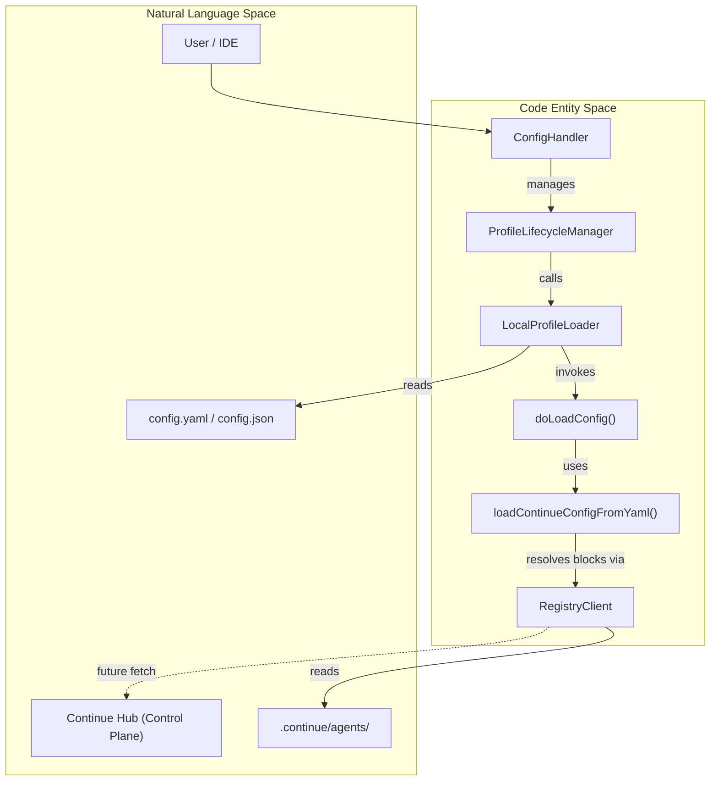
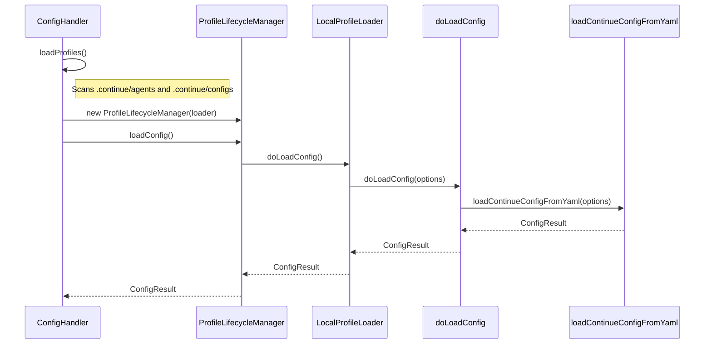

# Remote Configuration

Relevant source files

The following files were used as context for generating this wiki page:

- [core/config/ConfigHandler.ts](core/config/ConfigHandler.ts)
- [core/config/ProfileLifecycleManager.ts](core/config/ProfileLifecycleManager.ts)
- [core/config/load.ts](core/config/load.ts)
- [core/config/profile/LocalProfileLoader.ts](core/config/profile/LocalProfileLoader.ts)
- [core/config/profile/LocalProfileLoader.vitest.ts](core/config/profile/LocalProfileLoader.vitest.ts)
- [core/config/profile/doLoadConfig.ts](core/config/profile/doLoadConfig.ts)
- [core/config/profile/doLoadConfig.vitest.ts](core/config/profile/doLoadConfig.vitest.ts)
- [core/config/yaml/LocalPlatformClient.ts](core/config/yaml/LocalPlatformClient.ts)
- [core/config/yaml/loadYaml.ts](core/config/yaml/loadYaml.ts)
- [core/config/yaml/models.ts](core/config/yaml/models.ts)
- [core/util/paths.ts](core/util/paths.ts)
- [packages/config-yaml/src/interfaces/SecretResult.ts](packages/config-yaml/src/interfaces/SecretResult.ts)
- [packages/config-yaml/src/interfaces/index.ts](packages/config-yaml/src/interfaces/index.ts)
- [packages/config-yaml/src/interfaces/slugs.test.ts](packages/config-yaml/src/interfaces/slugs.test.ts)
- [packages/config-yaml/src/interfaces/slugs.ts](packages/config-yaml/src/interfaces/slugs.ts)
- [packages/config-yaml/src/load/clientRender.ts](packages/config-yaml/src/load/clientRender.ts)
- [packages/config-yaml/src/registryClient.test.ts](packages/config-yaml/src/registryClient.test.ts)
- [packages/config-yaml/src/registryClient.ts](packages/config-yaml/src/registryClient.ts)
- [packages/config-yaml/src/schemas/models.ts](packages/config-yaml/src/schemas/models.ts)

## Purpose and Scope

Remote Configuration enables Continue to load assistant definitions and settings from the **Continue Hub** (Control Plane) rather than solely from local files. This allows organizations to share standardized configurations across team members, manage secrets centrally, and maintain consistent AI assistant setups.

This page covers the platform-based configuration system, including profile loading, YAML unrolling, and the relationship between local and remote loaders. For authentication details, see [Authentication System](#9.1). For the underlying configuration architecture, see [Configuration Architecture](#5.1).

## Configuration Sources Architecture

The system distinguishes between local configurations (loaded from disk) and platform configurations (fetched from Control Plane). Each configuration is managed by a `ProfileLifecycleManager`, which abstracts the source via an `IProfileLoader`.

**Sources:** [core/config/ConfigHandler.ts:31-60](), [core/config/ProfileLifecycleManager.ts:28-36](), [core/config/profile/LocalProfileLoader.ts:12-41](), [core/config/profile/doLoadConfig.ts:64-81]()

## Profile Types and Loading

Each profile is managed by a `ProfileLifecycleManager` that wraps an `IProfileLoader` implementation. The loader type determines whether configuration is loaded from local files or fetched remotely.

### ProfileDescription Structure

The `ProfileDescription` interface defines the metadata for a configuration profile, including its unique ID and any validation errors encountered during loading.

| Field | Type | Description |
|-------|------|-------------|
| `id` | `string` | Unique identifier (e.g., file path for local profiles) |
| `fullSlug` | `FullSlug` | Owner/package/version identifiers |
| `title` | `string` | Display name (e.g., "Main Config" or filename) |
| `errors` | `ConfigValidationError[]` | Array of errors from the validation/loading process |
| `uri` | `string` | The source URI of the configuration |
| `rawYaml` | `string` | Optional raw YAML content |

**Sources:** [core/config/ProfileLifecycleManager.ts:18-26](), [core/config/profile/LocalProfileLoader.ts:24-40]()

## Profile Management Flow

The `ConfigHandler` orchestrates the discovery and selection of profiles. It persists the user's last selected profile per workspace in the `GlobalContext`.

**Sources:** [core/config/ConfigHandler.ts:138-159](), [core/config/profile/LocalProfileLoader.ts:43-67](), [core/config/profile/doLoadConfig.ts:107-124]()

## The Loading Pipeline (`doLoadConfig`)

The `doLoadConfig` function is the central entry point for configuration transformation. It handles both legacy JSON and modern YAML formats.

1. **Format Detection**: It checks for `config.yaml` at the path provided by `getConfigYamlPath()`. If it exists or if `overrideConfigYaml` is provided, it triggers the YAML pipeline. [core/config/profile/doLoadConfig.ts:107-124]()
2. **YAML Unrolling**: The `loadContinueConfigFromYaml` function uses `unrollAssistant` to resolve dependencies. It injects local blocks found in `.continue/agents`, `.continue/assistants`, and `.continue/configs`. [core/config/yaml/loadYaml.ts:57-71](), [core/config/yaml/loadYaml.ts:105-114]()
3. **Secret Rendering**: For remote-synced configurations, `renderSecrets` resolves template variables (e.g., `${{ secrets.API_KEY }}`) by checking local secret stores or querying the `PlatformClient`. [packages/config-yaml/src/load/clientRender.ts:20-58]()
4. **Rule Integration**: Rules are loaded from `.continuerules` and markdown files in `.continue/rules` and prepended to the config. [core/config/profile/doLoadConfig.ts:40-62](), [core/config/profile/doLoadConfig.ts:153-155]()

**Sources:** [core/config/profile/doLoadConfig.ts:64-137](), [core/config/yaml/loadYaml.ts:46-120](), [packages/config-yaml/src/load/clientRender.ts:20-70]()

## Remote Config vs. remoteConfigServerUrl

The system maintains support for a legacy remote configuration method alongside the new profile-based system.

| Feature | Platform/YAML Profiles | Legacy `remoteConfigServerUrl` |
|---------|-------------------------|---------------------------------|
| **Mechanism** | `IProfileLoader` / `unrollAssistant` | JSON Merge in `loadSerializedConfig` |
| **Format** | YAML (Blocks/Assistants) | JSON (`config.json`) |
| **Merging** | Recursive unrolling and composition | `mergeJson` with specific `configMergeKeys` |
| **Auth** | Platform/Registry based | Managed via IDE Settings |
| **File Path** | `~/.continue/config.yaml` | `~/.continue/config.json` |

**Sources:** [core/config/load.ts:142-151](), [core/config/load.ts:98-110](), [core/config/yaml/loadYaml.ts:105-119]()

## Error Handling and Validation

Validation occurs at multiple stages to prevent a broken remote configuration from crashing the extension.

- **Fatal Errors**: If `validateConfigYaml` or `validateConfig` detects fatal errors, the `configLoadInterrupted` flag is set to `true`, and the previous valid configuration is often retained. [core/config/yaml/loadYaml.ts:125-131](), [core/config/load.ts:130-136]()
- **Registry Failures**: The `RegistryClient` handles file read errors gracefully, especially for complex environments like WSL where `fs.readFileSync` might fail for `vscode-remote://` URIs. [packages/config-yaml/src/registryClient.ts:17-33]()
- **Validation Schemas**: Zod schemas in `@continuedev/config-yaml` define the structure for models, request options, and completion settings. [packages/config-yaml/src/schemas/models.ts:178-205]()

**Sources:** [core/config/profile/doLoadConfig.ts:139-146](), [core/config/yaml/loadYaml.ts:121-131](), [packages/config-yaml/src/registryClient.ts:17-33]()