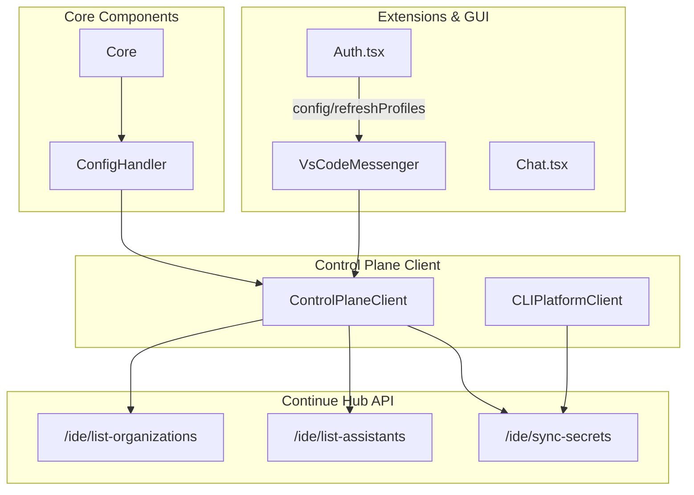
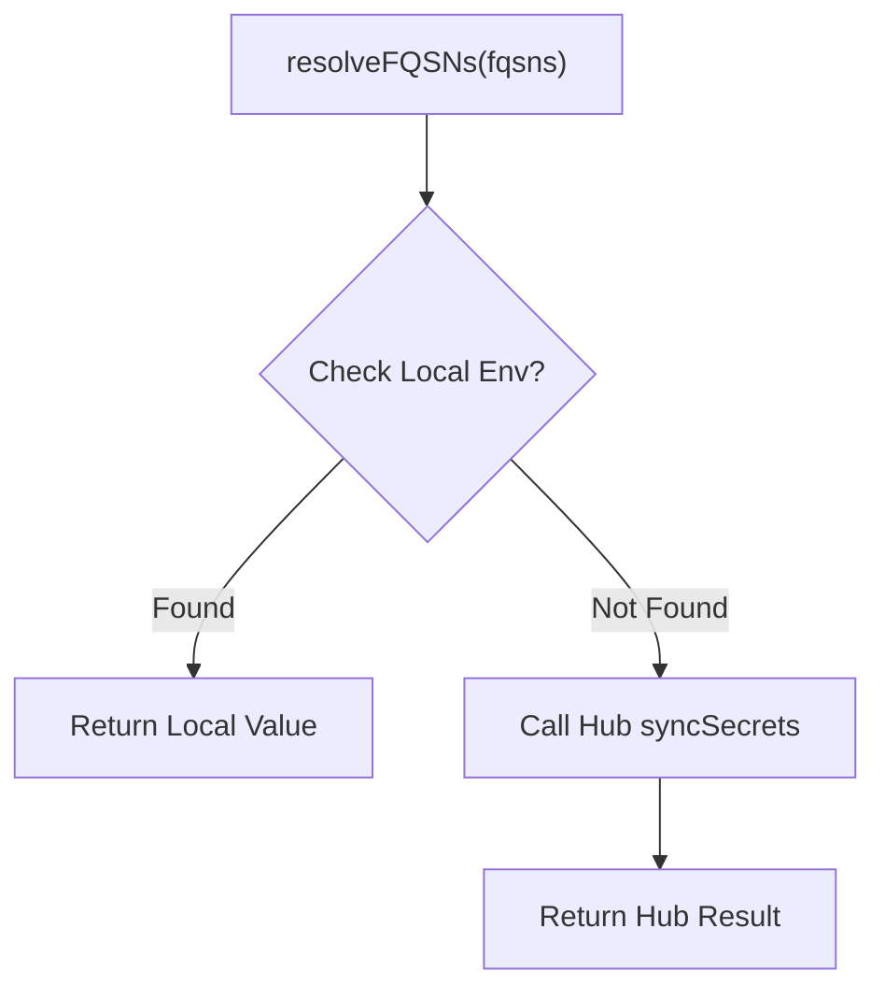

# Control Plane Client

<details>
<summary>Relevant source files</summary>

The following files were used as context for generating this wiki page:

- [extensions/cli/src/CLIPlatformClient.test.ts](extensions/cli/src/CLIPlatformClient.test.ts)
- [extensions/cli/src/CLIPlatformClient.ts](extensions/cli/src/CLIPlatformClient.ts)
- [extensions/cli/src/args.test.ts](extensions/cli/src/args.test.ts)
- [extensions/cli/src/auth/workos.ts](extensions/cli/src/auth/workos.ts)
- [extensions/cli/src/commands/review/resolveReviews.test.ts](extensions/cli/src/commands/review/resolveReviews.test.ts)
- [extensions/cli/src/commands/review/resolveReviews.ts](extensions/cli/src/commands/review/resolveReviews.ts)
- [extensions/cli/src/config.test.ts](extensions/cli/src/config.test.ts)
- [extensions/cli/src/config.ts](extensions/cli/src/config.ts)
- [extensions/cli/src/hubLoader.ts](extensions/cli/src/hubLoader.ts)
- [extensions/cli/src/integration/rule-duplication.test.ts](extensions/cli/src/integration/rule-duplication.test.ts)
- [extensions/cli/src/onboarding.test.ts](extensions/cli/src/onboarding.test.ts)
- [extensions/cli/src/services/AuthService.ts](extensions/cli/src/services/AuthService.ts)
- [extensions/cli/src/services/ModelService.test.ts](extensions/cli/src/services/ModelService.test.ts)
- [extensions/cli/src/services/ModelService.workflow-priority.test.ts](extensions/cli/src/services/ModelService.workflow-priority.test.ts)
- [extensions/cli/src/services/agent-file-integration.test.ts](extensions/cli/src/services/agent-file-integration.test.ts)
- [gui/src/components/PageHeader.tsx](gui/src/components/PageHeader.tsx)
- [gui/src/context/Auth.tsx](gui/src/context/Auth.tsx)
- [gui/src/pages/config/configTabs.tsx](gui/src/pages/config/configTabs.tsx)
- [gui/src/pages/config/index.tsx](gui/src/pages/config/index.tsx)
- [gui/src/pages/history/index.tsx](gui/src/pages/history/index.tsx)
- [packages/config-yaml/src/load/injectBlocks.test.ts](packages/config-yaml/src/load/injectBlocks.test.ts)
- [packages/openai-adapters/src/apis/AiSdk.ts](packages/openai-adapters/src/apis/AiSdk.ts)

</details>


The `ControlPlaneClient` is the primary HTTP client for communicating with the Continue Control Plane API (Continue Hub). It manages authentication, organization operations, assistant configurations, background agent sessions, and secret resolution. The client is instantiated during the Core initialization and used throughout the codebase for all platform interactions.

For information about authentication flows, see [Authentication System](9.1). For remote configuration loading, see [Remote Configuration](9.3). For background agent features, see [Background Agents](9.2).

## Overview

The `ControlPlaneClient` acts as a bridge between the local IDE environment and the remote Continue services. It is responsible for attaching authentication tokens to requests and handling environment-specific URL resolution. In the CLI, a specialized `CLIPlatformClient` provides similar functionality for resolving secrets and syncing configurations.



**Diagram: Control Plane Client Architecture**

Sources: [gui/src/context/Auth.tsx:33-35](), [extensions/cli/src/CLIPlatformClient.ts:25-30]()

## Client API Overview

The `ControlPlaneClient` provides methods organized into several functional areas:

| Category | Methods | Purpose |
|----------|---------|---------|
| **Authentication** | `getAccessToken()`, `isSignedIn()` | Manage authentication state and tokens |
| **Organizations** | `listOrganizations()` | Retrieve organization lists for the current user |
| **Assistants** | `listAssistants()`, `listAssistantFullSlugs()` | Fetch remote assistant configurations and slugs |
| **Secrets** | `resolveFQSNs()` | Sync and resolve secrets (FQSNs) from the Hub |
| **Background Agents** | `listBackgroundAgents()`, `getAgentSession()` | Manage and query background agent sessions |

### CLI Implementation
The CLI uses `getApiClient` to generate a `DefaultApi` instance for interacting with the Hub. This client uses the `accessToken` and a base path resolved from the environment.

```typescript
export function getApiClient(
  accessToken: string | undefined | null,
): DefaultApi {
  return new DefaultApi(
    new Configuration({
      basePath: env.apiBase.replace(/\/$/, ""),
      accessToken: accessToken ?? undefined,
    }),
  );
}
```

Sources: [extensions/cli/src/config.ts:90-99](), [extensions/cli/src/CLIPlatformClient.ts:25-35]()

## Secret Resolution (FQSN)

The system supports resolving Fully Qualified Secret Names (FQSNs). This allows configurations to reference secrets (like API keys) stored securely in the Control Plane or local environment variables rather than in local plaintext files.

The `CLIPlatformClient` implements a resolution strategy that prioritizes local environment variables before falling back to the Control Plane API.



**Diagram: CLI Secret Resolution Flow**

**Resolution Logic in CLI:**
1. **Local Environment**: Checks `process.env` for the secret name defined in the FQSN [extensions/cli/src/CLIPlatformClient.test.ts:52-54]().
2. **API Sync**: If not found locally, it calls `syncSecrets` on the Hub API, passing the FQSNs and organization scope [extensions/cli/src/CLIPlatformClient.test.ts:99-104]().
3. **Models Add-On**: Handles specific cases where a secret might be provided by a "models add-on" (found: true but no direct value) [extensions/cli/src/CLIPlatformClient.test.ts:123-131]().

Sources: [extensions/cli/src/CLIPlatformClient.test.ts:35-108](), [extensions/cli/src/CLIPlatformClient.ts:40-65]()

## Profile and Assistant Management

The client facilitates the retrieval of organization-scoped resources, which are essential for team-based configuration. In the GUI, the `AuthContext` manages the selection and refreshing of these profiles.

### Refreshing Profiles
When a user switches profiles or logs in, the GUI triggers a profile refresh through the `IdeMessenger`.

```typescript
const refreshProfiles = useCallback(
  async (reason?: string) => {
    dispatch(setConfigLoading(true));
    await ideMessenger.request("config/refreshProfiles", {
      reason,
    });
    // ...
  },
  [ideMessenger],
);
```

### CLI Model Prioritization
The CLI's `ModelService` uses the client-related configurations to determine which LLM to initialize. It prioritizes models specified in local `agent files` over default or persisted models from the Control Plane.

Sources: [gui/src/context/Auth.tsx:29-45](), [extensions/cli/src/services/ModelService.workflow-priority.test.ts:57-72](), [extensions/cli/src/services/ModelService.workflow-priority.test.ts:104-115]()

## GUI Integration

The Control Plane integration is visible in the GUI through the Account settings and Profile selection.

| Component | File | Role |
|-----------|------|------|
| `ConfigPage` | `gui/src/pages/config/index.tsx` | Main settings container [gui/src/pages/config/index.tsx:11]() |
| `AccountDropdown` | `gui/src/pages/config/features/account/AccountDropdown` | Displays user account and login status [gui/src/pages/config/index.tsx:61]() |
| `AuthProvider` | `gui/src/context/Auth.tsx` | Manages global auth state and profile list [gui/src/context/Auth.tsx:19]() |

The `ConfigPage` uses a vertical sidebar with `TabGroup` components to navigate between different configuration sections, including account management which interacts with the `ControlPlaneClient`.

Sources: [gui/src/pages/config/index.tsx:30-63](), [gui/src/context/Auth.tsx:48-57]()

## Legacy and Removed Features

Recent updates have removed certain Hub-related functionalities in the CLI to simplify the architecture:
- **Hub Package Loading**: The `loadPackageFromHub` function now throws an error, as loading rules/MCPs directly from Hub slugs is no longer supported [extensions/cli/src/hubLoader.ts:54-61]().
- **WorkOS Auth Stubs**: Hub/WorkOS authentication stubs remain in the CLI for compatibility but act as no-ops or return `null` [extensions/cli/src/auth/workos.ts:4-7]().
- **Review Resolution**: The `resolveReviews` logic now falls back to local `.continue/agents/*.md` files instead of resolving from the Hub API [extensions/cli/src/commands/review/resolveReviews.ts:49-51]().

Sources: [extensions/cli/src/hubLoader.ts:19-25](), [extensions/cli/src/auth/workos.ts:123-135](), [extensions/cli/src/commands/review/resolveReviews.ts:19-44]()