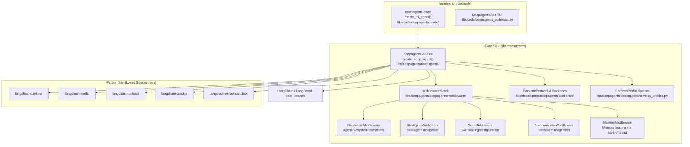
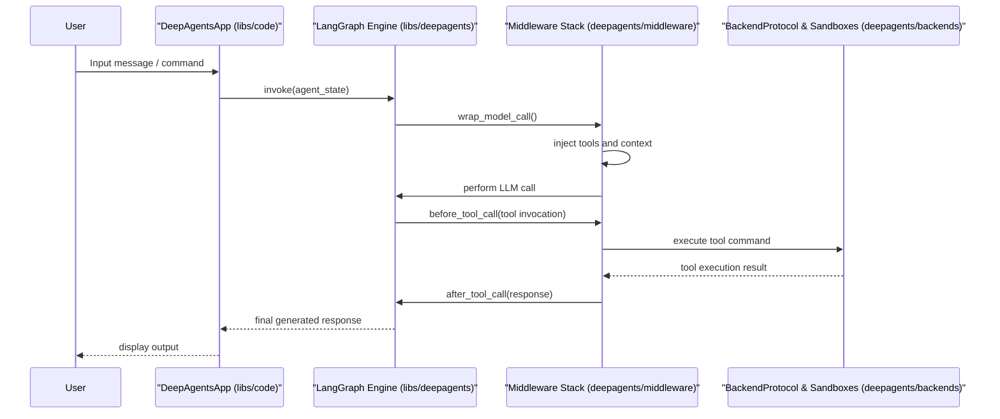

# Overview

<details>
<summary>Relevant source files</summary>

The following files were used as context for generating this wiki page:

- [.github/CODEOWNERS](.github/CODEOWNERS)
- [README.md](README.md)
- [examples/README.md](examples/README.md)
- [examples/async-subagent-server/uv.lock](examples/async-subagent-server/uv.lock)
- [examples/downloading_agents/README.md](examples/downloading_agents/README.md)
- [examples/downloading_agents/content-writer.zip](examples/downloading_agents/content-writer.zip)
- [examples/llm-wiki/uv.lock](examples/llm-wiki/uv.lock)
- [libs/acp/uv.lock](libs/acp/uv.lock)
- [libs/code/README.md](libs/code/README.md)
- [libs/deepagents/README.md](libs/deepagents/README.md)
- [libs/deepagents/pyproject.toml](libs/deepagents/pyproject.toml)
- [libs/deepagents/uv.lock](libs/deepagents/uv.lock)
- [libs/partners/daytona/uv.lock](libs/partners/daytona/uv.lock)
- [libs/partners/modal/uv.lock](libs/partners/modal/uv.lock)
- [libs/partners/quickjs/uv.lock](libs/partners/quickjs/uv.lock)
- [libs/partners/runloop/uv.lock](libs/partners/runloop/uv.lock)

</details>


Deep Agents is a batteries-included agent framework designed for building autonomous AI agents with advanced capabilities in planning, delegation, and filesystem interaction. It is built on top of LangGraph, providing an opinionated yet fully extensible agent harness that abstracts away manual wiring of prompts, toolsets, and context management. Deep Agents offers a rich CLI experience, extensibility through pluggable middleware, and supports a variety of backend environments including local and remote sandboxes.

For deeper dives, see the child pages on [Packages](#1.1), [Quick Start](#1.2), and [Architecture Overview](#1.3).

Sources: [README.md:12-24](), [libs/deepagents/README.md:1-21]()

---

## 1.1. Packages

The Deep Agents monorepo consists of multiple independently versioned Python packages managed via the `uv` package manager, designed to separate concerns between core SDK functionality, terminal UI, integrations, and evaluation frameworks:

- **`deepagents`**: The core SDK library featuring the primary function `create_deep_agent()` for agent instantiation, a modular middleware stack (`AgentMiddleware`), and backend abstractions following `BackendProtocol`. This is the foundational package for agent logic and orchestration.  
- **`deepagents-code`**: The pre-built interactive terminal UI and coding agent accessible through the `dcode` command-line tool, built using Textual for a rich TUI experience.
- **`deepagents-cli`**: Command-line tools for project initialization, development, and deploy workflows.
- **`deepagents-acp`**: Agent Client Protocol implementation to integrate with editors like Zed for communication and tooling.
- **`deepagents-evals`**: Behavioral evaluation framework including Harbor integration to provide standardized benchmarks and rigorous agent performance assessment.
- **`deepagents-talon`**: An experimental runtime host for long-lived agents supporting channel adapters (Slack, Telegram, etc.) and cron-based scheduling.
- **Partner Sandbox Integrations**: Remote sandbox environment adapters including `langchain-daytona`, `langchain-modal`, `langchain-runloop`, `langchain-quickjs`, and `langchain-vercel-sandbox` for flexible agent execution environments.

Each package addresses a specific layer or integration need, enabling composability and scalability across deployment scenarios.

Sources: [libs/deepagents/README.md:1-53](), [libs/code/README.md:1-32](), [.github/workflows/pr_lint.yml:30-137]()

---

## 1.2. Quick Start

Deep Agents supports two main onboarding paths: using it as a Python SDK to build customized agents, and running the out-of-the-box interactive terminal coding agent (`dcode`).

### Using the Core SDK Programmatically

The core SDK exposes `create_deep_agent()` which instantiates a fully configured agent with a default middleware stack tuned for multi-step reasoning, tool calling, and context management:

```python
from deepagents import create_deep_agent

agent = create_deep_agent(
    model="openai:gpt-6-astra",
    system_prompt="You are a research assistant.",
)
result = agent.invoke({"messages": "Research LangGraph and write a summary"})
```

This simple sequence shows creating an agent, invoking it with a user message, and collecting its response.

### Running the Interactive Terminal Coding Agent

Install and launch `deepagents-code`, a Claude-like terminal AI coding assistant powered by any LLM, with a single shell command:

```bash
curl -LsSf https://langch.in/dcode | bash
dcode
```

The `dcode` tool provides a rich interactive experience including chat input, filesystem browsing, sub-agent orchestration, human-in-the-loop approval, OAuth login for various providers, and persistent session management.

For installation details, environment configuration, and usage patterns, see the [Quick Start](#1.2) documentation page.

Sources: [README.md:51-64](), [libs/code/README.md:12-28]()

---

## 1.3. Architecture Overview

At its core, Deep Agents is built on LangGraph, an advanced graph runtime that supports streaming responses, persistence, checkpointing, and modular execution. Deep Agents leverages LangGraph to construct a middleware stack that intermediates between the LLM and tool invocation, providing features such as filesystem access, sub-agent delegation, skill management, and context window summarization.

### Package and Code Entity Structure



### Execution Flow Overview



The middleware intercepts agent interactions to manage filesystem access, delegate sub-agents with isolated state, load skills dynamically, and summarize or offload context to fit within model windows.

The `BackendProtocol` abstracts file storage, shell sandboxes, state persistence, and remote sandboxes, enabling flexible deployment on local environments or cloud providers.

For a detailed breakdown of components, data flow, and how the CLI UI integrates with the core SDK, see the [Architecture Overview](#1.3) page.

Sources: [libs/deepagents/README.md:21-40](), [README.md:86-91](), [libs/code/README.md:34-44]()

---

This overview provides a high-level introduction to the Deep Agents ecosystem, illustrating the relationship between core packages, key runtime components, and the interactive CLI application. Dive into the linked child pages for comprehensive documentation on package contents, usage instructions, and architectural details.