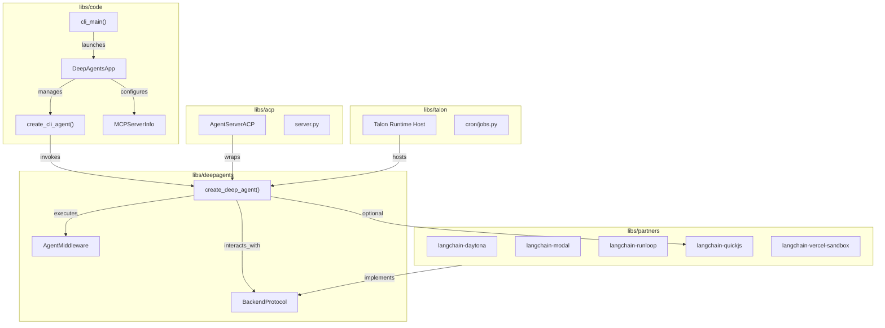
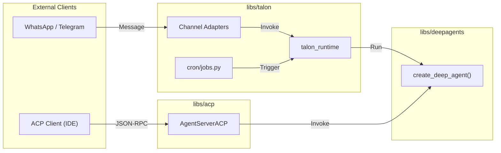
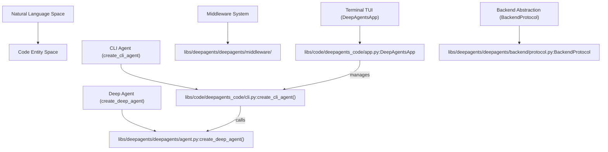
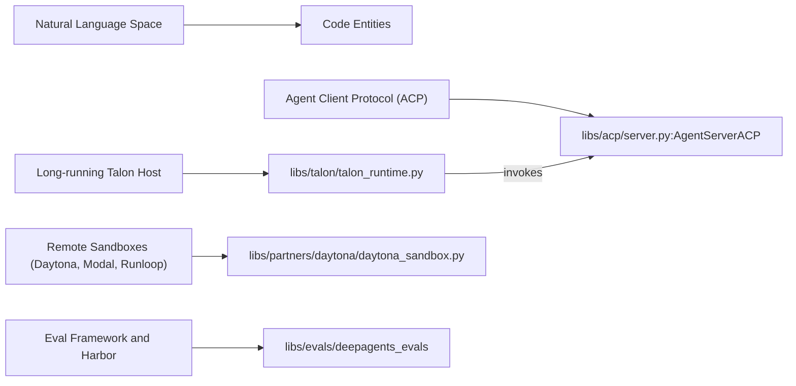

# Packages

Relevant source files

The following files were used as context for generating this wiki page:

- [.release-please-manifest.json](.release-please-manifest.json)
- [ACTION.md](ACTION.md)
- [action.yml](action.yml)
- [libs/ARCHITECTURE.md](libs/ARCHITECTURE.md)
- [libs/DEVELOPMENT.md](libs/DEVELOPMENT.md)
- [libs/README.md](libs/README.md)
- [libs/code/CHANGELOG.md](libs/code/CHANGELOG.md)
- [libs/code/deepagents_code/_version.py](libs/code/deepagents_code/_version.py)
- [libs/code/pyproject.toml](libs/code/pyproject.toml)
- [libs/code/uv.lock](libs/code/uv.lock)
- [libs/deepagents/CHANGELOG.md](libs/deepagents/CHANGELOG.md)
- [libs/deepagents/deepagents/_version.py](libs/deepagents/deepagents/_version.py)
- [libs/evals/AGENTS.md](libs/evals/AGENTS.md)
- [libs/evals/uv.lock](libs/evals/uv.lock)
- [libs/partners/AGENTS.md](libs/partners/AGENTS.md)
- [libs/talon/uv.lock](libs/talon/uv.lock)

## Purpose and Scope

This page documents the primary packages and partner integrations in the Deep Agents monorepo. The project is structured as a modular ecosystem providing a core SDK, interactive terminal interfaces, deployment tooling, and standardized protocol/provider integrations.

- **`deepagents`** (Core SDK): The foundational library for building agents with middleware, harness profiles, and pluggable backends. [libs/deepagents/pyproject.toml:2-5]()
- **`deepagents-code`** (Coding Agent): The primary user-facing interactive terminal UI (TUI) and coding agent. [libs/code/pyproject.toml:6-8](), [.release-please-manifest.json:4-4]()
- **`deepagents-cli`** / Lifecycle Tooling: Focused on the `init`, `deploy`, `agents`, and `mcp-servers` commands for agent lifecycle management. [.release-please-manifest.json:1-11]()
- **`deepagents-acp`** (Agent Client Protocol): Integration for exposing Deep Agents via the standardized ACP server protocol. [libs/acp/pyproject.toml:2-14]()
- **`deepagents-evals/harbor`**: Integration with the Harbor evaluation framework for benchmarking and LangSmith tracing. [libs/evals/AGENTS.md:1-40]()
- **`deepagents-talon`**: Experimental long-running runtime host for Deep Agents, supporting channel adapters like WhatsApp and Telegram, and persistent cron scheduling. [libs/talon/uv.lock:1-10](), [.release-please-manifest.json:5-5]()
- **Partner Sandboxes**: Specialized integration packages for remote execution environments like Daytona, Modal, Runloop, Vercel, and QuickJS. [libs/partners/daytona/uv.lock:1-10](), [libs/partners/modal/uv.lock:1-10](), [libs/partners/runloop/uv.lock:1-10](), [.release-please-manifest.json:6-10]()

Sources: [.release-please-manifest.json:1-11](), [libs/deepagents/pyproject.toml:1-35](), [libs/code/pyproject.toml:1-106](), [libs/evals/AGENTS.md:1-41]()

---

## Monorepo Architecture

The repository uses a `libs/` and `partners/` directory structure to isolate core logic from external integrations. Each package is independently versioned and managed with the `uv` package manager and contains its own configuration and lock files.

Key packages:

- `libs/deepagents`: Core SDK describing agent, middleware, backends.
- `libs/code`: Interactive terminal coding agent, CLI, TUI, MCP integration.
- `libs/acp`: Agent Client Protocol server exposing agents over stdio JSON-RPC.
- `libs/evals`: Evaluation framework with Harbor adapter and testing CLI.
- `libs/talon`: Experimental long-running host for persistent agents and channel adapters.
- `libs/partners`: Partner sandbox providers for remote execution (Daytona, Modal, Runloop, Vercel, QuickJS).

Sources: [libs/deepagents/pyproject.toml:22-30](), [libs/code/pyproject.toml:28-65](), [.release-please-manifest.json:1-11]()

---

## Core SDK: `deepagents`

The `deepagents` package is the engine of the framework. It defines the agent lifecycle and execution graph leveraging LangGraph, and implements a flexible middleware architecture that enables sub-agent spawning, skills loading, memory management, offline tools, and backend abstraction.

**Version:** `0.7.26` [.release-please-manifest.json:2-2]()

### Key Classes and Functions

- `create_deep_agent()`: Factory function that instantiates and configures an agent graph with default middleware and toolchain. This is the core entry point for building Deep Agents programmatically.
- **Middleware System**: A layered interceptor system implementing the `AgentMiddleware` interface. Built-in middleware includes:
  - `MemoryMiddleware`: Loads persistent agent memory from AGENTS.md files.
  - `SkillsMiddleware`: Loads modular skills with precedence for built-in, user, and project levels.
  - `FilesystemMiddleware`: Provides tools for file access and execution within configured backends.
  - `SubAgentMiddleware`: Supports spawning isolated and forked sub-agents, sync or async.
  - `SummarizationMiddleware`: Manages context window compaction and conversation offloading.
- **Backend Protocols**: Abstractions (`BackendProtocol`, `SandboxBackendProtocol`) for implementing filesystem and shell operations backed by local, composite, cloud (LangSmith), or remote sandbox environments.

### Data Flow

When calling an agent created via `create_deep_agent()`:

1. Input prompt is sent through middleware stack.
2. Middleware may intercept tool calls or model interactions.
3. If a tool calls for sub-agent delegation, `SubAgentMiddleware` manages spawning.
4. Filesystem and state tools route requests to configured backend implementations.
5. Middleware manage memory reads/writes and summarize conversation history as needed.

Sources: [.release-please-manifest.json:2-2](), [libs/deepagents/pyproject.toml:1-35](), [libs/deepagents/uv.lock:1-15]()

---

## Coding Agent: `deepagents-code`

`deepagents-code` is the official pre-built interactive terminal coding agent built on top of the core SDK. It provides a rich Textual-based TUI, interactive chat, command slash handlers, thread management, and extensive config for local and remote usage.

**Version:** `0.1.85` [.release-please-manifest.json:4-4]()

### Core Components

- `DeepAgentsApp`: The main Textual TUI class managing the interactive agent session lifecycle, event loop, message streaming, and user input handling.
- `create_cli_agent()`: Specialized agent factory that configures middleware stacks for CLI usage, adding local context injection (Git status, project files), local memory loading, and shell allow list security.
- MCP (Model Context Protocol) Integration: supports OAuth login flows, provider tool loading, and in-TUI management.
- Cost tracking: Bundled offline pricing data integrated for usage estimation.
- Shell and tool integrations with autocomplete, external editor support, and multi-line chat input.
- Headless mode for non-interactive automation and JSON output.
- Local context injection middleware adding Git status and project file tree to system prompts for coding context.

### Key Features

- Interactive multi-thread chat UI with persistent sessions.
- Slash command registry and dynamic command dispatch.
- Tool output virtualization and rich rendering with diffs and markdown.
- Plugin manager with marketplace and install lifecycle.
- Goal and rubric review system integrated in the UI.
- Local and remote context injection, including support for local shell allow lists.

Sources: [.release-please-manifest.json:4-4](), [libs/code/pyproject.toml:1-106](), [libs/code/CHANGELOG.md:1-109]()

---

## Agent Client Protocol: `deepagents-acp`

`deepagents-acp` implements the Agent Client Protocol allowing Deep Agents to run inside editors (like Zed) or other clients supporting the ACP JSON-RPC over stdio.

- **`AgentServerACP`**: The main server class handling ACP communication, wrapping a `create_deep_agent` instance.
- Supports command allowlists and agent lifecycle management over the protocol.
- Provides a demo overlay demonstrating protocol usage.

**Version:** `0.0.13` [.release-please-manifest.json:3-3]()

Sources: [libs/acp/pyproject.toml:2-14]()

---

## Evaluation Framework & Harbor Integration: `deepagents-evals/harbor`

The `deepagents-evals` package provides a structured evaluation framework leveraging Harbor and LangSmith tracing. It is designed for benchmarking agent behavior across scenarios and capturing detailed metrics.

- Provides a command-line interface `deepagents-evals` with subcommands for running tests, trials, aggregation, and radar charts.
- Supports listing eval categories, tiers, models, and runs.
- Integrates with Harbor through adapters to record runs and analysis.
- Designed to require LangSmith tracing enabled for invoking evaluations.

Sources: [libs/evals/AGENTS.md:1-41]()

---

## Talon Runtime Host: `deepagents-talon`

An experimental host runtime aimed at long-running agents with persistent state, background cron jobs, and multi-channel adapters:

- Manages agent lifecycle, configuration hardening, and sub-agent async handling.
- Includes channel adapters for WhatsApp (with Node.js bridge and QR pairing), Telegram, Slack, Discord, voice transcription, and speech output.
- Provides persistent conversation history storage using multiple backends (vector stores, SQL, archives).
- Supports cron scheduler for persistent jobs and automated triggers.

**Version:** `0.0.9` [.release-please-manifest.json:5-5]()

Sources: [.release-please-manifest.json:1-11](), [libs/acp/uv.lock:1-15](), [libs/talon/uv.lock:1-10]()

---

## Partner Sandbox Integrations

A set of integration packages providing sandboxed `BackendProtocol` implementations for remote or cloud execution environments. These allow Deep Agents to execute tool calls or shell actions remotely with environment isolation.

| Package Name               | Description                                   | Version           | Source Reference                        |
|----------------------------|-----------------------------------------------|-------------------|---------------------------------------|
| `langchain-daytona`         | Daytona sandbox provider for ephemeral remote execution | `0.0.8`           | [.release-please-manifest.json:6-6]() |
| `langchain-modal`           | Modal serverless sandbox provider             | `0.0.6`           | [.release-please-manifest.json:7-7]() |
| `langchain-runloop`         | Runloop managed environment sandbox provider  | `0.0.7`           | [.release-please-manifest.json:8-8]() |
| `langchain-vercel-sandbox`  | Vercel sandbox for serverless execution        | `0.0.2`           | [.release-please-manifest.json:9-9]() |
| `langchain-quickjs`         | Embedded QuickJS interpreter for local sandboxed JS execution | `0.3.9`           | [.release-please-manifest.json:10-10]() |

Each of these sandbox packages implements the `BackendProtocol` interface and exposes adapters to run code, scripts, or commands remotely, integrating transparently with Deep Agents middleware stacks.

Sources: [.release-please-manifest.json:6-10](), [libs/partners/daytona/uv.lock:1-10](), [libs/partners/modal/uv.lock:1-10](), [libs/partners/runloop/uv.lock:1-10]()

---

## Summary Table of Packages

| Package                 | Type                     | Features                                           | Version          |
|-------------------------|--------------------------|----------------------------------------------------|------------------|
| `deepagents`            | Core SDK Library          | Agent creation, middleware, tools, backends       | 0.7.26           |
| `deepagents-code`       | Terminal Coding Agent     | Interactive TUI, MCP integration, headless mode   | 0.1.85           |
| `deepagents-acp`        | Protocol Server           | ACP JSON-RPC server for IDE integration            | 0.0.13           |
| `deepagents-evals`      | Evaluation Framework      | Eval CLI, Harbor integration, LangSmith tracing   | — (varies)       |
| `deepagents-talon`      | Experimental Runtime Host | Channel adapters, cron scheduler, persistent jobs | 0.0.9            |
| Partners sandboxes      | Remote Sandboxed Backends | Daytona, Modal, Runloop, Vercel, QuickJS          | 0.0.x            |

Sources: [.release-please-manifest.json:1-11](), [libs/deepagents/pyproject.toml:2-35](), [libs/code/pyproject.toml:5-106]()

---

## Bridging Natural Language Space to Code Entity Space

Below are two diagrams illustrating how names and concepts appearing in the system description correspond closely to code entities and packages in the repository.

---

### Diagram 1: Core SDK and Terminal Coding Agent

---

### Diagram 2: Runtime Hosts, ACP, and Partner Sandboxes

---

## References

- For detailed package versions and dependency management see `.release-please-manifest.json` [1-11]()
- Core SDK configuration and dependencies: `libs/deepagents/pyproject.toml` [1-35]()
- Coding agent details and dependencies: `libs/code/pyproject.toml` [1-106]()
- Talon runtime dependencies and runtime specifics: `libs/talon/uv.lock` [1-10]()
- Evaluation framework agent guide and CLI usage: `libs/evals/AGENTS.md` [1-41]()

---

This completes the overview documentation of packages within the Deep Agents monorepo. Each package is detailed in respective child pages or documentation for further exploration.