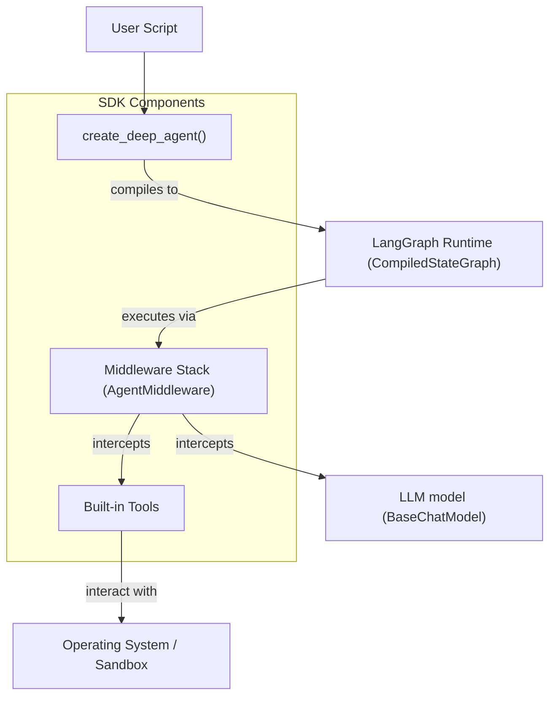
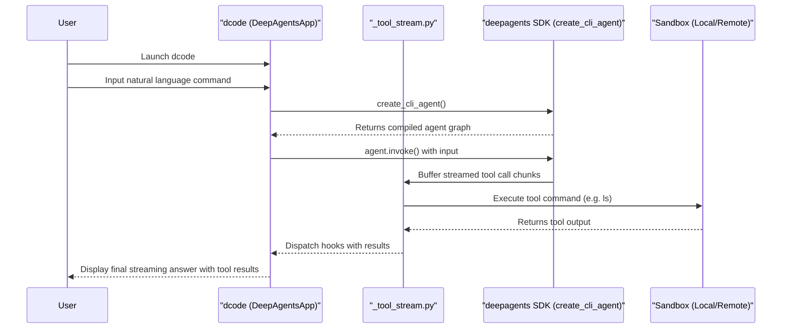

# Quick Start

<details>
<summary>Relevant source files</summary>

The following files were used as context for generating this wiki page:

- [.github/CODEOWNERS](.github/CODEOWNERS)
- [README.md](README.md)
- [examples/README.md](examples/README.md)
- [examples/downloading_agents/README.md](examples/downloading_agents/README.md)
- [examples/downloading_agents/content-writer.zip](examples/downloading_agents/content-writer.zip)
- [libs/code/DEVELOPMENT.md](libs/code/DEVELOPMENT.md)
- [libs/code/README.md](libs/code/README.md)
- [libs/code/deepagents_code/_debug.py](libs/code/deepagents_code/_debug.py)
- [libs/code/deepagents_code/_debug_buffer.py](libs/code/deepagents_code/_debug_buffer.py)
- [libs/code/deepagents_code/_tool_stream.py](libs/code/deepagents_code/_tool_stream.py)
- [libs/code/scripts/install.sh](libs/code/scripts/install.sh)
- [libs/code/tests/unit_tests/test__tool_stream.py](libs/code/tests/unit_tests/test__tool_stream.py)
- [libs/code/tests/unit_tests/test_debug.py](libs/code/tests/unit_tests/test_debug.py)
- [libs/code/tests/unit_tests/test_debug_buffer.py](libs/code/tests/unit_tests/test_debug_buffer.py)
- [libs/code/tests/unit_tests/test_install_script.py](libs/code/tests/unit_tests/test_install_script.py)
- [libs/deepagents/README.md](libs/deepagents/README.md)

</details>


This page provides minimal working instructions to get started with Deep Agents in both SDK (programmatic) and CLI (interactive terminal) modes. Deep Agents is an opinionated, ready-to-run agent harness built on LangGraph that provides planning, filesystem access, context management, human-in-the-loop approval, and extensible tooling out of the box. It integrates seamlessly with any LangChain-compatible chat model supporting tool calling and offers robust architecture for production deployments. [README.md:24-43](), [libs/deepagents/README.md:13-52]()

---

## Installation and Setup

### SDK Installation

Install the core `deepagents` package using `pip` or the `uv` package manager. The SDK is model-agnostic and works with any LLM backend that supports tool calling, including OpenAI, Anthropic, Google, open-weight providers, or local models. [README.md:51-53](), [libs/deepagents/README.md:13-17]()

```bash
pip install deepagents
# or
uv add deepagents
```

---

### Deep Agents Code (Terminal UI) Installation

`deepagents-code` is a pre-built, ready-to-run coding agent with a terminal-based interactive Textual UI. It provides session persistence, live streaming responses, web search, remote sandbox execution, persistent memory, custom skills, and human-in-the-loop approval. [libs/code/README.md:30-42]()

**Installation via automated shell script:**

The install shell script downloads and installs `deepagents-code` as a `uv` tool command named `dcode`. It manages isolated Python virtual environments, handles Python version management (default: 3.13), installs dependencies with optional extras for various model providers and sandbox backends, and supports safe upgrades and uninstallation. The installer includes environment flags like `DEEPAGENTS_CODE_EXTRAS` for model/sandbox extras, `DEEPAGENTS_CODE_VERSION` to pin a version, and `DEEPAGENTS_CODE_YES` for unattended upgrades. [libs/code/scripts/install.sh:1-137](), [libs/code/README.md:12-28]()

```bash
curl -LsSf https://langch.in/dcode | bash
```

**Example with extras:**

```bash
DEEPAGENTS_CODE_EXTRAS="nvidia,ollama" curl -LsSf https://langch.in/dcode | bash
```

*Extras include model providers such as `anthropic`, `openai`, `ollama`, and sandbox providers like `daytona`, `modal`, `runloop`. See the install script environment variables documentation for the full list.* [libs/code/scripts/install.sh:47-58]()

---

## SDK Quick Start

### Basic Usage

The core abstraction is a `DeepAgent` returned by `create_deep_agent()`, which constructs a LangGraph graph pre-assembled with layered middleware for planning, filesystem and shell tools, context management, skill loading, tool calling, and sub-agent delegation. Invocation is via `agent.invoke()` with a standard LangChain-style messages dictionary.

Example: create a simple research assistant agent:

```python
from deepagents import create_deep_agent

agent = create_deep_agent(
    model="openai:gpt-4o",
    system_prompt="You are a research assistant."
)

result = agent.invoke({"messages": "Research LangGraph and write a summary"})
print(result)
```

The agent automatically orchestrates planning, sub-tasks, filesystem and shell interactions, and manages its context window, memory, and skills. [README.md:54-64](), [libs/deepagents/README.md:41-52]()

---

### SDK Architectural Flow

Below is a high-level diagram showing the key components involved in the SDK agent creation and execution flow.



- `create_deep_agent`: Factory function that returns a compiled LangGraph agent graph with default middleware and tools wired up. [README.md:54-62]()
- Middleware stack (`AgentMiddleware` implementations) intercept execution to provide built-in tools for filesystem access, shell execution, context compaction, memory, skills, and sub-agent delegation.
- Tools include `ls`, `read_file`, `write_file`, `edit_file`, `execute`, and utilities for task planning, memory, and more.
- The agent calls into the configured LLM chat model for reasoning and planning behind the scenes.

**Sources:** [README.md:28-31](), [README.md:54-62]()

---

## CLI Quick Start (deepagents-code terminal UI)

### Launching the interactive terminal UI

After installation, launch `dcode` to start the Deep Agents Code interactive terminal UI. This launches a terminal-based Textual app with streaming output, persistent conversational threads, autocomplete, slash commands, and support for human-in-the-loop tool call approval. [libs/code/README.md:24-36]()

```bash
dcode
```

The UI reads and writes user data, configuration, sessions, and persistent memory to the configured `DEEPAGENTS_HOME` directory (`~/.deepagents` by default). [libs/code/scripts/install.sh:37-48]()

---

### deepagents-code Runtime Interaction Flow

The following sequence diagram illustrates the flow from user input in the terminal to agent execution and sandbox tool execution:



- The CLI creates an interactive agent graph with `create_cli_agent()`.
- User messages invoke the agent, whose middleware emits tool call messages streamed and buffered by `_tool_stream.py`.
- Tools execute in local or remote sandboxes.
- Hook events (`tool.use`, `tool.result`, `tool.error`) are dispatched to the UI for rendering in real time.
- The Textual UI renders streaming agent text, tool output, and supports user interactivity including approvals and submission prompts. [libs/code/deepagents_code/_tool_stream.py:1-106](), [libs/code/README.md:34-44]()

---

### CLI Installer and Features

- **Auto-update and version management**: The install script (`install.sh`) safely installs and upgrades `deepagents-code` as a `uv` tool, handling pre-release strategies, pinned versions, and optional extras for provider support. [libs/code/scripts/install.sh:25-90]()
- **Managed binaries**: Tools like `ripgrep` are installed in the `dcode` tool environment with SHA-256 verified binaries, avoiding system-wide dependencies. [libs/code/scripts/install.sh:70-77]()
- **Session Persistence**: Conversation threads and configurations persist across runs inside the `DEEPAGENTS_HOME` directory. [libs/code/scripts/install.sh:37-48]()
- **Security**: Runs are trusted at the local directory level, and human-in-the-loop approval gates tool calls. For untrusted code or repos, remote sandboxes are recommended. [libs/code/README.md:45-49]()

---

## Summary of Key Features

| Feature                    | Description                                                                | Key Implementation                    |
|----------------------------|----------------------------------------------------------------------------|-------------------------------------|
| **Agent Creation**          | `create_deep_agent()`: Creates a full harnessed agent with planning, tools, and memory | `deepagents.create_deep_agent` [README.md:54-66]() |
| **Middleware Stack**        | Intercepts agent requests for tool calling, context, sub-agent delegation | Middleware in `deepagents.middleware` |
| **Built-in Tools**          | Filesystem ops (`ls`, `read_file`, etc.), shell commands, planning utilities | Defined in core SDK tooling layers  |
| **Sub-Agents**              | Task delegation with isolated or forked contexts                          | `task` tool middleware              |
| **Persistent Memory**       | Session-spanning memory and recall via `AGENTS.md` files                  | `MemoryMiddleware`                   |
| **Skills System**           | Dynamically loaded reusable behaviors and commands                        | `SkillsMiddleware`                   |
| **Terminal UI - deepagents-code** | Interactive terminal app with streaming, sessions, approvals             | `dcode` command and Textual app     |
| **Remote Sandboxes**        | Support for isolated execution environments (Daytona, Modal, Runloop, Vercel) | Included provider extras and tooling|
| **Human-in-the-loop Approval**| User approves or rejects agent tool calls before execution               | CLI and SDK middleware               |

---

This page provides all necessary quick start instructions and architecture insight to begin developing and running Deep Agents both programmatically and via the rich terminal interface. Use this as a foundational reference to dive into the comprehensive features of the Deep Agents framework.

---

**Sources:**  
- [README.md:24-66]()  
- [libs/deepagents/README.md:13-52]()  
- [libs/code/README.md:12-44]()  
- [libs/code/scripts/install.sh:1-137]()  
- [libs/code/deepagents_code/_tool_stream.py:1-106]()