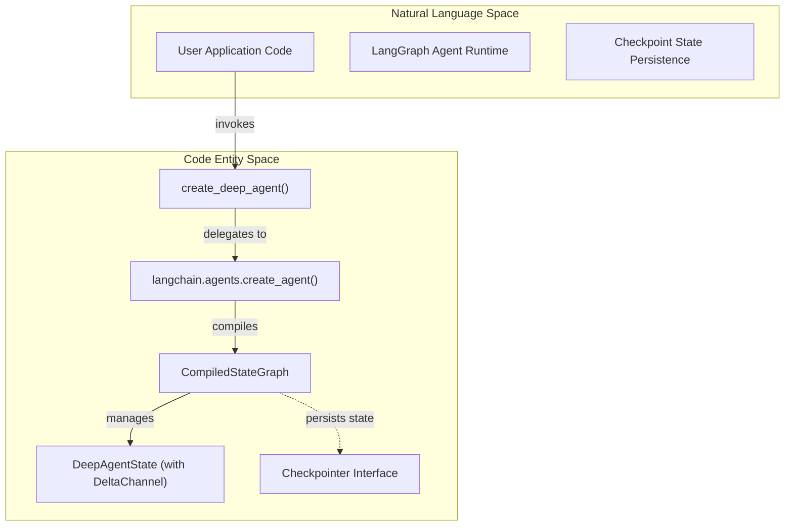
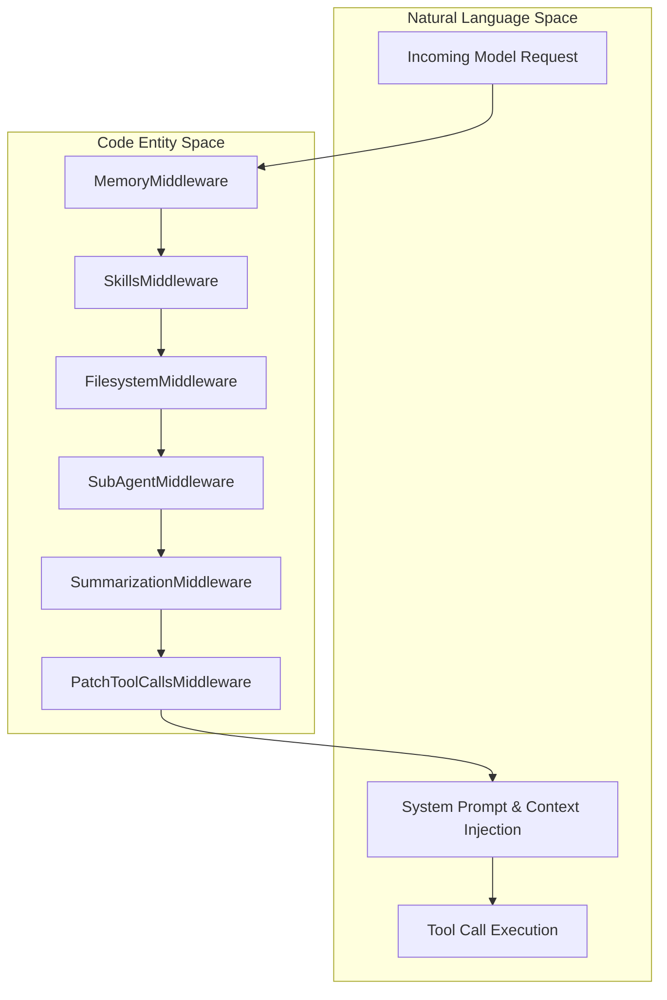
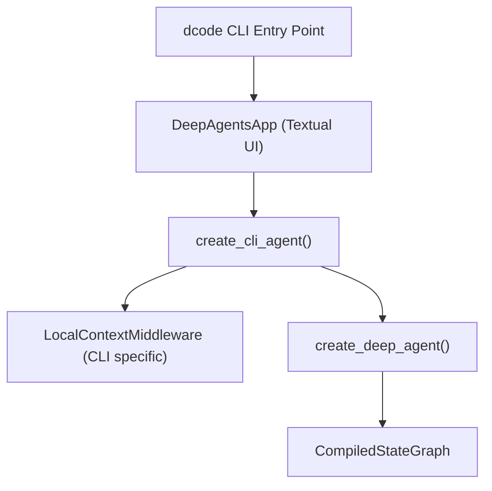

# Architecture Overview

<details>
<summary>Relevant source files</summary>

The following files were used as context for generating this wiki page:

- [libs/deepagents/deepagents/__init__.py](libs/deepagents/deepagents/__init__.py)
- [libs/deepagents/deepagents/graph.py](libs/deepagents/deepagents/graph.py)
- [libs/deepagents/deepagents/middleware/__init__.py](libs/deepagents/deepagents/middleware/__init__.py)
- [libs/deepagents/deepagents/middleware/patch_tool_calls.py](libs/deepagents/deepagents/middleware/patch_tool_calls.py)
- [libs/deepagents/deepagents/middleware/subagents.py](libs/deepagents/deepagents/middleware/subagents.py)
- [libs/deepagents/tests/integration_tests/test_filesystem_middleware.py](libs/deepagents/tests/integration_tests/test_filesystem_middleware.py)
- [libs/deepagents/tests/integration_tests/test_subagent_middleware.py](libs/deepagents/tests/integration_tests/test_subagent_middleware.py)
- [libs/deepagents/tests/unit_tests/middleware/test_subagent_middleware_init.py](libs/deepagents/tests/unit_tests/middleware/test_subagent_middleware_init.py)
- [libs/deepagents/tests/unit_tests/test_eviction_replay.py](libs/deepagents/tests/unit_tests/test_eviction_replay.py)
- [libs/deepagents/tests/unit_tests/test_graph.py](libs/deepagents/tests/unit_tests/test_graph.py)
- [libs/deepagents/tests/unit_tests/test_subagents.py](libs/deepagents/tests/unit_tests/test_subagents.py)
- [openwiki/.claims/architecture/source-map.json](openwiki/.claims/architecture/source-map.json)
- [openwiki/architecture/source-map.md](openwiki/architecture/source-map.md)

</details>


This page explains the high-level architecture of Deep Agents: how the core SDK and application packages are structured, how they interact, and the key design patterns that enable extensibility. It covers the LangGraph foundation, middleware execution model, backend abstraction layer, and the relationship between `deepagents` (core SDK) and `deepagents-code` (terminal UI).

---

## LangGraph Foundation

Deep Agents is built on top of LangGraph. The core SDK’s key function, `create_deep_agent()`, returns a `CompiledStateGraph` instance, which is the compiled executable agent graph managed by LangGraph’s runtime [libs/deepagents/deepagents/graph.py:28](). 

To address the scalability challenge of long-running interactive sessions, the agent’s state `messages` channel employs a `DeltaChannel` with a custom reducer. This reduces checkpoint storage growth from quadratic to linear with respect to conversation length, enabling efficient persistence [libs/deepagents/deepagents/graph.py:73-76]().


*Diagram 1: Mapping high-level agent creation and execution concepts to LangGraph code entities.*

Sources: [libs/deepagents/deepagents/graph.py:3-6,28,73-76]()

---

## Core SDK Architecture & Middleware Stack

The `deepagents` package provides `create_deep_agent()` which assembles a layered middleware pipeline around LangChain's agent runner. This pipeline is central to Deep Agents’ extensibility and feature integration [libs/deepagents/deepagents/graph.py:40-63]().

Middleware subclasses implement hooks (especially `wrap_model_call`) to intercept and modify requests and responses dynamically. This enables advanced capabilities like system prompt injection, tool filtering, history summarization, state tracking, and sub-agent orchestration.

### Middleware Pipeline and Roles


*Diagram 2: Middleware interception pipeline mapping request stages to concrete middleware classes.*

| Middleware Class         | Module Path                                                          | Primary Responsibility                                                                                   |
|--------------------------|----------------------------------------------------------------------|----------------------------------------------------------------------------------------------------------|
| `MemoryMiddleware`       | [middleware/memory.py](libs/deepagents/deepagents/middleware/memory.py#L52)       | Injects project-level and user memory instructions from `AGENTS.md` files into the system prompt context. |
| `SkillsMiddleware`       | [middleware/skills.py](libs/deepagents/deepagents/middleware/skills.py#L54)       | Dynamically loads and injects structured custom skills from multiple backend skill source locations.      |
| `FilesystemMiddleware`   | [middleware/filesystem.py](libs/deepagents/deepagents/middleware/filesystem.py#L51) | Provides vital file operations tools (`ls`, `read_file`, `write_file`, `edit_file`, `glob`, `grep`).       |
| `SubAgentMiddleware`    | [middleware/subagents.py](libs/deepagents/deepagents/middleware/subagents.py#L59)  | Exposes a `task` tool enabling spawning of specialized subagents in isolated or forked conversation modes. |
| `SummarizationMiddleware` | [middleware/summarization.py](libs/deepagents/deepagents/middleware/summarization.py#L5-L9) | Manages conversation compaction, summarizing history when context window thresholds are exceeded.          |
| `PatchToolCallsMiddleware` | [middleware/patch_tool_calls.py](libs/deepagents/deepagents/middleware/patch_tool_calls.py#L49) | Corrects malformed or incomplete tool calls in the conversation before further processing.                |

Sources:  
[libs/deepagents/deepagents/graph.py#L40-L63](),  
[libs/deepagents/deepagents/middleware/memory.py#L50-L70](),  
[libs/deepagents/deepagents/middleware/skills.py#L50-L90](),  
[libs/deepagents/deepagents/middleware/filesystem.py#L40-L110](),  
[libs/deepagents/deepagents/middleware/subagents.py#L55-L120](),  
[libs/deepagents/deepagents/middleware/summarization.py#L5-L45](),  
[libs/deepagents/deepagents/middleware/patch_tool_calls.py#L11-L53]()

---

## Backend Abstraction

Deep Agents abstracts file storage, state management, and sandboxed execution via defined `BackendProtocol` and `SandboxBackendProtocol` interfaces. This abstraction decouples agent functionality from storage details, allowing flexible backend selection and composition [libs/deepagents/deepagents/backends/protocol.py:44]().

Here is the typical hierarchy of backend implementations:

```mermaid
graph TB
    BackendProtocol["BackendProtocol Interface"]
    SandboxBackendProtocol["SandboxBackendProtocol Interface"]

    StateBackend["StateBackend"]
    StoreBackend["StoreBackend"]
    FilesystemBackend["FilesystemBackend"]
    CompositeBackend["CompositeBackend"]

    BackendProtocol <|-- StateBackend
    BackendProtocol <|-- StoreBackend
    BackendProtocol <|-- FilesystemBackend
    BackendProtocol <|-- CompositeBackend
    SandboxBackendProtocol --|> BackendProtocol
```
*Diagram 3: Backend interfaces and key implementations.*

| Backend Class          | Storage Target                 | Execute Support | Primary Use Case                                                          |
|-----------------------|-------------------------------|-----------------|---------------------------------------------------------------------------|
| `StateBackend`        | Runtime ephemeral in-memory state | No              | Short-lived file storage scoped to an individual agent run for full control over file state [backends/state.py:36](). |
| `StoreBackend`        | Persistent LangGraph Store        | No              | Durable cross-session file storage leveraging LangGraph’s store [backends/store.py:37](). |
| `FilesystemBackend`   | Local Host Filesystem             | No              | Directly proxies filesystem operations on the host machine [backends/filesystem.py:83](). |
| `CompositeBackend`    | Mounted backends by path prefix  | Varies          | Enables mounting multiple backend implementations under distinct filesystem roots [backends/composite.py:34](). |

Sources:  
[libs/deepagents/deepagents/backends/protocol.py:44](),  
[libs/deepagents/deepagents/backends/state.py:36](),  
[libs/deepagents/deepagents/backends/store.py:37](),  
[libs/deepagents/deepagents/backends/filesystem.py:83](),  
[libs/deepagents/deepagents/backends/composite.py:34]()

---

## deepagents-code Application Bridge

The `deepagents-code` package provides an interactive terminal UI wrapper around the SDK, exposing a richer CLI interface and additional local context features. The `dcode` tool bootstrap starts a `DeepAgentsApp`, which internally creates CLI-focused agents through `create_cli_agent()` that build upon `create_deep_agent()` [libs/deepagents/deepagents/graph.py:3-6]().


*Diagram 4: Flow from terminal CLI entrypoint to underlying SDK agent graph.*

The `deepagents-code` package augments the core SDK by adding middleware like `LocalContextMiddleware` which injects local Git status, directory structures, and active project snapshots into the context before dispatch. This design isolates UI/operational behavior while reusing the full feature set of the core SDK.

Sources: [libs/deepagents/deepagents/graph.py:3-6](), [libs/code/deepagents_code/app.py]()

---

## Conversation Compaction and Offloading

To manage context window limitations and token budget constraints, Deep Agents employs `SummarizationMiddleware` which monitors conversation activity and triggers automatic compaction when thresholds such as token count or message volume are exceeded. This middleware:

1. Evaluates thresholds for context fullness (tokens, message count, fraction of window) based on configuration [middleware/summarization.py:158-166]().
2. Calls out to LLM summarization routines that condense conversation history into a smaller summary block inserted into the system prompt [middleware/summarization.py:8-9]().
3. Offloads raw historical messages to backend persistent storage under `/conversation_history/{session_id}.md` paths to avoid losing information [middleware/summarization.py:42-45]().
4. Exposes a manual `compact_conversation` tool via `SummarizationToolMiddleware` to allow explicit conversation trimming [middleware/summarization.py:10-12]().

This middleware is crucial for enabling long, interactive deep agent sessions without overwhelming the model context or excess storage use.

Sources: [libs/deepagents/deepagents/middleware/summarization.py:5-45,158-166]()

---

# Summary

- Deep Agents core SDK is fundamentally a LangGraph compiled agent graph with a delta-based message state for scalable persistence.
- A rich middleware stack wraps the core agent execution path, enabling modular features including memory injection, skills tooling, filesystem operations, task delegation (subagents), and conversation summarization.
- Backend abstractions provide flexible filesystem and storage layering, crucial for sandboxing and persistent state.
- The `deepagents-code` package integrates the core with a CLI Textual UI, adding local context and session management while leveraging the SDK’s middleware and agent creation primitives.
- Summarization middleware and delta-state management make scaling to long-running interactive coding sessions practical and performant.

This architecture underpins Deep Agents’ design goal of extensible, composable AI agents with robust coding environment integration.

---

Sources Summary:  
- Core graph and agent construction: [libs/deepagents/deepagents/graph.py:3-156,610-653]()  
- Middleware stack and execution pipeline: [libs/deepagents/deepagents/middleware/__init__.py](), [libs/deepagents/deepagents/middleware/memory.py#L50-L70](), [libs/deepagents/deepagents/middleware/skills.py#L50-L90](), [libs/deepagents/deepagents/middleware/filesystem.py#L40-L110](), [libs/deepagents/deepagents/middleware/subagents.py#L50-L176](), [libs/deepagents/deepagents/middleware/summarization.py#L5-L45,158-166](), [libs/deepagents/deepagents/middleware/patch_tool_calls.py#L11-L53]()  
- Backend abstractions: [libs/deepagents/deepagents/backends/protocol.py:44](), [libs/deepagents/deepagents/backends/state.py:36](), [libs/deepagents/deepagents/backends/store.py:37](), [libs/deepagents/deepagents/backends/filesystem.py:83](), [libs/deepagents/deepagents/backends/composite.py:34]()  
- deepagents-code integration: [libs/deepagents/deepagents/graph.py:3-6](), [libs/code/deepagents_code/app.py]()