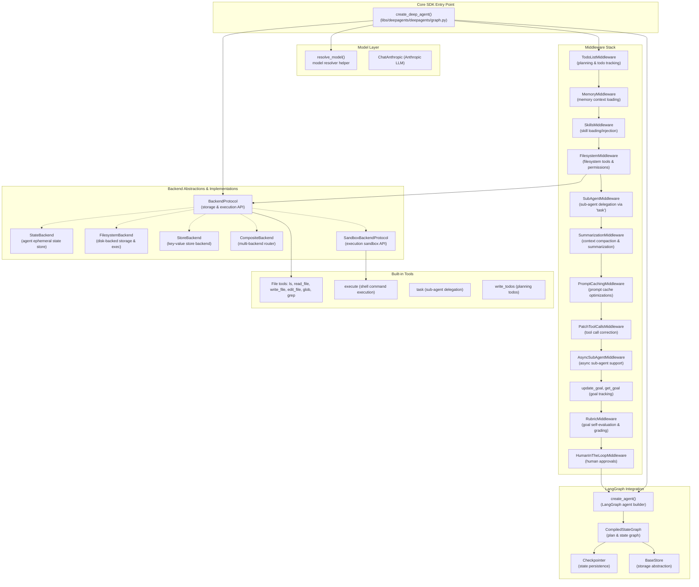
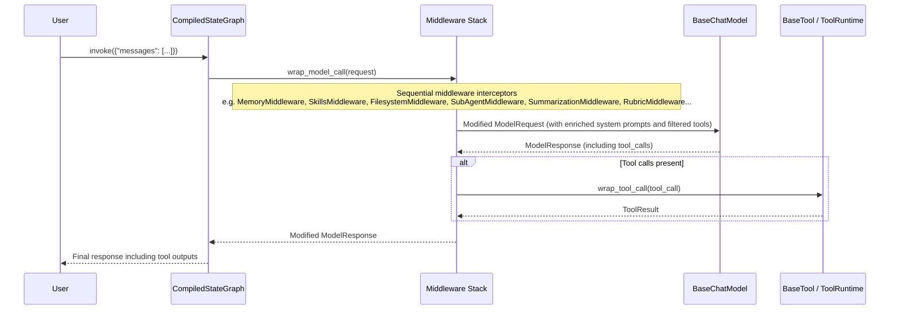
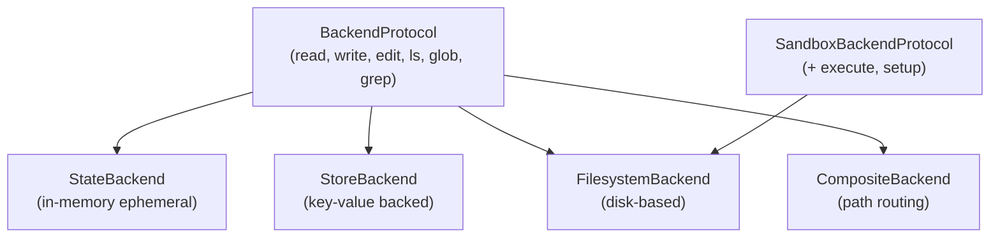
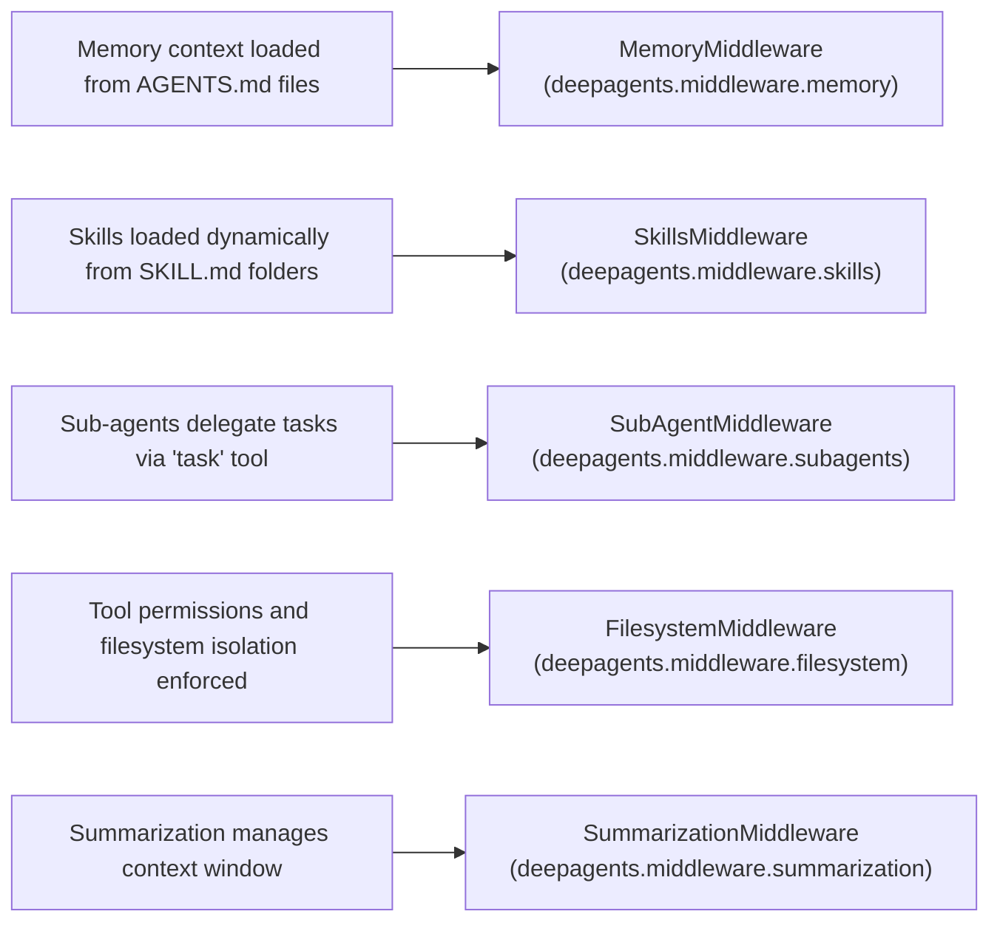
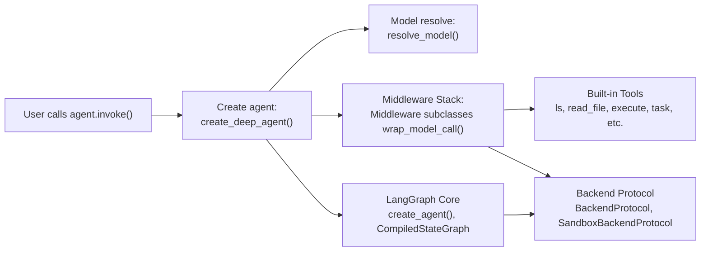

# Core SDK

<details>
<summary>Relevant source files</summary>

The following files were used as context for generating this wiki page:

- [libs/deepagents/deepagents/__init__.py](libs/deepagents/deepagents/__init__.py)
- [libs/deepagents/deepagents/graph.py](libs/deepagents/deepagents/graph.py)
- [libs/deepagents/deepagents/middleware/__init__.py](libs/deepagents/deepagents/middleware/__init__.py)
- [libs/deepagents/deepagents/middleware/patch_tool_calls.py](libs/deepagents/deepagents/middleware/patch_tool_calls.py)
- [libs/deepagents/deepagents/middleware/subagents.py](libs/deepagents/deepagents/middleware/subagents.py)
- [libs/deepagents/tests/integration_tests/test_filesystem_middleware.py](libs/deepagents/tests/integration_tests/test_filesystem_middleware.py)
- [libs/deepagents/tests/integration_tests/test_subagent_middleware.py](libs/deepagents/tests/integration_tests/test_subagent_middleware.py)
- [libs/deepagents/tests/unit_tests/middleware/test_subagent_middleware_init.py](libs/deepagents/tests/unit_tests/middleware/test_subagent_middleware_init.py)
- [libs/deepagents/tests/unit_tests/test_eviction_replay.py](libs/deepagents/tests/unit_tests/test_eviction_replay.py)
- [libs/deepagents/tests/unit_tests/test_graph.py](libs/deepagents/tests/unit_tests/test_graph.py)
- [libs/deepagents/tests/unit_tests/test_subagents.py](libs/deepagents/tests/unit_tests/test_subagents.py)

</details>


The Core SDK (`deepagents`) provides the foundational agent framework built on top of LangGraph. It is designed to enable the creation of rich, extensible AI agents with built-in capabilities such as planning, filesystem interaction, sub-agent delegation, memory context, skills integration, and conversation summarization. The primary entry point for SDK users is the [`create_deep_agent`](#agent-creation-create_deep_agent) function, which assembles a fully configured deep agent with a layered middleware stack and an abstracted backend architecture optimized for efficient state checkpointing via `DeltaChannel`. This SDK is model-agnostic and adaptable to a variety of LLM providers.

For detailed SDK usage within CLI tools, interactive terminals, or external runtimes, see the [deepagents-code Application](#3) and [Integrations](#5) sections.

---

## Architecture Overview

DeepAgents SDK follows a modular, middleware-driven design that cleanly separates concerns involved in agent operation. At its core, it integrates with LangGraph's state graph engine and utilizes middleware components to intercept, modify, and enhance model and tool calls.

### Core SDK Architecture Diagram



This diagram highlights:

- Entry at `create_deep_agent` which initializes models, middlewares, and backends.
- Sequential middleware execution managing memory, skills, filesystem, subagents, summarization, goal evaluation, and interactive approvals.
- Backend abstractions that enable pluggable storage and execution implementations.
- Integration with LangGraph for state graph compilation and execution.

Sources: [libs/deepagents/deepagents/graph.py:3-77,204-250](), [libs/deepagents/deepagents/middleware/__init__.py:1-114](), [libs/deepagents/deepagents/middleware/subagents.py:1-75](), [libs/deepagents/deepagents/backends/protocol.py:30-70]()

---

## Agent Creation: `create_deep_agent`

The SDK's primary API for agent instantiation is the function:

```python
def create_deep_agent(
    model: str | BaseChatModel | None = None,
    tools: Sequence[BaseTool | Callable | dict[str, Any]] | None = None,
    *,
    system_prompt: str | SystemMessage | None = None,
    middleware: Sequence[AgentMiddleware] = (),
    subagents: Sequence[SubAgent | CompiledSubAgent | AsyncSubAgent] | None = None,
    skills: list[str] | None = None,
    memory: list[str] | None = None,
    response_format: ResponseFormat[Any] | type | dict[str, Any] | None = None,
    context_schema: type | None = None,
    checkpointer: Checkpointer | None = None,
    store: BaseStore | None = None,
    backend: BackendProtocol | BackendFactory | None = None,
    interrupt_on: dict[str, bool | InterruptOnConfig] | None = None,
    debug: bool = False,
    name: str | None = None,
    cache: BaseCache | None = None,
) -> CompiledStateGraph
```

This function:

- Resolves the model to use (default Anthropic's "claude-sonnet-4-6" if none provided).
- Combines built-in, middleware-provided, and user-supplied tools into a coherent set available to the LLM.
- Assembles a middleware stack that layers memory context, skills, filesystem access, sub-agent delegation, summarization, goal tracking, and human-in-the-loop control.
- Configures backend storage for conversation and file artifacts.
- Compiles the entire setup as a `CompiledStateGraph` which can be invoked programmatically.

For detailed parameter descriptions, examples, and default configurations, see the child page [Agent Creation (create_deep_agent)](#2.1).

Sources: [libs/deepagents/deepagents/graph.py:204-250](), [libs/deepagents/deepagents/graph.py:143-153]()

---

## Middleware System

Middleware in DeepAgents intercepts agent requests and responses for extensibility and control. Each middleware subclasses `AgentMiddleware` and overrides lifecycle hooks:

- `wrap_model_call`: intercepts and modifies each LLM call.
- `wrap_tool_call`: manages tool execution lifecycle.

Middleware enables dynamic tool filtering, system prompt injection, message post-processing, and persistent state tracking.

### Middleware Stack Execution Flow



Middleware examples:

- `MemoryMiddleware`: Injects persistent memory context.
- `SkillsMiddleware`: Loads structured skill prompts dynamically.
- `FilesystemMiddleware`: Enforces file access permissions and provides file ops tools.
- `SubAgentMiddleware`: Offers the `task` tool for sub-agent delegation.
- `SummarizationMiddleware`: Manages context window via automatic summarization.
- `RubricMiddleware`: Provides goal evaluation and grading.
- `HumanInTheLoopMiddleware`: Supports manual intervention and approvals.

For full middleware ecosystem details, see [Middleware System](#2.2).

Sources: [libs/deepagents/deepagents/graph.py:343-375](), [libs/deepagents/deepagents/middleware/__init__.py:1-114]()

---

## Sub-Agent Delegation

Sub-agent delegation allows agents to spawn smaller, focused agents ("subagents") to handle tasks. This is implemented via the `SubAgentMiddleware` which provides a `task` tool callable by the main agent.

Key concepts:

- **Isolated mode**: The subagent receives only the delegated task description and runs independently.
- **Fork mode** (experimental): The subagent inherits the parent's conversation context and state.

Subagents can have separate models, tools, middleware, memory, and skills. This enables modular, composable workflows with specialized capabilities.

Example sub-agent configuration fields include:

- `name`: Identifier for the subagent.
- `description`: Action-focused description for delegation.
- `model`: Optional different model override.
- `middleware`: Additional middleware to inject.
- `permissions`: Filesystem permissions specific to this subagent.
- `response_format`: Controls structured output.

For comprehensive usage, configuration options, and the `task` tool's behavior, see [Sub-Agent Delegation](#2.3).

Sources: [libs/deepagents/deepagents/middleware/subagents.py:1-176]()

---

## Skills System

The Skills system enables the agent to load and use declarative skill definitions typically authored in structured markdown files (`SKILL.md`). The `SkillsMiddleware` dynamically loads these skill prompts from multiple sources with defined precedence:

- Built-in SDK skills.
- User-level skills folder.
- Project-level skills folder.

Skills expand the agent's toolset and context by injecting relevant natural language instructions and capabilities.

For details about skill discovery, precedence, and middleware configuration, consult [Skills System](#2.4).

Sources: [libs/deepagents/deepagents/middleware/skills.py:1]()

---

## Memory System

The Memory system persists long-term context and workspace knowledge for agents. It loads memory context from `AGENTS.md` files located in various config scopes (project, user, global), and integrates this in agent prompts.

The `MemoryMiddleware` handles:

- Scanning memory files on startup.
- Loading and injecting memory context for each model call.
- Managing memory source precedence.

For specifications on memory file formats, source priority, and middleware usage, see [Memory System](#2.5).

Sources: [libs/deepagents/deepagents/middleware/memory.py:1]()

---

## Filesystem Operations and Built-in Tools

DeepAgents SDK includes a set of built-in tools for managing and interacting with the workspace filesystem:

- File listing: `ls`
- File reading: `read_file`
- File writing: `write_file`
- File editing: `edit_file`
- Glob pattern matching: `glob`
- File search: `grep`
- Command execution: `execute`
- Todo writing: `write_todos`

The filesystem tools operate through interactions with a backend implementing the `BackendProtocol`. The `execute` tool requires a backend conforming to the `SandboxBackendProtocol` for secure shell command execution.

These tools support parameters for pagination, path scoping, and permission enforcement.

For details of tool parameters, default behavior, and backend integration, see [Filesystem Operations and Built-in Tools](#2.6).

Sources: [libs/deepagents/deepagents/graph.py:344-352](), [libs/deepagents/deepagents/backends/protocol.py:30-70]()

---

## Backend Architecture

The backend system abstracts persistent storage and execution sandboxes behind well-defined protocols:

1. **BackendProtocol** — defines core filesystem-like interfaces (`read`, `write`, `edit`, `ls`, `glob`, `grep`).
2. **SandboxBackendProtocol** — extends `BackendProtocol` with execution support (`execute` shell commands, `setup` for initialization).

### Common Backend Implementations

- `StateBackend`: In-memory ephemeral state store ideal for transient data.
- `StoreBackend`: Key-value store backend built on arbitrary `BaseStore` implementations.
- `FilesystemBackend`: Real filesystem integration supporting full `BackendProtocol` and `SandboxBackendProtocol`.
- `CompositeBackend`: Routes paths to different backend instances based on configured rules.
- `ContextHubBackend`: Context aggregation backed by LangSmith.
- `LangSmithBackend`: LangSmith managed backend.
- Local shell sandbox for command execution.

### Backend Protocol Diagram



This abstraction allows agents to flexibly manage storage and code execution environments without coupling to a specific platform.

Full details and backend selection strategies are in [Backend Architecture](#2.7).

Sources: [libs/deepagents/deepagents/backends/protocol.py:30-70](), [libs/deepagents/deepagents/backends/state.py:1-60]()

---

## Context Window Management

Managing large conversation contexts is critical for LLM agents. The `SummarizationMiddleware`:

- Monitors conversation token counts.
- Automatically summarizes and compacts old message history upon reaching configurable triggers.
- Offloads evicted messages to backend storage.
- Supports media reference handling for non-text content.

These mechanisms maintain efficient memory usage while preserving essential context for agent performance.

For configuration options and detailed explanation, see [Context Window Management](#2.8).

Sources: [libs/deepagents/deepagents/middleware/summarization.py:1-51]()

---

## System Prompts and Model Configuration

System prompts are assembled dynamically incorporating:

- SDK defaults and instruction sets.
- Harness profiles that model the interaction style per target LLM provider.
- Injected memory and skills context.
- User-supplied prompt overrides.

Models are resolved flexibly by name or specification using `resolve_model`, which supports Anthropic, OpenAI, and custom model providers.

Snapshot smoke tests ensure prompt integrity and stop regressions.

More information is available at [System Prompts and Model Configuration](#2.9).

Sources: [libs/deepagents/deepagents/graph.py:64-68](), [libs/deepagents/deepagents/_models.py:40]()

---

## Harness Profiles

Harness profiles (`HarnessProfile` and `ProviderProfile`) enable customizing the agent runtime to the specifics of particular LLM providers or use cases.

Profiles define:

- System prompt suffixes or configurations.
- Middleware exclusions (to strip or replace certain middleware).
- Tool visibility and behavior tuning.

These are registered in the SDK and applied automatically when the target model provider is detected.

For all profile API details, registration strategies, and usage notes, see [Harness Profiles](#2.10).

Sources: [libs/deepagents/deepagents/profiles/harness/harness_profiles.py:1-100]()

---

## Goal and Rubric System

For structured task tracking and evaluation, the SDK includes:

- `GoalToolsMiddleware`: managing goal lifecycle statuses and transitions.
- `RubricMiddleware`: enables automated self-evaluation with grader prompts, generating a `GraderVerdict` indicating acceptance or failure.
- Tools facilitate criteria acceptance generation and rubric management.

This tightly couples with agent toolsets and middleware to guide and assess agent task completion.

For in-depth explanation and configuration, see [Goal and Rubric System](#2.11).

Sources: [libs/deepagents/deepagents/middleware/rubric.py:1-150]()

---

This concludes the Core SDK overview. Each major area has a dedicated child page for full technical reference and usage instructions. For next steps, explore:

- [Agent Creation (create_deep_agent)](#2.1)
- [Middleware System](#2.2)
- [Sub-Agent Delegation](#2.3)
- [Skills System](#2.4)
- [Memory System](#2.5)
- [Filesystem Operations and Built-in Tools](#2.6)
- [Backend Architecture](#2.7)
- [Context Window Management](#2.8)
- [System Prompts and Model Configuration](#2.9)
- [Harness Profiles](#2.10)
- [Goal and Rubric System](#2.11)

---

# Additional Diagrams Bridging Natural Language to Code Entities

### Diagram 1: Natural Language Concept → Middleware Code Entities



### Diagram 2: Natural Language Feature → Core SDK Code Path



Sources: [libs/deepagents/deepagents/graph.py:3-77,204-250](), [libs/deepagents/deepagents/middleware/__init__.py:1-114](), [libs/deepagents/deepagents/middleware/subagents.py:1-176](), [libs/deepagents/deepagents/backends/protocol.py:30-70]()

---

This page provides a top-level guide to the deepagents core SDK structure, components, and architecture. For technical details, configuration options, and usage instructions, please refer to the linked child pages.