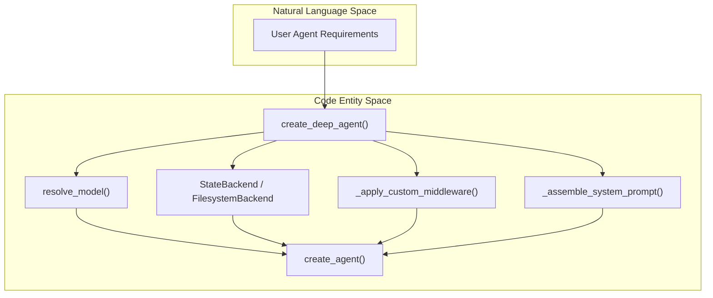
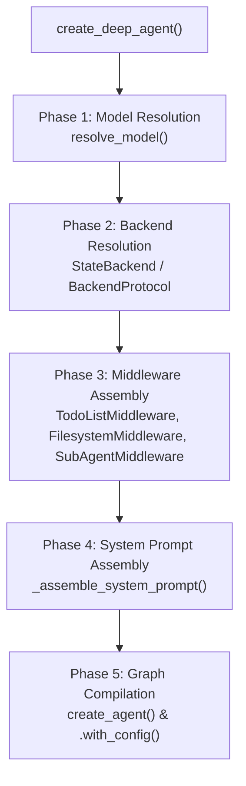
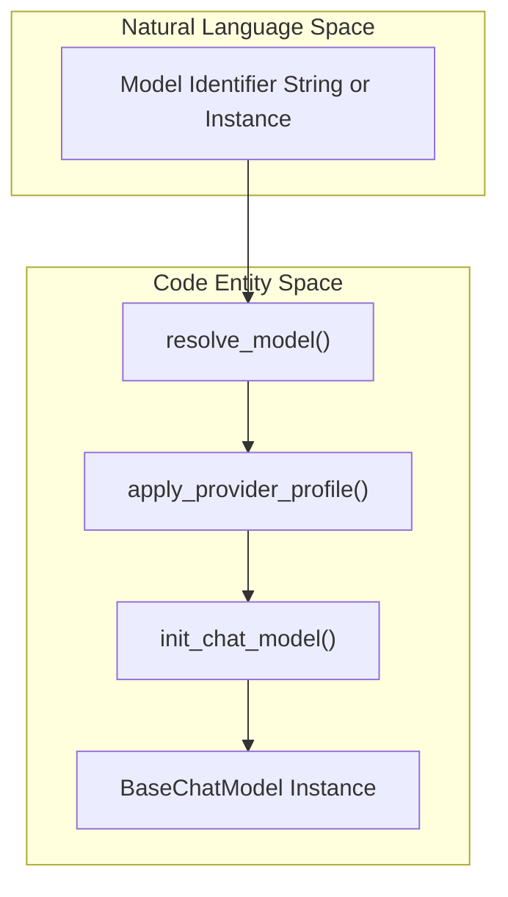
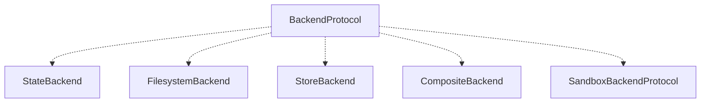

# Agent Creation (create_deep_agent)

<details>
<summary>Relevant source files</summary>

The following files were used as context for generating this wiki page:

- [libs/deepagents/deepagents/__init__.py](libs/deepagents/deepagents/__init__.py)
- [libs/deepagents/deepagents/graph.py](libs/deepagents/deepagents/graph.py)
- [libs/deepagents/deepagents/middleware/__init__.py](libs/deepagents/deepagents/middleware/__init__.py)
- [libs/deepagents/deepagents/middleware/patch_tool_calls.py](libs/deepagents/deepagents/middleware/patch_tool_calls.py)
- [libs/deepagents/deepagents/middleware/subagents.py](libs/deepagents/deepagents/middleware/subagents.py)
- [libs/deepagents/tests/integration_tests/test_filesystem_middleware.py](libs/deepagents/tests/integration_tests/test_filesystem_middleware.py)
- [libs/deepagents/tests/integration_tests/test_subagent_middleware.py](libs/deepagents/tests/integration_tests/test_subagent_middleware.py)
- [libs/deepagents/tests/unit_tests/middleware/test_subagent_middleware_init.py](libs/deepagents/tests/unit_tests/middleware/test_subagent_middleware_init.py)
- [libs/deepagents/tests/unit_tests/test_eviction_replay.py](libs/deepagents/tests/unit_tests/test_eviction_replay.py)
- [libs/deepagents/tests/unit_tests/test_graph.py](libs/deepagents/tests/unit_tests/test_graph.py)
- [libs/deepagents/tests/unit_tests/test_subagents.py](libs/deepagents/tests/unit_tests/test_subagents.py)

</details>


The `create_deep_agent` function is the primary entry point for constructing Deep Agent graphs in the core SDK. It orchestrates the composition of several components: LLM model resolution, backend storage configuration, middleware stack assembly, system prompt composition, and ultimately compiles a LangGraph `CompiledStateGraph` instance that represents the fully configured deep agent runtime environment. This makes it a critical integration function allowing for flexible, extensible AI agents with sophisticated middleware and toolsets.

This page documents the full function signature, detailed semantics of its parameters, its internal assembly pipeline, and fundamental usage patterns. For CLI-oriented agent creation, consult page 3.8. For middleware internals, see page 2.2.

---

## Function Signature

```python
def create_deep_agent(
    model: str | BaseChatModel | None = None,
    tools: Sequence[BaseTool | Callable | dict[str, Any]] | None = None,
    *,
    system_prompt: str | SystemMessage | SystemPromptConfig | None = None,
    middleware: Sequence[AgentMiddleware] = (),
    subagents: Sequence[SubAgent | CompiledSubAgent | AsyncSubAgent] | None = None,
    skills: list[str] | None = None,
    memory: list[str] | None = None,
    response_format: ResponseFormat[ResponseT] | type[ResponseT] | dict[str, Any] | None = None,
    context_schema: type[ContextT] | None = None,
    checkpointer: Checkpointer | None = None,
    store: BaseStore | None = None,
    backend: BackendProtocol | BackendFactory | None = None,
    interrupt_on: dict[str, bool | InterruptOnConfig] | None = None,
    debug: bool = False,
    name: str | None = None,
    cache: BaseCache | None = None,
    state_schema: type[AgentState] | None = None,
    excluded_middleware: Sequence[str | type[AgentMiddleware]] | None = None,
) -> CompiledStateGraph:
    ...
```

This signature accepts a wide array of agent configuration parameters enabling highly customizable agent instantiation. 

**Sources:** [libs/deepagents/deepagents/graph.py:167-194]()

---

## Parameters Reference

### Core Parameters

| Parameter          | Type                                                 | Default | Description                                                                                                |
|--------------------|------------------------------------------------------|---------|------------------------------------------------------------------------------------------------------------|
| `model`            | `str \| BaseChatModel \| None`                      | `None`  | The LLM model instance or identifier string. It is resolved via `resolve_model()`, supporting provider prefixes like `openai:`, `anthropic:`, etc. Defaults to Anthropic's Claude Sonnet v4. [libs/deepagents/deepagents/graph.py:145-153](), [libs/deepagents/deepagents/graph.py:210-212]() |
| `tools`            | `Sequence[BaseTool \| Callable \| dict] \| None`    | `None`  | Additional custom tools to supplement the built-in tools the agent provides.                              |
| `system_prompt`    | `str \| SystemMessage \| SystemPromptConfig \| None`| `None`  | Custom system prompt or configuration for assembling prefix/base/suffix for the agent’s initial prompt.  |
| `backend`          | `BackendProtocol \| BackendFactory \| None`          | `None`  | Specifies the storage backend for the agent’s filesystem operations. Defaults to `StateBackend`, which stores file state directly in the agent's LangGraph state dictionary. |
| `checkpointer`     | `Checkpointer \| None`                               | `None`  | An optional LangGraph checkpointer for maintaining agent state persistence and enabling time travel debugging of agent conversations.  |
| `store`            | `BaseStore \| None`                                  | `None`  | Optional LangGraph store instance used for persistent key-value storage and checkpointing integration.   |
| `state_schema`     | `type[AgentState] \| None`                           | `None`  | Custom agent state schema, defaults to `DeepAgentState`. This controls message storage and other state fields. |

### Middleware and Extension Parameters

| Parameter             | Type                                                                         | Default | Description                                                                                                  |
|-----------------------|------------------------------------------------------------------------------|---------|--------------------------------------------------------------------------------------------------------------|
| `middleware`          | `Sequence[AgentMiddleware]`                                                  | `()`    | Additional middleware layers to insert into the stack for request interception and behavior modification.    |
| `subagents`           | `Sequence[SubAgent \| CompiledSubAgent \| AsyncSubAgent] \| None`            | `None`  | Subagents exposed via the `task` tool, each with isolated or forked conversation modes and custom config.  |
| `skills`              | `list[str] \| None`                                                          | `None`  | Skill source directory paths, loaded as prompt sections and toolsets by the SkillsMiddleware.                |
| `memory`              | `list[str] \| None`                                                          | `None`  | Memory source directory paths containing `AGENTS.md` context injected via MemoryMiddleware.                  |
| `interrupt_on`        | `dict[str, bool \| InterruptOnConfig] \| None`                              | `None`  | Controls which tools trigger human-in-the-loop interruptions (via `HumanInTheLoopMiddleware`).              |
| `excluded_middleware` | `Sequence[str \| type[AgentMiddleware]] \| None`                            | `None`  | Middleware names or classes to be removed from the default middleware stack, for fine customization.        |

**Sources:** [libs/deepagents/deepagents/graph.py:167-194](), [libs/deepagents/deepagents/middleware/subagents.py:36-123]()

---

## Agent Assembly Architecture

The construction of a Deep Agent proceeds through well-defined phases, transforming input parameters into a graph instance that handles LLM orchestration, tool dispatch, prompt engineering, and memory management.

### Architectural Data Flow from User Intent to Code Entities



This sequence depicts the mapping from high-level user inputs, such as specifying the model and tools, through various resolution and assembly layers resulting in the final `CompiledStateGraph`.

**Sources:** [libs/deepagents/deepagents/graph.py:210-316]()

---

### Detailed Assembly Pipeline



- **Phase 1:** The `model` parameter is normalized to a `BaseChatModel` instance using `resolve_model()`, which supports model specifiers with provider prefixes and applies provider profiles for billing and attribution headers.
- **Phase 2:** The backend storage abstraction is resolved to a concrete `BackendProtocol` implementation. If none is provided, defaults to `StateBackend`.
- **Phase 3:** Middleware layers comprising task management, memory injection, skills loading, filesystem tools, and subagent support are assembled in a canonical order before user custom layers append.
- **Phase 4:** The system prompt is composed, merging base instructions, user overrides, and middleware contributions.
- **Phase 5:** The agent graph is compiled and configured as a `CompiledStateGraph` ready for invocation.

**Sources:** [libs/deepagents/deepagents/graph.py:210-316]()

---

## Model Resolution Mechanism

The agent creation process transforms the `model` parameter into a fully instantiated `BaseChatModel` using `resolve_model()`. The function interprets strings with provider prefixes (e.g., `openai:gpt-4`, `anthropic:claude`) and applies provider-specific profiles that may append billing tags and attribution headers.



- If `model=None` is passed, the default is Anthropic's Claude Sonnet 4 (`ChatAnthropic(model_name="claude-sonnet-4-6")`).
- The resolved model supports structured output and is compatible with middleware expectations.

**Sources:** [libs/deepagents/deepagents/_models.py:35-57](), [libs/deepagents/deepagents/graph.py:145-153](), [libs/deepagents/deepagents/graph.py:210-212]()

---

## Backend Architecture

The backend abstracts how file state and execution state are stored and accessed. It follows a protocol interface (`BackendProtocol`) that allows interoperability of multiple backend implementations:



- The default `StateBackend` stores mutable file state inside LangGraph's shared state dictionary.
- Other backends include `FilesystemBackend` which interfaces with local or remote filesystems, `StoreBackend` mapping to key-value stores, and `CompositeBackend` for routing requests.
- Sandboxed backends (`SandboxBackendProtocol`) support running code/tools in isolated environments.

**Sources:** [libs/deepagents/deepagents/backends/protocol.py:31-31](), [libs/deepagents/deepagents/backends/state.py:39-49](), [libs/deepagents/deepagents/backends/filesystem.py:24-24]()

---

## Middleware Stack Configuration

`create_deep_agent()` assembles a comprehensive middleware stack that is injected in a well-defined order. This stack enriches model calls with additional capabilities such as tool filtering, context injection, action delegation, and conversation compaction:

| Order | Middleware Class             | Role                                                                       |
|-------|-----------------------------|----------------------------------------------------------------------------|
| 1     | `TodoListMiddleware`        | Manages task lists exposed via the `write_todos` tool.                     |
| 2     | `MemoryMiddleware`          | Loads and injects persistent memory context from `AGENTS.md` files.        |
| 3     | `SkillsMiddleware`          | Loads skills (`SKILL.md`) directories, injecting instructions and tools.   |
| 4     | `FilesystemMiddleware`      | Provides core filesystem tools like `ls`, `read_file`, `write_file`, etc.  |
| 5     | `SubAgentMiddleware`        | Implements synchronous subagents accessible via the `task` tool.           |
| 6     | `AsyncSubAgentMiddleware`   | Adds asynchronous subagent dispatch and API call support.                   |
| 7     | `SummarizationMiddleware`   | Automatically compacts conversation history, offloads to disk/backends.    |
| 8     | `AnthropicPromptCachingMiddleware` | Optimizes prompt payloads through caching for Anthropic endpoint users.  |
| 9     | `PatchToolCallsMiddleware` | Fixes malformed or dangling tool call results in LLM conversation history. |
| 10    | `HumanInTheLoopMiddleware` | Intercepts designated tool calls to allow manual human approval or interruption. |

Additional user-supplied middleware is appended last, respecting configuration flags to optionally exclude standard middleware.

**Sources:** [libs/deepagents/deepagents/graph.py:237-293]()

---

## State Schema and Delta Channel Optimization

By default, agents use the `DeepAgentState` schema extending `AgentState`. This schema applies a custom `DeltaChannel` reducer on the `messages` field, compressing the checkpoint growth on conversation histories from $O(N^2)$ to $O(N)$ complexity by serializing only incremental changes rather than full message lists.

- `DeltaChannel` emits full snapshots approximately every 50 messages (configurable).
- This mechanism significantly improves scalability in long-running agent conversations.

**Sources:** [libs/deepagents/deepagents/graph.py:73-80]()

---

## Basic Usage Example

```python
from deepagents.graph import create_deep_agent
from langchain_anthropic import ChatAnthropic

# Optional: specify your own model or use the default
model = ChatAnthropic(model_name="claude-sonnet-4-6")

# Create a basic deep agent with default middleware and filesystem backend
agent = create_deep_agent(model=model)

# Invoke the agent with a human message
response = agent.invoke({"messages": [{"type": "human", "text": "List files in root directory"}]})

print(response["messages"][-1].text)
```

This simple example shows how to instantiate a Deep Agent using `create_deep_agent` and invoke it with a message. Advanced options for tools, skills, subagents, and middleware override can also be specified.

**Sources:** [libs/deepagents/deepagents/graph.py:315-316]()

---

# Summary

The `create_deep_agent` function is a centralized API for creating powerful, extensible AI agents within the Deep Agents SDK. It converts user-oriented parameters into a fully compiled LangGraph graph with rich middleware layers, subagent support, filesystem integration, memory and skills context, and human-in-the-loop capabilities. Its design supports flexibility via backend abstraction, middleware customization, and sophisticated prompt assembly strategies optimized for efficiency and state management.

---

# Mermaid Diagrams Summary

### Diagram 1: Natural Language Intent to Code Entities in create_deep_agent


### Diagram 2: Detailed Internal Assembly Pipeline within create_deep_agent


### Diagram 3: Model Resolution Flow from Identifier to BaseChatModel


### Diagram 4: Backend Protocol Implementations Supporting Agent Storage


---

**Sources:**  
- [libs/deepagents/deepagents/graph.py:1-316]()  
- [libs/deepagents/deepagents/_models.py:35-57]()  
- [libs/deepagents/deepagents/middleware/subagents.py:36-123]()  
- [libs/deepagents/deepagents/backends/protocol.py:31-31]()  
- [libs/deepagents/deepagents/backends/state.py:39-49]()  
- [libs/deepagents/deepagents/backends/filesystem.py:24-24]()