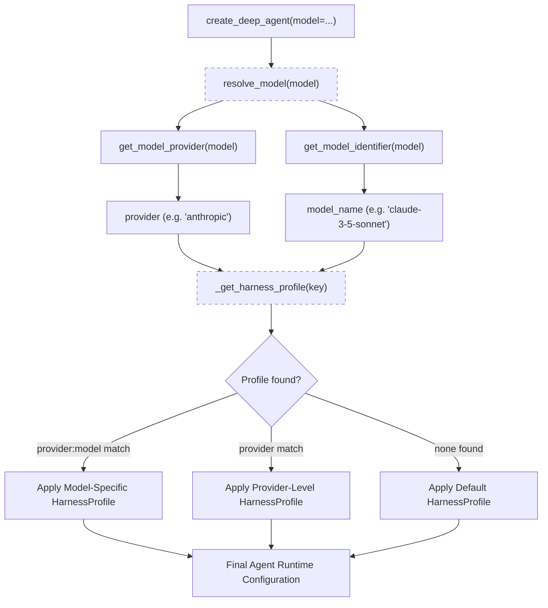
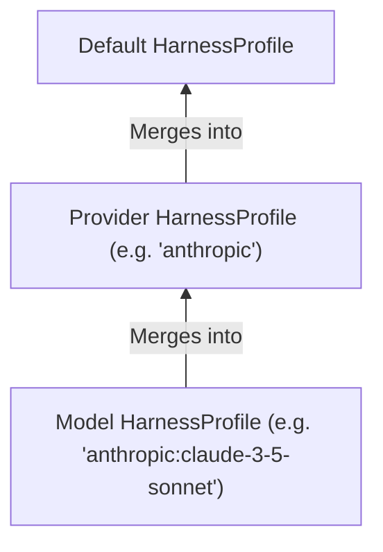
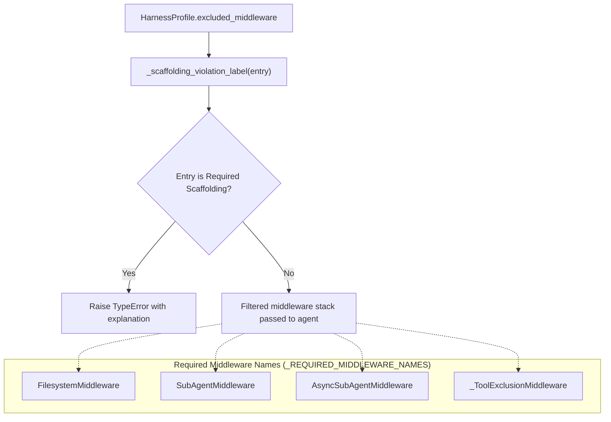
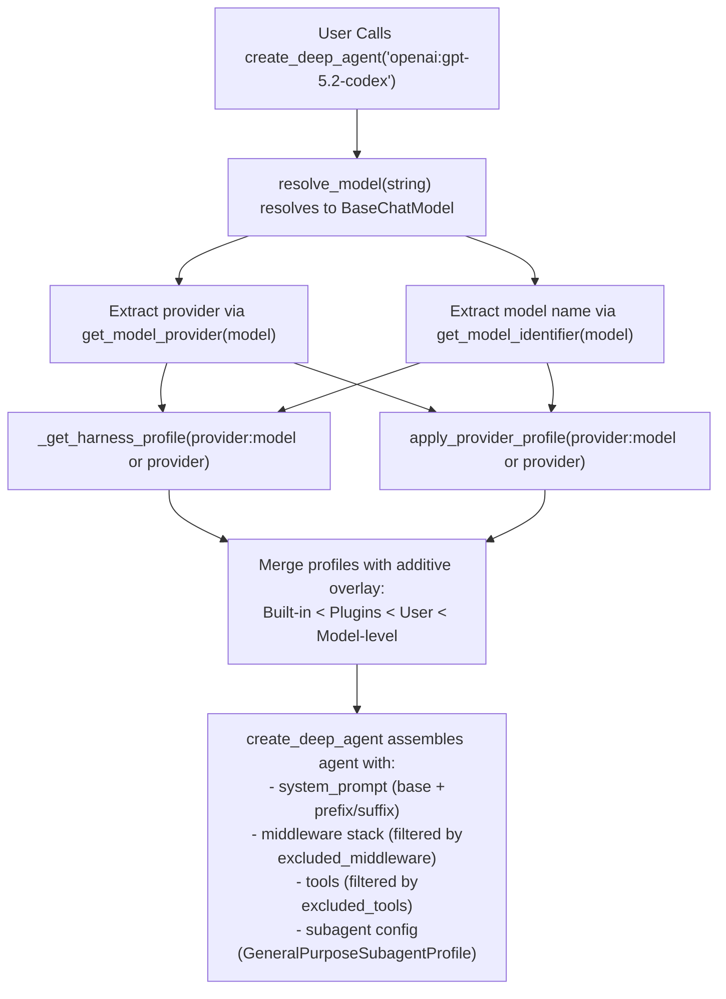

# Harness Profiles

Relevant source files

The following files were used as context for generating this wiki page:

- [libs/deepagents/deepagents/_models.py](libs/deepagents/deepagents/_models.py)
- [libs/deepagents/deepagents/middleware/_tool_exclusion.py](libs/deepagents/deepagents/middleware/_tool_exclusion.py)
- [libs/deepagents/deepagents/profiles/__init__.py](libs/deepagents/deepagents/profiles/__init__.py)
- [libs/deepagents/deepagents/profiles/_builtin_profiles.py](libs/deepagents/deepagents/profiles/_builtin_profiles.py)
- [libs/deepagents/deepagents/profiles/_keys.py](libs/deepagents/deepagents/profiles/_keys.py)
- [libs/deepagents/deepagents/profiles/harness/_openai_codex.py](libs/deepagents/deepagents/profiles/harness/_openai_codex.py)
- [libs/deepagents/deepagents/profiles/harness/harness_profiles.py](libs/deepagents/deepagents/profiles/harness/harness_profiles.py)
- [libs/deepagents/deepagents/profiles/provider/_nvidia.py](libs/deepagents/deepagents/profiles/provider/_nvidia.py)
- [libs/deepagents/deepagents/profiles/provider/_openrouter.py](libs/deepagents/deepagents/profiles/provider/_openrouter.py)
- [libs/deepagents/deepagents/profiles/provider/provider_profiles.py](libs/deepagents/deepagents/profiles/provider/provider_profiles.py)
- [libs/deepagents/tests/unit_tests/middleware/test_tool_exclusion.py](libs/deepagents/tests/unit_tests/middleware/test_tool_exclusion.py)
- [libs/deepagents/tests/unit_tests/test_models.py](libs/deepagents/tests/unit_tests/test_models.py)

Harness profiles provide a configuration layer that tunes agent runtime behavior without requiring changes to call sites [libs/deepagents/deepagents/profiles/harness/harness_profiles.py:9-13](). While **Provider Profiles** control the model construction phase (such as setting API keys or attribution headers), **Harness Profiles** shape how `create_deep_agent` assembles the agent's system prompt, tool visibility, middleware stack, and subagent behavior [libs/deepagents/deepagents/profiles/harness/harness_profiles.py:9-13]().

---

## 1. Overview and Data Flow

The profile system allows the SDK to adapt to the specific capabilities and quirks of different model families (e.g., Anthropic Claude vs. OpenAI GPT or NVIDIA Nemotron). Profiles are resolved based on the model's provider or a specific `provider:model` key. Harness profiles focus on controlling agent runtime shaping, while provider profiles affect model construction [libs/deepagents/deepagents/profiles/harness/harness_profiles.py:9-18](), [libs/deepagents/deepagents/_models.py:35-57]().

### Model to Profile Resolution Flow

This pipeline ensures that runtime shaping enables tailored behavior based on provider or exact model identifiers, aiding in model-specific tuning without modifying agent call sites.

Sources: [libs/deepagents/deepagents/_models.py:35-57](), [libs/deepagents/deepagents/profiles/harness/harness_profiles.py:9-18]()

---

## 2. Key Data Classes

### HarnessProfile

`HarnessProfile` is a frozen dataclass that captures runtime configuration overrides for agents after the chat model is constructed. It controls system prompt augmentation, middleware exclusion, tool visibility, subagent defaults, and tool metadata overrides [libs/deepagents/deepagents/profiles/harness/harness_profiles.py:82-192]().

| Field                  | Type                             | Description                                                                                                             |
|------------------------|---------------------------------|-------------------------------------------------------------------------------------------------------------------------|
| `system_prompt_prefix`  | `str \| None`                   | Text prepended to the assembled system prompt before the default base prompt.                                           |
| `system_prompt_suffix`  | `str \| None`                   | Text appended after the assembled system prompt for final prompt shaping.                                               |
| `base_system_prompt`    | `str \| None`                   | Complete replacement of the default base system prompt (`BASE_AGENT_PROMPT`).                                           |
| `excluded_middleware`   | `frozenset[type \| str]`        | Middleware classes or names to exclude from the agent's middleware stack (e.g., to disable or replace default behavior).|
| `excluded_tools`        | `frozenset[str]`                | Names of tools to hide from the model via the internal tool-exclusion middleware, preventing their invocation.           |
| `tool_overrides`        | `dict[str, dict]`               | Tool metadata overrides such as descriptions or specific behavior tuning for tools exposed to the agent.               |
| `general_purpose_subagent` | `GeneralPurposeSubagentProfile` | Configuration for customizing the auto-added "general-purpose" subagent's inclusion, description, and prompt.           |
| `extra_middleware`      | `Callable[[], list[AgentMiddleware]] \| None` | Factory returning extra middleware to insert into the stack at runtime.                                                 |

---

#### GeneralPurposeSubagentProfile

This is a nested dataclass within the harness profile system that tunes the default auto-added "general-purpose" synchronous subagent. It allows enabling/disabling the subagent or overriding its system prompt and description [libs/deepagents/deepagents/profiles/harness/harness_profiles.py:83-175]().

| Field           | Type          | Description                                                                                   |
|-----------------|---------------|-----------------------------------------------------------------------------------------------|
| `enabled`       | `bool \| None`| Optional three-state flag controlling subagent inclusion (None = default on, True = force on, False = disable).|
| `description`   | `str \| None` | Optional override for the default description of the subagent.                               |
| `system_prompt` | `str \| None` | Optional override for the subagent's base system prompt; takes precedence over base_system_prompt for this subagent.|

---

### ProviderProfile

`ProviderProfile` controls model construction behavior by specifying initialization keyword arguments and runtime side effects like enforcing minimum version or injecting headers for attribution. It is used by `resolve_model()` to create `BaseChatModel` instances with provider-specific customizations [libs/deepagents/deepagents/profiles/provider/provider_profiles.py:37-130](), [libs/deepagents/deepagents/_models.py:35-57]().

Key components:

- `init_kwargs`: Static kwargs forwarded to `init_chat_model`.
- `init_kwargs_factory`: Optional factory callable producing dynamic kwargs at resolution time, merged with static `init_kwargs`.
- `pre_init`: Optional callable invoked before model instantiation to perform side effects or validation (e.g., version checks).

Example: OpenRouter profile enforces minimum package version and injects app attribution headers conditionally [libs/deepagents/deepagents/profiles/provider/_openrouter.py:27-130]().

---

## 3. Registration and Extension

### Profile Registration Functions

- `register_harness_profile(key: str, profile: HarnessProfile)`  
- `register_provider_profile(key: str, profile: ProviderProfile)`

These functions register profiles keyed by provider or `provider:model` strings into global registries populated at runtime [libs/deepagents/deepagents/profiles/harness/harness_profiles.py:43-47](), [libs/deepagents/deepagents/profiles/provider/provider_profiles.py:47-52]().

### Entry Point Plugins

Deep Agents discovers third-party profiles registered via [PEP-517 entry points](https://packaging.python.org/en/latest/specifications/entry-points/) under these groups:

- `deepagents.provider_profiles` — for model/provider construction profiles.
- `deepagents.harness_profiles` — for runtime agent harness profiles.

These are loaded lazily on first profile access during bootstrap [libs/deepagents/deepagents/profiles/_builtin_profiles.py:103-132]().

### Merge Semantics

Profile registrations are _additive_. Multiple profiles registered under the same key merge overlaying keys, enabling overrides and extensions instead of replacement [libs/deepagents/deepagents/profiles/harness/harness_profiles.py:15-18]().

The layering priority:

1. Built-in profiles register first on bootstrap.
2. Third-party entry-point plugins merge on top.
3. User-registered profiles override both.
4. Model-specific keys (`provider:model`) merge on top of provider-level keys (`provider`).

Sources: [libs/deepagents/deepagents/profiles/harness/harness_profiles.py:15-18](), [libs/deepagents/deepagents/profiles/_builtin_profiles.py:103-160]()

---

## 4. Built-in Profiles

Deep Agents includes built-in provider and harness profiles shipped with the SDK, applied automatically during bootstrap:

| Provider/Model              | Description and Purpose                                                 | Files / Registration |
|----------------------------|------------------------------------------------------------------------|----------------------|
| **Anthropic**               | Profiles for Claude family models like Opus, Sonnet, Haiku with behavior overrides | `libs/deepagents/deepagents/profiles/_builtin_profiles.py:29-32` |
| **OpenAI Codex**            | Special suffix and middleware (e.g., `TodoListMiddleware`) for Codex models tuned for autonomous engineering reasoning | `libs/deepagents/deepagents/profiles/harness/_openai_codex.py` |
| **NVIDIA**                 | Injects `X-BILLING-INVOKE-ORIGIN` headers for usage attribution in NVIDIA NIM endpoints | `libs/deepagents/deepagents/profiles/provider/_nvidia.py` |
| **OpenRouter**             | Enforces minimum `langchain-openrouter` version and injects attribution headers; excludes Azure routing by default | `libs/deepagents/deepagents/profiles/provider/_openrouter.py` |

These built-ins are vital for ensuring the agent behaves correctly with each backend's expectations and are not disabled by missing or malformed packaging metadata [libs/deepagents/deepagents/profiles/_builtin_profiles.py:103-160]().

---

## 5. Middleware Exclusion and Tool Visibility Tuning

Harness profiles allow excluding middleware classes or names via `excluded_middleware` but protect essential "scaffolding" middleware required for core agent operations. Attempting to exclude such critical middleware triggers detailed validation errors [libs/deepagents/deepagents/profiles/harness/harness_profiles.py:39-81]().

### Validated Middleware Exclusion Process

This protects core components that back filesystem tools, subagent dispatch, and permission enforcement, while still permitting removal of optional middleware.

### Tool Visibility and Exclusion

Tool visibility is controlled via the `excluded_tools` field of `HarnessProfile`. Deep Agents applies an internal `_ToolExclusionMiddleware` late in the middleware stack to prevent excluded tools from appearing in model prompts or being callable by the model [libs/deepagents/deepagents/middleware/_tool_exclusion.py:34-101]().

- Before the model sees tools, excluded ones are filtered out from the tool list.
- If a model attempts to call an excluded tool by name despite this, the middleware rejects it with an immediate error message, ensuring consistent behavior.
- This middleware thus acts both as a filter and a runtime gatekeeper.

Sources: [libs/deepagents/deepagents/profiles/harness/harness_profiles.py:39-81](), [libs/deepagents/deepagents/middleware/_tool_exclusion.py:34-101]()

---

# Summary Diagram: Natural Language Concepts Mapped to Core Code Entities

---

# Summary

Harness Profiles in Deep Agents provide a sophisticated, declarative mechanism for dynamically configuring agent runtime behavior tailored to specific model providers or versions, orthogonal to model construction by Provider Profiles. They enable nuanced prompt shaping, control over middleware, tool visibility tuning, and subagent defaults while maintaining system integrity by protecting essential scaffolding components. The built-in profiles cover key frontier models and providers, and third parties can extend or override defaults via entry points with additive merge semantics.

Sources:  
- [libs/deepagents/deepagents/profiles/harness/harness_profiles.py:1-192](),  
- [libs/deepagents/deepagents/profiles/_builtin_profiles.py:1-166](),  
- [libs/deepagents/deepagents/_models.py:1-173](),  
- [libs/deepagents/deepagents/profiles/provider/provider_profiles.py:1-157](),  
- [libs/deepagents/deepagents/profiles/provider/_openrouter.py:1-130](),  
- [libs/deepagents/deepagents/profiles/provider/_nvidia.py:1-50](),  
- [libs/deepagents/deepagents/middleware/_tool_exclusion.py:1-101]()