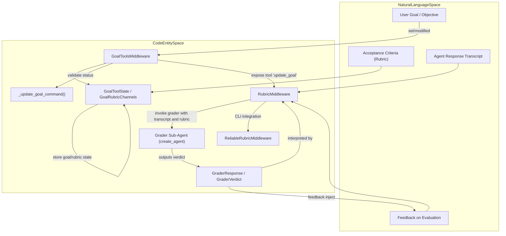

# Goal and Rubric System

<details>
<summary>Relevant source files</summary>

The following files were used as context for generating this wiki page:

- [libs/code/deepagents_code/goal_state_notice.py](libs/code/deepagents_code/goal_state_notice.py)
- [libs/code/deepagents_code/goal_tools.py](libs/code/deepagents_code/goal_tools.py)
- [libs/code/tests/unit_tests/test_fork_goal_notice.py](libs/code/tests/unit_tests/test_fork_goal_notice.py)
- [libs/code/tests/unit_tests/test_goal_state_notice.py](libs/code/tests/unit_tests/test_goal_state_notice.py)
- [libs/code/tests/unit_tests/test_goal_tools.py](libs/code/tests/unit_tests/test_goal_tools.py)
- [libs/deepagents/deepagents/middleware/rubric.py](libs/deepagents/deepagents/middleware/rubric.py)
- [libs/deepagents/tests/unit_tests/backends/test_timeout_compat.py](libs/deepagents/tests/unit_tests/backends/test_timeout_compat.py)
- [libs/deepagents/tests/unit_tests/middleware/test_rubric_middleware.py](libs/deepagents/tests/unit_tests/middleware/test_rubric_middleware.py)
- [libs/deepagents/tests/unit_tests/test_deep_agent_streaming.py](libs/deepagents/tests/unit_tests/test_deep_agent_streaming.py)
- [libs/deepagents/tests/unit_tests/test_rubric_example.py](libs/deepagents/tests/unit_tests/test_rubric_example.py)

</details>


## Purpose and Scope

The Goal and Rubric system provides a structured framework within Deep Agents for defining, managing, and automatically evaluating agent tasks through a goal lifecycle enriched with formal acceptance criteria (the *rubric*). This system enables the agent to internally assess its output against defined criteria and iteratively revise its response until the rubric is satisfied or a failure condition or iteration limit is reached. This automation reduces manual oversight and introduces robustness and reliability into agent workflows.

Core components include `GoalToolsMiddleware` exposing goal management tools, `RubricMiddleware` implementing the self-evaluation grading loop using sub-agents, and state management of the goal lifecycle. The goal lifecycle states, rubric evaluation results (`GraderVerdict`), and tool interfaces integrate closely with LangGraph execution and the Deep Agents agent middleware stack.

Sources: [libs/deepagents/deepagents/middleware/rubric.py:2-11](), [libs/code/deepagents_code/goal_tools.py:1-181](), [libs/code/deepagents_code/goal_rubric.py:1-156]()

---

## Goal Lifecycle and GoalStatus

The system tracks and manages the goal through various lifecycle states represented in agent graph state channels and accessible to the agent via specialized middleware.

### Goal Lifecycle States

- **active**: The goal is live and actionable.
- **paused**: User or system paused state, blocking agent updates.
- **blocked**: A blocker status indicating an unmet prerequisite or issue.
- **complete**: Terminal completed state signaling goal fulfillment.

These states coordinate agent behavior and tooling usage permissions; for example, when paused or complete, goal update tools reject changes to avoid inconsistent states.

### Goal Lifecycle Diagram

This diagram shows how natural language goals and rubrics relate to the supporting middleware and code entities managing the goal lifecycle and evaluation outcomes.

```mermaid
graph TD
    subgraph "NaturalLanguageSpace"
        UserGoal["User Request / Goal"]
        Criteria["Acceptance Criteria (Rubric)"]
    end

    subgraph "CodeEntitySpace"
        GTM["GoalToolsMiddleware"]
        RM["RubricMiddleware"]
        GRC["GoalRubricChannels"]
        GV["GraderVerdict"]

        UserGoal --> GTM["update_goal tool calls"]
        Criteria --> GRC["rubric state input"]

        GTM --> |"updates goal status & notes"| GRC
        GRC --> |"sets GoalStatus.active" | Active["GoalStatus.active"]
        Active --> RM
        RM --> |"evaluates transcript vs rubric"| GV
        GV --> |"satisfied -> complete"| Done["GoalStatus.complete"]
        GV --> |"needs_revision -> active"| Active
        GV --> |"failed -> blocked"| Blocked["GoalStatus.blocked"]
```

Sources: [libs/deepagents/deepagents/middleware/rubric.py:66-73](), [libs/code/deepagents_code/goal_tools.py:110-143](), [libs/code/deepagents_code/resume_state.py:72-79]()

---

## GoalToolsMiddleware and Goal Tools

The `GoalToolsMiddleware` enables persistent goal and rubric state interaction via dedicated agent-exposed tools. These tools read from and write to graph private state channels encapsulated by the `GoalRubricChannels` base class to maintain state stability and consistency.

### Key Goals and Tools

- `update_goal`: The primary tool letting the agent report goal status changes (`complete` or `blocked`) along with evidence notes. The tool performs runtime validation for:
  - Presence of an active goal objective.
  - Status transitions disallowed if paused or completed.
  - Note length constraints (`GOAL_STATUS_NOTE_CHAR_LIMIT`).
  - Oversized saved state preventing any updates to avoid inconsistent rubric or goal state.
  
Completion requests are staged for confirmation post-turn rubric evaluation before committing, allowing the rubric verdict to finalize acceptance.

### Implementation Highlights

- `GoalToolState` extends `GoalRubricChannels` with a public `rubric` input.
- `_update_goal_command` builds and validates the `update_goal` command dynamically depending on the current goal state and agent inputs.
- Oversized state detection prevents the agent from working toward or grading against unusable goals, prompting user intervention.

```python
def _update_goal_command(
    *, status: Literal["complete", "blocked"], note: str, tool_call_id: str, state: dict[str, Any]
) -> Command[Any]:
    # Validates and constructs update commands depending on goal lifecycle and note size
    ...
```

Sources: [libs/code/deepagents_code/goal_tools.py:108-160](), [libs/code/deepagents_code/goal_state_limits.py:1-80](), [libs/code/deepagents_code/resume_state.py:155-185]()

---

## RubricMiddleware and Self-Evaluation Workflow

The `RubricMiddleware` realizes the goal's acceptance criteria evaluation by invoking a *grader sub-agent* each time the agent attempts to finish an iteration (i.e., when no further tool calls are made).

### Functional Flow

- When the agent's response has no pending tool calls, `RubricMiddleware` extracts a capped transcript of recent messages.
- It relays this transcript alongside the rubric to a grader sub-agent, configured from a system prompt that instructs the grader to evaluate criteria strictly as context.
- The grader outputs a structured `GraderResponse` with a `GraderVerdict`:
  - `satisfied`: All criteria met, evaluation terminates successfully.
  - `needs_revision`: One or more criteria failed; feedback added to a synthetic human message tagged `lc_source="rubric_grader"`, injected back into the conversation to resume loop.
  - `failed`: Severe rubric or system error; terminates with failure.
- Iteration capped at `max_iterations` (default 3) to avoid infinite loops; if reached with unresolved `needs_revision`, evaluation stops with the last agent response.

### Grading Loop Diagram

```mermaid
graph TD
    subgraph "NaturalLanguageSpace"
        Prompt["Agent Transcript"]
        Rubric["Acceptance Criteria Rubric"]
    end

    subgraph "CodeEntitySpace"
        RM["RubricMiddleware"]
        Grader["Grader Sub-Agent"]
        Verdict["GraderResponse"]

        RM --> |"Extract Transcript & Rubric"| Grader
        Grader --> |"Evaluate Criteria"| Verdict
        Verdict --> |"needs_revision"| InjectRevision["Inject HumanMessage with feedback (lc_source=rubric_grader)"]
        InjectRevision --> RM
```

Sources: [libs/deepagents/deepagents/middleware/rubric.py:2-11](), [libs/deepagents/deepagents/middleware/rubric.py:121-140](), [libs/deepagents/deepagents/middleware/rubric.py:66-91]()

---

## GraderVerdict and RubricResult

The `GraderVerdict` is a typed literal representing the grading verdict emitted by the grader sub-agent; it drives the iterative evaluation workflow as follows:

| Verdict            | Meaning                                                                                                   |
|--------------------|-----------------------------------------------------------------------------------------------------------|
| `satisfied`        | The agent's transcript meets all acceptance criteria; evaluation ends successfully.                       |
| `needs_revision`   | Some criteria failed; includes actionable feedback. Middleware injects feedback to resume iteration.      |
| `failed`           | The rubric is malformed or evaluation is impossible; evaluation terminates in failure.                    |

The middleware defines two additional internal terminal statuses augmenting `GraderVerdict` to manage the middleware loop:

| RubricResult          | Description                                                                                                  |
|-----------------------|--------------------------------------------------------------------------------------------------------------|
| `max_iterations_reached` | The iteration limit hit with unresolved `needs_revision`; stops loop preserving last agent answer.       |
| `grader_error`          | The grader sub-agent experienced an error (e.g., model timeout, structured output errors).                 |

Only `needs_revision` continues the iteration loop; all others terminate grading. To bound cost, the agent transcript sent to the grader is capped at 30 messages and each message is truncated to 4000 characters if needed.

Sources: [libs/deepagents/deepagents/middleware/rubric.py:66-119]()

---

## Acceptance Criteria Generation

Acceptance criteria (the rubric) for goals are automatically generated using a specialized criteria agent. This agent distills a goal's natural language objective into a minimal set of concrete bullet points that serve as measurable acceptance criteria.

### Generation Process

1. **Context Injection:**  
   Recent conversation history is included up to length/character limits to provide sufficient context for creating meaningful criteria.
   
2. **Allowed Read-Only Tools:**  
   The criteria agent can use readonly tools such as repository read commands, `fetch_url`, and `web_search`—the latter strictly budgeted to avoid excessive cost.

3. **Drafting Criteria:**  
   The criteria agent drafts 2-5 bullet points that define measurable success conditions aligned with the goal.

4. **Revision with User Feedback:**  
   If user feedback on the criteria draft is present, the system refines the objective minimally to incorporate that feedback while preserving explicit user constraints.

Sources: [libs/code/deepagents_code/goal_rubric.py:87-156]()

---

## Reliable Rubric and CLI Integration

In CLI environments, a custom subclass `ReliableRubricMiddleware` extends `RubricMiddleware` to facilitate more robust evaluation workflows with enhancements including:

- Context-aware nested graders accommodating verification-tool budgets.
- Runtime model selection influenced by thread state.
- Clean handling of model retry logic and error reporting.
- Tighter integration with persisted thread and goal state optimized for CLI workflows.

This middleware enables reliable, repeatable acceptance criteria reviews in terminal UI-based Deep Agents CLI usage.

Sources: [libs/code/deepagents_code/reliable_rubric.py:99-118]()

---

# Summary Mermaid Diagram: Bridging Concepts to Code Entities

This composite diagram relates key natural language concepts—Goals, Rubrics, and Graders—to Deep Agents codebase middleware and tooling components.



Sources: [libs/code/deepagents_code/goal_tools.py:1-181](), [libs/deepagents/deepagents/middleware/rubric.py:2-140](), [libs/code/deepagents_code/reliable_rubric.py:99-118]()

---

# Data Flow Summary

The typical flow for goal definition and evaluation is:

1. User or system sets a goal objective and optionally a rubric via agent tools (`update_goal`).
2. The goal state and rubric are persisted in `GoalRubricChannels`.
3. The agent performs a turn, producing a response transcript.
4. `RubricMiddleware` intercepts attempts to finish and calls a grader sub-agent with the transcript + rubric.
5. The grader returns a verdict:  
   - If `needs_revision`, feedback is injected and the agent re-runs.  
   - If `satisfied`, the goal is marked complete.  
   - If `failed` or max iterations hit, the goal is blocked or final.
6. On completion, TUI or CLI components resolve the staged completion note.

---

# Key Classes and Functions

| Code Entity                  | Description                                                   | Location (lines)                      |
|-----------------------------|---------------------------------------------------------------|-------------------------------------|
| `GoalToolsMiddleware`        | Middleware exposing goal management tools (`update_goal`).    | `deepagents_code/goal_tools.py:20-165` |
| `GoalToolState`              | Holds middleware state for goal and rubric channels.          | `deepagents_code/goal_tools.py:110-130`|
| `_update_goal_command`       | Command builder validating and updating goal status.          | `deepagents_code/goal_tools.py:130-181`|
| `RubricMiddleware`           | Middleware implementing grading loop with grader sub-agent.   | `deepagents/deepagents/middleware/rubric.py:13-2000+` (full file)|
| `GraderVerdict`              | Literal type enumerating grader possible verdicts.            | `deepagents/deepagents/middleware/rubric.py:66-73`|
| `ReliableRubricMiddleware`   | Subclass enhancing rubric middleware for CLI.                  | `deepagents_code/reliable_rubric.py:99-118`|
| Goal Rubric Generation Agent | Uses read-only tools to draft acceptance criteria from goals. | `deepagents_code/goal_rubric.py:87-156`|

---

# Conclusion

The Goal and Rubric system in Deep Agents presents a rigorous, middleware-driven framework that connects natural language objectives with formalized acceptance criteria and iterative self-evaluation loops. It introduces tool-mediated stateful goal management and leverages sub-agent grading to ensure agent outputs align with user-defined success conditions. This system is foundational for building reliable multi-turn workflows that can self-correct and confidently report completion or roadblocks with evidence.

---

# References

- `libs/deepagents/deepagents/middleware/rubric.py` (lines 2-140 plus full file for grading internals)
- `libs/code/deepagents_code/goal_tools.py` (lines 1-181)
- `libs/code/deepagents_code/goal_rubric.py` (lines 87-156)
- `libs/code/deepagents_code/reliable_rubric.py` (lines 99-118)
- `libs/code/deepagents_code/resume_state.py` (lines 72-79, 155-185)

Sources:  
[libs/deepagents/deepagents/middleware/rubric.py:2-140](),  
[libs/code/deepagents_code/goal_tools.py:1-181](),  
[libs/code/deepagents_code/goal_rubric.py:87-156](),  
[libs/code/deepagents_code/reliable_rubric.py:99-118](),  
[libs/code/deepagents_code/resume_state.py:72-79,155-185]()