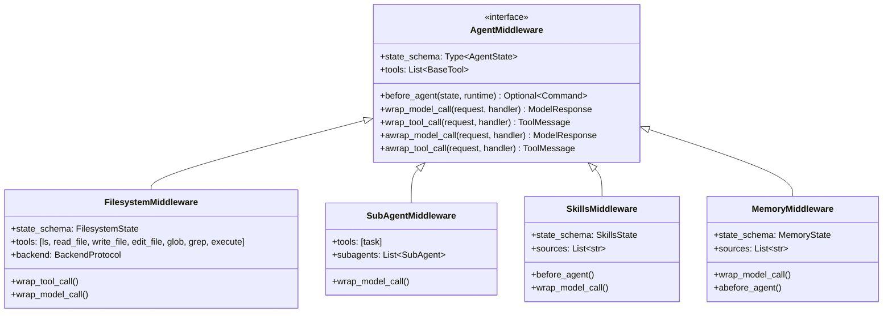
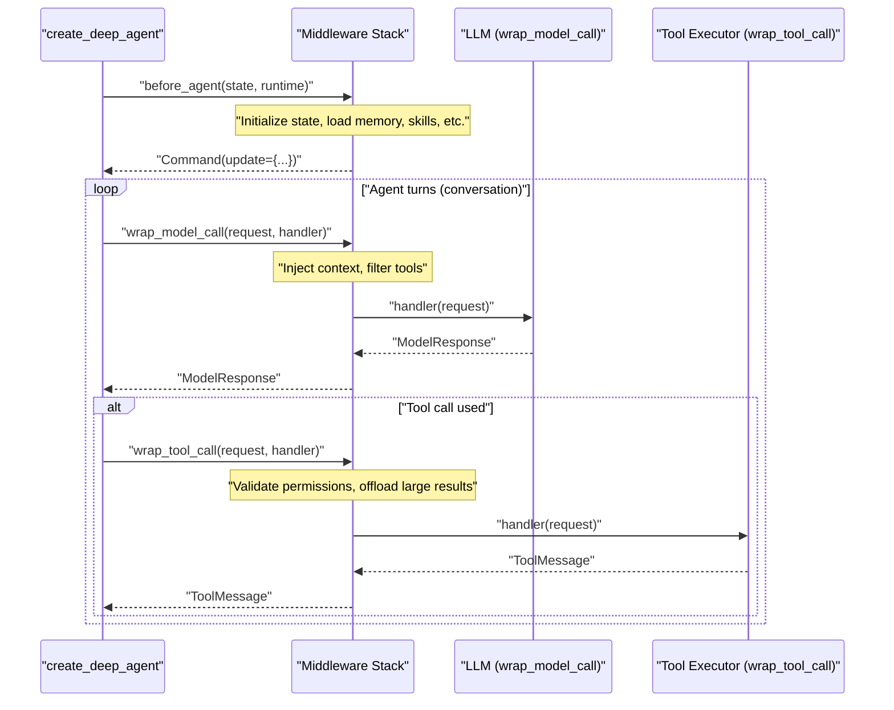
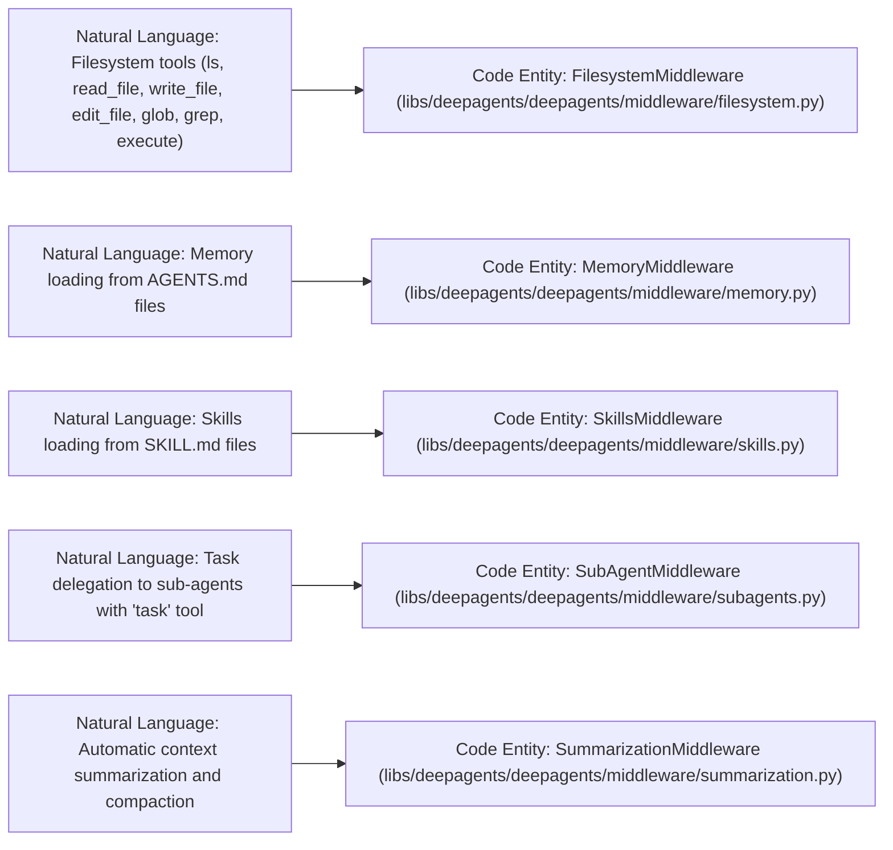
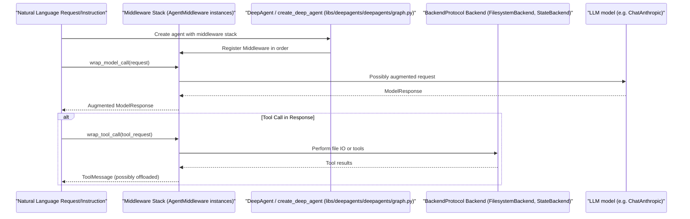

# Middleware System

<details>
<summary>Relevant source files</summary>

The following files were used as context for generating this wiki page:

- [libs/deepagents/deepagents/__init__.py](libs/deepagents/deepagents/__init__.py)
- [libs/deepagents/deepagents/backends/filesystem.py](libs/deepagents/deepagents/backends/filesystem.py)
- [libs/deepagents/deepagents/backends/protocol.py](libs/deepagents/deepagents/backends/protocol.py)
- [libs/deepagents/deepagents/backends/sandbox.py](libs/deepagents/deepagents/backends/sandbox.py)
- [libs/deepagents/deepagents/backends/utils.py](libs/deepagents/deepagents/backends/utils.py)
- [libs/deepagents/deepagents/graph.py](libs/deepagents/deepagents/graph.py)
- [libs/deepagents/deepagents/middleware/__init__.py](libs/deepagents/deepagents/middleware/__init__.py)
- [libs/deepagents/deepagents/middleware/_fs_interrupt.py](libs/deepagents/deepagents/middleware/_fs_interrupt.py)
- [libs/deepagents/deepagents/middleware/filesystem.py](libs/deepagents/deepagents/middleware/filesystem.py)
- [libs/deepagents/deepagents/middleware/patch_tool_calls.py](libs/deepagents/deepagents/middleware/patch_tool_calls.py)
- [libs/deepagents/deepagents/middleware/permissions.py](libs/deepagents/deepagents/middleware/permissions.py)
- [libs/deepagents/deepagents/middleware/subagents.py](libs/deepagents/deepagents/middleware/subagents.py)
- [libs/deepagents/tests/integration_tests/test_filesystem_middleware.py](libs/deepagents/tests/integration_tests/test_filesystem_middleware.py)
- [libs/deepagents/tests/integration_tests/test_subagent_middleware.py](libs/deepagents/tests/integration_tests/test_subagent_middleware.py)
- [libs/deepagents/tests/unit_tests/backends/test_filesystem_backend.py](libs/deepagents/tests/unit_tests/backends/test_filesystem_backend.py)
- [libs/deepagents/tests/unit_tests/backends/test_protocol.py](libs/deepagents/tests/unit_tests/backends/test_protocol.py)
- [libs/deepagents/tests/unit_tests/backends/test_sandbox_backend.py](libs/deepagents/tests/unit_tests/backends/test_sandbox_backend.py)
- [libs/deepagents/tests/unit_tests/backends/test_utils.py](libs/deepagents/tests/unit_tests/backends/test_utils.py)
- [libs/deepagents/tests/unit_tests/middleware/test_subagent_middleware_init.py](libs/deepagents/tests/unit_tests/middleware/test_subagent_middleware_init.py)
- [libs/deepagents/tests/unit_tests/test_end_to_end.py](libs/deepagents/tests/unit_tests/test_end_to_end.py)
- [libs/deepagents/tests/unit_tests/test_eviction_replay.py](libs/deepagents/tests/unit_tests/test_eviction_replay.py)
- [libs/deepagents/tests/unit_tests/test_graph.py](libs/deepagents/tests/unit_tests/test_graph.py)
- [libs/deepagents/tests/unit_tests/test_local_sandbox_operations.py](libs/deepagents/tests/unit_tests/test_local_sandbox_operations.py)
- [libs/deepagents/tests/unit_tests/test_middleware.py](libs/deepagents/tests/unit_tests/test_middleware.py)
- [libs/deepagents/tests/unit_tests/test_middleware_async.py](libs/deepagents/tests/unit_tests/test_middleware_async.py)
- [libs/deepagents/tests/unit_tests/test_permissions.py](libs/deepagents/tests/unit_tests/test_permissions.py)
- [libs/deepagents/tests/unit_tests/test_subagents.py](libs/deepagents/tests/unit_tests/test_subagents.py)

</details>


Purpose and scope: This page explains the middleware architecture in Deep Agents, detailing execution order, available built-in middleware (`MemoryMiddleware`, `SkillsMiddleware`, `FilesystemMiddleware`, `SubAgentMiddleware`, `SummarizationMiddleware`, etc.), the `AgentMiddleware` protocol, state extension via reducers, and how middleware intercepts requests and responses across the agent lifecycle.

---

## Overview

Middleware layers are the primary mechanism for extending agent functionality. Unlike plain tools, middleware can:

- **Filter tools dynamically**: For example, `FilesystemMiddleware` removes the `execute` tool at call-time if the resolved backend does not support execution [libs/deepagents/deepagents/middleware/filesystem.py:335-353]().
- **Inject system-prompt context**: Middleware such as `MemoryMiddleware` and `SkillsMiddleware` inject relevant instructions and memory content into the system message on every model call [libs/deepagents/deepagents/middleware/memory.py:82-108](), [libs/deepagents/deepagents/middleware/skills.py:122-134]().
- **Transform messages**: `SummarizationMiddleware` manages token count, truncates oversized tool arguments, and replaces conversation history with summaries when context windows are filled [libs/deepagents/deepagents/middleware/summarization.py:173-186]().
- **Maintain state across turns**: Middleware can read and write a typed state dictionary that persists across agent turns to assist in complex workflows or long-term memory [libs/deepagents/deepagents/middleware/memory.py:88-97]().

| Middleware               | Purpose                                            | Key Hooks Used                              |
|--------------------------|----------------------------------------------------|--------------------------------------------|
| `MemoryMiddleware`       | Loads project and user context from `AGENTS.md`    | `wrap_model_call`, `abefore_agent`         |
| `SkillsMiddleware`       | Loads and injects skill capabilities from `SKILL.md` | `before_agent`, `wrap_model_call`           |
| `FilesystemMiddleware`   | Provides file system tools and manages result eviction | `wrap_model_call`, `wrap_tool_call`         |
| `SubAgentMiddleware`     | Task delegation to synchronous sub-agents          | `wrap_model_call`                           |
| `AsyncSubAgentMiddleware`| Remote background task delegation                   | `wrap_model_call`                           |
| `SummarizationMiddleware`| Automatic context window management                 | `wrap_model_call`                           |
| `HumanInTheLoopMiddleware`| Handles tool call approvals and interruptions       | `wrap_tool_call`                            |
| `RubricMiddleware`       | Self-evaluates progress against acceptance criteria | `wrap_model_call`                           |
| `GoalToolsMiddleware`    | Tools for goal lifecycle management                  | `tools`                                    |

Sources: [libs/deepagents/deepagents/middleware/filesystem.py:1-45](), [libs/deepagents/deepagents/middleware/memory.py:1-53](), [libs/deepagents/deepagents/middleware/summarization.py:1-48](), [libs/deepagents/deepagents/graph.py:12-14](), [libs/deepagents/deepagents/middleware/rubric.py:41-41](), [libs/deepagents/deepagents/middleware/subagents.py:1-17]()

---

## AgentMiddleware Protocol

Middleware components implement the `AgentMiddleware` protocol, which defines hooks corresponding to various stages of the agent lifecycle. Middleware classes subclass `AgentMiddleware` and override these hooks to:

- Modify or enrich prompts before the model call (`wrap_model_call`).
- Intercept and potentially modify tool calls and responses (`wrap_tool_call`).
- Extend state with typed dictionaries exposed via a `state_schema`.
- Perform asynchronous variants of hooks (`awrap_model_call`, `awrap_tool_call`).
- Optionally perform operations before the agent session starts (`before_agent` or `abefore_agent`).

### Middleware Class Relationships



- `state_schema` defines the TypedDict keys that extend agent state for that middleware (e.g., `FilesystemState` adds the `"files"` key in state).
- `tools` lists tool instances the middleware registers to extend the capabilities exposed to the agent.
- `before_agent` or `abefore_agent` run once at session start to load data or initialize state.
- `wrap_model_call` and `wrap_tool_call` intercept calls to the LLM or tools to inject context, filter tools, perform permission checks, or offload large results.

Sources: [libs/deepagents/deepagents/middleware/filesystem.py:114-121](), [libs/deepagents/deepagents/middleware/memory.py:88-102](), [libs/deepagents/deepagents/middleware/subagents.py:11-17]()

---

## Execution Flow and Lifecycle Hooks

Middleware are wrapped in a stack, forming a pipeline through which model requests and tool calls pass. The order of middleware registration is critical because inner middleware can alter state or requests that outer middleware see.

### Middleware Execution Pipeline



### Prompt Injection by Middleware

- `MemoryMiddleware` and `SkillsMiddleware` inject context by appending to the system message using utilities like `append_to_system_message`.
- Contextual memory files wrapped in tags like `<agent_memory>` appear in the system prompt to instruct the agent.
- `SubAgentMiddleware` may inject directives specifying task delegation.

### Tool Result Offloading and Eviction

- `FilesystemMiddleware` handles large tool results by offloading them to the backend if their token count exceeds a configured threshold (`TOOL_RESULT_TOKEN_LIMIT`).
- When offloaded, the tool result is replaced with a reference path, and a preview snippet is included to aid in interpretation without flooding the conversational buffer.
- This eviction pattern reduces token usage in the conversation and preserves large outputs externally.

Sources: [libs/deepagents/deepagents/graph.py:12-63](), [libs/deepagents/deepagents/middleware/memory.py:82-108](), [libs/deepagents/deepagents/middleware/filesystem.py:355-419](), [libs/deepagents/backends/utils.py:33-33]()

---

## State Schema Extension and Reducers

Middleware extend the base `AgentState` by adding new keys. These keys correspond to TypedDict schemas they define. Changes from middleware are merged into the agent's state across turns.

### Filesystem State and File Data Reducer

```mermaid
graph TD
    subgraph "Code Entity Space"
        FS["FilesystemState (TypedDict)"]
        FDR["_file_data_reducer (function)"]
        FD[ "FileData (TypedDict)" ]
    end

    subgraph "Natural Language Space"
        Files["'files' state key: file path -> FileData or None"]
        Delete["File Deletion (None means remove file key)"]
        Update["File Content Update"]
    end

    FS -->|"annotated with"| FDR
    FDR -->|"manages"| FD
    Files -.-> FS
    Delete -.-> FDR
    Update -.-> FDR
```

- The middleware keeps the `"files"` key in state as a mapping from filepath strings to `FileData` dictionaries.
- The `_file_data_reducer` function applies incoming update dictionaries to the current `"files"` state by setting files and removing any file path keys whose value is `None`, implementing deletions [libs/deepagents/deepagents/middleware/filesystem.py:78-121]().

This reducer pattern ensures consistent and declarative state updates for file contents managed internally by `FilesystemMiddleware`.

Sources: [libs/deepagents/deepagents/middleware/filesystem.py:78-121]()

---

## Key Built-in Middleware

### FilesystemMiddleware

- Provides the agent with tools to interact with the filesystem, including `ls`, `read_file`, `write_file`, `edit_file`, `glob`, `grep`, and conditionally `execute`.
- Uses an underlying backend implementing `BackendProtocol` (e.g., `StateBackend`, `FilesystemBackend`, `CompositeBackend`) to perform actual file I/O.
- Dynamically filters the availability of the `execute` tool based on backend capability.
- Enforces filesystem permissions defined via `FilesystemPermission` rules during tool calls, guarding operations paths and access [libs/deepagents/deepagents/middleware/filesystem.py:335-353]().

### SkillsMiddleware

- Loads skill definitions from `SKILL.md` files at configured source directories.
- Parses YAML frontmatter in these files to extract metadata and instructions.
- Injects skill instructions as context into the system prompt, enhancing the agent's capability set [libs/deepagents/deepagents/middleware/skills.py:1-45]().

### MemoryMiddleware

- Loads `AGENTS.md` files from configured memory sources to provide long-term project or user memory context.
- Encourages agents to learn from feedback by updating these memory files via edit operations.
- Injects memory contents into every model call's system prompt wrapped in `<agent_memory>` tags for clarity [libs/deepagents/deepagents/middleware/memory.py:27-126]().

### SummarizationMiddleware

- Manages the automatic compression of conversation history to stay within model context token limits.
- Upon excess tokens, summarizes and offloads prior conversation history to the backend filesystem, referencing it in the ongoing context.
- Supports a manual `compact_conversation` tool to trigger compaction explicitly [libs/deepagents/deepagents/middleware/summarization.py:1-194]().

### Additional Middleware

- `SubAgentMiddleware` provides sub-agent task delegation via a `task` tool.
- `AsyncSubAgentMiddleware` supports asynchronous remote sub-agent invocation.
- `HumanInTheLoopMiddleware` wraps tool calls to enforce approval workflows.
- `RubricMiddleware` injects prompts to self-evaluate adherence to goal rubrics.
- `GoalToolsMiddleware` exposes goal lifecycle management tools to the agent [libs/deepagents/deepagents/graph.py:211-211]().

Sources: [libs/deepagents/deepagents/middleware/filesystem.py:335-353](), [libs/deepagents/deepagents/middleware/memory.py:1-136](), [libs/deepagents/deepagents/middleware/summarization.py:1-194](), [libs/deepagents/deepagents/graph.py:211-211]()

---

## Middleware Composition Order

The `create_deep_agent` function composes middleware in a defined order to ensure logical layering of functionality:

1. `TodoListMiddleware` — innermost context, manages a todo list [libs/deepagents/deepagents/graph.py:14]()
2. `MemoryMiddleware` — injects agent memory and context [libs/deepagents/deepagents/graph.py:52]()
3. `SkillsMiddleware` — injects skill context [libs/deepagents/deepagents/graph.py:54]()
4. `FilesystemMiddleware` — provides filesystem tools and permission enforcement [libs/deepagents/deepagents/graph.py:51]()
5. `SubAgentMiddleware` — task delegation for synchronous subagents [libs/deepagents/deepagents/graph.py:59]()
6. `AsyncSubAgentMiddleware` — remote async subagent support [libs/deepagents/deepagents/graph.py:50]()
7. `SummarizationMiddleware` — context summarization and compaction [libs/deepagents/deepagents/graph.py:63]()
8. `AnthropicPromptCachingMiddleware` — prompt caching optimizations [libs/deepagents/deepagents/graph.py:46]()
9. `PatchToolCallsMiddleware` — patching tool call formatting [libs/deepagents/deepagents/graph.py:53]()
10. `_ToolExclusionMiddleware` — exclude certain tools dynamically [libs/deepagents/deepagents/graph.py:48]()
11. `HumanInTheLoopMiddleware` — outermost middleware for approval/interruption [libs/deepagents/deepagents/graph.py:14]()

The wrapping order ensures that system prompt injection and middleware augmentations occur inside out, with approvals and interrupts applied last.

Sources: [libs/deepagents/deepagents/graph.py:13-63]()

---

# Diagrams Bridging Natural Language Concepts to Code Entities


### Diagram 1: Middleware System Natural Language to Code Entity Mapping



### Diagram 2: Middleware Lifecycle Hook Usage Across Agent Execution



---

# Summary

The Deep Agents middleware system provides a robust, layered framework for intercepting and enhancing both language model calls and tool executions. Middleware can add stateful memory, inject skills, manage filesystem interactions with permissions and offloading, delegate work to sub-agents, and manage conversation history via summarization. The lifecycle hooks `before_agent`, `wrap_model_call`, and `wrap_tool_call` enable fine-grained control and context injection at each stage. Middleware are composed in a carefully defined order in `create_deep_agent` to maximize extensibility and ensure consistent behavior. The strongly-typed state schemas and reducers provide structured cross-turn data management.

Sources:  
- [libs/deepagents/deepagents/middleware/filesystem.py:1-185,335-419]()  
- [libs/deepagents/deepagents/middleware/memory.py:27-108]()  
- [libs/deepagents/deepagents/middleware/skills.py:1-53]()  
- [libs/deepagents/deepagents/middleware/subagents.py:1-176]()  
- [libs/deepagents/deepagents/middleware/summarization.py:1-194]()  
- [libs/deepagents/deepagents/graph.py:12-63, 211-211]()