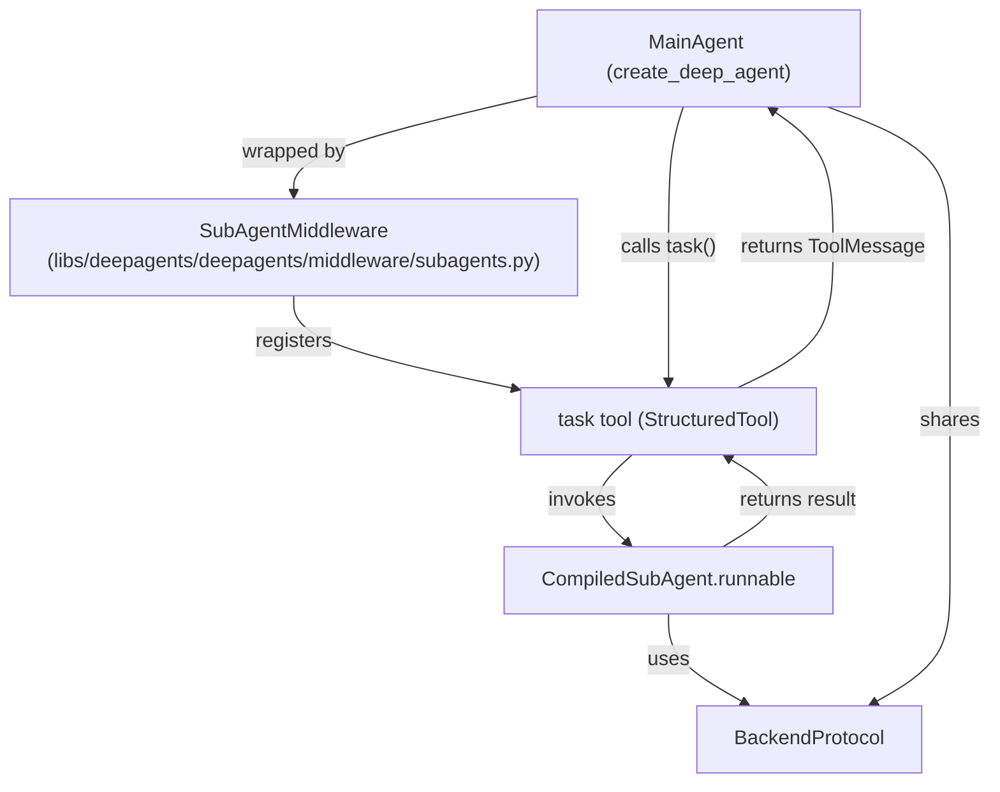
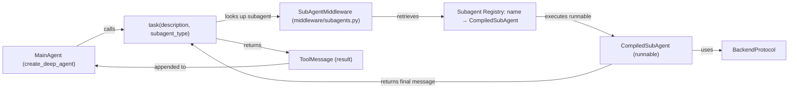
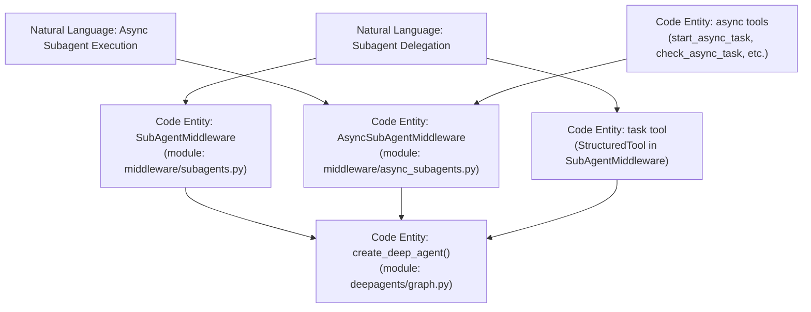
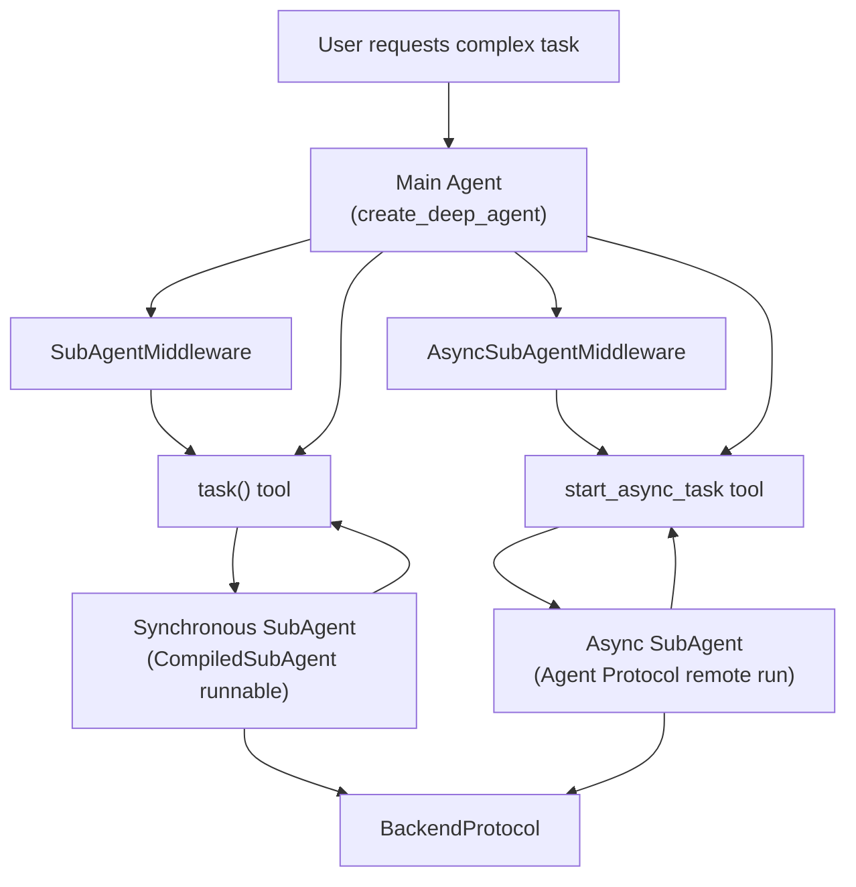

# Sub-Agent Delegation

Relevant source files

The following files were used as context for generating this wiki page:

- [libs/deepagents/deepagents/__init__.py](libs/deepagents/deepagents/__init__.py)
- [libs/deepagents/deepagents/graph.py](libs/deepagents/deepagents/graph.py)
- [libs/deepagents/deepagents/middleware/__init__.py](libs/deepagents/deepagents/middleware/__init__.py)
- [libs/deepagents/deepagents/middleware/_blob_offload.py](libs/deepagents/deepagents/middleware/_blob_offload.py)
- [libs/deepagents/deepagents/middleware/_parent_notifier.py](libs/deepagents/deepagents/middleware/_parent_notifier.py)
- [libs/deepagents/deepagents/middleware/async_subagents.py](libs/deepagents/deepagents/middleware/async_subagents.py)
- [libs/deepagents/deepagents/middleware/patch_tool_calls.py](libs/deepagents/deepagents/middleware/patch_tool_calls.py)
- [libs/deepagents/deepagents/middleware/subagents.py](libs/deepagents/deepagents/middleware/subagents.py)
- [libs/deepagents/tests/integration_tests/test_filesystem_middleware.py](libs/deepagents/tests/integration_tests/test_filesystem_middleware.py)
- [libs/deepagents/tests/integration_tests/test_subagent_middleware.py](libs/deepagents/tests/integration_tests/test_subagent_middleware.py)
- [libs/deepagents/tests/unit_tests/middleware/test_blob_offload.py](libs/deepagents/tests/unit_tests/middleware/test_blob_offload.py)
- [libs/deepagents/tests/unit_tests/middleware/test_filesystem_middleware_init.py](libs/deepagents/tests/unit_tests/middleware/test_filesystem_middleware_init.py)
- [libs/deepagents/tests/unit_tests/middleware/test_subagent_middleware_init.py](libs/deepagents/tests/unit_tests/middleware/test_subagent_middleware_init.py)
- [libs/deepagents/tests/unit_tests/test_async_subagents.py](libs/deepagents/tests/unit_tests/test_async_subagents.py)
- [libs/deepagents/tests/unit_tests/test_eviction_replay.py](libs/deepagents/tests/unit_tests/test_eviction_replay.py)
- [libs/deepagents/tests/unit_tests/test_graph.py](libs/deepagents/tests/unit_tests/test_graph.py)
- [libs/deepagents/tests/unit_tests/test_subagents.py](libs/deepagents/tests/unit_tests/test_subagents.py)

Sub-agent delegation enables a main agent to spawn specialized child agents for focused tasks. Each sub-agent operates with an isolated context window and can be configured with its own model, tools, and system prompt. This mechanism is exposed to the agent through the `task` tool, which is automatically registered by `SubAgentMiddleware` [libs/deepagents/deepagents/middleware/subagents.py:1-176]().

---

## Purpose and Architecture

Sub-agents provide task decomposition and context isolation. When a conversation grows long or involves distinct subtasks, the main agent can delegate work to a sub-agent that starts with a fresh context window. The sub-agent executes independently, returns its result, and its internal conversation history is discarded—only the final output is returned to the parent agent as a `ToolMessage` [libs/deepagents/deepagents/middleware/subagents.py:167-169]().

### Subagent Delegation Flow

Sources: [libs/deepagents/deepagents/middleware/subagents.py:1-176](), [libs/deepagents/tests/unit_tests/test_subagents.py:130-144]()

---

## Subagent Types

### Synchronous Subagents (`SubAgent`)

Synchronous subagents are defined as `SubAgent` TypedDicts specifying their configuration. The `SubAgentMiddleware` compiles these specifications into `CompiledSubAgent` instances used internally when the `task` tool is called. This allows the main agent to delegate tasks seamlessly [libs/deepagents/deepagents/middleware/subagents.py:83-174]().

**SubAgent Specification Fields**

| Field             | Type                           | Required | Description                                                                                                   |
|-------------------|--------------------------------|----------|---------------------------------------------------------------------------------------------------------------|
| `name`            | `str`                          | Yes      | Unique ID used by the main agent in `task(subagent_type="name")` calls.                                       |
| `description`     | `str`                          | Yes      | Text describing the subagent’s function used for delegation decisions.                                       |
| `mode`            | `Literal["isolated", "fork"]`  | No       | Defaults to `"isolated"`. `"fork"` allows continuing the parent's conversation instead of starting fresh.    |
| `system_prompt`   | `str`                          | No       | Additional instructions appended to the inherited prompt in fork mode or used standalone in isolated mode.   |
| `model`           | `str \| BaseChatModel`          | No       | Model override for the subagent, e.g., `"openai:gpt-5.5"`.                                                   |
| `tools`           | `Sequence[BaseTool \| Callable \| dict]` | No     | Tools accessible to the subagent. Inherits from main agent if absent.                                        |
| `middleware`      | `list[AgentMiddleware]`        | No       | Additional/overriding middleware for the subagent.                                                          |
| `skills`          | `list[str]`                    | No       | Skill directories for `SkillsMiddleware`. Forbidden in fork mode.                                            |
| `permissions`     | `list[FilesystemPermission]`   | No       | Filesystem access restrictions replacing parent's permissions if provided.                                   |
| `response_format` | `ResponseFormat \| type \| dict`| No      | Structured output format for the subagent’s response.                                                        |

Sources: [libs/deepagents/deepagents/middleware/subagents.py:83-174]()

### Asynchronous Subagents (`AsyncSubAgent`)

Async subagents run as background jobs on remote Agent Protocol servers. They are described by the `AsyncSubAgent` TypedDict, managed by `AsyncSubAgentMiddleware`, which supplies tools to start, monitor, update, and cancel these tasks [libs/deepagents/deepagents/middleware/async_subagents.py:56-133]().

**AsyncSubAgent Specification Fields**

| Field        | Type               | Required | Description                                                            |
|--------------|--------------------|----------|------------------------------------------------------------------------|
| `name`       | `str`              | Yes      | Unique identifier.                                                     |
| `description`| `str`              | Yes      | Description for delegation decisions.                                 |
| `graph_id`   | `str`              | Yes      | Graph or assistant ID on the remote server.                          |
| `url`        | `str`              | No       | URL of the remote Agent Protocol server; omitted for local ASGI.     |
| `headers`    | `dict[str, str]`   | No       | Additional request headers, e.g., for authentication.                |
| `mode`       | `Literal["isolated", "fork"]` | No     | Fork mode sends parent's conversation snapshot; isolated sends only task description (default). |

Async subagents immediately return a `task_id` to the main agent, which can then query progress and results asynchronously [libs/deepagents/deepagents/middleware/async_subagents.py:5-7]().

Sources: [libs/deepagents/deepagents/middleware/async_subagents.py:56-133](), [libs/deepagents/deepagents/middleware/async_subagents.py:135-172]()

---

## Context Isolation and Recursion

### Delegation Modes

- **Isolated (Default)**: Subagent receives only the delegated task description with a fresh context. It does not inherit the parent's message history or context [libs/deepagents/deepagents/middleware/subagents.py:86-90]().
- **Fork (Experimental)**: Subagent receives a snapshot of the parent's conversation as the starting context and then continues with the delegated task description. Some parent state keys (like summarization events, structured responses) are excluded to avoid confusion or incorrect result scattering [libs/deepagents/deepagents/middleware/subagents.py:52-72]().

### Recursion Protection

Forked subagents are marked with a special state key (`_FORKED_CONTEXT_KEY`) preventing them from invoking `task` or `atask` again. Attempting recursive delegation results in a refusal message: 

*“You are a subagent and cannot delegate to another subagent. Complete this task yourself instead of calling this tool again.”* [libs/deepagents/deepagents/middleware/subagents.py:54-63]().

This safeguards against infinite delegation loops and unbounded task recursion.

Sources: [libs/deepagents/deepagents/middleware/subagents.py:43-63](), [libs/deepagents/deepagents/middleware/subagents.py:72-77]()

---

## Middleware Architecture and Data Flow

### The `task` Tool

The `task` tool is the primary interface for synchronous subagent delegation. It is implemented as a `StructuredTool` registered by `SubAgentMiddleware`. When the main agent invokes `task(...)`, the middleware looks up the subagent by name, executes the subagent’s runnable, and returns its final result in a `ToolMessage` to the main agent [libs/deepagents/deepagents/middleware/subagents.py:95-116]().

### SubAgentMiddleware Data Flow Diagram

**Explanation:**  
- The main agent (constructed by `create_deep_agent`) uses `SubAgentMiddleware` which registers the `task` tool.  
- Calling `task()` invokes the associated subagent by name.  
- The subagent runs in isolation or fork mode via `CompiledSubAgent`, using the shared backend.  
- The subagent’s last message is converted into a `ToolMessage` sent back to the parent agent.

Sources: [libs/deepagents/deepagents/middleware/subagents.py:20-60](), [libs/deepagents/tests/unit_tests/test_subagents.py:130-144]()

---

## Async Subagent Execution

Async subagents are managed by `AsyncSubAgentMiddleware`. Instead of blocking for results, they start background runs on external Agent Protocol servers using the LangGraph SDK, returning a `task_id` immediately. The main agent can asynchronously query, update, or cancel tasks via tools registered by this middleware [libs/deepagents/deepagents/middleware/async_subagents.py:1-173]().

### Async Subagent Tools Provided

| Tool Name           | Purpose                                           |
|---------------------|--------------------------------------------------|
| `start_async_task`   | Starts a new async subagent run; returns `task_id` immediately [async_subagents.py:110-117]() |
| `check_async_task`   | Queries the status and result of an async task [async_subagents.py:119-124]()                  |
| `update_async_task`  | Sends new instructions to a running async task [async_subagents.py:126-131]()                   |
| `cancel_async_task`  | Cancels a running async task [async_subagents.py:133-137]()                                    |
| `list_async_tasks`   | Lists tracked tasks with optional filtering [async_subagents.py:139-144]()                     |

### Async Task Tracking State

Async tasks are persisted in the middleware state under the `async_tasks` dictionary keyed by `task_id`. Each task is an `AsyncTask` TypedDict with metadata including `thread_id`, `run_id`, `agent_name`, `status` and timestamps in ISO-8601 format.

The reducer function `_tasks_reducer` ensures incoming async task updates are merged correctly into existing state without loss [libs/deepagents/deepagents/middleware/async_subagents.py:120-129]().

Sources: [libs/deepagents/deepagents/middleware/async_subagents.py:138-172](), [libs/deepagents/deepagents/middleware/async_subagents.py:172-194]()

---

## Implementation Details

### SubAgent Middleware Interface

Both `SubAgentMiddleware` and `AsyncSubAgentMiddleware` subclass `AgentMiddleware` from LangChain. They intercept messages sent to the LLM to:

- Register tools for subagent delegation.
- Inject or modify system prompts and tool lists dynamically.
- Manage sub-agent-specific state and context isolation.
- Handle task lifecycle and persistence of async tasks.

### Key Classes and Functions

| Symbol                     | Description                                                                          | Location                                                     |
|----------------------------|--------------------------------------------------------------------------------------|--------------------------------------------------------------|
| `SubAgent`                 | TypedDict describing synchronous subagent specification fields.                     | `middleware/subagents.py` lines 83-174                        |
| `AsyncSubAgent`            | TypedDict describing asynchronous subagent specification fields.                    | `middleware/async_subagents.py` lines 56-133                 |
| `SubAgentMiddleware`       | Middleware implementing sync subagent support with `task` tool registration.          | `middleware/subagents.py` entire module                       |
| `AsyncSubAgentMiddleware`  | Middleware implementing async subagent support with async task tools registered.      | `middleware/async_subagents.py` entire module                 |
| `_tasks_reducer`           | Function to merge async task updates into middleware state.                          | `middleware/async_subagents.py` lines 122-129                 |
| `create_sub_agent`         | Helper to compile a `SubAgent` spec into a `CompiledSubAgent` runnable.              | `middleware/subagents.py` lines 30-40                          |
| `_build_task_tool`          | Constructs the `task` StructuredTool for invoking sync subagents.                   | `middleware/subagents.py` lines 27-33                          |

Sources: [libs/deepagents/deepagents/middleware/subagents.py:1-176](), [libs/deepagents/deepagents/middleware/async_subagents.py:1-173](), [libs/deepagents/tests/unit_tests/test_subagents.py:95-160]()

---

## Bridging Natural Language to Code Entities: Sub-Agent Delegation Overview

---

## Bridging Natural Language to Code Entities: Subagent Delegate Flow

Sources: [libs/deepagents/deepagents/middleware/subagents.py](), [libs/deepagents/deepagents/middleware/async_subagents.py](), [libs/deepagents/deepagents/graph.py]()

---

# Summary

Sub-Agent Delegation in the Deep Agents framework is realized primarily via the `SubAgentMiddleware` which provides synchronous subagents through the `task` tool with isolated or fork modes. Asynchronous subagents run on remote Agent Protocol servers managed by `AsyncSubAgentMiddleware`, returning control immediately to the parent with task IDs and providing tools for ongoing management.

This separation allows rich task decomposition, context isolation, and externalized background processing within the agent framework. Both middleware types integrate tightly with the backend for persistent state and reuse within the overarching Deep Agents architecture instantiated by `create_deep_agent`.

---

Sources:  
- libs/deepagents/deepagents/middleware/subagents.py  
- libs/deepagents/deepagents/middleware/async_subagents.py  
- libs/deepagents/deepagents/graph.py  
- libs/deepagents/tests/unit_tests/test_subagents.py  
- libs/deepagents/tests/unit_tests/test_async_subagents.py