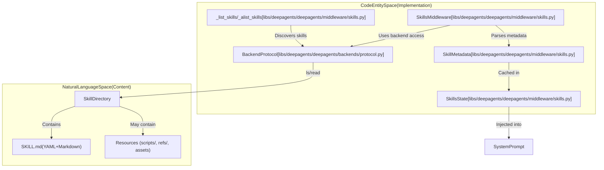
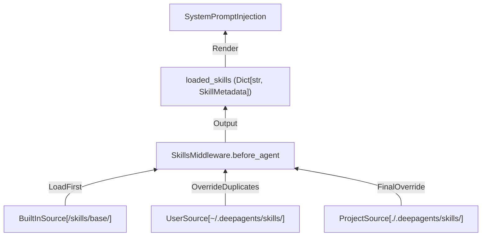
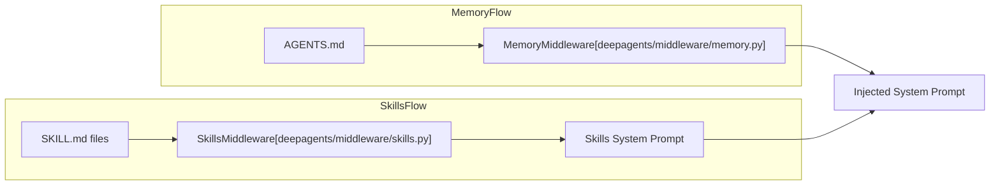

# Skills System

<details>
<summary>Relevant source files</summary>

The following files were used as context for generating this wiki page:

- [libs/deepagents/deepagents/middleware/_skill_tools.py](libs/deepagents/deepagents/middleware/_skill_tools.py)
- [libs/deepagents/deepagents/middleware/skills.py](libs/deepagents/deepagents/middleware/skills.py)
- [libs/deepagents/tests/unit_tests/middleware/skill_tools_support.py](libs/deepagents/tests/unit_tests/middleware/skill_tools_support.py)
- [libs/deepagents/tests/unit_tests/middleware/test_pinned_skills.py](libs/deepagents/tests/unit_tests/middleware/test_pinned_skills.py)
- [libs/deepagents/tests/unit_tests/middleware/test_skill_tool_resolver.py](libs/deepagents/tests/unit_tests/middleware/test_skill_tool_resolver.py)
- [libs/deepagents/tests/unit_tests/middleware/test_skill_tools.py](libs/deepagents/tests/unit_tests/middleware/test_skill_tools.py)
- [libs/deepagents/tests/unit_tests/middleware/test_skill_tools_payload.py](libs/deepagents/tests/unit_tests/middleware/test_skill_tools_payload.py)
- [libs/deepagents/tests/unit_tests/middleware/test_skills_middleware.py](libs/deepagents/tests/unit_tests/middleware/test_skills_middleware.py)
- [libs/deepagents/tests/unit_tests/middleware/test_skills_middleware_async.py](libs/deepagents/tests/unit_tests/middleware/test_skills_middleware_async.py)
- [openwiki/.claims/concepts/subagents-skills.json](openwiki/.claims/concepts/subagents-skills.json)
- [openwiki/concepts/subagents-skills.md](openwiki/concepts/subagents-skills.md)

</details>


## Purpose and Scope

The Skills System implements Anthropic's agent skills pattern with progressive disclosure, enabling agents to load specialized capabilities from structured directories. Unlike simple tool definitions, skills bundle markdown instructions with metadata to guide the agent on when and how to apply specific procedures. This page documents the skills loading mechanism, including built-in, user-level, and project-level skills, precedence rules, and `SkillsMiddleware` configuration.

Sources: [libs/deepagents/deepagents/middleware/skills.py:1-11]()

---

## Architecture and Data Flow

The Skills System bridges "Natural Language Space" (Markdown instructions in `SKILL.md`) to "Code Entity Space" (the `SkillsMiddleware` and `BackendProtocol`), exposing a middleware-driven pattern for skill discovery, validation, caching, and injection into agent prompts.



**Skills System Component Mapping**

| Concept | Code Entity / Implementation | Role |
| :-------| :---------------------------| :----|
| Skill Source | `SkillSource` type ([skills.py:206-208]()) | Backend paths or tuples specifying where skills reside, with optional labels. |
| Metadata Parsing | `_parse_skill_metadata` ([skills.py:417-458]()) | Parses YAML frontmatter from `SKILL.md`. |
| Validation | `_validate_metadata` ([skills.py:378-414]()) | Validates skill name, description length, and overall metadata consistency. |
| Backend Access | BackendProtocol ([backends/protocol.py]) | Abstracts over storage backends; supports listing and reading skill files. |
| State Management | `SkillsState` ([skills.py:229-240]()) | Holds `loaded_skills` dictionary and load warnings for progressive disclosure management. |
| Prompt Injection | `_format_skills_for_prompt` ([skills.py:539-577]()) | Converts skills into markdown prompt blocks, injecting instructions progressively. |

Sources: [libs/deepagents/deepagents/middleware/skills.py:1-44](), [libs/deepagents/deepagents/middleware/skills.py:151-240](), [libs/deepagents/deepagents/middleware/skills.py:378-577](), [libs/deepagents/tests/unit_tests/middleware/test_skills_middleware.py:32-48]()

---

## Skill Structure and Specification

Each skill follows a strict directory and file pattern with structured metadata to support agent understanding and runtime tool gating.

### File Layout

```txt
/skills/user/web-research/
├── SKILL.md          # Required: YAML frontmatter + markdown instructions
├── helper.py         # Optional: Supporting files & scripts
└── ...
```

Sources: [libs/deepagents/deepagents/middleware/skills.py:21-30]()

### SKILL.md Format

The `SKILL.md` file contains YAML frontmatter with keys like `name`, `description`, `license` and optionally `compatibility`, `metadata`, and `allowed_tools`.

Example:

```markdown
---
name: web-research
description: Structured approach to conducting thorough web research
license: MIT
---

# Web Research Skill

## When to Use
- User asks you to research a topic
...
```

Sources: [libs/deepagents/deepagents/middleware/skills.py:31-44](), [libs/deepagents/tests/unit_tests/middleware/test_skills_middleware.py:75-94]()

### Metadata Constraints

The middleware strictly enforces these validations:

- **Skill Name**: Must be 1–64 characters, lowercase alphanumeric plus hyphens, no consecutive or trailing hyphens, and must match the skill directory name.  
- **Description**: Max 1024 characters.  
- **Maximum File Size**: SKILL.md is limited to 10MB to mitigate DoS risks.  
- **Warnings**: Load errors log and produce prompt warnings truncated to 1000 chars with a maximum of 20 warnings per load session.

These constraints implement the [Agent Skills specification](https://agentskills.io/specification).

Sources: [libs/deepagents/deepagents/middleware/skills.py:135-194](), [libs/deepagents/deepagents/middleware/skills.py:339-414](), [libs/deepagents/tests/unit_tests/middleware/test_skills_middleware.py:93-153]()

---

## Skills Loading Mechanism and Precedence

### Loading Sources

Skill sources define backend paths where skills are discovered. These can be:

- Built-in skills (e.g., `/skills/base/`)  
- User-level skills (e.g., `~/.deepagents/skills/`)  
- Project-level skills (e.g., `./.deepagents/skills/`)  
- Explicit labeled sources (e.g., `("/repo/.claude/skills", "Project Claude")`)

Sources are iterated in order, and later sources override earlier ones by skill name (last-wins), allowing layered customization and overrides.

### Precedence Diagram



Sources: [libs/deepagents/deepagents/middleware/skills.py:8-11](), [libs/deepagents/deepagents/middleware/skills.py:65-73](), [libs/deepagents/tests/unit_tests/middleware/test_skills_middleware.py:178-196]()

---

## SkillsMiddleware Configuration

The middleware implementation relies exclusively on backend APIs (no direct filesystem access). It supports any backend implementing `BackendProtocol`, including `FilesystemBackend`, `StateBackend`, or `StoreBackend`, ensuring portability.

### Initialization Example

```python
from deepagents.backends.state import StateBackend
from deepagents.middleware.skills import SkillsMiddleware

middleware = SkillsMiddleware(
    backend=StateBackend(),
    sources=[
        "/skills/base/",
        "/skills/user/",
        "/skills/project/",
        ("/repo/.claude/skills", "Project Claude"),
    ],
)
```

The `sources` parameter accepts a list of paths or `(path, label)` tuples.

Sources: [libs/deepagents/deepagents/middleware/skills.py:84-97](), [libs/deepagents/deepagents/middleware/skills.py:151-204]()

### Source Labeling

If a source is a bare path, `SkillsMiddleware` derives a label:

- By default, the last path segment capitalized (e.g., `/skills/user/` → `User`)  
- Special case: `built_in_skills` becomes `Built-in`  
- Special case: paths ending with `skills` climb one parent directory to avoid redundant "Skills Skills" naming (e.g., `~/.claude/skills` → `Claude`)  

Explicit labels can be passed via `(path, label)` tuples to disambiguate conflicting source names.

Sources: [libs/deepagents/deepagents/middleware/skills.py:194-204]()

---

## Skill Tools and Progressive Disclosure

Skills may declare `include_tools` metadata listing tool names or tool resolver names. The middleware defers loading these tools until the skill instructions are explicitly read by the agent ("progressive disclosure").

This is governed by:

- `_SkillTools` submodule for disclosure gating of tools named or resolved at runtime.  
- A `SkillToolResolver` callback that resolves include names to actual `BaseTool` instances at runtime.

Tools declared in `include_tools` are not immediately available; they become enabled only after a successful read of that skill's `SKILL.md`.

For more, see also `deepagents.middleware._skill_tools` which orchestrates tool gating.

Sources: [libs/deepagents/deepagents/middleware/skills.py:176-204](), [libs/deepagents/deepagents/middleware/_skill_tools.py](), [libs/deepagents/tests/unit_tests/middleware/test_skill_tools.py](), [libs/deepagents/tests/unit_tests/middleware/test_skill_tool_resolver.py]()

---

## Skills and Sub-Agent Delegation

In the sub-agent system, skills can be specified on a per-subagent basis:

- When using `SubAgentMiddleware`, synchronous `SubAgent` specifications may include a list of skill source paths. This causes independent `SkillsMiddleware` to load those paths and inject relevant skills into the subagent’s prompt.  
- In `fork` mode (where the sub-agent continues the parent thread), explicit skill sources are disallowed to avoid conflicting or redundant compositions—subagents inherit the already-loaded skills from the parent's context.

This design isolates skill environments between parent and subagent.

Sources: [libs/deepagents/deepagents/middleware/subagents.py:66-120]()

---

## Comparison with Memory System

While both skills and memory contribute context to the agent prompt, they have distinct purposes and behaviors.



| Feature | Skills System (`SkillsMiddleware`) | Memory System (`MemoryMiddleware`) |
|---|---|---|
| Primary files | `SKILL.md` | `AGENTS.md` |
| Content type | Structured YAML frontmatter + markdown instructions | Unstructured markdown/text instructions |
| Update mechanism | Read-only, static per session | Can be updated dynamically by the agent |
| Loading precedence | Last source wins (overrides) | Concatenated in order (additive) |
| Prompt markup | `<skills>` block, labeled by source | `<agent_memory>` block |

Sources: [libs/deepagents/deepagents/middleware/skills.py:1-44](), [libs/deepagents/deepagents/middleware/subagents.py:1-41]()

---

# Summary

The Skills System is a robust, layered approach to loading reusable, instruction-rich capabilities for agents. Using the `SkillsMiddleware`, agents discover skills across multiple backend sources, validate and parse skill metadata and instructions, progressively disclose skill tools on demand, and enforce source precedence to enable local customization and overrides.

This architecture promotes extensibility, runtime portability over multiple backend abstractions, and coordination with sub-agent delegation, forming an essential foundation for high-quality, domain-specific agent behaviors.

---

# References

- SkillsMiddleware core implementation: [libs/deepagents/deepagents/middleware/skills.py:1-208]()  
- SubAgent skills integration: [libs/deepagents/deepagents/middleware/subagents.py:60-120]()  
- Skill tools disclosure: [libs/deepagents/deepagents/middleware/_skill_tools.py]()  
- Skills unit tests: [libs/deepagents/tests/unit_tests/middleware/test_skills_middleware.py]()  
- Skill tools resolver tests: [libs/deepagents/tests/unit_tests/middleware/test_skill_tool_resolver.py]()