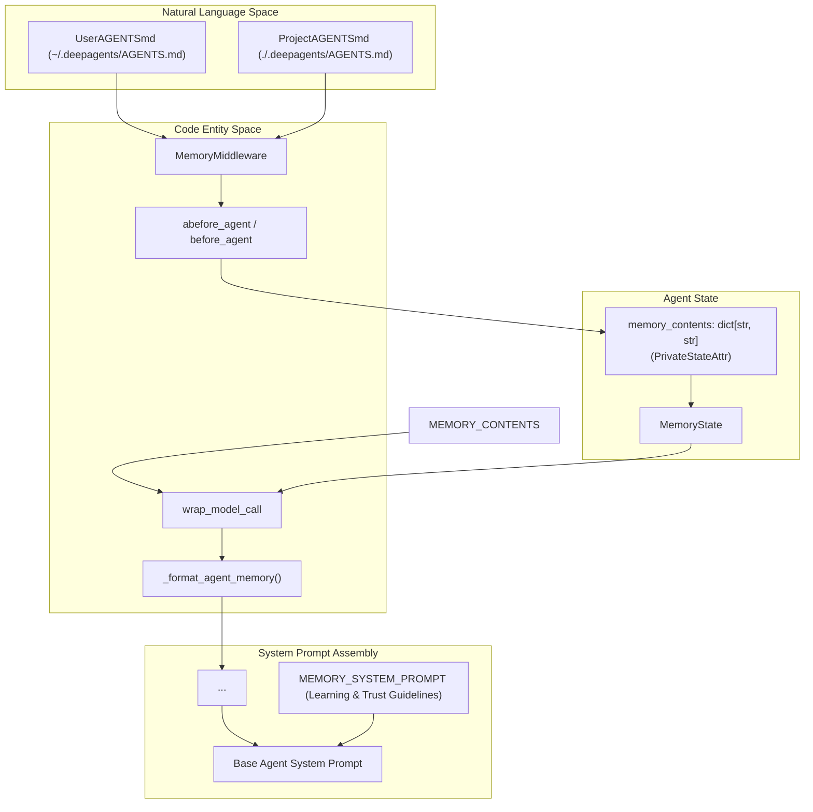
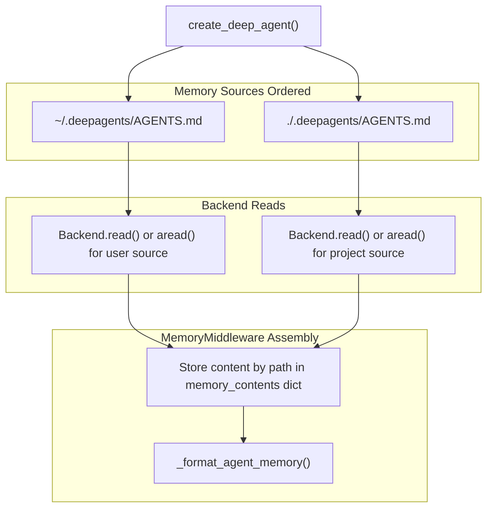

# Memory System

<details>
<summary>Relevant source files</summary>

The following files were used as context for generating this wiki page:

- [libs/deepagents/deepagents/middleware/memory.py](libs/deepagents/deepagents/middleware/memory.py)
- [libs/deepagents/tests/integration_tests/test_deepagents.py](libs/deepagents/tests/integration_tests/test_deepagents.py)
- [libs/deepagents/tests/integration_tests/test_hitl.py](libs/deepagents/tests/integration_tests/test_hitl.py)
- [libs/deepagents/tests/unit_tests/middleware/test_memory_middleware.py](libs/deepagents/tests/unit_tests/middleware/test_memory_middleware.py)
- [libs/deepagents/tests/unit_tests/middleware/test_memory_middleware_async.py](libs/deepagents/tests/unit_tests/middleware/test_memory_middleware_async.py)

</details>


The Memory System in Deep Agents provides a persistent contextual foundation for AI agents via `AGENTS.md` files. These markdown-based memory files serve as continual knowledge sources loaded into the agent's runtime state, enabling agents to retain instructions, preferences, and domain knowledge across sessions and interactions. Unlike skills which are invoked on demand, memory is automatically injected into the system prompt on every model invocation, shaping consistent and informed agent behavior.

`MemoryMiddleware` is the core component that implements this functionality, orchestrating the loading, combination, and injection of memory sources from external storage backends. This allows flexible support for memory stored locally on disk, in state storage, or other backends supporting the `BackendProtocol` interface [libs/deepagents/deepagents/middleware/memory.py:2-11]().

---

## Purpose and Scope

The Memory System's main goal is to provide persistent instruction and context for AI agents using standard Markdown documents named `AGENTS.md` that can live in multiple hierarchical locations within a user or project environment. These contexts persistently influence the system prompt on all calls to the language model, ensuring agents operate with domain knowledge and project conventions [libs/deepagents/deepagents/middleware/memory.py:10-11](). This system complements but is distinct from:

- **Skills:** On-demand workflows or tool integrations invoked explicitly by the agent.
- **Local Context:** Dynamically detected project or file context injected per invocation.

Key aspects include:
- Supports multiple memory sources, concatenated in a well-defined precedence order.
- Memory content is included in the system prompt under tagged XML-like blocks.
- Memory files are read via a pluggable filesystem or state backend implementing `BackendProtocol`.
- Memory contents are tracked in agent internal state, marked private to avoid inadvertent propagation.
- The memory file format is flexible markdown with stripped HTML comments to clean metadata [libs/deepagents/deepagents/middleware/memory.py:26-52]().

Typical use example:

```python
from deepagents import MemoryMiddleware, create_deep_agent
from deepagents.backends.filesystem import FilesystemBackend

backend = FilesystemBackend(root_dir="/")

middleware = MemoryMiddleware(
    backend=backend,
    sources=[
        "~/.deepagents/AGENTS.md",
        "./.deepagents/AGENTS.md",
    ],
)

agent = create_deep_agent(middleware=[middleware])
```

Sources: [libs/deepagents/deepagents/middleware/memory.py:1-53]()

---

## Architecture Overview

The Memory System is implemented as a middleware layer (`MemoryMiddleware`) that hooks into the agent execution lifecycle defined by LangGraph. It performs two main roles:

1. **Loading** the raw markdown content from configured memory source files through `BackendProtocol` reads.
2. **Injecting** the combined memory content into the system prompt on every model call, wrapped inside `<agent_memory>` XML-style tags plus instructional guidelines.

### Core Components and Data Flow



- **`MemoryMiddleware`** reads configured source paths from the backend asynchronously or synchronously during `before_agent` lifecycle hooks, assembling content keyed by source path into the private state attribute `memory_contents` [libs/deepagents/deepagents/middleware/memory.py:88-96]().

- The method `_format_agent_memory` composes the entire combined memory block, preserving source ordering and stripping HTML comments [libs/deepagents/tests/unit_tests/middleware/test_memory_middleware.py:133-180]().

- The `wrap_model_call` hook appends the formatted memory block plus a detailed instructional prompt (`MEMORY_SYSTEM_PROMPT`) guiding the agent on trust, learning, and updating memory, thereby integrating memory seamlessly into the model’s system prompt [libs/deepagents/deepagents/middleware/memory.py:105-149]().

Sources: [libs/deepagents/deepagents/middleware/memory.py:1-156](), [libs/deepagents/tests/unit_tests/middleware/test_memory_middleware.py:107-196]()

---

## Memory Source Precedence

Memory content is loaded from multiple hierarchical sources supplied as a list of paths to the `MemoryMiddleware`. These paths are read and concatenated in order, with content from later sources appended after earlier ones. This defines a clear precedence where more local or project-specific memories can override or supplement global ones [libs/deepagents/deepagents/middleware/memory.py:24-30]().

### Typical Memory Sources and Scope

| Priority (Order in `sources`) | Location                     | Example Path               | Scope                      |
|-------------------------------|------------------------------|---------------------------|----------------------------|
| 1 (lowest precedence)          | User Home                    | `~/.deepagents/AGENTS.md` | Global user preferences    |
| 2 (higher precedence)          | Project Root or Workspace    | `./.deepagents/AGENTS.md` | Project-specific context   |

### Loading and Concatenation Flow



- The memory backends (`FilesystemBackend` or others) read each configured file path.
- Missing files are safely skipped without error, preserving the loading of other sources [libs/deepagents/tests/unit_tests/middleware/test_memory_middleware_async.py:100-123]().
- The original order of sources is used during formatting to maintain human-expected precedence in the combined prompt [libs/deepagents/tests/unit_tests/middleware/test_memory_middleware.py:178-196]().
- Content is preserved verbatim except HTML comments (`<!-- ... -->`) which are removed before injection [libs/deepagents/deepagents/middleware/memory.py:50-52]().

Sources: [libs/deepagents/deepagents/middleware/memory.py:35-52](), [libs/deepagents/tests/unit_tests/middleware/test_memory_middleware.py:178-196](), [libs/deepagents/tests/unit_tests/middleware/test_memory_middleware_async.py:100-123]()

---

## Learning and Memory Updates

The memory system explicitly instructs the AI agent on appropriate handling of persistent memory via `MEMORY_SYSTEM_PROMPT`. This prompt is appended to every system prompt and provides detailed guidelines on how to interpret, trust, and update memory content stored in `AGENTS.md` files.

### Guidelines Highlights

- **Trust and Verification:**
  - Memory content is reference data read from disk and may be outdated or inaccurate.
  - Memory should not override explicit user instructions, safety policies, or verified tool outputs.
  - When memory conflicts with user input or verified facts, the agent should prefer user and evidence [libs/deepagents/deepagents/middleware/memory.py:113-117]().
  
- **Learning from Feedback:**
  - Agents should learn implicit and explicit corrections from interaction to update memory promptly.
  - Using the `edit_file` tool to immediately persist useful learnings is encouraged.
  - Capturing patterns behind corrections improves permanent agent knowledge [libs/deepagents/deepagents/middleware/memory.py:118-124]().

- **When to Update Memories:**
  - On explicit user instructions to remember information.
  - When user feedback describes role or desired behavior changes.
  - When new preferences or workflow patterns are observed.
  - When missing context for tool use is discovered.
  
- **When NOT to Update:**
  - Temporary or transient details (e.g., "I'm running late").
  - Simple questions or one-off requests.
  - Never store credentials or API keys in memory [libs/deepagents/deepagents/middleware/memory.py:132-146]().

This extensive prompt governs the agent's interaction with its persistent knowledge, guiding judicious updates to the `AGENTS.md` files as the conversation progresses [libs/deepagents/deepagents/middleware/memory.py:104-149]().

Sources: [libs/deepagents/deepagents/middleware/memory.py:104-149]()

---

## State Schema and Isolation

Memory loaded by `MemoryMiddleware` is tracked inside the agent's LangGraph runtime state using a defined schema:

```python
class MemoryState(AgentState):
    """State schema for MemoryMiddleware."""

    memory_contents: NotRequired[Annotated[dict[str, str], PrivateStateAttr]]
```

- The key `memory_contents` holds a dictionary mapping source file paths (strings) to their full markdown content (strings) [libs/deepagents/deepagents/middleware/memory.py:88-96]().

- The attribute is annotated with `PrivateStateAttr`. This means:
  - It is persisted in the agent's checkpointed state.
  - However, it is **excluded** from the "public" or output state visible to subagents or external callers by default.
  - This private attribute isolation allows delegated subagents to load their own, contextually relevant memory files rather than inheriting the parent's entire memory content [libs/deepagents/deepagents/middleware/memory.py:95-96]().

This design ensures memory is modular, scoped, and safely managed across hierarchical/recursive agent calls.

Sources: [libs/deepagents/deepagents/middleware/memory.py:88-96]()

---

## Implementation Details

### Memory Loading Workflow

- On the `before_agent` or `abefore_agent` hook, `MemoryMiddleware` checks if memory content is already loaded in the state.
- If not, it iterates over the configured `sources` list, calling `backend.read(path)` or `backend.aread(path)` to fetch the raw markdown content asynchronously or synchronously.
- Read contents are collected into a dictionary mapping each source path to its file content.
- Missing or unreadable files are silently skipped, allowing flexible partial overrides.
- The loaded memory dictionary is stored in the private `memory_contents` key within the agent state [libs/deepagents/deepagents/middleware/memory.py:24-79](), [libs/deepagents/tests/unit_tests/middleware/test_memory_middleware.py:29-33](), [libs/deepagents/tests/unit_tests/middleware/test_memory_middleware_async.py:32-47]().

### System Prompt Injection

- The core function `_format_agent_memory(memory_contents)` generates an injected prompt block.
- It iterates over memory sources in the configured order, pairing each file path with its content.
- HTML comments (`<!-- ... -->`) are stripped to avoid leaking author notes into the prompt.
- If no memory is loaded or no sources are configured, a placeholder `"No memory loaded"` is shown inside the `<agent_memory>` block.
- The generated memory block is appended inside the system prompt, followed by the detailed `MEMORY_SYSTEM_PROMPT` instructions [libs/deepagents/middleware/memory.py:105-149](), [libs/deepagents/tests/unit_tests/middleware/test_memory_middleware.py:107-196]().

Sources: [libs/deepagents/deepagents/middleware/memory.py:16-33](), [libs/deepagents/tests/unit_tests/middleware/test_memory_middleware.py:29-33](), [libs/deepagents/tests/unit_tests/middleware/test_memory_middleware_async.py:32-47]()

---

## Usage Example

```python
from deepagents import MemoryMiddleware, create_deep_agent
from deepagents.backends.filesystem import FilesystemBackend

# Initialize backend, e.g. filesystem root directory
backend = FilesystemBackend(root_dir="/project/root")

# Configure MemoryMiddleware with source precedence
middleware = MemoryMiddleware(
    backend=backend,
    sources=[
        "~/.deepagents/AGENTS.md",  # Global user instructions
        "./.deepagents/AGENTS.md",  # Project-specific memory
    ],
)

# Create agent with MemoryMiddleware included
agent = create_deep_agent(middleware=[middleware])
```

This setup ensures the agent always injects both global and project-specific persistent context stored in the configured `AGENTS.md` files [libs/deepagents/deepagents/middleware/memory.py:13-33]().

---

# Summary

The Memory System implemented via `MemoryMiddleware` integrates continuously loaded, persistent agent knowledge from hierarchical `AGENTS.md` markdown files into the Deep Agents framework. It manages ordered loading from multiple customizable sources through abstracted backends, carefully injects combined memory content into the system prompt with rich usage instructions, and isolates this state for scoped use within agents and subagents. The design encourages iterative learning and explicit user instruction capture while enforcing security and freshness guards in the agent's ongoing interaction cycle.

Sources:  
- `libs/deepagents/deepagents/middleware/memory.py:1-156`  
- `libs/deepagents/tests/unit_tests/middleware/test_memory_middleware.py:29-196`  
- `libs/deepagents/tests/unit_tests/middleware/test_memory_middleware_async.py:32-123`