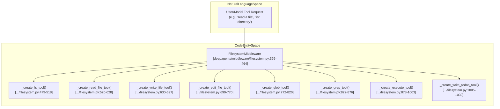
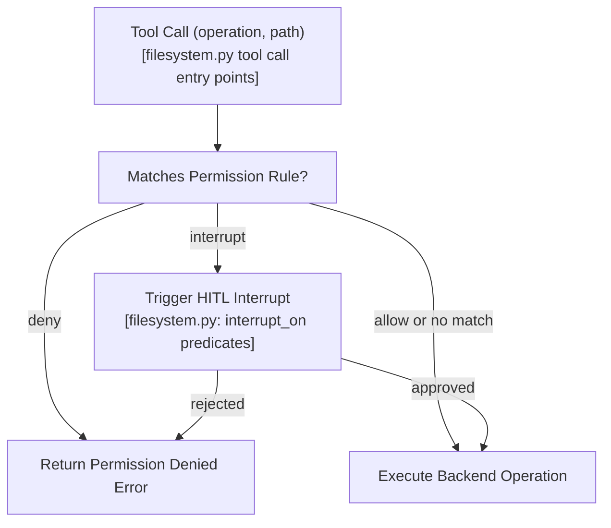
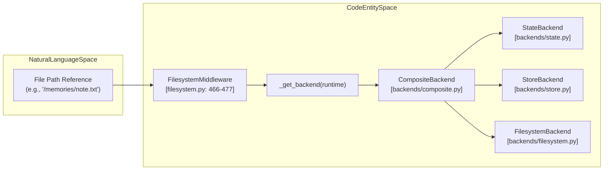
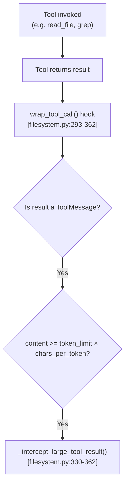
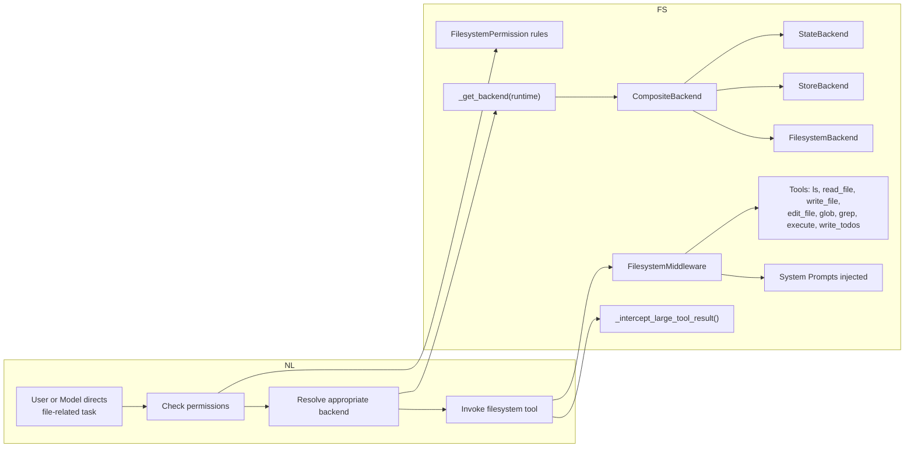

# Filesystem Operations and Built-in Tools

Relevant source files

The following files were used as context for generating this wiki page:

- [libs/deepagents/deepagents/backends/filesystem.py](libs/deepagents/deepagents/backends/filesystem.py)
- [libs/deepagents/deepagents/backends/protocol.py](libs/deepagents/deepagents/backends/protocol.py)
- [libs/deepagents/deepagents/backends/sandbox.py](libs/deepagents/deepagents/backends/sandbox.py)
- [libs/deepagents/deepagents/backends/utils.py](libs/deepagents/deepagents/backends/utils.py)
- [libs/deepagents/deepagents/middleware/_fs_interrupt.py](libs/deepagents/deepagents/middleware/_fs_interrupt.py)
- [libs/deepagents/deepagents/middleware/filesystem.py](libs/deepagents/deepagents/middleware/filesystem.py)
- [libs/deepagents/deepagents/middleware/permissions.py](libs/deepagents/deepagents/middleware/permissions.py)
- [libs/deepagents/tests/unit_tests/backends/test_filesystem_backend.py](libs/deepagents/tests/unit_tests/backends/test_filesystem_backend.py)
- [libs/deepagents/tests/unit_tests/backends/test_protocol.py](libs/deepagents/tests/unit_tests/backends/test_protocol.py)
- [libs/deepagents/tests/unit_tests/backends/test_sandbox_backend.py](libs/deepagents/tests/unit_tests/backends/test_sandbox_backend.py)
- [libs/deepagents/tests/unit_tests/backends/test_utils.py](libs/deepagents/tests/unit_tests/backends/test_utils.py)
- [libs/deepagents/tests/unit_tests/test_end_to_end.py](libs/deepagents/tests/unit_tests/test_end_to_end.py)
- [libs/deepagents/tests/unit_tests/test_local_sandbox_operations.py](libs/deepagents/tests/unit_tests/test_local_sandbox_operations.py)
- [libs/deepagents/tests/unit_tests/test_middleware.py](libs/deepagents/tests/unit_tests/test_middleware.py)
- [libs/deepagents/tests/unit_tests/test_middleware_async.py](libs/deepagents/tests/unit_tests/test_middleware_async.py)
- [libs/deepagents/tests/unit_tests/test_permissions.py](libs/deepagents/tests/unit_tests/test_permissions.py)

This page documents the `FilesystemMiddleware` class and its suite of built-in tools within the Deep Agents framework. These tools empower agents to perform rich filesystem interactions including file listings, content reads and writes, pattern-based file searches, text searches, file edits, shell command execution in sandboxed environments, and task item writing.

The middleware integrates with various backends via the abstract `BackendProtocol`, supports permission-based access control, manages large tool results with eviction to storage, and injects guiding system prompts to improve agent tool usage.

For backend storage details see [Backend Architecture (2.7)](2.7). For security and approval flows see [HITL Approval (4.1)](4.1). For overall agent and middleware setup see [Agent Creation (2.1)](2.1).

---

## `FilesystemMiddleware` Overview

`FilesystemMiddleware` is the central component enabling filesystem manipulation tools for an agent. It registers a fixed set of essential tools for filesystem operations and command execution and manages tool invocation, result handling, and permission enforcement.

### Initialization Parameters

| Parameter                     | Type                                | Default                   | Description                                                    |
|-------------------------------|-----------------------------------|---------------------------|----------------------------------------------------------------|
| `backend`                     | `BACKEND_TYPES | None`              | `StateBackend`            | Storage backend for filesystem data and optional command execution. |
| `system_prompt`               | `str | None`                      | `None`                    | Custom overriding system prompt for filesystem operations.    |
| `custom_tool_descriptions`   | `dict[str, str] | None`             | `{}`                      | Custom descriptions per tool name.                             |
| `tool_token_limit_before_evict` | `int | None`                   | `20000`                   | Token count threshold to trigger offloading large results.    |
| `max_execute_timeout`         | `int`                             | `3600`                    | Maximum timeout in seconds for `execute` shell command tool.  |
| `_permissions`                | `list[FilesystemPermission]`     | `[]`                      | Rule-based access control for filesystem operations.          |

### Core Responsibilities

- Provide built-in tools for common filesystem operations: `ls`, `read_file`, `write_file`, `edit_file`, `glob`, `grep`, `execute`, `write_todos`.
- Enforce **permission rules** controlling access to file paths grouped by operation (`read`, `write`).
- Inject **system prompts** with usage conventions, path normalization rules, and tool behavioral guidelines.
- Intercept and **evict large tool results** to the filesystem to manage conversation token limits.
- Determine and route to appropriate backend implementations dynamically using runtime context.
- Conditionally expose execution capabilities only if backend supports shell command runs.

### Code Entity Bridge: Tools in `FilesystemMiddleware`

Sources: [libs/deepagents/deepagents/middleware/filesystem.py:365-464](), [libs/deepagents/deepagents/middleware/filesystem.py:479-1030]()

---

## Filesystem Permissions and Access Control

`FilesystemMiddleware` supports fine-grained access permissions via `FilesystemPermission` dataclasses. These permission rules govern whether an operation on a given file path is allowed, denied, or requires a Human-in-the-Loop (HITL) interrupt approval.

### Permission Rule Fields

- **operations:** List of operations the rule applies to; `"read"` or `"write"`.
- **paths:** List of absolute glob path patterns (must start with `/`) defining scoped file targets.
- **mode:** One of `"allow"`, `"deny"`, or `"interrupt"` (request approval).

### Enforcement Logic Flow

If no matching allow rule is found, the operation is denied by default.

Sources: [libs/deepagents/deepagents/middleware/filesystem.py:1200-1250](), [libs/deepagents/deepagents/middleware/filesystem.py:123-134]()

---

## Backend Integration and Routing

`FilesystemMiddleware` determines the backend to use for file operations dynamically. It utilizes the `BackendProtocol` interface shared among several backend implementations:

- `StateBackend`: In-memory and graph-backed storage.
- `StoreBackend`: Backend backed by generalized key-value stores.
- `FilesystemBackend`: Direct OS filesystem reads/writes.
- `CompositeBackend`: Routes operations to appropriate routed backend by path prefix.

### Dynamic Backend Resolution Bridge

Sources: [libs/deepagents/deepagents/middleware/filesystem.py:466-477](), [libs/deepagents/deepagents/backends/composite.py]()

---

## Tools for File Operations

### 1. `ls` — List Directory Contents

Lists filenames within a specified directory. Returns a list of paths including trailing `/` on directory entries.

- **Parameters:**
  - `path` (str, required): Absolute directory path to list (must start with `/`).
- **Behavior:** Only lists immediate directory contents; does not recursively descend.
- **Returns:** List of file and folder names.

Sources: [libs/deepagents/deepagents/middleware/filesystem.py:479-518]()

---

### 2. `read_file` — Read File Contents (with Pagination & Multimodal Support)

Reads file content optionally paginated by lines. Returns text with line numbers for context.

- **Parameters:**
  - `file_path` (str, required): Absolute file path.
  - `offset` (int, optional): Line offset (0-indexed). Defaults to 0.
  - `limit` (int, optional): Maximum lines to return. Defaults to 100.
- **Multimodal Support:**
  - Determines file type by extension (image, audio, video, etc.).
  - For images, returns base64 encoded media blocks wrapped in special `ToolMessage` containing `ContentBlock` for multimodal LLM models.
  - For videos, extracts sampled still frames (if dependencies available) and returns them as video metadata and media blocks.
- **File Type Detection:** Uses `_get_file_type()` helper that maps extensions to types.

Sources: [libs/deepagents/deepagents/middleware/filesystem.py:520-628](), [libs/deepagents/deepagents/backends/utils.py:71]()

---

### 3. `write_file` — Write Text Content to a File

Creates or replaces a specified file with given text content.

- **Parameters:**
  - `file_path` (str, required): Absolute path for new or existing file.
  - `content` (str, required): UTF-8 text content to write.

Sources: [libs/deepagents/deepagents/middleware/filesystem.py:630-697]()

---

### 4. `edit_file` — Edit File by String Replacement

Performs string replacement operations in the specified file.

- **Parameters:**
  - `file_path` (str, required): Absolute file path.
  - `old_string` (str, required): Exact string to find.
  - `new_string` (str, required): Replacement string.
  - `replace_all` (bool, optional): When true, replaces all occurrences, else only first.

Supports partial replacements with backend support for efficient text editing operations.

Sources: [libs/deepagents/deepagents/middleware/filesystem.py:699-770]()

---

## Search and Discovery Tools

### 5. `glob` — File Pattern Matching Search

Finds files matching a glob pattern at or under a given path.

- Accepts brace expansion and recursive `**` wildcards.
- Uses a thread pool with a timeout to prevent long-running operations.
- Returns matching paths with a flag indicating if truncation occurred due to timeout or walk size.

Sources: [libs/deepagents/deepagents/middleware/filesystem.py:772-820](), [libs/deepagents/deepagents/middleware/filesystem.py:120]()

---

### 6. `grep` — Text Pattern Search

Performs search for regex or plain text matches across files with context lines.

- Supports output modes:
  - `files_with_matches`: Return only matching file paths.
  - `content`: Return matched lines with optional context lines.
  - `count`: Return total number of matches.

Integrates with `ripgrep` if available; otherwise, falls back to Python search.

Sources: [libs/deepagents/deepagents/middleware/filesystem.py:822-876]()

---

## Shell and Task Tools

### 7. `execute` — Run Shell Commands in Sandbox

Runs arbitrary shell commands within isolated environments provided by backends implementing `SandboxBackendProtocol`.

- **Parameters:**
  - `command` (str, required): Shell command to execute.
  - `timeout` (int, optional): Maximum runtime seconds (default capped by middleware).
- **Availability:** Tool is only registered if backend supports execution interface.

Sources: [libs/deepagents/deepagents/middleware/filesystem.py:878-1003]()

---

### 8. `write_todos` — Manage TODO Task List File

Writes a list of TODO task items (strings) to a designated `TODO.md` file in storage backend.

- Useful for agents needing to track multi-turn objectives.
- Accepts a list of strings representing to-do entries.

Sources: [libs/deepagents/deepagents/middleware/filesystem.py:1005-1030]()

---

## Large Tool Result Management (Eviction)

To handle conversation token limits, large outputs returned by filesystem tools are intercepted and offloaded to the filesystem backend automatically.

### Eviction Flow Diagram

- If tool result length surpasses the configured limit multiplied by `NUM_CHARS_PER_TOKEN`, the textual result is truncated.
- The full content is saved to a file path in the backend.
- The agent is redirected to read the partial content from disk in increments using `read_file` with `offset` and `limit`.
- Preview snippets show head and tail with truncated lines indicated.

Sources: [libs/deepagents/deepagents/middleware/filesystem.py:293-362](), [libs/deepagents/deepagents/backends/utils.py:70-99]()

---

## System Prompts and Behavioral Guidance

`FilesystemMiddleware` injects system prompts into the agent via `before_agent()` that define conventions, path normalization, and behavioral expectations for the filesystem tools.

### Key System Prompts

- **FILESYSTEM_SYSTEM_PROMPT:**

  Details filesystem navigation conventions, path normalizations (requiring absolute paths starting with `/`), and usage examples for tools like `ls`, `read_file`, `write_file`, `edit_file`, `glob`, and `grep`.

- **EXECUTION_SYSTEM_PROMPT:**

  Provides context for executing shell commands safely. It emphasizes non-interactive command usage, signal handling, and environment expectations inside the sandbox backend.

These prompts guide the language model to produce valid file paths and correct tool parameters, improving robustness.

Sources: [libs/deepagents/deepagents/middleware/filesystem.py:1130-1146](), [libs/deepagents/deepagents/middleware/filesystem.py:244-270]()

---

# Summary Diagram: Natural Language Intent to Filesystem Code

Sources: Synthesized from [libs/deepagents/deepagents/middleware/filesystem.py](), [libs/deepagents/deepagents/backends/composite.py](), [libs/deepagents/deepagents/backends/filesystem.py](), [libs/deepagents/deepagents/middleware/permissions.py]()

---

This concludes the detailed explanation of the filesystem operations and built-in tools middleware provided in Deep Agents. These components enable robust file interactions with powerful permission controls and management hooks, supporting varied backend implementations and large-result handling for AI agents performing code and data manipulation tasks.