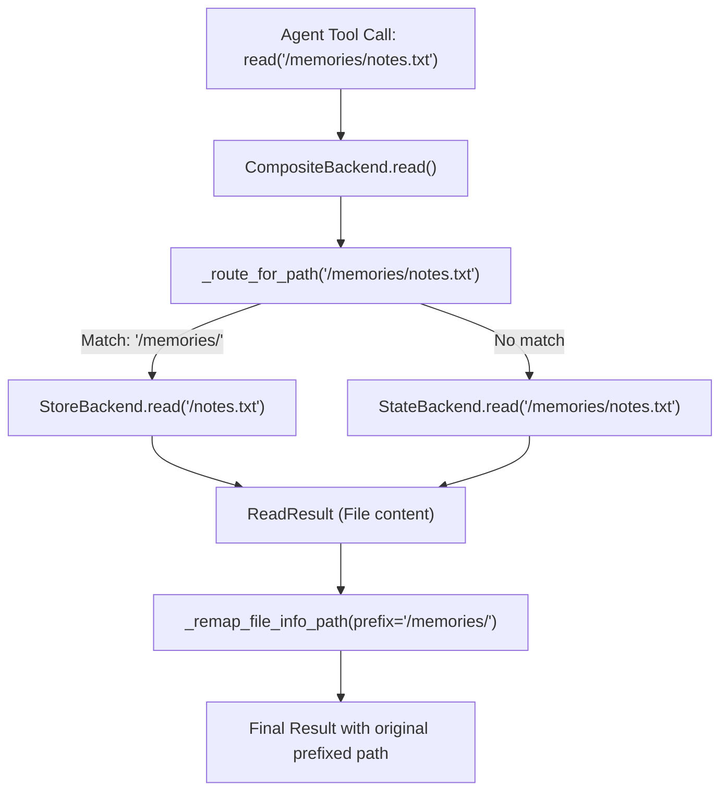
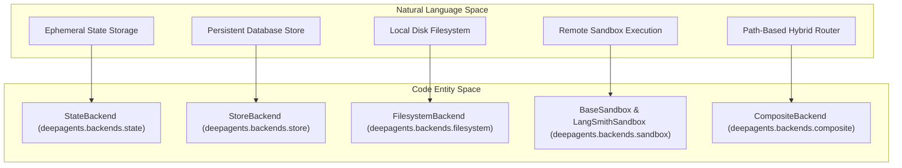
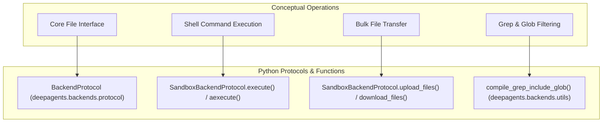

# Backend Architecture

<details>
<summary>Relevant source files</summary>

The following files were used as context for generating this wiki page:

- [libs/deepagents/deepagents/backends/__init__.py](libs/deepagents/deepagents/backends/__init__.py)
- [libs/deepagents/deepagents/backends/composite.py](libs/deepagents/deepagents/backends/composite.py)
- [libs/deepagents/deepagents/backends/context_hub.py](libs/deepagents/deepagents/backends/context_hub.py)
- [libs/deepagents/deepagents/backends/local_shell.py](libs/deepagents/deepagents/backends/local_shell.py)
- [libs/deepagents/deepagents/backends/state.py](libs/deepagents/deepagents/backends/state.py)
- [libs/deepagents/deepagents/backends/store.py](libs/deepagents/deepagents/backends/store.py)
- [libs/deepagents/tests/integration_tests/test_context_hub_backend.py](libs/deepagents/tests/integration_tests/test_context_hub_backend.py)
- [libs/deepagents/tests/unit_tests/backends/__init__.py](libs/deepagents/tests/unit_tests/backends/__init__.py)
- [libs/deepagents/tests/unit_tests/backends/test_composite_backend.py](libs/deepagents/tests/unit_tests/backends/test_composite_backend.py)
- [libs/deepagents/tests/unit_tests/backends/test_composite_backend_async.py](libs/deepagents/tests/unit_tests/backends/test_composite_backend_async.py)
- [libs/deepagents/tests/unit_tests/backends/test_context_hub_backend.py](libs/deepagents/tests/unit_tests/backends/test_context_hub_backend.py)
- [libs/deepagents/tests/unit_tests/backends/test_file_format.py](libs/deepagents/tests/unit_tests/backends/test_file_format.py)
- [libs/deepagents/tests/unit_tests/backends/test_filesystem_backend_async.py](libs/deepagents/tests/unit_tests/backends/test_filesystem_backend_async.py)
- [libs/deepagents/tests/unit_tests/backends/test_local_shell_backend.py](libs/deepagents/tests/unit_tests/backends/test_local_shell_backend.py)
- [libs/deepagents/tests/unit_tests/backends/test_state_backend.py](libs/deepagents/tests/unit_tests/backends/test_state_backend.py)
- [libs/deepagents/tests/unit_tests/backends/test_state_backend_async.py](libs/deepagents/tests/unit_tests/backends/test_state_backend_async.py)
- [libs/deepagents/tests/unit_tests/backends/test_store_backend.py](libs/deepagents/tests/unit_tests/backends/test_store_backend.py)
- [libs/deepagents/tests/unit_tests/backends/test_store_backend_async.py](libs/deepagents/tests/unit_tests/backends/test_store_backend_async.py)

</details>


This document explains the backend architecture in `deepagents`, which provides pluggable storage and execution environments for file operations. Backends control where files are stored and how commands are executed, enabling support for ephemeral state, persistent storage, local disk access, and remote sandbox execution.

For information about how backends are used by tools, see [Filesystem Operations and Built-in Tools](2.6). For sandbox-specific configuration and lifecycle management, see [Sandbox Integration](4.3).

Sources: `[libs/deepagents/deepagents/backends/protocol.py:1-6]()`, `[libs/deepagents/deepagents/backends/protocol.py:236-250]()`

---

## Purpose and Protocol Design

The backend system implements a protocol-based architecture that decouples file storage and command execution from the agent's core logic. This enables flexible deployment patterns:

- **Ephemeral mode**: Files stored in agent state via `StateBackend`.
- **Persistent mode**: Files stored across conversations using `StoreBackend`.
- **Local mode**: Direct filesystem operations on disk via `FilesystemBackend`.
- **Remote mode**: Sandboxed execution in isolated environments via `BaseSandbox` and `LangSmithSandbox`.
- **Hybrid mode**: Different paths routed to different backends via `CompositeBackend`.

All backends implement `BackendProtocol`, with execution-capable backends additionally implementing `SandboxBackendProtocol`.

Sources: `[libs/deepagents/deepagents/backends/protocol.py:1-6]()`, `[libs/deepagents/deepagents/backends/protocol.py:236-375]()`

---

## Protocol Hierarchy

The backend system is built on two core protocols defined in `libs/deepagents/deepagents/backends/protocol.py`. All backends implement `BackendProtocol`, which provides the basic file operation interface. Backends that support command execution additionally implement `SandboxBackendProtocol`.

### Interface Definitions

The following diagram illustrates the relationship between the abstract protocols and the concrete implementation classes.

**Backend Class Hierarchy**

```mermaid
classDiagram
    class "BackendProtocol" {
        <<interface>>
        +id: str
        +ls(path: str) LsResult
        +read(path: str, offset: int, limit: int) ReadResult
        +write(path: str, content: str) WriteResult
        +edit(path: str, old: str, new: str, replace_all: bool) EditResult
        +glob(pattern: str, path: str) GlobResult
        +grep(pattern: str, path: str, glob: str) GrepResult
    }
    
    class "SandboxBackendProtocol" {
        <<interface>>
        +execute(command: str, timeout: int) ExecuteResponse
        +aexecute(command: str, timeout: int) ExecuteResponse
        +upload_files(files: list) list
        +download_files(paths: list) list
    }
    
    "BackendProtocol" <|-- "SandboxBackendProtocol"
    "BackendProtocol" <|.. "StateBackend"
    "BackendProtocol" <|.. "StoreBackend"
    "BackendProtocol" <|.. "CompositeBackend"
    "BackendProtocol" <|.. "ContextHubBackend"
    "SandboxBackendProtocol" <|.. "FilesystemBackend"
    "SandboxBackendProtocol" <|.. "BaseSandbox"
    "BaseSandbox" <|-- "LangSmithSandbox"
```

| Protocol                   | Key Methods                                | Purpose                                                                          |
|----------------------------|--------------------------------------------|----------------------------------------------------------------------------------|
| `BackendProtocol`           | `ls()`, `read()`, `write()`, `edit()`, `glob()`, `grep()` | Base interface for file operations. Includes both sync and async variants (e.g., `aread`). |
| `SandboxBackendProtocol`    | `execute()`, `aexecute()`, `upload_files()`, `download_files()` | Extends `BackendProtocol` to add shell command execution and bulk file transfer capabilities. |

Sources: `[libs/deepagents/deepagents/backends/protocol.py:236-375]()`

---

## Backend Implementations

### StateBackend

`StateBackend` stores files in the agent's ephemeral state, existing only within a single conversation thread. It interacts with the `files` channel in the LangGraph state.

- **Storage Location**: LangGraph state channel named `files`.
- **Persistence**: Thread-scoped only; state is checkpointed after each agent step.
- **Execution Support**: None.
- **Read-Your-Writes Semantics**: Uses `fresh=True` when reading state via `_read_files()` to ensure visibility of updates within a single superstep (e.g., a tool writing then reading a file in one eval) (`_read_files` and `_send_files_update` methods).
- **Key Functions**:
  - `_get_config()`: obtains current LangGraph config ensuring presence of `CONFIG_KEY_READ` and `CONFIG_KEY_SEND`.
  - `_read_files()`: reads the current files from the state channel.
  - `_send_files_update()`: queues file updates to the state channel.
  - `ls()`, `read()`, `write()`, `edit()`, etc.: implement file operations by manipulating in-memory state snapshots.

Sources: `[libs/deepagents/deepagents/backends/state.py:38-146]()`

---

### StoreBackend

`StoreBackend` provides persistent storage using LangGraph's `BaseStore` interface. Files persist across conversation threads, enabling long-term memory.

- **Storage Location**: LangGraph Store with a configurable namespace returned by a caller-supplied factory. Namespaces prevent conflicts and isolate data (e.g., per user or project).
- **Persistence**: Durable and cross-thread.
- **Execution Support**: None.
- **Isolation**: Uses namespace tuples (validated with character restrictions) to isolate data and prevent wildcard injections.
- **Key Functions**:
  - `_get_store()`: returns the BaseStore instance, obtained dynamically if needed.
  - `_get_namespace()`: resolves namespace from current `Runtime`.
  - `read()`, `write()`, `edit()`, `ls()`, `grep()`, `glob()`, etc.: all interact with the store using the resolved namespace.
  - Content migration logic supports legacy list-based storage formats to current string content.

Sources: `[libs/deepagents/deepagents/backends/store.py:89-167]()`

---

### FilesystemBackend

`FilesystemBackend` executes direct filesystem operations on local disk under a specified `root_dir`. It supports sandbox backend operations with local shell command execution.

- **Storage Location**: Local filesystem rooted at `root_dir`.
- **Persistence**: Permanent on disk.
- **Execution Support**: Implements `SandboxBackendProtocol` with actual shell commands via subprocess.
- **Security Measures**: `virtual_mode` blocks path traversal potentially escaping `root_dir`; this applies for filesystem access but **does not restrict shell commands**.
- **Performance**: Uses `ripgrep` (`rg`) if available on PATH for fast file search (`grep`); falls back to Python implementations.
- **Key Features**:
  - Path normalization and traversal blocking.
  - Async and sync variants for file operations.
  - Execution with a configurable timeout and environment.
  - File listing, reading with pagination, writing, editing, globbing, and grep-like search.

Sources: `[libs/deepagents/deepagents/backends/filesystem.py:91-180]()` (inferred from tests and local_shell override)

---

### LocalShellBackend

`LocalShellBackend` extends `FilesystemBackend` with **unrestricted local shell execution** on the host machine.

- **Execution**: Commands run directly on the host system without sandboxing or isolation.
- **Security Warning**: Grants agents full filesystem and shell access with serious security risks.
- **Use Cases**:
  - Local development scenarios where full trust is established.
- **Safeguards**:
  - Use only with Human-in-the-Loop (HITL) middleware.
  - Deploy only in trusted dev environments.
- **Configuration**:
  - `root_dir`, `virtual_mode`, execution timeout, environment variables, and inheritance of host env.
- Uses `subprocess` to run shell commands synchronously or asynchronously.

Sources: `[libs/deepagents/deepagents/backends/local_shell.py:1-165]()`

---

### BaseSandbox and LangSmithSandbox

`BaseSandbox` is a base class for remote sandboxed execution backends implementing `SandboxBackendProtocol`.

- **Design**:
  - File ops can be implemented by running Python/shell commands inside the sandbox itself, minimizing transfer of large file contents.
  - Supports inline editing for small payloads; large edits use temporary uploaded files.
  - Supports paginated reads by executing server-side scripts with line offsets/limits.
  - Bounded `glob` implementations limit walk time and max match counts to avoid long-running glob operations.
- `LangSmithSandbox` extends `BaseSandbox` to integrate with the LangSmith remote execution system.

Sources: `[libs/deepagents/deepagents/backends/sandbox.py:1-44]`, `[libs/deepagents/tests/unit_tests/backends/test_sandbox_backend.py:46-141]()`

---

### ContextHubBackend

`ContextHubBackend` is a specialized persistent backend for LangSmith Hub repositories.

- Stores files and metadata in an agent hub repo (persistent cloud service).
- Supports fetch, caching, mutation queue with conflict retrying, and linked entries.
- Threading is used internally to batch mutations efficiently.
- Suitable for remote syncing and managed agent contexts.

Sources: `[libs/deepagents/deepagents/backends/context_hub.py:1-211]()`

---

## CompositeBackend and Routing

`CompositeBackend` enables hybrid backend architectures by routing file operations to different backend implementations based on **path prefixes**.

- The default backend handles paths not matched by any route.
- Routes are defined as a mapping from string path prefixes (e.g., `/memories/`) to backend instances.
- File paths matching a route prefix are passed to the routed backend with the prefix stripped.
- For glob/glob patterns, patterns are adjusted so routed backends receive relative patterns.
- File info and grep matches received are remapped to prepend their route prefix again for consistency.

### Routing Logic Diagram



### Routing Use Cases

- `/memories/` routed to `StoreBackend` for persistent memories.
- Root `/` routed to `StateBackend` for ephemeral state files.
- Can route different prefixes to local `FilesystemBackend` or remote sandboxes.

Sources: `[libs/deepagents/deepagents/backends/composite.py:1-106]()`, `[libs/deepagents/deepagents/backends/composite.py:145-176]()`

---

## Architecture to Code Space Mapping

To bridge conceptual backend features to concrete code constructs, the following diagrams associate architectural subsystems with their defining classes and modules.

### Storage Abstraction Mapping



Sources:  
`[libs/deepagents/deepagents/backends/state.py:38]`,  
`[libs/deepagents/deepagents/backends/store.py:89]`,  
`[libs/deepagents/deepagents/backends/filesystem.py:91]`,  
`[libs/deepagents/deepagents/backends/sandbox.py:34]`,  
`[libs/deepagents/deepagents/backends/composite.py]`

---

### Execution and Protocol Mapping



Sources: `[libs/deepagents/deepagents/backends/protocol.py:236-375]`, `[libs/deepagents/deepagents/backends/utils.py:98-167]`

---

## Utility Functions and Data Structures

### FileData and FileInfo

Backends communicate using typed dictionaries defining file contents and metadata:

```python
class FileData(TypedDict):
    content: str       # Plain text or base64 encoded binary
    encoding: str      # "utf-8" or "base64"
    created_at: NotRequired[str]    # ISO timestamp
    modified_at: NotRequired[str]   # ISO timestamp
```

### Content Formatting

The utility `format_content_with_line_numbers` produces a `cat -n` style view with line numbers for LLM consumption. It chunks long lines if exceeding the `MAX_LINE_LENGTH` (5000 characters), inserting continuation symbols (`↵`).

Sources: `[libs/deepagents/deepagents/backends/protocol.py:129-201]`, `[libs/deepagents/deepagents/backends/utils.py:74-76]`

---

## Large Tool Result Eviction

To prevent context window exhaustion, large tool results are automatically evicted from memory and offloaded to backend storage by the filesystem middleware:

1. **Detection**: Monitors token count against a limit (`TOOL_RESULT_TOKEN_LIMIT`=20,000 tokens).
2. **Offloading**: Large results are saved to the backend at a path based on tool call ID via `sanitize_tool_call_id`.
3. **Preview Replacement**: The original tool message content is replaced with a truncation guidance placeholder.

This enables streaming large tool outputs without surpassing LLM context limits.

Sources:  
`[libs/deepagents/deepagents/backends/utils.py:89-90]`,  
`[libs/deepagents/deepagents/middleware/filesystem.py:82-88]`

---

# Summary

The backend architecture in `deepagents` offers a modular, extensible, and protocol-driven storage and execution system for AI agents. It supports ephemeral state storage, persistent cross-thread stores, local disk access with optional shell execution, remote sandbox environments, and hybrid routing. This flexible design enables safe, scalable, and performant handling of files and commands across diverse deployments.

# End of Page

Sources:  
`[libs/deepagents/deepagents/backends/protocol.py:1-6]()`,  
`[libs/deepagents/deepagents/backends/protocol.py:236-375]()`,  
`[libs/deepagents/deepagents/backends/state.py:38-146]()`,  
`[libs/deepagents/deepagents/backends/store.py:89-167]()`,  
`[libs/deepagents/deepagents/backends/filesystem.py:91-180]()`,  
`[libs/deepagents/deepagents/backends/local_shell.py:1-165]()`,  
`[libs/deepagents/deepagents/backends/sandbox.py:1-44]()`,  
`[libs/deepagents/deepagents/backends/context_hub.py:1-211]()`,  
`[libs/deepagents/deepagents/backends/composite.py:1-106]()`,  
`[libs/deepagents/deepagents/backends/composite.py:145-176]()`,  
`[libs/deepagents/deepagents/backends/utils.py:74-90]()`,  
`[libs/deepagents/deepagents/middleware/filesystem.py:82-88]()`,  
`[libs/deepagents/tests/unit_tests/backends/test_composite_backend.py:1-177]()`,  
`[libs/deepagents/tests/unit_tests/backends/test_store_backend.py:1-179]()`,  
`[libs/deepagents/tests/unit_tests/backends/test_state_backend.py:1-168]()`,  
`[libs/deepagents/tests/unit_tests/backends/test_composite_backend_async.py:1-177]()`,  
`[libs/deepagents/tests/unit_tests/backends/test_filesystem_backend_async.py:1-175]()`,  
`[libs/deepagents/tests/unit_tests/backends/test_store_backend_async.py:1-177]()`,  
`[libs/deepagents/tests/unit_tests/backends/test_local_shell_backend.py:1-40]()`,  
`[libs/deepagents/tests/unit_tests/backends/test_context_hub_backend.py:1-60]()`,  
`[libs/deepagents/tests/unit_tests/backends/test_file_format.py:1-180]()`.