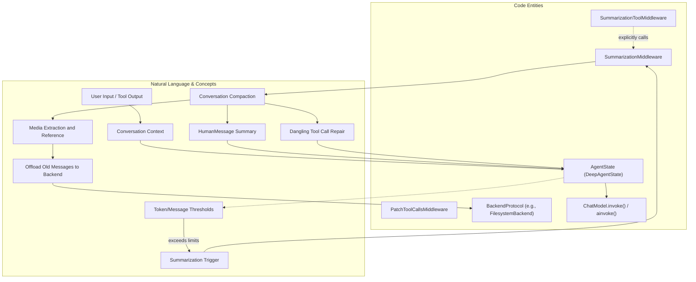
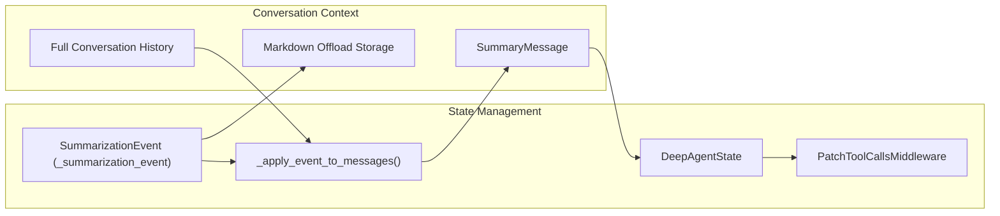

# Context Window Management

<details>
<summary>Relevant source files</summary>

The following files were used as context for generating this wiki page:

- [libs/deepagents/deepagents/middleware/summarization.py](libs/deepagents/deepagents/middleware/summarization.py)
- [libs/deepagents/tests/unit_tests/middleware/test_compact_tool.py](libs/deepagents/tests/unit_tests/middleware/test_compact_tool.py)
- [libs/deepagents/tests/unit_tests/middleware/test_summarization_factory.py](libs/deepagents/tests/unit_tests/middleware/test_summarization_factory.py)
- [libs/deepagents/tests/unit_tests/middleware/test_summarization_middleware.py](libs/deepagents/tests/unit_tests/middleware/test_summarization_middleware.py)

</details>


Context window management in Deep Agents prevents conversations from exceeding model token limits through automatic summarization, conversation compaction, argument truncation, and media reference handling. These mechanisms maintain conversation continuity while staying within model constraints by offloading historical data to backend storage and preserving conversation state validity.

---

## Overview

Deep Agents employs a multi-layered automatic context management system to maintain conversation coherence within model context size limits:

1. **Automatic Summarization**  
   The `SummarizationMiddleware` automatically detects when conversation history grows too large based on token or message count thresholds. It performs LLM-based summarization of older messages to reduce token usage while preserving recent context. The evicted conversation is offloaded to persistent backend storage for later retrieval.

2. **Manual Compaction via Tool**  
   `SummarizationToolMiddleware` exposes a `compact_conversation` tool that agents or human-in-the-loop approval flows can invoke on demand to trigger compaction using the same summarization engine.

3. **Argument Truncation Optimization**  
   Prior to full summarization, large arguments in tool calls (e.g., file contents, patches) in older messages outside the keep window are truncated to smaller summaries. This lightweight pre-truncation reduces bloat.

4. **Reactive Overflow Tail Clipping**  
   If a `ContextOverflowError` occurs during inference from too-large context, trailing `ToolMessage` batches are offloaded through `_aclip_overflow_tail` or `_clip_overflow_tail` helpers to reduce context size.

5. **Dangling Tool Call Patching**  
   `PatchToolCallsMiddleware` ensures conversation graph integrity by repairing incomplete tool call responses when messages are compacted or removed, injecting placeholder `ToolMessage` results to maintain valid agent state.

6. **Media Reference Handling**  
   Media content embedded in messages (e.g., images encoded as base64) is extracted and saved as external files by the summarization middleware. Summaries include XML-style media reference tags understood by downstream models, allowing future retrieval and inspection on-demand.


These capabilities cooperate in a middleware stack to transparently and proactively manage context size, preserving agent responsiveness and historical continuity.

Sources: [libs/deepagents/deepagents/middleware/summarization.py:1-60](), [libs/deepagents/deepagents/middleware/patch_tool_calls.py:1-46]()

---

## Architecture and Data Flow

At the core lies the `SummarizationMiddleware` class, which wraps around the chat model inference calls. It monitors the cumulative token and message count of the current `AgentState`'s message buffer. When configured trigger thresholds are exceeded, it summarizes and offloads older messages while retaining a recent window.

`SummarizationToolMiddleware` wraps the compact conversation tool interface atop this service, exposing an explicit trigger callable by agents.

### Context Window Management Interaction Diagram



Sources: [libs/deepagents/deepagents/middleware/summarization.py:1-60](), [libs/deepagents/deepagents/middleware/summarization.py:463-565](), [libs/deepagents/deepagents/middleware/patch_tool_calls.py:11-46]()

---

## Automatic Summarization

### SummarizationMiddleware Key Concepts

- Implements automatic detection when conversation exceeds token or message count limits.
- Uses `TriggerClause` types to define when summarization triggers:

| Trigger Type | Format | Description |
|--------------|---------|-------------|
| Messages     | `("messages", N)` | Trigger when message count ≥ N |
| Tokens       | `("tokens", N)`   | Trigger when token count ≥ N |
| Fraction     | `("fraction", F)` | Trigger when tokens ≥ fraction F of model context window |

- Uses `keep` window settings to retain recent messages intact, e.g. last 10% or last N messages.
- Employs an LLM summarization model and a prompt that instructs preservation of media tags.
- Summaries are saved as a special `HumanMessage` replacing older messages, reducing context tokens.
- Produces and updates a summarization event in the agent state for further processing.

```python
# Instantiating SummarizationMiddleware with model-aware defaults
summ = SummarizationMiddleware(
    model="gpt-5.5",
    backend=backend,
    trigger=("fraction", 0.85),
    keep=("fraction", 0.10),
)
```

Sources: [libs/deepagents/deepagents/middleware/summarization.py:5-60](), [libs/deepagents/deepagents/middleware/summarization.py:155-167]()

### Model-Aware Defaults

The summarization middleware factory `create_summarization_tool_middleware` sets default trigger and keep policies depending on the model's `max_input_tokens` profile:

- If profile present, trigger at 85% of context window, keep last 10%.
- If unknown or legacy model, defaults to preset token/message counts to avoid overshoot.

Summary prompts embed an addendum explaining XML-style media reference tags so LLMs preserve these references conceptually and syntactically.

Sources: [libs/deepagents/deepagents/middleware/summarization.py:16-17](), [libs/deepagents/deepagents/middleware/summarization.py:100-117]()

---

## Argument Truncation

Before full summarization, the system applies **argument truncation** as an optimization:

- Applied only to older messages before the keep window.
- Targets tool call arguments in `AIMessage.tool_calls`, like file patches or long textual contents.
- Shortens large string arguments with a truncation suffix instead of discarding them entirely.
- Reduces token usage to keep preservation of essential context at minimal cost.

This is implemented by the `_truncate_args` method within `SummarizationMiddleware`.

Sources: [libs/deepagents/deepagents/middleware/summarization.py:168-177](), [libs/deepagents/deepagents/middleware/summarization.py:519-565]()

---

## Tool-Based Conversation Compaction

To enable manual control and Human-In-The-Loop modes, `SummarizationToolMiddleware` provides a `compact_conversation` tool:

- Agents or users can invoke this tool to trigger context compaction on demand.
- Internally calls `_run_compact` or `_arun_compact` on the wrapped `SummarizationMiddleware`.
- Returns a `Command` with updated conversation messages reflecting the summary and pruning.
- Updates the summarization event in state, allowing consistent conversation context downstream.

```python
tool_mw = SummarizationToolMiddleware(summ)
agent = create_deep_agent(middleware=[summ, tool_mw])
```

The tool's input schema, `CompactConversationSchema`, formalizes parameters passed to the compacting logic.

Sources: [libs/deepagents/deepagents/middleware/summarization.py:10-15](), [libs/deepagents/deepagents/middleware/summarization.py:726-761](), [libs/deepagents/tests/unit_tests/middleware/test_compact_tool.py:123-127]()

---

## Backend Storage and Offloading

### Offloading Evicted History

After summarizing old messages, the evicted conversation segment is offloaded in markdown format under:

```
/conversation_history/{session_id}.md
```

- Each summarization appends a new dated section to the file.
- Allows reconstruction or inspection of full conversation history if needed.
- Media content embedded in messages is stored separately within `<artifacts_root>/conversation_history/media/` to keep markdown free of large base64 blobs.

### Media Reference Tags

Media files are replaced in messages with special XML tags like:

```xml
<image url="/conversation_history/media/abcd1234.png" />
```

The default summary prompt instructs the LLM to preserve these tags verbatim rather than hallucinate visual information. Models can re-load media content on-demand by invoking a `read_file` tool on the referenced paths.

### Offload Implementation

The `_offload_to_backend` method performs:

1. Formatting offloaded messages as markdown string.
2. Writing this content asynchronously or synchronously via configured `BackendProtocol`.
3. On success, the file path is set in the summarization event.
4. Failures fall back gracefully, leaving offload path as None.

Sources: [libs/deepagents/deepagents/middleware/summarization.py:44-60](), [libs/deepagents/deepagents/middleware/summarization.py:662-710](), [libs/deepagents/deepagents/middleware/summarization.py:100-117]()

---

## State Management and Graph Integrity

### LangGraph State Integration

- `DeepAgentState` subclasses underlying state with a `DeltaChannel` on `messages` to efficiently track conversational diffs, limiting checkpoint size growth.
- Summarization events are recorded as a `_summarization_event` key pointing to the latest summarization metadata.
  
### Dangling Tool Call Patching

When messages are removed by compaction, `AIMessage` nodes with missing associated `ToolMessage` results ("dangling" calls) are fixed by `PatchToolCallsMiddleware`:

- Injects synthetic `ToolMessage` nodes with status messages like "Tool call omitted due to conversation compression."
- Ensures LangGraph engine's message graph remains valid and consistent to prevent runtime errors.
- Protects agent from corrupt or incomplete conversation histories.

### State and Summarization Event Flow Diagram



Sources: [libs/deepagents/deepagents/middleware/summarization.py:135-146](), [libs/deepagents/deepagents/middleware/summarization.py:463-477](), [libs/deepagents/deepagents/middleware/patch_tool_calls.py:11-46](), [libs/deepagents/deepagents/graph.py:73-76]()

---

# Summary

The context window management system in Deep Agents leverages:

- **SummarizationMiddleware** for automatic history compaction with LLM summaries and offloading.
- **SummarizationToolMiddleware** for explicit conversation compaction tooling.
- Backend offloading of evicted messages and external handling of media content.
- Guarding conversation graph validity with `PatchToolCallsMiddleware` to patch dangling calls.
- Model-aware trigger defaults and pre-summarization argument truncation optimizations.

Together, these components enable scalable, maintainable conversational AI agents that respect the token limits of modern large language models without losing historical context or breaking tooling workflows.

For implementation details, explore the core class `SummarizationMiddleware` and associated tooling in `libs/deepagents/deepagents/middleware/summarization.py`.

---

# Citations

- SummarizationMiddleware and SummarizationToolMiddleware implementation: [libs/deepagents/deepagents/middleware/summarization.py:1-176]()  
- SummarizationToolMiddleware tests: [libs/deepagents/tests/unit_tests/middleware/test_compact_tool.py:1-127]()  
- Summarization middleware factory defaults: [libs/deepagents/tests/unit_tests/middleware/test_summarization_factory.py:1-141]()  
- PatchToolCallsMiddleware: [libs/deepagents/deepagents/middleware/patch_tool_calls.py:1-46]()  
- DeepAgentState with DeltaChannel: [libs/deepagents/deepagents/graph.py:73-76]()