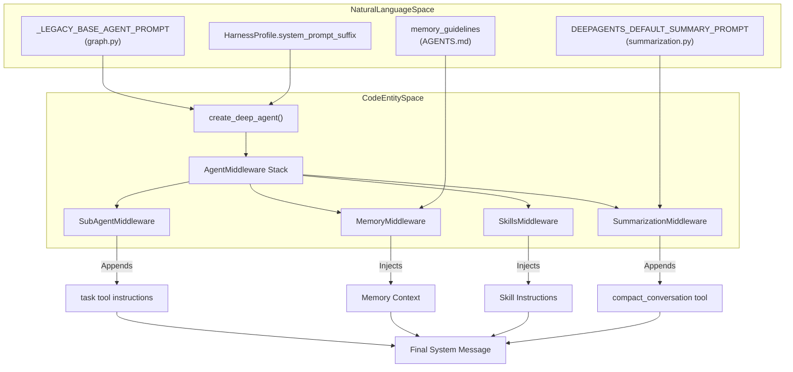
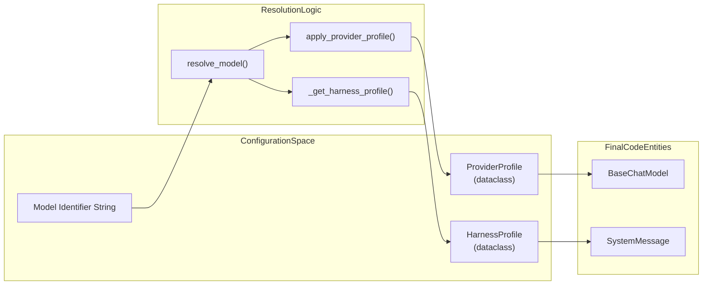

# System Prompts and Model Configuration

Relevant source files

The following files were used as context for generating this wiki page:

- [libs/deepagents/tests/unit_tests/smoke_tests/snapshots/custom_system_message.md](libs/deepagents/tests/unit_tests/smoke_tests/snapshots/custom_system_message.md)
- [libs/deepagents/tests/unit_tests/smoke_tests/snapshots/custom_system_message_tools.json](libs/deepagents/tests/unit_tests/smoke_tests/snapshots/custom_system_message_tools.json)
- [libs/deepagents/tests/unit_tests/smoke_tests/snapshots/system_prompt_with_execute.md](libs/deepagents/tests/unit_tests/smoke_tests/snapshots/system_prompt_with_execute.md)
- [libs/deepagents/tests/unit_tests/smoke_tests/snapshots/system_prompt_with_execute_tools.json](libs/deepagents/tests/unit_tests/smoke_tests/snapshots/system_prompt_with_execute_tools.json)
- [libs/deepagents/tests/unit_tests/smoke_tests/snapshots/system_prompt_with_media_extra_tools.json](libs/deepagents/tests/unit_tests/smoke_tests/snapshots/system_prompt_with_media_extra_tools.json)
- [libs/deepagents/tests/unit_tests/smoke_tests/snapshots/system_prompt_with_memory_and_skills.md](libs/deepagents/tests/unit_tests/smoke_tests/snapshots/system_prompt_with_memory_and_skills.md)
- [libs/deepagents/tests/unit_tests/smoke_tests/snapshots/system_prompt_with_memory_and_skills_tools.json](libs/deepagents/tests/unit_tests/smoke_tests/snapshots/system_prompt_with_memory_and_skills_tools.json)
- [libs/deepagents/tests/unit_tests/smoke_tests/snapshots/system_prompt_with_routed_backend_tools.json](libs/deepagents/tests/unit_tests/smoke_tests/snapshots/system_prompt_with_routed_backend_tools.json)
- [libs/deepagents/tests/unit_tests/smoke_tests/snapshots/system_prompt_with_sync_and_async_subagents.md](libs/deepagents/tests/unit_tests/smoke_tests/snapshots/system_prompt_with_sync_and_async_subagents.md)
- [libs/deepagents/tests/unit_tests/smoke_tests/snapshots/system_prompt_with_sync_and_async_subagents_tools.json](libs/deepagents/tests/unit_tests/smoke_tests/snapshots/system_prompt_with_sync_and_async_subagents_tools.json)
- [libs/deepagents/tests/unit_tests/smoke_tests/snapshots/system_prompt_without_execute.md](libs/deepagents/tests/unit_tests/smoke_tests/snapshots/system_prompt_without_execute.md)
- [libs/deepagents/tests/unit_tests/smoke_tests/snapshots/system_prompt_without_execute_tools.json](libs/deepagents/tests/unit_tests/smoke_tests/snapshots/system_prompt_without_execute_tools.json)
- [libs/deepagents/tests/unit_tests/smoke_tests/test_system_prompt.py](libs/deepagents/tests/unit_tests/smoke_tests/test_system_prompt.py)

This page documents the assembly and configuration of system prompts and language models within the Deep Agents framework. It covers the hierarchical construction of instructions from base templates, middleware contributions, snapshot smoke tests, interactive versus non-interactive modes, model resolution logic, and the Harness Profiles system.

## Overview

System prompts in Deep Agents are dynamically assembled documents rather than static strings. The final prompt seen by the LLM is a concatenation of multiple sources, ensuring that core behavioral guidelines, user instructions, and middleware-specific tool guidance are all present and correctly prioritized.

The assembly logic follows a strict order to ensure that caller instructions take precedence while model-tuning guidance sits closest to the conversation history where the model attends most [libs/deepagents/deepagents/graph.py:49-68]().

## System Prompt Assembly Architecture

The final system prompt is composed of four primary segments joined by blank lines (`\n\n`):

1.  **Prefix (User)**: The `prefix` key in `SystemPromptConfig` (or the `system_prompt=` string argument to `create_deep_agent`). This is always first, allowing caller instructions to take precedence [libs/deepagents/deepagents/graph.py:30-49]().
2.  **Base**: The legacy `_LEGACY_BASE_AGENT_PROMPT` constant. This can be replaced by a `HarnessProfile.base_system_prompt` or explicitly overridden via the `base` key in `SystemPromptConfig` [libs/deepagents/deepagents/graph.py:79-121](). Note: Direct access to `BASE_AGENT_PROMPT` is deprecated in favor of profile-based management [libs/deepagents/deepagents/graph.py:124-138]().
3.  **Suffix**: Text placed after the base, typically via the `suffix` key in `SystemPromptConfig` [libs/deepagents/deepagents/graph.py:49-50]().
4.  **Middleware/Model Tuning**: Instructions contributed by active middleware (e.g., `MemoryMiddleware`, `SkillsMiddleware`) and the `HarnessProfile.system_prompt_suffix` (model-specific tuning appended last) [libs/deepagents/deepagents/graph.py:49-68]().

### System Prompt Flow Diagram

This diagram maps the relationship between natural language specification templates and the code entities that process them into the final prompt.

Sources: [libs/deepagents/deepagents/graph.py:79-138](), [libs/deepagents/deepagents/middleware/summarization.py:100-117](), [libs/deepagents/deepagents/middleware/__init__.py:17-48](), [libs/deepagents/deepagents/profiles/harness/harness_profiles.py:119-135]()

---

## Base Prompt, Behavioral Guidelines, and Mode Variations

### Base Agent Prompt

The SDK's legacy `_LEGACY_BASE_AGENT_PROMPT` establishes the agent's persona, though users are encouraged to provide their own via `create_deep_agent` [libs/deepagents/deepagents/graph.py:79-121]():

- **Core Behavior**: Emphasizes conciseness, directness, and the removal of "polite" preambles like "Sure!" or "I'll now..." [libs/deepagents/deepagents/graph.py:81-87]().
- **Professional Objectivity**: Prioritizes accuracy over user validation and avoids emotional validation [libs/deepagents/deepagents/graph.py:89-94]().
- **Operational Loop**: Defines a 3-step process: **Understand first**, **Act**, and **Verify** [libs/deepagents/deepagents/graph.py:95-103]().
- **Blocked State**: Instructs the agent to stop and analyze failures rather than retrying the same approach repeatedly [libs/deepagents/deepagents/graph.py:105-108]().

### Interactive vs. Non-Interactive Modes

Prompt assembly adapts depending on whether the agent executes in an interactive terminal user interface (`deepagents-code`) or a headless, non-interactive pipeline:

- **Interactive Mode**: The prompt is augmented to include instructions for progress updates and real-time interaction feedback during longer tasks to maintain user engagement [libs/deepagents/deepagents/graph.py:119-121]().
- **Non-Interactive / Headless Mode**: Relies on standard system prompt configurations without auxiliary UI progress prompts, optimized for automated batch execution, JSON output streaming, and strict turn limits.

Sources: [libs/deepagents/deepagents/graph.py:79-121](), [libs/deepagents/tests/unit_tests/smoke_tests/snapshots/system_prompt_with_memory_and_skills.md:64-102]()

---

## Middleware-Contributed Prompts

Middleware components extend the prompt to explain the tools and context they provide. This is handled via the `AgentMiddleware.wrap_model_call` hook [libs/deepagents/deepagents/middleware/__init__.py:17-33]().

| Middleware        | Section Injected       | Key Logic                                                                                                      |
|-------------------|-----------------------|----------------------------------------------------------------------------------------------------------------|
| **Summarization** | `DEEPAGENTS_DEFAULT_SUMMARY_PROMPT` | Explains how conversation history is compacted and media references are preserved [libs/deepagents/deepagents/middleware/summarization.py:100-117](). |
| **Memory**        | `<agent_memory>` & `<memory_guidelines>`      | Injects contents from `AGENTS.md` and provides instructions on how to update memory using `edit_file` [libs/deepagents/tests/unit_tests/smoke_tests/snapshots/system_prompt_with_memory_and_skills.md:47-102](). |
| **Skills**         | `## Skills System`        | Details available skills and the **progressive disclosure** pattern (read instructions only when needed) [libs/deepagents/tests/unit_tests/smoke_tests/snapshots/system_prompt_with_memory_and_skills.md:1-45](). |
| **Rubric**         | `GRADER_SYSTEM_PROMPT`     | Used by the internal grader agent to evaluate task completion against rubrics [libs/deepagents/deepagents/middleware/rubric.py:53-65](). |

Sources: [libs/deepagents/deepagents/middleware/summarization.py:100-117](), [libs/deepagents/tests/unit_tests/smoke_tests/snapshots/system_prompt_with_memory_and_skills.md:1-116](), [libs/deepagents/deepagents/middleware/rubric.py:53-65]()

---

## Model Resolution and Harness Profiles

Deep Agents uses a resolution layer to map model identifiers to specific configurations and provider-specific initialization logic.

### Model Resolution

The `resolve_model` function in `deepagents._models` handles the instantiation of `BaseChatModel` instances [libs/deepagents/deepagents/_models.py:13-19]().

- **OpenAI**: Automatically sets `use_responses_api=True` when initializing OpenAI models [libs/deepagents/tests/unit_tests/test_models.py:91-97]().
- **OpenRouter**: Injects SDK attribution headers (`app_url`, `app_title`) and defaults to ignoring Azure providers (`openrouter_provider={"ignore": ["azure"]}`) to ensure consistent tool-calling behavior [libs/deepagents/tests/unit_tests/test_models.py:99-110]().
- **NVIDIA**: Injects specific billing and origin headers [libs/deepagents/tests/unit_tests/test_models.py:112-123]().
- **Provider Discovery**: The `get_model_provider` function extracts the provider string from the model instance for profile lookup [libs/deepagents/deepagents/_models.py:15]().

### Harness Profiles System

Harness profiles declare how `create_deep_agent` should shape the agent's runtime behavior for a given model [libs/deepagents/deepagents/profiles/harness/harness_profiles.py:9-18]().

- **Prompt Modification**: Profiles use `system_prompt_suffix` to layer model-specific instructions onto the base prompt [libs/deepagents/deepagents/profiles/harness/harness_profiles.py:134-135]().
- **Bootstrap**: Built-in profiles for Anthropic, NVIDIA, and OpenAI are registered during a lazy bootstrap phase [libs/deepagents/deepagents/profiles/_builtin_profiles.py:1-172]().
- **Registration**: Users and third-party plugins can register profiles using `register_harness_profile` and `register_provider_profile` [libs/deepagents/deepagents/profiles/harness/harness_profiles.py:15-16]().

Sources: [libs/deepagents/deepagents/_models.py:13-19](), [libs/deepagents/deepagents/profiles/provider/provider_profiles.py:50-52](), [libs/deepagents/deepagents/profiles/harness/harness_profiles.py:82-135](), [libs/deepagents/deepagents/profiles/_builtin_profiles.py:1-172]()

---

## Snapshot Smoke Tests and Verification

System prompt assembly is verified through extensive snapshot testing to ensure that middleware and profiles contribute expected structural text and tool descriptors without regression.

- **Prompt Snapshots**: The `test_system_prompt.py` suite captures the materialized system message across various configurations (e.g., with/without execution tools, memory, skills) [libs/deepagents/tests/unit_tests/smoke_tests/test_system_prompt.py:87-113]().
- **Routed Backends**: Tests verify that prompt assembly correctly reflects filesystem routing in `CompositeBackend`, displaying virtual mounts and host path mappings [libs/deepagents/tests/unit_tests/smoke_tests/test_system_prompt.py:145-172]().
- **Media Extras**: Optional `[video]` extras are tested via marks to ensure `read_file` descriptions update appropriately to advertise seconds-based offset/limit capabilities [libs/deepagents/tests/unit_tests/smoke_tests/test_system_prompt.py:117-143]().

Sources: [libs/deepagents/tests/unit_tests/smoke_tests/test_system_prompt.py:1-172](), [libs/deepagents/tests/unit_tests/smoke_tests/snapshots/system_prompt_with_memory_and_skills.md:1-116]()