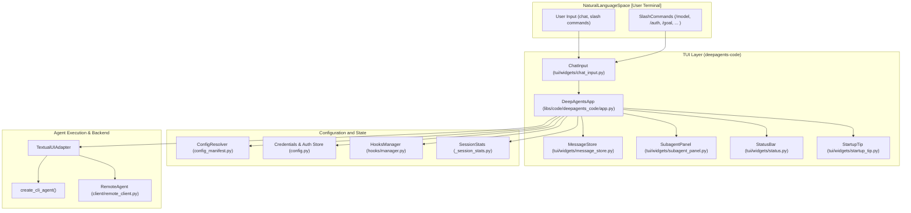
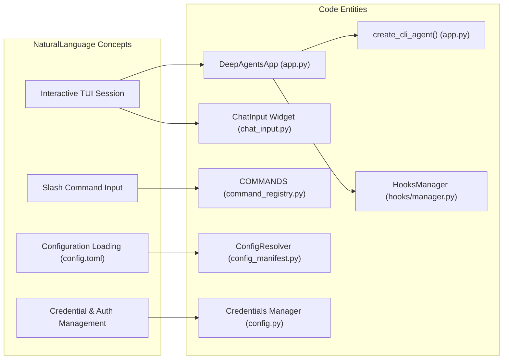

# deepagents-code Application

Relevant source files

The following files were used as context for generating this wiki page:

- [libs/code/COMMANDS.md](libs/code/COMMANDS.md)
- [libs/code/deepagents_code/app.py](libs/code/deepagents_code/app.py)
- [libs/code/deepagents_code/command_registry.py](libs/code/deepagents_code/command_registry.py)
- [libs/code/deepagents_code/tui/widgets/startup_tip.py](libs/code/deepagents_code/tui/widgets/startup_tip.py)
- [libs/code/tests/unit_tests/test_app.py](libs/code/tests/unit_tests/test_app.py)
- [libs/code/tests/unit_tests/test_command_registry.py](libs/code/tests/unit_tests/test_command_registry.py)
- [libs/code/tests/unit_tests/test_thread_naming_app.py](libs/code/tests/unit_tests/test_thread_naming_app.py)
- [libs/code/tests/unit_tests/tui/widgets/test_startup_tip.py](libs/code/tests/unit_tests/tui/widgets/test_startup_tip.py)

The `deepagents-code` package provides the terminal interface and interactive coding agent for the Deep Agents framework. Formerly a part of `deepagents-cli`, it was split into a dedicated package at v0.1.0 to focus on the interactive terminal UI (TUI) and local coding workflows [libs/code/CHANGELOG.md:44-48](), [libs/code/pyproject.toml:5-8]().

## Package Overview

`deepagents-code` serves as the primary user-facing entry point for interacting with Deep Agents on a local machine. It leverages the [Textual](https://github.com/Textualize/textual) framework to provide a rich, asynchronous terminal interface [libs/code/pyproject.toml:53]().

Key capabilities include:
- **Interactive TUI**: A multi-pane terminal interface with virtualized message scrolling and real-time streaming managed by the `DeepAgentsApp` class, which drives the app lifecycle, message queue, and event handling [libs/code/deepagents_code/app.py:70](), [libs/code/tests/unit_tests/test_app.py:68-180]().
- **Coding Agent**: Optimized for local project workflows, file system interaction, and shell commands via the `create_cli_agent` factory that assembles the middleware stack and configures the backend [libs/code/deepagents_code/app.py:70]() (details in child pages).
- **Slash Commands**: A unified slash-command registry enables commands like `/model`, `/thread`, `/mcp`, `/auth`, `/goal`, and others to be invoked from the TUI input, supporting user interaction, session control, and configuration [libs/code/deepagents_code/command_registry.py:1-192](), [libs/code/COMMANDS.md:1-67]().
- **Thread and Session Management**: Persistence of conversation threads through a SQLite-backed sessions database, enabling resume, rename, and switching with associated metadata tracked by the app [libs/code/deepagents_code/app.py:70](), [libs/code/tests/unit_tests/test_thread_naming_app.py]().
- **Configuration and Model Profiles**: Dynamic loading of user/project config (`config.toml`), model profiles/specifications, and managed providers for runtime model selection and credential management.
- **MCP Integration**: Full support for the Model Context Protocol including in-TUI OAuth login flows, tool loading, and a dedicated MCP viewer to manage federated servers and authentication.
- **Hooks and Plugins**: A robust event-driven hooks v2 system for injecting custom user shell commands and extensibility, alongside a plugin manager UI to install and manage skills, MCP servers, and hooks [libs/code/tests/unit_tests/test_app.py:101]().
- **Performance Optimizations**: Use of virtualized scrolling, message streaming, and context offloading to maintain responsiveness even with large conversation histories.

Sources: [libs/code/pyproject.toml:5-106](), [libs/code/deepagents_code/app.py:1-199](), [libs/code/deepagents_code/command_registry.py:1-192](), [libs/code/tests/unit_tests/test_app.py:1-210](), [libs/code/tests/unit_tests/test_thread_naming_app.py:1-181]()

---

## Architecture Overview

`deepagents-code` serves as the orchestration layer between the user’s terminal and the underlying LangGraph-based agent framework. It handles environment loading, configuration resolution, message routing, and UI state management through the main class `DeepAgentsApp` [libs/code/deepagents_code/app.py:70]().

### System Architecture and Component Relationships

This architecture bridges user natural language inputs and slash commands through the terminal UI widgets (`ChatInput`, `MessageStore`) managed by the `DeepAgentsApp`. Configuration and credentials feed local or remote agent backends that execute and respond to user queries and coding tasks.

Sources: [libs/code/deepagents_code/app.py:100-171](), [libs/code/deepagents_code/config_manifest.py:1-32](), [libs/code/deepagents_code/command_registry.py:1-44]()

---

### Execution Mapping: Natural Language to Code Entities

This diagram shows how user concepts map to specific codebase components: natural user inputs and commands drive widgets and app logic, which resolve configuration, credentials, and agent creation dynamically.

Sources: [libs/code/deepagents_code/app.py:70-120](), [libs/code/deepagents_code/command_registry.py:1-50](), [libs/code/deepagents_code/config.py:80-110](), [libs/code/tests/unit_tests/test_app.py:68-180]()

---

## Execution Modes

`deepagents-code` supports multiple modes of operation to fit diverse workflows:

### 1. Interactive Mode (Terminal UI)

The default mode, launched via commands like `dcode`, providing:
- A fully interactive textual UI with chat-based conversation
- Multi-line input with autocomplete and slash commands
- Real-time streaming of agent responses and tool outputs
- Support for media attachments, message virtualization, and subagent UI panels
- Incognito shell mode for executing one-off shell commands excluded from model context
- Onboarding experiences and startup tips for discoverability

This mode is centered on the `DeepAgentsApp` class which manages the app lifecycle, event loop integration, and UI rendering [libs/code/deepagents_code/app.py:60-171](), [libs/code/tests/unit_tests/test_app.py:1-210]().

### 2. Non-Interactive Mode (Headless Automation)

Supports execution of single tasks non-interactively via `run_non_interactive`:
- Ideal for scripted automation and pipeline integrations
- Can receive input from piped stdin and output structured JSON results
- Removes interactive UI overhead and disables event handling
- Configurable with max turn limits and timeouts for safety [libs/code/deepagents_code/app.py:70-171]() (see child page for details).

### 3. Client-Server Mode

Allows the terminal client to connect to a remote agent server:
- Utilizes a LangGraph developer server or hosted LangGraph backend
- Communicates via the `RemoteAgent` client interface
- Enables offloading compute or centralizing multi-user deployments
- Managed within deepagents-code's client submodules and supported by interactive UI [libs/code/pyproject.toml:30-58]().

Sources: [libs/code/deepagents_code/app.py:70-171](), [libs/code/pyproject.toml:30-58]()

---

## Sub-Pages

For detailed documentation on deepagents-code components and features, see the following child pages:

- [deepagents-code Overview and Installation](#3.1) — Setup instructions, the `dcode` command, dependencies, and installation options.
- [Interactive Mode and DeepAgentsApp](#3.2) — App lifecycle, event routing, message queue mechanics, onboarding, and incognito shell mode.
- [Chat Input and Autocomplete](#3.3) — Multi-line input handling, mode detection, autocomplete logic, and external editor integration.
- [Message Display and Virtualization](#3.4) — Rendering logic, streaming updates, virtualization for performance, message types, and tool output formats.
- [Thread and Session Management](#3.5) — Thread lifecycle, thread selector UI, session persistence, state migration, and usage statistics.
- [Configuration and Model Management](#3.6) — Configuration resolution, config.toml, model profiles, authentication, and runtime model switching.
- [Non-Interactive Mode](#3.7) — Detailed usage of headless mode, JSON output, HITL automation, and exit code semantics.
- [Agent Creation (create_cli_agent)](#3.8) — Middleware stack configuration, backend setup, system prompt generation, and subagent loading.
- [Local Context Injection](#3.9) — Git-aware context generation, directory tree snapshots, and project-level prompt injection.
- [CLI Commands and Utilities](#3.10) — Slash command registry and reference, diagnostics commands, startup tips, debug console.
- [Client-Server Mode](#3.11) — Remote agent connections, langgraph dev server manager, workspace binding, and offload APIs.
- [MCP Integration and OAuth](#3.12) — MCP manifest configuration, tool loading, in-TUI OAuth flows, provider modules, and MCP viewer UI.
- [Deploy Command (deepagents deploy)](#3.13) — Packaging and deployment workflows using the `deepagents.toml` manifest and bundler internals.
- [Goal Review and Notifications](#3.14) — Goal acceptance-criteria lifecycle, rubric grading, goal review UI, and notification system.
- [Hooks System](#3.15) — Lifecycle event hooks v2 design, hooks.json schema, policy enforcement, and execution engine.
- [Plugin Manager](#3.16) — Marketplace integration, skill/plugin installation lifecycle, PluginManagerScreen UI, and adapters.

---

This page provides a high-level overview of the deepagents-code application layer, emphasizing its interactive terminal interface, agent orchestration, and extensibility. For implementation specifics, architectural deep-dives, and user guidance, consult the linked subpages.

Sources: [libs/code/deepagents_code/app.py:1-199](), [libs/code/deepagents_code/command_registry.py:1-192](), [libs/code/tests/unit_tests/test_app.py:1-210](), [libs/code/tests/unit_tests/test_thread_naming_app.py:1-181]()