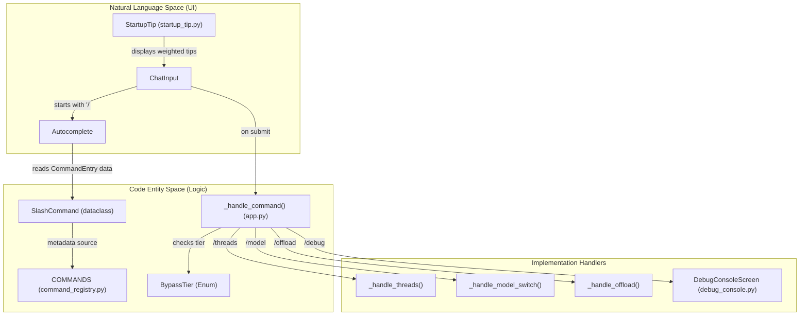
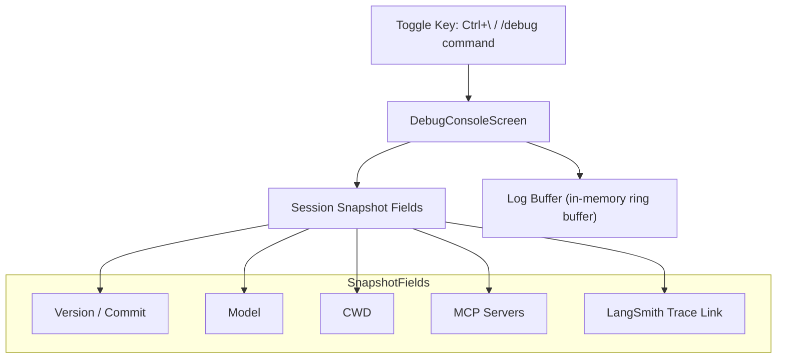

# CLI Commands and Utilities

Relevant source files

The following files were used as context for generating this wiki page:

- [libs/code/COMMANDS.md](libs/code/COMMANDS.md)
- [libs/code/deepagents_code/app.py](libs/code/deepagents_code/app.py)
- [libs/code/deepagents_code/command_registry.py](libs/code/deepagents_code/command_registry.py)
- [libs/code/deepagents_code/doctor.py](libs/code/deepagents_code/doctor.py)
- [libs/code/deepagents_code/tui/widgets/_condense_path.py](libs/code/deepagents_code/tui/widgets/_condense_path.py)
- [libs/code/deepagents_code/tui/widgets/startup_tip.py](libs/code/deepagents_code/tui/widgets/startup_tip.py)
- [libs/code/deepagents_code/tui/widgets/status.py](libs/code/deepagents_code/tui/widgets/status.py)
- [libs/code/tests/unit_tests/test_app.py](libs/code/tests/unit_tests/test_app.py)
- [libs/code/tests/unit_tests/test_command_registry.py](libs/code/tests/unit_tests/test_command_registry.py)
- [libs/code/tests/unit_tests/test_doctor.py](libs/code/tests/unit_tests/test_doctor.py)
- [libs/code/tests/unit_tests/test_startup_fast_paths.py](libs/code/tests/unit_tests/test_startup_fast_paths.py)
- [libs/code/tests/unit_tests/test_thread_naming_app.py](libs/code/tests/unit_tests/test_thread_naming_app.py)
- [libs/code/tests/unit_tests/tui/widgets/test_condense_path.py](libs/code/tests/unit_tests/tui/widgets/test_condense_path.py)
- [libs/code/tests/unit_tests/tui/widgets/test_startup_tip.py](libs/code/tests/unit_tests/tui/widgets/test_startup_tip.py)
- [libs/code/tests/unit_tests/tui/widgets/test_status.py](libs/code/tests/unit_tests/tui/widgets/test_status.py)

This page documents the command-line interface commands and utilities available in `deepagents-code`. The CLI provides two primary categories of commands:

1. **Slash commands**: Interactive commands entered during a conversation session (e.g., `/threads`, `/model`) defined in a unified registry [libs/code/deepagents_code/command_registry.py:1-192]().
2. **Command-line flags and subcommands**: Arguments passed when launching the CLI from a shell (e.g., `dcode auth`, `dcode mcp`, `dcode doctor`) [libs/code/deepagents_code/doctor.py:1-193]().

---

## Slash Command System and Registry

Slash commands are processed at the chat input layer and handled within the main application, providing interactive control and features accessible via commands prefixed with a slash (`/`). The centralized command registry maintains all metadata for these commands to ensure consistency and support autocomplete.

### Bypass Tiers and Command Classification

Each slash command is classified into a `BypassTier` that controls its execution priority and handling semantics, especially when the system is busy:

- `ALWAYS`: Executes immediately regardless of any busy state, including during thread switches.
- `CONNECTING`: Bypasses queues only during initial server connection.
- `IMMEDIATE_UI`: Opens UI modals immediately but defers heavy work.
- `SIDE_EFFECT_FREE`: Executes side effects immediately but defers chat output.
- `QUEUED`: Waits in the message queue when the app is busy.

This tiering system ensures a responsive UI while maintaining consistent command processing [libs/code/deepagents_code/command_registry.py:18-35]()

### Command Registry Structure

The `COMMANDS` tuple in `command_registry.py` contains all registered slash commands as frozen dataclasses `SlashCommand`. Each entry includes:

- Canonical name (e.g., `/quit`)
- Description (short user-facing description)
- Bypass tier
- Optional aliases (e.g., `/q` for `/quit`)
- Hidden keywords for fuzzy matching in autocomplete
- Argument hints for commands accepting parameters
- Optionally, an experimental flag requiring advanced mode

This design centralizes command metadata, avoiding duplication across code or documentation [libs/code/deepagents_code/command_registry.py:37-192]()

### Slash Command Execution Flow

When a user enters text starting with `/` in the chat input, the autocomplete subsystem uses the command registry entries to suggest and validate commands, providing argument hints and keyword-based fuzzy matching.

Upon submission, commands are dispatched for handling by the main application (`_handle_command` method in `app.py`), which:

- Checks the command's `BypassTier` to determine if it can bypass the queue
- Routes the command to a dedicated handler function or modal screen depending on the command name
- Supports commands that open interactive UI components immediately or queue actions appropriately

Key commands include:

- `/threads` for thread management
- `/model` to switch the AI model
- `/offload` to manage context summarization
- `/debug` to open the debug console overlay

Sources: [libs/code/deepagents_code/command_registry.py:1-192](), [libs/code/deepagents_code/tui/widgets/startup_tip.py:23-54](), [libs/code/deepagents_code/tui/widgets/debug_console.py:1-150](), [libs/code/deepagents_code/app.py:180-199]()

---

## COMMANDS.md Catalog Generation

The repository contains a generated markdown catalog of all slash commands (`COMMANDS.md`) for user reference.

- **Data Source**: Command names, aliases, and descriptions are directly read from the `COMMANDS` registry in `command_registry.py` [libs/code/deepagents_code/COMMANDS.md:2-8]().
  
- **Regeneration**: The file is auto-generated by running `make commands-catalog`, which invokes `scripts/generate_commands_catalog.py`. This ensures documentation stays in sync with the codebase and reflects changes in commands or their metadata [libs/code/deepagents_code/COMMANDS.md:7-8]().

- **Hidden Commands**: Some commands, like `/debug` and `/debug-error`, are intentionally hidden from autocomplete and help outputs for administrative use only [libs/code/deepagents_code/COMMANDS.md:62-68]().

| Command | Aliases | Description |
|---------|---------|-------------|
| `/agents` |  | Browse and switch between available agents |
| `/auth` | `/connect` | Connect and manage provider and service credentials |
| `/auto` |  | Switch to Auto approval mode or manage its classifier model |
| `/btw` |  | Ask a side question without changing the conversation |
| `/clear` |  | Start a fresh thread |
| `/copy` |  | Copy the latest assistant message to clipboard |
| `/context` |  | Show current context window usage |
| `/cost` |  | Show estimated thread cost |
| `/goal` |  | Set and manage a persistent objective with acceptance criteria |
| ... | ... | ... |

*The table above represents sample entries; see `COMMANDS.md` for full details.*

Sources: [libs/code/COMMANDS.md:1-67]()

---

## Startup Tips Widget

The `StartupTip` widget provides helpful usage tips displayed above the chat input box in the interactive TUI. These tips serve to highlight useful slash commands, shortcuts, and features to improve discoverability and usability [libs/code/deepagents_code/tui/widgets/startup_tip.py:1-54]().

### Tip Selection

- Tips are stored in a weighted dictionary `_TIPS`, where each text item maps to a relative weight indicating its selection probability.
- On each launch, one tip is randomly selected with weighted probability, biasing towards useful or important tips.
- The tip text may be dynamically customized, such as replacing a generic external editor keybinding hint with the actual editor name detected in your environment.
- The tip selection also adapts to runtime feature flags, disabling or substituting tips related to policies like YOLO approval mode availability [libs/code/deepagents_code/tui/widgets/startup_tip.py:23-110]().

### Environment Control

- Users may disable the startup tip entirely by setting the environment variable `HIDE_SPLASH_TIPS` [libs/code/deepagents_code/_env_vars.py], which is checked before rendering the widget [libs/code/deepagents_code/tui/widgets/startup_tip.py:110-124]().

### Widget Implementation

The `StartupTip` class extends the `textual.widgets.Static` widget and renders the selected tip with muted dim italic styling controlled via CSS. It assembles a `Content` object containing the label "Tip:" followed by the selected tip text for rendering in the terminal UI [libs/code/deepagents_code/tui/widgets/startup_tip.py:121-143]().

Sources: [libs/code/deepagents_code/tui/widgets/startup_tip.py:1-143]()

---

## Doctor Diagnostics (`dcode doctor`)

The `dcode doctor` CLI command provides an offline diagnostic report that summarizes the health and configuration state of the installed `deepagents-code` environment, including version info, dependency checks, and configuration paths [libs/code/deepagents_code/doctor.py:1-193]().

### Diagnostic Model

- Diagnostics are structured as groups called `DiagnosticSection`, each representing an area of system health.
- Each section contains multiple `DiagnosticItem` instances representing individual facts with a label, value, and an `ok` flag indicating whether the item is healthy.
- The presence of any unhealthy item marks the entire section as unhealthy, aiding quick triage [libs/code/deepagents_code/doctor.py:33-58]().

### Key Diagnostic Checks

- **Version and Platform**: Reports the version of the CLI, SDK, platform architecture, git commit hashes, and install method.
- **SDK Version Health**: Checks for declared SDK dependency mismatches, invalid editable source versions, and resolves installed metadata versions.
- **Git Commit Detection**: Uses either a baked-in build commit stamped at package build time or probes the local `.git` working tree using `git rev-parse` to determine the exact commit hash representing the installed version [libs/code/deepagents_code/doctor.py:59-153]().

### Offline and Safe

- The `doctor` command does not contact external servers like PyPI; it relies solely on local metadata and caches.
- This design ensures safe copy-paste sharing of diagnostic data for debugging or bug reporting without exposing sensitive or private information [libs/code/deepagents_code/doctor.py:3-8]().

Sources: [libs/code/deepagents_code/doctor.py:1-193]()

---

## Read-Only Debug Console (`Ctrl+\` / `/debug`)

The Debug Console is an interactive read-only modal overlay within the TUI designed for in-situ diagnostics and runtime introspection. It can be toggled with the keyboard chord `Ctrl+\` or invoked via the hidden slash command `/debug` [libs/code/deepagents_code/tui/widgets/debug_console.py:1-150]().

### User Interaction and Activation

- The console opens immediately on `Ctrl+\` keystroke or when entering `/debug` at the chat prompt.
- It is designed to be non-blocking and does not mutate any agent or session state.
- Serves as a diagnostic session snapshot and log viewer [libs/code/deepagents_code/tui/widgets/debug_console.py:57-60]().

### Implementation Details

- Displays a snapshot of key session metadata fields, such as:
  - Current CLI version and git commit
  - Active model in use
  - Current working directory
  - MCP (Multi-Cloud Protocol) server status and authentication details
  - Link to open the current thread's trace in LangSmith [libs/code/deepagents_code/tui/widgets/debug_console.py:61-87]()

- The metadata fields are represented as tuples with labels and asynchronous content fetchers that refresh periodically while the console is open.

- The log section displays recent application log records pulled from an in-memory ring buffer (`_debug_buffer`), allowing filtering log messages by severity level (e.g., show only warnings or errors) or exact level matches [libs/code/deepagents_code/tui/widgets/debug_console.py:1-150]().

Sources: [libs/code/deepagents_code/tui/widgets/debug_console.py:1-150]()

---

# Summary

The CLI commands and utilities in `deepagents-code` provide a comprehensive and extensible interface both for interactive slash command invocation and for external CLI interactions. The centralized `command_registry.py` serves as the authoritative source of command metadata for slash commands facilitating consistency and discoverability in the TUI.

Support tools such as the `StartupTip` widget enhance user guidance, while diagnostic commands like `dcode doctor` and the debug console provide robust introspection facilities for maintainers and advanced users.

This architecture and tooling ensure an efficient command ecosystem enabling both day-to-day productivity and deep debugging in the development and production lifecycle of Deep Agents.

---

Sources:  
- libs/code/deepagents_code/command_registry.py:1-192()  
- libs/code/deepagents_code/COMMANDS.md:1-68()  
- libs/code/deepagents_code/tui/widgets/startup_tip.py:1-144()  
- libs/code/deepagents_code/doctor.py:1-193()  
- libs/code/deepagents_code/tui/widgets/debug_console.py:1-150()  
- libs/code/deepagents_code/app.py:180-199()