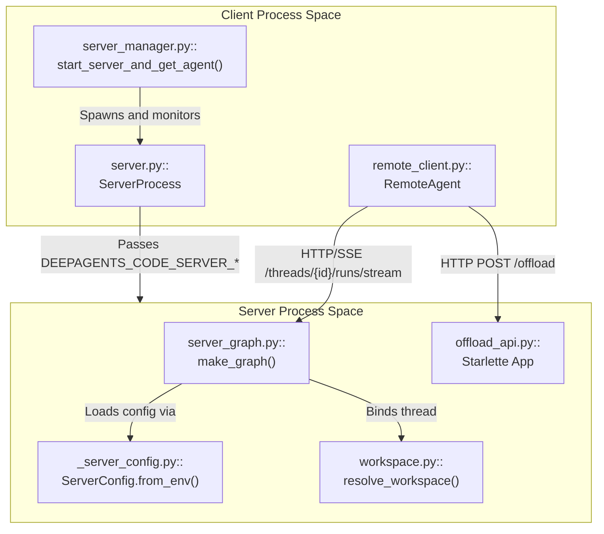
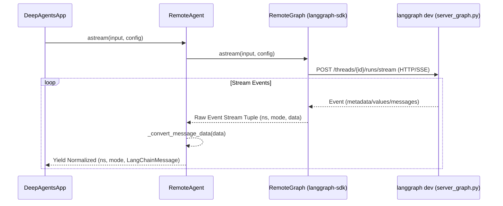

# Client-Server Mode

<details>
<summary>Relevant source files</summary>

The following files were used as context for generating this wiki page:

- [libs/code/deepagents_code/client/launch/server.py](libs/code/deepagents_code/client/launch/server.py)
- [libs/code/deepagents_code/client/launch/server_manager.py](libs/code/deepagents_code/client/launch/server_manager.py)
- [libs/code/deepagents_code/client/remote_client.py](libs/code/deepagents_code/client/remote_client.py)
- [libs/code/deepagents_code/model_api.py](libs/code/deepagents_code/model_api.py)
- [libs/code/deepagents_code/model_catalog.py](libs/code/deepagents_code/model_catalog.py)
- [libs/code/deepagents_code/model_metadata.py](libs/code/deepagents_code/model_metadata.py)
- [libs/code/deepagents_code/offload_api.py](libs/code/deepagents_code/offload_api.py)
- [libs/code/deepagents_code/workspace.py](libs/code/deepagents_code/workspace.py)
- [libs/code/tests/unit_tests/test_model_catalog.py](libs/code/tests/unit_tests/test_model_catalog.py)
- [libs/code/tests/unit_tests/test_model_metadata.py](libs/code/tests/unit_tests/test_model_metadata.py)
- [libs/code/tests/unit_tests/test_model_switch.py](libs/code/tests/unit_tests/test_model_switch.py)
- [libs/code/tests/unit_tests/test_offload_api.py](libs/code/tests/unit_tests/test_offload_api.py)
- [libs/code/tests/unit_tests/test_remote_client.py](libs/code/tests/unit_tests/test_remote_client.py)
- [libs/code/tests/unit_tests/test_server.py](libs/code/tests/unit_tests/test_server.py)
- [libs/code/tests/unit_tests/test_server_manager.py](libs/code/tests/unit_tests/test_server_manager.py)
- [libs/code/tests/unit_tests/test_workspace.py](libs/code/tests/unit_tests/test_workspace.py)

</details>


## Purpose and Scope

This document details the client-server architecture powering the `deepagents-code` application (`dcode`). It covers the lifecycle orchestration of the background `langgraph dev` server process, environment variable serialization via `ServerConfig`, graph bootstrap through `make_graph()`, client communication via `RemoteAgent`, and server-side thread offloading via the `/offload` API and workspace binding mechanisms.

Sources: [libs/code/deepagents_code/client/launch/server_manager.py:1-14](), [libs/code/deepagents_code/_server_config.py:1-10](), [libs/code/deepagents_code/server_graph.py:1-10]()

---

## Architecture & System Overview

The client-server mode decouples the Textual-based interactive user interface (or headless runner) from the LangGraph execution runtime. The client application spawns and monitors a `langgraph dev` subprocess, communicating asynchronously using HTTP and Server-Sent Events (SSE) via the `langgraph-sdk` client wrapped by `RemoteAgent`.

### System Entity Mapping (Natural Language Space to Code Entity Space)



Sources: [libs/code/deepagents_code/client/launch/server_manager.py:1-15](), [libs/code/deepagents_code/client/launch/server.py:1-5](), [libs/code/deepagents_code/server_graph.py:1-10](), [libs/code/deepagents_code/offload_api.py:1-43]()

---

## Server Lifecycle Management

The server lifecycle is managed by `server_manager.py` and `server.py`. The `start_server_and_get_agent()` function coordinates workspace scaffolding, configuration injection, server execution, and health validation.

### Workspace Scaffolding

Before launching the `langgraph dev` subprocess, the client creates an ephemeral workspace directory containing auxiliary runtime files:

| File            | Purpose                                                                                                                |
|-----------------|------------------------------------------------------------------------------------------------------------------------|
| `langgraph.json`| Generated via `generate_langgraph_json()` to register `deepagents_code.server_graph:make_graph` and point to the session checkpointer |
| `checkpointer.py`| Dynamically written to instantiate an `AsyncSqliteSaver` tied to the app's sessions DB path read from the environment    |
| `pyproject.toml` | Declares dependencies and points the server runtime back to the installed `deepagents-code` package                   |

The checkpointer code reads the database path from the environment, enabling dynamic runtime access without bake-in source paths. The project root is set so the server can install dependencies correctly and link to the core package [libs/code/deepagents_code/client/launch/server_manager.py:94-164](), [libs/code/deepagents_code/client/launch/server.py:200-216]().

### Subprocess Launch and Environment Sanitization

The `ServerProcess` class encapsulates subprocess startup, managing lifecycle signals and port assignment:

- It deletes inherited environment variables listed in `_SERVER_ENV_DENYLIST` (such as `PYTHONPATH`, `LD_PRELOAD`, and `NODE_OPTIONS`) to prevent contamination or hijacking of the server environment.
- The server uses an ephemeral port (default `0`) found by `_find_free_port()` avoiding the known default port `2024` to permit local coexistence with user `langgraph dev` instances.
- It retries to find a free port if the requested one is busy, with port checks via `_port_in_use()`.
- Server health is polled with configurable timeouts and backoffs to detect readiness or failure promptly.

This isolation and sanitization ensure security and stable startup of the contained LangGraph runtime subprocess [libs/code/deepagents_code/client/launch/server.py:130-170](), [libs/code/deepagents_code/client/launch/server_manager.py:134-180]().

Sources: [libs/code/deepagents_code/client/launch/server_manager.py:1-188](), [libs/code/deepagents_code/client/launch/server.py:21-216]()

---

## Server Configuration (`ServerConfig`)

Configuration parameters are transmitted from the client process to the server process using environment variables with the prefix `DEEPAGENTS_CODE_SERVER_`.

### Serialization Contract and Validation

- `ServerConfig` is a dataclass that encapsulates runtime policy options such as:
  - `allow_fs_tools`: An allowlist of permitted filesystem tool names; must include `"read_file"` if present.
  - `assistant_id`: Identifier string for the agent.
  - `auto_approve`, `enable_shell`, `enable_ask_user`: Booleans controlling runtime behavior.
  - `mcp_config_path`, `sandbox_type`, `sandbox_id`, `sandbox_snapshot_name`, `sandbox_setup`: Sandbox and MCP integration parameters.
- The method `to_env()` serializes these configurations to string values or JSON-encoded arrays for environment variables.
- The method `from_env()` reconstructs and validates configuration from environment variables inside the server process.
- Strict fail-closed validation avoids accepting malformed, tampered, or partial configurations.
- Environment variables are carefully set or cleared atomically before server launch by `_apply_server_config()` and managed lifecycle code.

This contract is verified with unit tests to maintain the invariant that `allow_fs_tools` always includes `"read_file"` upon deserialization, guarding against incomplete or unsafe tool allowlists [libs/code/deepagents_code/_server_config.py:1-60](), [libs/code/deepagents_code/tests/unit_tests/test_server_manager.py:26-82]().

Sources: [libs/code/deepagents_code/_server_config.py:1-188](), [libs/code/deepagents_code/tests/unit_tests/test_server_manager.py:26-82]()

---

## Server Graph Entrypoint (`make_graph`)

The server-side runtime graph construction occurs in `server_graph.py`, referenced directly by `langgraph.json`.

### Key Components and Flow

- `make_graph()` asynchronously reads server startup configuration via `ServerConfig.from_env()`.
- Builds the LangGraph runtime environment by assembling:
  - Backend storages and caches.
  - Agent middleware including the task and skills systems.
  - MCP session management tools via `MCPSessionManager`.
- Context schema validations and overrides are applied for runtime parameters (model names, approval modes, etc.).
- The runtime and graph are cached in process memory to avoid redundant container startup on multiple requests.

This factory function defines the core runtime powered by LangGraph on the server [libs/code/deepagents_code/server_graph.py:1-175](), [libs/code/deepagents_code/tests/unit_tests/test_server_graph.py:60-76](), [libs/code/deepagents_code/_cli_context.py:44-91]().

Sources: [libs/code/deepagents_code/server_graph.py:1-175](), [libs/code/deepagents_code/tests/unit_tests/test_server_graph.py:60-76]()

---

## RemoteAgent Client and Data Flow

The `RemoteAgent` class in `remote_client.py` abstracts the client-side communication to the background LangGraph server.

### Data Flow: Client to Server Stream



### Normalization Helpers

- `_convert_message_data()`: Converts raw streamed JSON message dicts from the SDK into typed LangChain message objects such as `AIMessageChunk` and `ToolMessage`. This preserves fields like chunk positions and additional metadata for client rendering and message state [libs/code/deepagents_code/client/remote_client.py:20-20](), [libs/code/deepagents_code/tests/unit_tests/test_remote_client.py:65-133]().
- `_convert_interrupts()`: Converts server-side dictionaries describing interrupt events into LangGraph `Interrupt` objects for interactive prompts and flow control on the client [libs/code/deepagents_code/client/remote_client.py:19-19](), [libs/code/deepagents_code/tests/unit_tests/test_remote_client.py:140-169]().
- `_prepare_config()`: Ensures that top-level trace tags and other metadata survive the boundary between CLI and server, retaining observability and grouping semantics in distributed traces [libs/code/deepagents_code/client/remote_client.py:21-21](), [libs/code/deepagents_code/tests/unit_tests/test_remote_client.py:46-59]().

`RemoteAgent` is responsible for managing run cancellation, offload request coordination, and session cost monitoring via associated trackers, offering an asynchronous streaming API to the interactive UI [libs/code/deepagents_code/client/remote_client.py:1-186]().

Sources: [libs/code/deepagents_code/client/remote_client.py:16-24](), [libs/code/deepagents_code/tests/unit_tests/test_remote_client.py:1-169]()

---

## Offload API and Workspace Binding

The server application exposes additional HTTP operations using a Starlette application in `offload_api.py`.

### Thread Offloading (`/offload`)

- The endpoint `/dcode/threads/{thread_id}/offload` enables the client to request offloading (such as summary compaction or conversation history archiving) without active tool execution interrupts.
- Offloading is restricted to threads in quiescent states (`idle` or `error`) to avoid disrupting ongoing runs.
- Per-thread `asyncio.Lock` prevents concurrent conflicting offload attempts.
- Server-side code validates offload result fields and protocol compliance strictly before notifying clients.
- LangSmith trace flushing is triggered during graceful shutdown to ensure telemetry completeness.

These mechanisms enable context management scalability, preventing extremely large context windows from degrading UI responsiveness or model cost [libs/code/deepagents_code/offload_api.py:1-174](), [libs/code/deepagents_code/client/remote_client.py:60-123]().

### Workspace Binding

Thread-to-workspace bindings are managed authoritatively by the server to maintain consistent policy enforcement and prevent workspace conflicts:

- `WorkspaceBinding` carries workspace identity and configuration fingerprints, including policy and runtime details.
- The binding validates project roots, directory canonicalization, and restricts config updates that would violate trust boundaries.
- Conflict errors contain structured diagnostics for display and handling in the client.
- Bindings are referenced in thread operation requests and used to resolve model metadata and sandbox/middleware policies.

The workspace binding strategy isolates concurrent projects on the same server to avoid policy leaks or resource conflicts [libs/code/deepagents_code/workspace.py:1-120](), [libs/code/deepagents_code/offload_api.py:160-182]().

Sources: [libs/code/deepagents_code/offload_api.py:1-174](), [libs/code/deepagents_code/workspace.py:1-120]()

---

# Summary Diagram: Client-Server Interaction for `deepagents-code`

```mermaid
flowchart TB
    Client[DeepAgentsApp (Textual UI / CLI)]
    RemoteAgent["remote_client.py::<br/>RemoteAgent"]
    LangGraphSDK["langgraph_sdk.RemoteGraph<br/>(HTTP/SSE Streaming)"]
    ServerProcess["langgraph dev subprocess<br/>(ServerProcess)"]
    ServerGraph["server_graph.py::<br/>make_graph() - Execution Runtime"]
    OffloadAPI["offload_api.py::<br/>/offload HTTP API"]
    Workspace["workspace.py::<br/>WorkspaceBinding / Policy"]
    ServerConfig["_server_config.py::<br/>ServerConfig from_env()"]

    Client -->|astream()| RemoteAgent
    RemoteAgent -->|streams HTTP/SSE| LangGraphSDK
    LangGraphSDK -->|POST /runs/stream| ServerGraph
    ServerProcess -->|env: DEEPAGENTS_CODE_SERVER_*| ServerConfig
    ServerGraph -->|binds thread| Workspace
    Workspace --> ServerGraph
    Client -->|POST /offload| OffloadAPI
    OffloadAPI --> Workspace
    OffloadAPI --> ServerGraph
```

This diagram bridges the natural language concept of client-server communication with the concrete code entities responsible for each part of the interaction, clarifying roles and data flow in the architecture.

Sources: Combined from all above sections.

---

# End of 3.11 Client-Server Mode