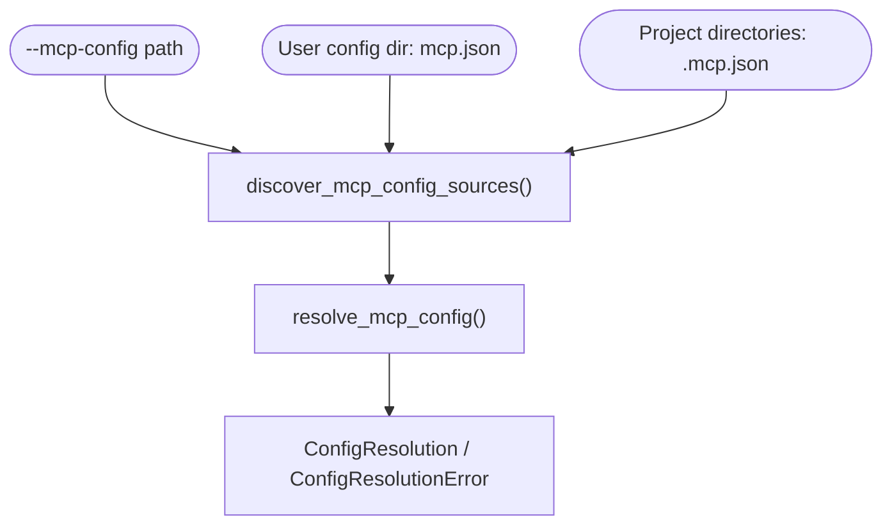
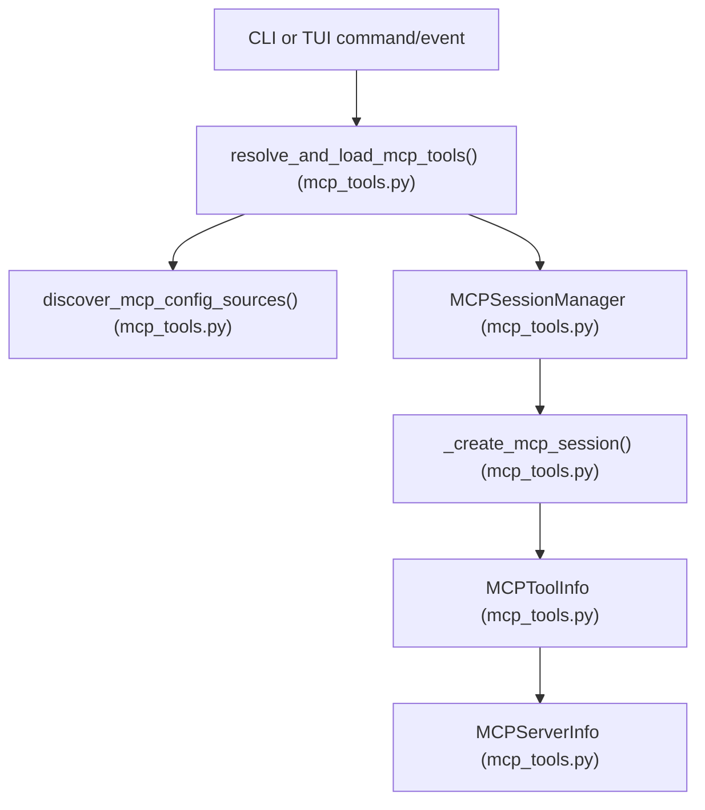
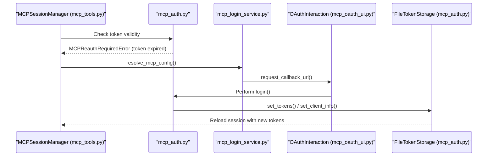

# MCP Integration and OAuth

Relevant source files

The following files were used as context for generating this wiki page:

- [libs/code/deepagents_code/mcp_auth.py](libs/code/deepagents_code/mcp_auth.py)
- [libs/code/deepagents_code/mcp_login_service.py](libs/code/deepagents_code/mcp_login_service.py)
- [libs/code/deepagents_code/mcp_oauth_ui.py](libs/code/deepagents_code/mcp_oauth_ui.py)
- [libs/code/deepagents_code/mcp_providers/base.py](libs/code/deepagents_code/mcp_providers/base.py)
- [libs/code/deepagents_code/mcp_providers/github.py](libs/code/deepagents_code/mcp_providers/github.py)
- [libs/code/deepagents_code/mcp_providers/slack.py](libs/code/deepagents_code/mcp_providers/slack.py)
- [libs/code/deepagents_code/mcp_tools.py](libs/code/deepagents_code/mcp_tools.py)
- [libs/code/deepagents_code/tui/widgets/mcp_reconnect.py](libs/code/deepagents_code/tui/widgets/mcp_reconnect.py)
- [libs/code/deepagents_code/tui/widgets/mcp_viewer.py](libs/code/deepagents_code/tui/widgets/mcp_viewer.py)
- [libs/code/tests/unit_tests/test_mcp_auth.py](libs/code/tests/unit_tests/test_mcp_auth.py)
- [libs/code/tests/unit_tests/test_mcp_login_service.py](libs/code/tests/unit_tests/test_mcp_login_service.py)
- [libs/code/tests/unit_tests/test_mcp_oauth_ui.py](libs/code/tests/unit_tests/test_mcp_oauth_ui.py)
- [libs/code/tests/unit_tests/test_mcp_tools.py](libs/code/tests/unit_tests/test_mcp_tools.py)
- [libs/code/tests/unit_tests/tui/widgets/test_mcp_reconnect.py](libs/code/tests/unit_tests/tui/widgets/test_mcp_reconnect.py)
- [libs/code/tests/unit_tests/tui/widgets/test_mcp_viewer.py](libs/code/tests/unit_tests/tui/widgets/test_mcp_viewer.py)

DeepAgents integrates the **Model Context Protocol (MCP)** to extend the capabilities of agents by connecting to external tool servers using a standardized JSON configuration format, supporting multiple transports, OAuth authentication, and user-trusted project-based controls. This page details the MCP integration focusing on configuration management (`mcp.json`), tool loading, the in-terminal user interface (TUI) OAuth login flow, provider-specific modules, MCP viewer and reconnect widgets, and trust fingerprinting mechanisms.

---

## MCP Configuration and Discovery

MCP supports multiple transport types, primarily `stdio`, `http`, and `sse` transports [libs/code/deepagents_code/mcp_auth.py:97-101](). MCP configurations are customarily stored in JSON files named `mcp.json` (or `.mcp.json`) that specify MCP servers and their tool endpoints.

### Discovery and Merging

MCP configuration discovery merges servers declared in:

1. **Explicit user-supplied config**: Passed via CLI option `--mcp-config`.
2. **User-level config files**: In standard user directories.
3. **Project-level `.mcp.json` files**: Found within project directory hierarchies.

The merge respects strict precedence, and open policies on project vs. user configs. This process is driven by functions like `discover_mcp_config_sources()` and `resolve_mcp_config()` which return structured results in the form of `ConfigResolution` or error details `ConfigResolutionError` [libs/code/deepagents_code/mcp_tools.py:1-42](), [libs/code/deepagents_code/mcp_login_service.py:27-160]().

---

## Trust Fingerprinting and Project-Level Controls

To safeguard against malicious or leaked environment variables and control access to sensitive MCP configurations, DeepAgents implements:

- **Trust gating for project MCP configurations**:
  - **User-level configs** are implicitly trusted.
  - **Project-level configs** require explicit per-session trust approval (flag `trust_project_mcp`) or persistent user approval via stored fingerprints.
  - **Disabled or untrusted project servers** are filtered out and user is notified [libs/code/deepagents_code/mcp_login_service.py:61-99]().

- **Cryptographic fingerprinting**:
  Each project-level server config dictionary is hashed (via `fingerprint_mcp_server_config`) and stored in the user's config approval list (`enabled_project_server_approvals`) to reliably detect unauthorized or mutated entries [libs/code/tests/unit_tests/test_mcp_login_service.py:37-72]().

This mechanism cleanly isolates unsafe project configs and enforces user vigilance before allowing new servers.

---

## MCP Server and Tool Metadata

The MCP subsystem represents servers and tools with clear data classes to encapsulate their properties and states:

| Class           | Description                                      |
|-----------------|------------------------------------------------|
| `MCPServerInfo` | Holds metadata for each configured MCP server including name, transport type, status flags, error messages, and its exposed tools [libs/code/deepagents_code/mcp_tools.py:116-162](). |
| `MCPToolInfo`   | Represents a single MCP tool’s metadata, including name, human-readable description, and the raw JSON Schema input parameter definitions [libs/code/deepagents_code/mcp_tools.py:71-90](). |
| `MCPServerStatus`| Literal string indicating server load state: `"ok"`, `"unauthenticated"`, `"awaiting_reconnect"`, `"error"`, or `"disabled"` [libs/code/deepagents_code/mcp_tools.py:90-113](). |

These classes help upper layers visualize the MCP ecosystem and drive tool-loading logic.

---

## Tool Loading and Session Management

The `MCPSessionManager` class along with helper functions manages MCP server lifecycle including connection, authentication, tool discovery, and session caching [libs/code/deepagents_code/mcp_tools.py:38-200]().

- MCP tools are loaded from resolved MCP server configs.
- Environment variable expansions and `${VAR}` style substitutions are resolved during loading.
- Handling of different transports (`stdio`, `http`, `sse`) specifies how the client connects.
- Tools discovered for each server are wrapped into `MCPToolInfo` instances.
- Session states track errors, authentication status, and whether OAuth login is required.

---

## OAuth Integration and Provider Modules

Many remote MCP servers require OAuth authentication:

### OAuth Mechanism

- Implemented via `mcp_auth.py` which provides OAuth login flows, token management, and persistence with `FileTokenStorage` [libs/code/deepagents_code/mcp_auth.py:1-187]().
- Supports **authorization code flow** with browser-based authorization and local callback servers or manual paste-back URLs.
- Supports **device code flow** (RFC 8628) for devices/bots without browsers.
- Tokens and client info are stored securely on disk with refresh token handling and a 30-second safety refresh margin.
- The `OAuthInteraction` protocol abstracts the UI interaction interface, enabling both CLI and TUI flows [libs/code/deepagents_code/mcp_oauth_ui.py:18-160]().

### UI Abstractions

- `CliOAuthInteraction` is the existing CLI handler that uses stdin/stdout for prompts and user input.
- A TUI-compatible implementation satisfies `OAuthInteraction` for integrated in-terminal OAuth flows without blocking stdin/stdout interaction.

### Provider Modules

Service-specific OAuth behaviors are encapsulated in modular provider classes under `deepagents_code.mcp_providers`.

For example, the **Slack MCP Provider**:

- Uses Authorization Code flow with a fixed public client ID (no secret) and a hardcoded local callback port `3118`.
- Provides preseeded client metadata and supports threading optional Slack team workspace IDs into auth URLs.
- Implements specialized login flow to seamlessly manage Slack workspaces during OAuth [libs/code/deepagents_code/mcp_providers/slack.py:1-175]().

---

## TUI Widgets for MCP Management

Interactive TUI widgets offer visibility and controls to users for MCP servers and OAuth state:

### MCP Viewer (`MCPViewerScreen`)

- A modal dialog displays a searchable, filterable list of MCP servers and their tools (names, descriptions, parameters parsed from JSON Schema).
- Displays server statuses using semantic glyphs (checkmark, warning, error, pause) and colors mapped by status (`ok`, `unauthenticated`, `error`, `disabled`).
- Allows user toggling server disable/enable states via `F2`.
- Enables triggering an MCP tools reconnect with `Ctrl+R`.
- Helps users diagnose authentication requirements and errors interactively [libs/code/deepagents_code/tui/widgets/mcp_viewer.py:1-193]().

### MCP Reconnect Prompts

- Modal confirmation dialogs handling scenarios where a restart of the LangGraph backend server is necessary to apply new tokens or enable/disable toggles.
- `MCPReconnectPromptScreen` is shown after OAuth login success to request immediate reconnect or defer.
- `MCPDisableReconnectPromptScreen` presents choices when toggling server states without immediate reconnect [libs/code/deepagents_code/tui/widgets/mcp_reconnect.py:14-196]().

---

## Component Architecture and Code Entities

The following diagrams connect natural language concepts to exact code entities and function calls to clarify the flow of MCP integration.

### MCP Tool Resolution and Loading Flow

### MCP OAuth Reauthentication and Token Flow

---

# Summary

- DeepAgents auto-discovers, loads, and merges MCP JSON configs from system-wide, user, and project locations.
- It implements trust fingerprinting mechanisms to control untrusted project-level server configurations.
- `MCPSessionManager` and helper classes manage MCP server connection states, tool loading, and authentication.
- OAuth flows support device and authorization code grants, integrated via an abstract user interaction protocol implemented by CLI and TUI surfaces.
- Provider modules, such as Slack, encapsulate service-specific OAuth client details and login flow hooks.
- The TUI provides informative, interactive widgets including MCP server viewers and reconnect confirmation modals, offering seamless tool and auth management within the terminal UI.

---

Sources:  
- [libs/code/deepagents_code/mcp_tools.py:1-162]()  
- [libs/code/deepagents_code/mcp_auth.py:1-187]()  
- [libs/code/deepagents_code/mcp_login_service.py:1-160]()  
- [libs/code/deepagents_code/mcp_providers/slack.py:1-175]()  
- [libs/code/deepagents_code/mcp_oauth_ui.py:1-160]()  
- [libs/code/deepagents_code/tui/widgets/mcp_viewer.py:1-193]()  
- [libs/code/deepagents_code/tui/widgets/mcp_reconnect.py:1-196]()