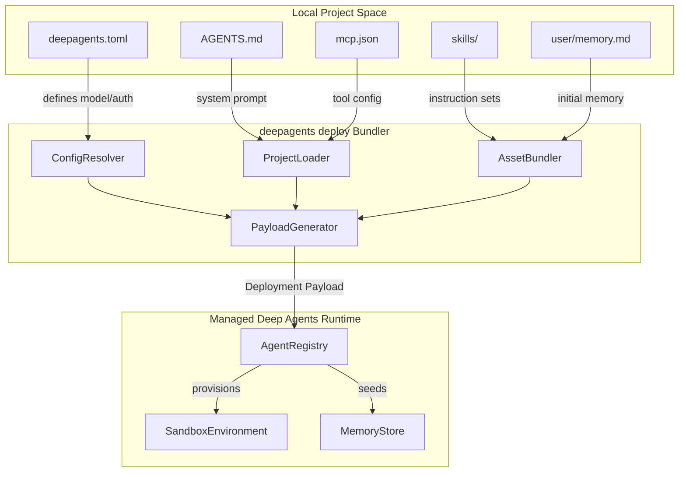
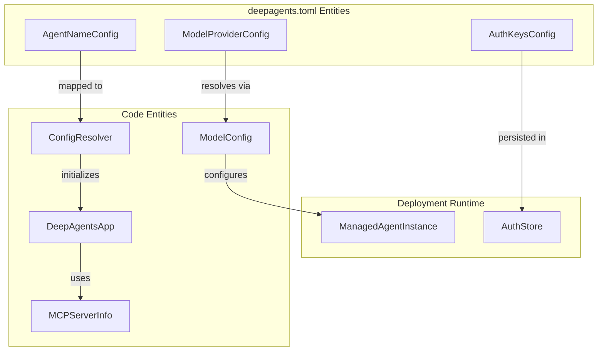

# Deploy Command (deepagents deploy)

<details>
<summary>Relevant source files</summary>

The following files were used as context for generating this wiki page:

- [examples/async-subagent-server/pyproject.toml](examples/async-subagent-server/pyproject.toml)
- [examples/content-builder-agent/uv.lock](examples/content-builder-agent/uv.lock)
- [examples/deep_research/pyproject.toml](examples/deep_research/pyproject.toml)
- [examples/deep_research/uv.lock](examples/deep_research/uv.lock)
- [examples/nvidia_deep_agent/pyproject.toml](examples/nvidia_deep_agent/pyproject.toml)
- [examples/nvidia_deep_agent/uv.lock](examples/nvidia_deep_agent/uv.lock)
- [examples/text-to-sql-agent/pyproject.toml](examples/text-to-sql-agent/pyproject.toml)
- [examples/text-to-sql-agent/uv.lock](examples/text-to-sql-agent/uv.lock)
- [libs/code/THREAT_MODEL.md](libs/code/THREAT_MODEL.md)
- [libs/code/deepagents_code/main.py](libs/code/deepagents_code/main.py)
- [libs/code/deepagents_code/ui.py](libs/code/deepagents_code/ui.py)
- [libs/code/deepagents_code/update_check.py](libs/code/deepagents_code/update_check.py)
- [libs/code/tests/unit_tests/test_args.py](libs/code/tests/unit_tests/test_args.py)
- [libs/code/tests/unit_tests/test_main.py](libs/code/tests/unit_tests/test_main.py)
- [libs/code/tests/unit_tests/test_main_args.py](libs/code/tests/unit_tests/test_main_args.py)
- [libs/code/tests/unit_tests/test_update_check.py](libs/code/tests/unit_tests/test_update_check.py)
- [libs/code/tests/unit_tests/test_version.py](libs/code/tests/unit_tests/test_version.py)

</details>


The `deepagents deploy` command is a core feature in the Deep Agents ecosystem designed for packaging and deploying AI agent harnesses in a manner that is agnostic to the underlying LLM model or infrastructure. This command bundles together the agent's configuration, memory, skills, system prompts, and related assets into a deployable payload that targets managed runtimes or sandboxed environments. It bridges local project development with production hosting platforms, supporting open protocols such as the Model Context Protocol (MCP) and Agent Protocol.

This page provides an in-depth technical overview of the deploy command's configuration, project layout conventions, execution subcommands (`init`, `dev`, `deploy`), the internal bundler mechanics, the sandbox execution scope options, and the supported deployment endpoints.

---

## Project Layout and Conventions

The deployment process relies heavily on a convention-driven project layout. This structure enables automatic discovery and bundling of agent-related files, facilitating reproducible and consistent deployments.

### Canonical Directory Structure

```
my-agent/
├── deepagents.toml         # Deployment manifest: model, backend, and auth config
├── AGENTS.md               # Required system prompt and agent instructions
├── mcp.json                # Optional MCP server configurations
├── .env                    # Optional local environment variable settings
├── skills/                 # Optional skills directory with reusable instructions
│   └── example/
│       ├── SKILL.md        # Skill definition files with instruction frontmatter
│       └── extra.txt       # Optional supporting data files for skills
└── user/                   # Optional user memory seeding files
    └── memory.md           # User-specific persistent memory seeded to the agent
```

### Key Configuration Components

- **`deepagents.toml`**  
  This is the primary deployment manifest file defining:
  - The agent's identity and metadata (e.g., name, author).
  - Model provider configuration including endpoint and parameters.
  - Authentication blocks for remote service credentials.  
  It is the key source for the `ConfigResolver` to interpret deployment settings at runtime.

- **`AGENTS.md`**  
  Contains the agent's primary system prompt and instructions. It forms the base prompt environment for the agent during execution and is mandatory.

- **`mcp.json`**  
  An optional file describing MCP servers associated with the agent deployment. Servers are represented as `MCPServerInfo` instances internally, enabling managed tool access through the MCP protocol.

- **`user/memory.md` and skills directory**  
  Provide persistent memory and modular skills that are bundled at deployment time. These are loaded by memory and skills middleware to extend agent behavior in production.

These layout conventions are enforced and consumed primarily by the `deepagents-code` CLI and its deployment bundler [libs/code/deepagents_code/main.py:37-48](), [libs/code/deepagents_code/ui.py:127-148](), [libs/code/THREAT_MODEL.md:64-67]()

---

## Deployment Subcommands

The deploy feature exposes several subcommands under the `deepagents deploy` umbrella:

### 1. `deepagents deploy init`

- Initializes a new deployable agent project scaffold.
- Creates the canonical directory structure laid out above.
- Generates a template `deepagents.toml` configuration and example files.
- Prepares the environment for local development and deployment.

### 2. `deepagents deploy dev`

- Starts a local runtime or sandboxed environment for iterative development.
- Uses the bundler to package current project files in-memory.
- Launches a local sandbox scope according to the configured deployment backend.
- Enables rapid testing and debugging of agent behaviors prior to production deployment.

### 3. `deepagents deploy deploy`

- Performs a full bundle of the project files and metadata.
- Uploads or pushes the bundle to configured managed agent runtime endpoints.
- Validates authentication tokens and deployment configurations.
- Supports multiple target protocols (MCP, A2A, Agent Protocol).
- Manages lifecycle events and reports deployment success or failure.

These subcommands integrate tightly with the project layout conventions and configuration resolution layers, streamlining the developer experience.

---

## Bundler Internals and Data Flow

At its core, the deploy command uses an internal bundler to aggregate disparate assets from disk and configuration into a unified deployment payload.

### Bundler Components:

- **ConfigResolver**  
  Parses and validates the `deepagents.toml` file, resolving model providers, authentication credentials, deployment backends, and other runtime parameters.

- **ProjectLoader**  
  Discovers project files such as `AGENTS.md`, `mcp.json`, skill directories, and user memory in accordance with canonical layout.

- **AssetBundler**  
  Reads content files, serializes them into structured formats, and prepares them for transport. This includes interpreting frontmatter in skills, memory seeding files, and prompt fragments.

- **PayloadGenerator**  
  Combines configuration data with bundled assets, producing a deployable package consumed by managed runtime APIs.

### Deployment Data Flow Diagram



This flow exemplifies how assets and configuration flow from the filesystem to the deployed managed runtime environment. The deployment payload carries all necessary items to instantiate the agent in production, including model details, skills, memory, and endpoint configurations.

Sources: [libs/code/deepagents_code/main.py:37-48](), [libs/code/THREAT_MODEL.md:64-67]()

---

## Sandbox and Memory Scope

Sandboxing is a crucial aspect of agent deployment, controlling the execution environment boundaries and lifecycle.

### Sandbox Scopes Supported

- **`thread` Scope**  
  Each conversation thread obtains a unique sandbox instance. This is suited for execution isolation, ensuring side effects or state do not leak between threads or users. It fits security-sensitive deployments where compartmentalization is essential.

- **`assistant` Scope**  
  All conversation threads share a single sandbox instance. This mode enables persistent shared state or long-running daemon-like behavior. Useful for deployments where continuity and efficiency over multiple threads are priorities.

The scope setting is governed by the deployment configuration and determines the lifecycle and visibility of any in-memory or filesystem sandbox artifacts.

### User Memory Seeding

- Memory files such as `user/memory.md` and `AGENTS.md` are bundled during deployment.
- They seed the agent's initial memory state and system prompt.
- Persistent memory updates during agent runtime are managed by backend protocols and storage.
- Memory middleware consumes these seeds at agent startup.

Sandbox and memory scoping form a foundational trust and security boundary modeled and enforced primarily within the Deep Agents CLI and runtime stack [libs/code/THREAT_MODEL.md:60-67]()

---

## Deployment Endpoints and Authentication

Deep Agents supports multiple runtime endpoints and authentications modes when deploying agents.

### Supported Deployment Protocols:

1. **Model Context Protocol (MCP)**
   - Exposes the deployed agent as a server endpoint adhering to MCP.
   - Allows external clients and tools to invoke the agent programmatically.
   - MCP server configurations are described via `mcp.json` files and translated internally into `MCPServerInfo` instances.

2. **Agent-to-Agent (A2A)**
   - Enables high-fidelity agent communication patterns.
   - Supports managed runtime interactions with rich event and message passing interfaces.

3. **Agent Protocol**
   - An open, extensible standard for generic agent interactions.
   - Designed for compatibility with a wide range of tooling and integrations.

### Authentication and `[auth]` Blocks

- The `deepagents.toml` file may define one or more `[auth]` sections.
- These contain external service credentials for model APIs, webhooks, or custom runtime backends.
- Auth credentials are managed persistently via the `/auth` command in the `deepagents-code` CLI.
- Integration with the broader credential store ensures secure handling and seamless runtime usage.

### Deployment Configuration to Code Mapping



This diagram illustrates how configuration entities defined in `deepagents.toml` correspond to internal objects used by the CLI and runtime components to initialize and deploy the agent, including authentication and server bindings.

Sources: [libs/code/deepagents_code/main.py:37-41](), [libs/code/deepagents_code/ui.py:138-140](), [libs/code/THREAT_MODEL.md:64-67]()

---

## Supported Providers

The deployment system supports a versatile collection of model and sandbox providers, configured optionally in the `pyproject.toml` file and loaded dynamically.

### Model Providers

- **Anthropic**
- **OpenAI**
- **Google GenAI**
- **DeepSeek**
- **Mistral**
- **Ollama**
- Additional providers via plugin systems or MCP integration

### Sandbox Providers

- **LangSmith Sandbox**: Hosted sandbox with LangSmith integration.
- **Daytona**: Remote execution environment.
- **Modal**: Cloud function sandbox backend.
- **Runloop**: Interactive execution sandbox.
- **Vercel**: Edge runtime provider.

These providers are discovered and managed via the sandbox factory and registry subsystem, accessible through the CLI deployment commands to initiate appropriate sandboxed agent instances.

Sources: [libs/code/deepagents_code/extras_info.py:1-45](), [libs/code/THREAT_MODEL.md:43]()

---

# Summary

The `deepagents deploy` command harmonizes agent configuration, prompt engineering, skills, memory, authentication, and deployment protocol compliance within a coherent, extendable framework. Its convention-based project layout and integrated bundler simplify repetitive tasks, while sandbox scope options and endpoint support enable flexible deployment topologies from local development sandboxes to cloud-managed agent APIs. Authentication and protocol support ensure secure, standards-compliant interactions with both managed and partner runtimes.

This functionality is critical for production-grade agent deployments in the Deep Agents eco-system, enabling developers to bridge their local development environments with managed cloud runtimes transparently and securely.

---

**Sources:**  
- [libs/code/deepagents_code/main.py:37-48,40-41]()  
- [libs/code/deepagents_code/ui.py:127-148,138-140]()  
- [libs/code/THREAT_MODEL.md:60-67,43,64-67]()  
- [libs/code/deepagents_code/extras_info.py:1-45]()