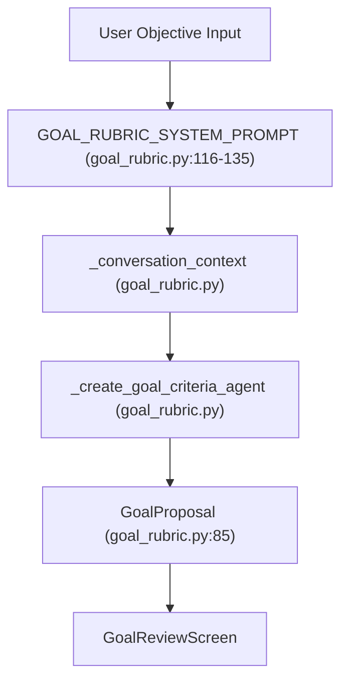
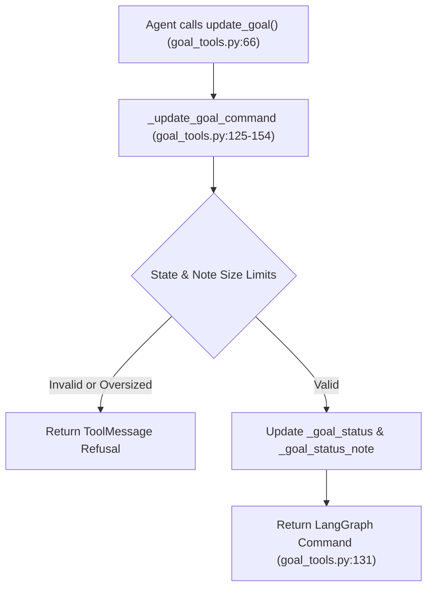
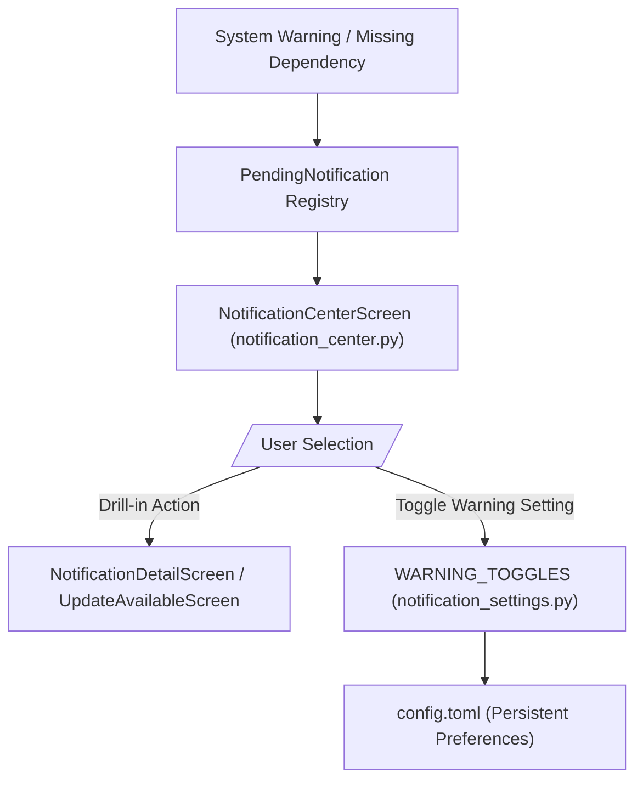
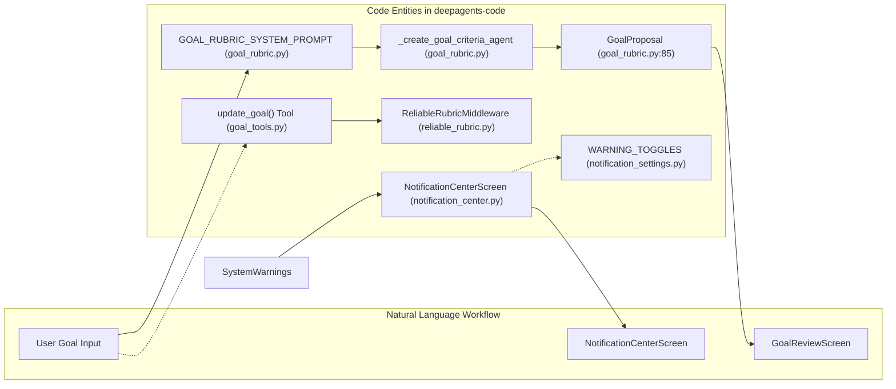

# Goal Review and Notifications

Relevant source files

The following files were used as context for generating this wiki page:

- [libs/code/deepagents_code/_constants.py](libs/code/deepagents_code/_constants.py)
- [libs/code/deepagents_code/goal_rubric.py](libs/code/deepagents_code/goal_rubric.py)
- [libs/code/deepagents_code/reliable_rubric.py](libs/code/deepagents_code/reliable_rubric.py)
- [libs/code/deepagents_code/tui/widgets/agent_selector.py](libs/code/deepagents_code/tui/widgets/agent_selector.py)
- [libs/code/deepagents_code/tui/widgets/effort_selector.py](libs/code/deepagents_code/tui/widgets/effort_selector.py)
- [libs/code/deepagents_code/tui/widgets/notification_center.py](libs/code/deepagents_code/tui/widgets/notification_center.py)
- [libs/code/deepagents_code/tui/widgets/notification_settings.py](libs/code/deepagents_code/tui/widgets/notification_settings.py)
- [libs/code/tests/unit_tests/test_goal_rubric.py](libs/code/tests/unit_tests/test_goal_rubric.py)
- [libs/code/tests/unit_tests/test_reliable_rubric.py](libs/code/tests/unit_tests/test_reliable_rubric.py)
- [libs/code/tests/unit_tests/tui/widgets/test_agent_selector.py](libs/code/tests/unit_tests/tui/widgets/test_agent_selector.py)
- [libs/code/tests/unit_tests/tui/widgets/test_notification_center.py](libs/code/tests/unit_tests/tui/widgets/test_notification_center.py)
- [libs/code/tests/unit_tests/tui/widgets/test_notification_settings.py](libs/code/tests/unit_tests/tui/widgets/test_notification_settings.py)

This page documents the goal acceptance-criteria workflow (`GoalReviewScreen`, `goal_rubric.py`, `ReliableRubricMiddleware`) and the notification center/settings system within `deepagents-code`.

## Purpose and Scope

The goal acceptance-criteria workflow orchestrates the process of translating user goals into structured, actionable acceptance criteria with automated verification using a reliable rubric system. This workflow is critical to ensure alignment between user intent and agent execution, driving goal lifecycle progression (`active`, `blocked`, `complete`, `paused`).

Simultaneously, the notification center component provides a unified UI hub for system-level alerts, dependency warnings, and user-configurable preferences. It exposes pending notices as rows, expandable settings toggles for warnings, and detail modals for actionable notification items.

**Sources:**  
`[libs/code/deepagents_code/goal_rubric.py:1-60]()`  
`[libs/code/deepagents_code/tui/widgets/notification_center.py:1-48]()`

---

## Goal Acceptance-Criteria Workflow (`goal_rubric.py`)

The acceptance-criteria workflow uses the `goal_rubric.py` module to parse raw goal objectives into minimal, concrete, and measurable acceptance criteria — furnished as flat Markdown bullet lists, without implementation or extraneous detail.

### Key Classes and Constants

- **`GOAL_RUBRIC_SYSTEM_PROMPT`**:  
  This system prompt instructs the LLM to produce concise, necessary acceptance criteria in Markdown bullets, focusing on observable results rather than implementation details. It restricts excessive web searches (max 3) and repository tool calls (bounded by `_REPOSITORY_TOOL_CALL_LIMIT`) to keep inspection targeted and efficient.  
  This prompt enforces preserving user constraints exactly, disallowing invention of requirements, and resolving underspecified objectives from conversation context.

- **`GoalProposal`** (structured output model): encapsulates the objective and the drafted criteria bullet list.

- **`_conversation_context`**:  
  Extracts recent, text-only, sanitized messages from the conversation history, excluding internal system/tool/debug messages and limiting content size. This context is key for concretizing underspecified goals during rubric drafting.

### Workflow Sequence

1. **User Input**: The user provides a textual goal objective.
2. **Prompt Construction**: `GOAL_RUBRIC_SYSTEM_PROMPT` is combined with the cleaned conversation context.
3. **Agent Invocation**: A goal criteria drafting agent (`_create_goal_criteria_agent`) receives the prompt and context.
4. **Goal Proposal Output**: The agent returns a `GoalProposal` containing the structured acceptance criteria.
5. **Review and Presentation**: The `GoalReviewScreen` presents the criteria to the user for acceptance or amendment.

**Sources:**  
`[libs/code/deepagents_code/goal_rubric.py:85-156]()`  
`[libs/code/tests/unit_tests/test_goal_rubric.py:173-190]()`

---

## Reliable Rubric and Goal Tools (`reliable_rubric.py` and `goal_tools.py`)

The robustness of the rubric and goal state management at runtime is achieved through middleware customizations and tools that enforce rigorous validation, structured retries, and state transitions.

### Reliable Rubric Middleware

The `ReliableRubricMiddleware` extends the SDK's `RubricMiddleware` to add specialized CLI-specific behavior supporting:

- **Per-request grader model selection**: Using thread-local state, it respects thread-scoped grade model overrides or falls back to main model specs.  
- **Nested grading**: The middleware runs a nested grading process with dcode’s verification middleware stack, supporting retries and managing operation budgets to avoid redundant evaluations.  
- **Failure handling**: On grader failures, it can fallback gracefully or propagate distinct errors for oversized goal states or recursion limits.

This middleware consumes and emits state via a private schema subclass (`ReliableRubricState`), carrying additional runtime model selections used in the CLI [libs/code/deepagents_code/reliable_rubric.py:71-175]().

### Goal Tools Middleware

`GoalToolsMiddleware` registers the key tool function `update_goal` exposed to the agent:

- The `_update_goal_command` validates the update payload's size limits and correctness before applying state transitions.  
- The method updates internal `_goal_status` and `_goal_status_note` state channels accordingly (e.g., moving a goal to `complete` or `blocked`).  
- It returns a LangGraph `Command` reflecting the state update, or a refusal `ToolMessage` for invalid updates.

**Sources:**  
`[libs/code/deepagents_code/reliable_rubric.py:71-175]()`  
`[libs/code/deepagents_code/goal_tools.py:50-154]()`  

---

## Notification Center and Actionable Notices

The notification subsystem provides a centralized UI hub, called `NotificationCenterScreen`, for presenting pending notifications, including missing dependencies, system warnings, and user alerts. It supports an inline notification settings section for toggling warning preferences.

### Core Components and Flow

- **`PendingNotification`**: Represents an individual notification entry with fields like `key`, `title`, `body`, and a list of `NotificationAction` objects. Actions include typical functionalities such as copy install commands, entering API keys, suppressing notices, and opening websites.  
- **Notification Actions**: Actions triggering modals or operations fall into two categories:  
  - *Terminal actions* dismiss the notification center upon completion.  
  - *In-place actions* (e.g., `ENTER_API_KEY`) open sub-dialogs over the center without dismissing it, posting messages like `NotificationActionRequested` to trigger app-layer handlers.

- **User Experience**:  
  - The center displays notifications as clickable single-line rows (`_NotificationRow`), with a dedicated detail modal layered on top on selection.  
  - Users can suppress notifications inline (`SUPPRESS`), which keeps the center open but refreshes the registry of notices.  
  - Warning toggles appear at the bottom in an expandable settings section, allowing users to control which warnings to show.

### Notification Settings

The settings toggles are defined in `notification_settings.py` as `WARNING_TOGGLES`:

| Warning Key           | Description                                    |
|-----------------------|------------------------------------------------|
| `COLD_CACHE_WARNING_KEY` | Warn before expensive cold prompt-cache turns |
| `ripgrep`             | Warn when ripgrep is not installed              |
| `tavily`              | Warn when TAVILY_API_KEY is not set (web search)|
| `YOLO_WARNING_KEY`    | Warn when YOLO mode is active (no approval review)|

User preferences are persisted in the configuration and respected across sessions.

**Sources:**  
`[libs/code/deepagents_code/tui/widgets/notification_center.py:1-163]()`  
`[libs/code/deepagents_code/tui/widgets/notification_settings.py:1-15]()`  
`[libs/code/tests/unit_tests/tui/widgets/test_notification_center.py:1-177]()`  
`[libs/code/tests/unit_tests/tui/widgets/test_notification_settings.py:1-170]()`  

---

## Summary Diagram Connecting Natural Language and Code Entities

---

This completes the technical overview of the goal review acceptance-criteria workflow and the notification center/settings subsystems in `deepagents-code`. Both components play critical roles in the interactive user-agent experience: the first for goal verification and progress control, and the second for system-wide alerts and user preferences.

# End of 3.14 Goal Review and Notifications

---

**Complete Sources:**  
- `[libs/code/deepagents_code/goal_rubric.py:1-175]()`  
- `[libs/code/deepagents_code/reliable_rubric.py:1-175]()`  
- `[libs/code/deepagents_code/goal_tools.py:50-154]()`  
- `[libs/code/deepagents_code/tui/widgets/notification_center.py:1-163]()`  
- `[libs/code/deepagents_code/tui/widgets/notification_settings.py:1-15]()`  
- `[libs/code/tests/unit_tests/test_goal_rubric.py:173-190]()`  
- `[libs/code/tests/unit_tests/test_reliable_rubric.py:1-200]()`  
- `[libs/code/tests/unit_tests/tui/widgets/test_notification_center.py:1-177]()`  
- `[libs/code/tests/unit_tests/tui/widgets/test_notification_settings.py:1-170]()`