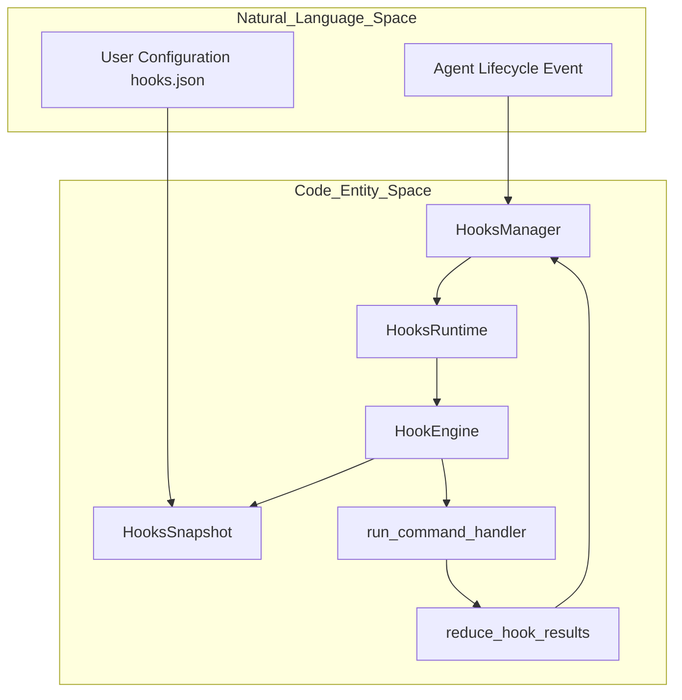
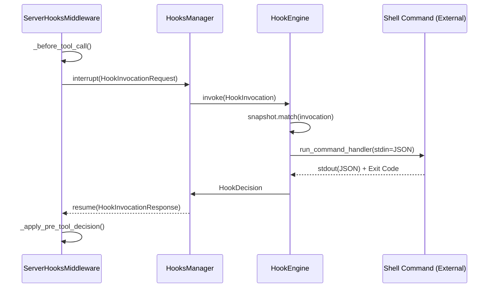

# Hooks System

Relevant source files

The following files were used as context for generating this wiki page:

- [libs/code/HOOKS.md](libs/code/HOOKS.md)
- [libs/code/deepagents_code/hooks/capabilities.py](libs/code/deepagents_code/hooks/capabilities.py)
- [libs/code/deepagents_code/hooks/engine.py](libs/code/deepagents_code/hooks/engine.py)
- [libs/code/deepagents_code/hooks/env.py](libs/code/deepagents_code/hooks/env.py)
- [libs/code/deepagents_code/hooks/manager.py](libs/code/deepagents_code/hooks/manager.py)
- [libs/code/deepagents_code/hooks/models/config.py](libs/code/deepagents_code/hooks/models/config.py)
- [libs/code/deepagents_code/hooks/models/domain.py](libs/code/deepagents_code/hooks/models/domain.py)
- [libs/code/deepagents_code/hooks/models/wire.py](libs/code/deepagents_code/hooks/models/wire.py)
- [libs/code/deepagents_code/hooks/projection.py](libs/code/deepagents_code/hooks/projection.py)
- [libs/code/deepagents_code/hooks/reducer.py](libs/code/deepagents_code/hooks/reducer.py)
- [libs/code/deepagents_code/hooks/runner.py](libs/code/deepagents_code/hooks/runner.py)
- [libs/code/deepagents_code/hooks/runtime.py](libs/code/deepagents_code/hooks/runtime.py)
- [libs/code/deepagents_code/hooks/server_middleware.py](libs/code/deepagents_code/hooks/server_middleware.py)
- [libs/code/deepagents_code/hooks/snapshot.py](libs/code/deepagents_code/hooks/snapshot.py)
- [libs/code/deepagents_code/hooks/tools.py](libs/code/deepagents_code/hooks/tools.py)
- [libs/code/deepagents_code/hooks/transcript.py](libs/code/deepagents_code/hooks/transcript.py)
- [libs/code/deepagents_code/hooks/trust.py](libs/code/deepagents_code/hooks/trust.py)
- [libs/code/deepagents_code/plugins/adapters/hooks.py](libs/code/deepagents_code/plugins/adapters/hooks.py)
- [libs/code/deepagents_code/tui/widgets/cwd_switch.py](libs/code/deepagents_code/tui/widgets/cwd_switch.py)
- [libs/code/deepagents_code/tui/widgets/mcp_login.py](libs/code/deepagents_code/tui/widgets/mcp_login.py)
- [libs/code/tests/unit_tests/hooks/models/test_models.py](libs/code/tests/unit_tests/hooks/models/test_models.py)
- [libs/code/tests/unit_tests/hooks/test_engine.py](libs/code/tests/unit_tests/hooks/test_engine.py)
- [libs/code/tests/unit_tests/hooks/test_execution.py](libs/code/tests/unit_tests/hooks/test_execution.py)
- [libs/code/tests/unit_tests/hooks/test_server_lifecycle.py](libs/code/tests/unit_tests/hooks/test_server_lifecycle.py)
- [libs/code/tests/unit_tests/hooks/test_transcript.py](libs/code/tests/unit_tests/hooks/test_transcript.py)
- [libs/code/tests/unit_tests/hooks/test_trust.py](libs/code/tests/unit_tests/hooks/test_trust.py)
- [libs/code/tests/unit_tests/tui/widgets/test_cwd_switch.py](libs/code/tests/unit_tests/tui/widgets/test_cwd_switch.py)

The Hooks v2 system provides a robust mechanism for executing user-configured shell commands or script handlers at specific agent lifecycle events `[libs/code/HOOKS.md:3-4]()`. It enables real-time monitoring, security policy enforcement, and context injection by allowing external handlers to inspect agent state and influence execution via exit codes and structured JSON payloads `[libs/code/HOOKS.md:127-135]()`.

## Overview and Lifecycle Events

Hooks are triggered by two primary process owners: the **Client** (the interactive terminal UI or headless runner) and the **Server** (the LangGraph agent runtime) `[libs/code/deepagents_code/hooks/models/domain.py:53-58]()`.

### Supported Events Matrix

| Event               | Owner  | Matcher Field | Description                                        |
| ------------------- | ------ | ------------- | ------------------------------------------------ |
| `SessionStart`      | Client | `cause`       | Triggered on startup, resume, or clear            `[libs/code/HOOKS.md:51]()`                   |
| `UserPromptSubmit`  | Client | _None_        | Before a user prompt is dispatched to the agent   `[libs/code/HOOKS.md:52]()`                   |
| `PermissionRequest` | Client | `tool_name`   | Before the TUI requests user permission for tool execution `[libs/code/HOOKS.md:54]()`          |
| `Notification`      | Client | `notification_type` | On lifecycle notifications such as agent completion `[libs/code/HOOKS.md:55]()`              |
| `PreToolUse`        | Server | `tool_name`   | Before a tool call is executed by the model         `[libs/code/HOOKS.md:56]()`                   |
| `PostToolUse`       | Server | `tool_name`   | After a tool call completes successfully             `[libs/code/HOOKS.md:57]()`                   |
| `PostToolUseFailure`| Server | `tool_name`   | After a tool call raises an error                     `[libs/code/deepagents_code/hooks/models/domain.py:46]()` |
| `PreCompact`        | Server | `trigger`     | Before conversation history compaction               `[libs/code/HOOKS.md:59]()`                   |
| `Stop`              | Server | _None_        | After an agent turn completes                         `[libs/code/HOOKS.md:60]()`                   |
| `SubagentStart`     | Server | `agent_name`  | When a subagent is spawned                            `[libs/code/HOOKS.md:61]()`                   |
| `SubagentStop`      | Server | `agent_name`  | When a subagent finishes executing                    `[libs/code/deepagents_code/hooks/models/domain.py:50]()` |

Sources: `[libs/code/HOOKS.md:49-63]()`, `[libs/code/deepagents_code/hooks/models/domain.py:36-51]`, `[libs/code/deepagents_code/hooks/server_middleware.py:3-5]()`

---

## Configuration and Trust Model

Hooks are declared using `hooks.json` configuration files distributed across three distinct scope levels.

### Scope Precedence and Merging

1. **Project Scope**: `{project_root}/.deepagents/hooks.json`  
2. **User Scope**: `~/.deepagents/hooks.json` (or alternate config directory in tests)  
3. **Plugin Scope**: Contributed via `plugin.json` or plugin registrations from enabled plugins  

The `load_hooks_config` function validates, merges, and computes a canonical SHA-256 fingerprint (`snapshot_id`) for the combined configuration `[libs/code/deepagents_code/hooks/loading.py:131-137]()`, `[libs/code/deepagents_code/hooks/loading.py:186-198]()`. All matching handlers for an event execute in declaration order, and aggregation policies combine their results `[libs/code/deepagents_code/hooks/loading.py:9-11]()`.

### Workspace Trust Boundary

Because project-scoped hooks can execute arbitrary code within a repository, the engine enforces strict workspace trust rules implemented by `WorkspaceTrust` to prevent security risks `[libs/code/deepagents_code/hooks/trust.py:25-27]()`. Key points:

- **Interactive Mode**: The user is prompted to authorize project hooks when encountering an untrusted repository `[libs/code/HOOKS.md:21]()`.
- **Trust Persistence**: Trusted project hooks are persisted across sessions in `~/.deepagents/.state/hooks_trust.json` with restricted (0o600) permissions `[libs/code/HOOKS.md:22]()`, `[libs/code/tests/unit_tests/hooks/test_trust.py:57-66]()`.
- **Headless Mode / CI**: Without explicit flags like `--trust-project-hooks`, project-scoped handlers are not loaded to avoid executing untrusted code `[libs/code/HOOKS.md:25]()`.

This mitigates risks of compromised or malicious hooks in external projects.

Sources: `[libs/code/HOOKS.md:7-42]()`, `[libs/code/deepagents_code/hooks/loading.py:1-26]()`, `[libs/code/deepagents_code/hooks/trust.py:57-67]()`, `[libs/code/tests/unit_tests/hooks/test_trust.py:111-125]()`

---

## Hook Execution Engine

The `HookEngine` is the core executor that matches incoming lifecycle invocations against a compiled `HooksSnapshot` configuration and coordinates handler execution `[libs/code/deepagents_code/hooks/engine.py:15]()`, `[libs/code/deepagents_code/hooks/snapshot.py:69-75]()`.

### Handler Types

- **Command**: Runs a shell command string (POSIX `/bin/sh`, Windows `cmd.exe`), allowing full shell capability such as pipes and environment expansions `[libs/code/HOOKS.md:78]()`, `[libs/code/deepagents_code/hooks/runner.py:95-103]()`.
- **Argv**: Runs a direct list of arguments with `asyncio.create_subprocess_exec`, avoiding shell parsing and reducing injection risks `[libs/code/HOOKS.md:79]()`, `[libs/code/deepagents_code/hooks/runner.py:84-93]()`.

### Execution Data Flow

1. **Invocation Creation**: A `HookInvocation` object wraps a `HookEvent` and shared `HookContext` describing the lifecycle state `[libs/code/deepagents_code/hooks/models/domain.py:152-163]()`.
2. **Projection**: The domain event is transformed into a Claude-compatible JSON wire format `HookWireInput` by `project_hook_input` to serve the external handler interface `[libs/code/deepagents_code/hooks/projection.py:70-75]()`.
3. **Running Handlers**: The `run_command_handler` async coroutine launches the configured command with bounded timeout, feeding the JSON payload into `stdin` and collecting structured JSON output from `stdout` `[libs/code/deepagents_code/hooks/runner.py:46-60]()`.
4. **Reducing Results**: Multiple handler outputs are merged via `reduce_hook_results` into final typed decisions including exit code interpretation and diagnostic aggregation `[libs/code/deepagents_code/hooks/reducer.py:56-57]()`.

### Exit Code and Aggregation Policies

- **Exit Code 0**: Success. The handler's stdout is parsed as `HookWireOutput` JSON and interpreted to influence lifecycle decisions.
- **Exit Code 2**: Synthetic "block" decision. For example, in `PreToolUse` hooks, this immediately denies tool execution with a reason, regardless of stdout content.
- **Other non-zero codes**: Treated as failures, reported as diagnostics but typically allow continuation.

### Natural Language to Code Entity Mapping

This diagram illustrates how lifecycle hooks conceptually bridge the natural language domain of agent lifecycle events and user configurations into concrete code entities.

Sources: `[libs/code/deepagents_code/hooks/manager.py:106-112]()`, `[libs/code/deepagents_code/hooks/runtime.py:49-55]()`, `[libs/code/deepagents_code/hooks/snapshot.py:69-75]()`, `[libs/code/deepagents_code/hooks/engine.py:15]()`

---

## Transcripts and Materialization

The hooks system integrates tightly with conversation history. Transcripts are stored in JSONL format for both user sessions and individual subagents via `TranscriptStore` `[libs/code/deepagents_code/hooks/transcript.py]()`. 

- The client runtime materializes transcripts and provides file paths (`transcript_path`, `agent_transcript_path`) to hook handlers in wire input payloads to give external commands access to the full conversational context without querying the live graph `[libs/code/deepagents_code/hooks/runtime.py:38-46]()`, `[libs/code/deepagents_code/hooks/projection.py:59-75]()`.

This allows shell scripts or external processes to analyze thread history, agent turns, and subagent activity for complex lifecycle decision making or notifications.

Sources: `[libs/code/deepagents_code/hooks/runtime.py:126-142]()`, `[libs/code/deepagents_code/hooks/projection.py:59-75]()`

---

## Migration from Legacy Hooks

Legacy hooks used a more limited flat list configuration format. The Hooks v2 system provides migration utilities (`migrate_legacy_hooks`, `is_legacy_hooks_document`) that transform legacy user or project hook configurations into the new structured schema supporting full lifecycle events and finer-grained handler declarations `[libs/code/deepagents_code/hooks/loading.py:24-46]`, `[libs/code/deepagents_code/hooks/migration.py]()`. 

- Deprecated legacy formats emit warnings with deprecation timelines to prompt users to upgrade `[libs/code/deepagents_code/hooks/loading.py:59]()`.

Sources: `[libs/code/deepagents_code/hooks/loading.py:24-46]()`, `[libs/code/deepagents_code/hooks/migration.py]()`

---

## Implementation Details

### Server-Side Middleware

`ServerHooksMiddleware` is a critical middleware layer integrated into the server-side LangGraph agent runtime `[libs/code/deepagents_code/hooks/server_middleware.py:1-6]()`. It manages the dispatch and orchestration of server-owned lifecycle events:

- Emits lifecycle events including `PreCompact`, `PreToolUse`, `PostToolUse`, `PostToolUseFailure`, `Stop`, `SubagentStart`, and `SubagentStop` through LangGraph's interrupt channel, enabling client runtimes or external handlers to process them `[libs/code/deepagents_code/hooks/server_middleware.py:3-5]()`.
- Maintains private state keys for:
  - `_hooks_pre_tool_outcomes` caching tool-call permission decisions,
  - `_hooks_stop_continuation_count` tracking stop-hook loop iterations,
  - `_hooks_pending_post_tools` monitoring tool executions awaiting post-action hooks `[libs/code/deepagents_code/hooks/server_middleware.py:90-92]()`.
- Handles interruption by propagating hook invocation requests and resuming operations after receiving decisions.

### Client-Side Management Flow

Here is a typical lifecycle interaction between server-side middleware, the client-side hook manager, the hook execution engine, and external command runners during a `PreToolUse` event:

- The `ServerHooksMiddleware` intercepts tool calls, emits a `PreToolUse` hook invocation via async interrupt to the client.
- The `HooksManager` on the client receives the invocation, then passes it to the `HookEngine`, which matches against configured handlers.
- The `HookEngine` runs each handler's shell command with the invocation JSON passed to stdin.
- Handler JSON outputs and exit codes are gathered and reduced into a `HookDecision`.
- The client sends the decision back to the server middleware, which applies the result to permit or deny tool execution.

Sources: `[libs/code/deepagents_code/hooks/server_middleware.py:22-38]()`, `[libs/code/deepagents_code/hooks/manager.py:106-125]()`, `[libs/code/deepagents_code/hooks/engine.py:15]()`, `[libs/code/deepagents_code/hooks/runner.py:46-60]()`

---