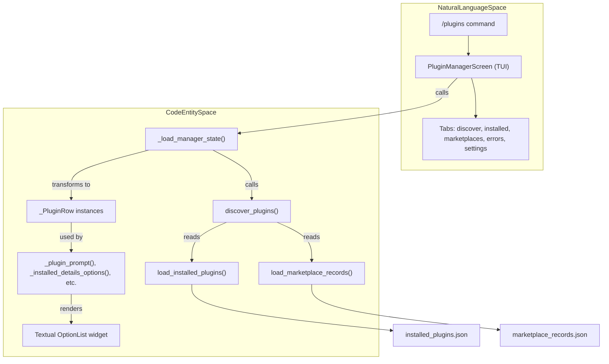
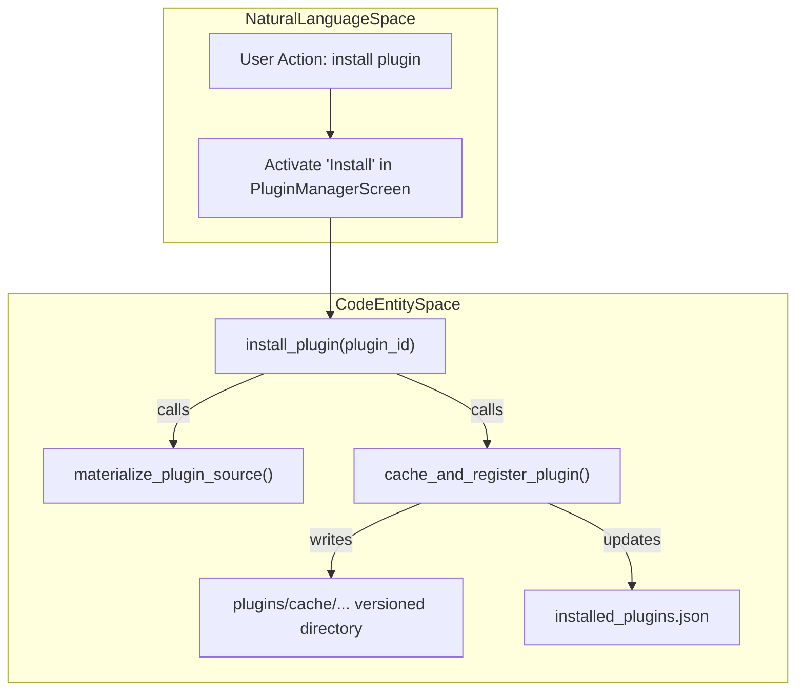
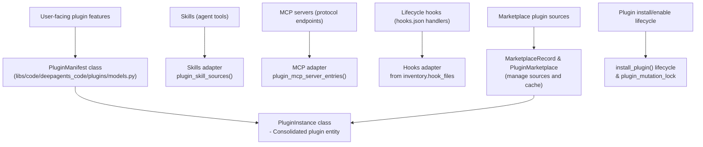

# Plugin Manager

<details>
<summary>Relevant source files</summary>

The following files were used as context for generating this wiki page:

- [libs/code/deepagents_code/plugins/discovery.py](libs/code/deepagents_code/plugins/discovery.py)
- [libs/code/deepagents_code/plugins/manifest.py](libs/code/deepagents_code/plugins/manifest.py)
- [libs/code/deepagents_code/plugins/marketplace.py](libs/code/deepagents_code/plugins/marketplace.py)
- [libs/code/deepagents_code/plugins/models.py](libs/code/deepagents_code/plugins/models.py)
- [libs/code/deepagents_code/tui/modals/plugin_manager/__init__.py](libs/code/deepagents_code/tui/modals/plugin_manager/__init__.py)
- [libs/code/deepagents_code/tui/modals/plugin_manager/content.py](libs/code/deepagents_code/tui/modals/plugin_manager/content.py)
- [libs/code/deepagents_code/tui/modals/plugin_manager/models.py](libs/code/deepagents_code/tui/modals/plugin_manager/models.py)
- [libs/code/deepagents_code/tui/modals/plugin_manager/plugin_manager.tcss](libs/code/deepagents_code/tui/modals/plugin_manager/plugin_manager.tcss)
- [libs/code/deepagents_code/tui/modals/plugin_manager/state.py](libs/code/deepagents_code/tui/modals/plugin_manager/state.py)
- [libs/code/deepagents_code/tui/modals/plugin_manager/tabs.py](libs/code/deepagents_code/tui/modals/plugin_manager/tabs.py)
- [libs/code/tests/unit_tests/plugins/test_marketplace.py](libs/code/tests/unit_tests/plugins/test_marketplace.py)
- [libs/code/tests/unit_tests/plugins/test_plugins_p0.py](libs/code/tests/unit_tests/plugins/test_plugins_p0.py)
- [libs/code/tests/unit_tests/tui/modals/plugin_manager/test_structure.py](libs/code/tests/unit_tests/tui/modals/plugin_manager/test_structure.py)

</details>


The Plugin Manager provides an extensible system for augmenting `deepagents-code` with new capabilities. It manages the discovery, installation, and lifecycle of plugins that contribute skills, Model Context Protocol (MCP) servers, and event hooks to the agentic environment.

## Purpose and Scope

This page documents the internal architecture of the plugin system in `deepagents-code`. This includes the `plugin.json` manifest specification, supported plugin components (skills, MCP servers, hooks), marketplace sources and parsing, the installation lifecycle, the `PluginManagerScreen` TUI implementation, persistence stores, and component adapters.

Sources: [libs/code/deepagents_code/tui/modals/plugin_manager/__init__.py:1-166](), [libs/code/deepagents_code/plugins/manifest.py:1-38]()

## Plugin Manifest and Components

Plugins are identified by a manifest file, `plugin.json`, located either at the plugin root or within a `.claude-plugin/` or `.codex-plugin/` directory [libs/code/deepagents_code/plugins/manifest.py:21-25]().

### Plugin Manifest (`plugin.json`)
The manifest defines the plugin's identity and its constituent components.

| Attribute | Description |
| :--- | :--- |
| `name` | Unique identifier for the plugin (no whitespace, validated by a regex). Names such as `code-review` and `review@team` are valid; spaces are not allowed. [libs/code/deepagents_code/plugins/manifest.py:58-82]() |
| `version` | Version string of the plugin manifest [libs/code/deepagents_code/plugins/models.py:72]() |
| `displayName` | Optional human-readable label presented in the UI [libs/code/deepagents_code/plugins/models.py:77]() |
| `skills` | One or multiple relative paths pointing to skill directories within the plugin [libs/code/deepagents_code/plugins/manifest.py:150-163]() |
| `mcpServers` | One or multiple relative paths or inline MCP server definitions, exposing commands or services to the agent environment [libs/code/deepagents_code/plugins/manifest.py:187-196]() |
| `hooks` | One or multiple relative paths or inline hook configurations conforming to `hooks.json` format [libs/code/deepagents_code/plugins/manifest.py:199-213]() |
| `autoUpdate` | Boolean indicating if this plugin permits automatic update by the system [libs/code/deepagents_code/plugins/models.py:78]() |

### Supported Components
The system discovers and loads the following components:

1.  **Skills**: Agent tools or capabilities organized in skill directories according to the manifest [libs/code/deepagents_code/plugins/models.py:89]().
2.  **MCP Servers**: Background or interactive protocol servers providing tools or capabilities remotely [libs/code/deepagents_code/plugins/models.py:90]().
3.  **Hooks**: Systems hooks (Hooks v2) responding to lifecycle events like `PreToolUse` or `SessionStart` [libs/code/deepagents_code/plugins/models.py:91]().

**Unsupported Components**: Certain directories such as `agents/` and `commands/` appear in plugin directories but are explicitly not loaded by the system to prevent conflicts. These are recorded as unsupported components for display purposes [libs/code/deepagents_code/plugins/manifest.py:28-31]().

Sources: [libs/code/deepagents_code/plugins/manifest.py:21-31](), [libs/code/deepagents_code/plugins/models.py:54-94]()

## Marketplace Architecture

Plugins are distributed via **Marketplaces**, which are collections of plugins declared in `marketplace.json` manifests [libs/code/deepagents_code/plugins/models.py:190-199]().

### Marketplace Sources
Marketplaces can be sourced from various locations and formats via `parse_marketplace_source` and `add_marketplace_source`:

* **Local Directory** - A local filesystem directory containing a `marketplace.json` file [libs/code/deepagents_code/plugins/models.py:20-25]().
* **GitHub Repository** - Either shorthand notation (e.g., `owner/repo`) or full HTTPS URL [libs/code/deepagents_code/plugins/marketplace.py:180-191]().
* **Git Repository URL** - Generic Git repository URLs supporting optional `#ref` for branches or tags [libs/code/deepagents_code/plugins/marketplace.py:159-179]().
* **HTTPS URL** - Direct URL to a JSON marketplace manifest (must be HTTPS for security) [libs/code/deepagents_code/plugins/marketplace.py:168-191]().

Marketplace URLs and repository credentials are redacted in logs and UI displays to avoid leaking secrets [libs/code/deepagents_code/plugins/marketplace.py:78-140]().

### Plugin Identity

Plugins use a canonical stable identity string in the form:

```
{name}@{marketplace}
```

Example: `quality-review-plugin@company-tools`

This identity is used for registration, enablement, and installation bookkeeping [libs/code/deepagents_code/plugins/models.py:111-129]().

Sources: [libs/code/deepagents_code/plugins/marketplace.py:142-201](), [libs/code/deepagents_code/plugins/models.py:13-50](), [libs/code/deepagents_code/plugins/discovery.py:53-97]()

## Plugin Lifecycle and Storage

### Persistence Stores

Plugin state is persisted with several JSON files managed in package `plugins.store`:

| Store | Description |
| --- | --- |
| `installed_plugins.json` | Maps plugin IDs to `install_path` and manifest `version` for installed plugin caches [libs/code/deepagents_code/plugins/store.py:213-221]() |
| `enabled_plugins.json` | List of plugin IDs currently enabled and active in the user's session [libs/code/deepagents_code/plugins/store.py:32-49]() |
| `marketplace_records.json` | Stores configured marketplace sources with metadata like source type, URL, cache location, and optional ref [libs/code/deepagents_code/plugins/store.py:202-210]() |

These stores are accessed and mutated with concurrency protection by `plugin_mutation_lock` decorators ensuring consistency [libs/code/deepagents_code/plugins/discovery.py:54-80]().

### Lifecycle States

The UI and internal state logic represent plugins with `_PluginRow` dataclasses supporting these session-aware status states:

* **`enabled`** — Plugin is enabled and loaded in the current interactive session.
* **`disabled`** — Plugin is installed but not enabled, thus inactive.
* **`pending_reload`** — The plugin's enabled state differs from the loaded session; changes require a `/reload` command to apply.
* **`error`** — Plugin failed to load due to manifest or runtime errors.

The UI displays these states prominently and supports transitions via enable/disable and installation commands [libs/code/deepagents_code/tui/modals/plugin_manager/models.py:38-64]().

Sources: [libs/code/deepagents_code/plugins/store.py:32-49](), [libs/code/deepagents_code/tui/modals/plugin_manager/models.py:37-78]()

## Implementation: Plugin Manager TUI

### PluginManagerScreen Overview

The `PluginManagerScreen` class is a `ModalScreen` implemented using the Textual TUI framework. It offers a keyboard-navigable interface for plugin discovery, installation, enablement, marketplace management, and error inspection. It supports multiple tabs (`discover`, `installed`, `marketplaces`, `errors`, `settings`) and modal dialogs for details and confirmation actions [libs/code/deepagents_code/tui/modals/plugin_manager/__init__.py:89-166]():

- Keyboard bindings for navigation: arrow keys, tab, enter, escape, and search `/` focusing.
- Lifecycle hooks to check for reload necessity on close and to handle plugin state changes in place.
- Deferred checks allow prompting users to `/reload` their session when plugin states have changed.

### Data Flow: Discovery to Display

The UI data flow from plugin system discovery to user interface involves scanning filesystem and marketplace data, merging installed and enabled states, and presenting consistent plugin rows with detailed metadata.


This data flow ensures static and dynamic plugin information, including enabled state, MCP server connection status, skill counts, hook presence, and load state errors are synchronized for display in the TUI.

Sources: [libs/code/deepagents_code/tui/modals/plugin_manager/state.py:20-165](), [libs/code/deepagents_code/tui/modals/plugin_manager/__init__.py:150-165]()

### Installation and Materialization Lifecycle

When a user installs a plugin, the system executes the following steps:

1. Resolves the plugin source (local directory, Git repo, or URL) using marketplace metadata.
2. Materializes the plugin source by downloading/cloning or copying files to a versioned cache directory under:

```
plugins/cache/{marketplace}/{plugin_name}/{version}/
```

3. Writes or updates the `installed_plugins.json` store to register the installation path and version.
4. Enables the plugin by adding it to `enabled_plugins.json`.
5. Prepares plugin runtime data directories.



This process is atomic and guarded by `plugin_mutation_lock` to prevent concurrent mutations [libs/code/deepagents_code/plugins/discovery.py:203-217](), [libs/code/deepagents_code/plugins/marketplace.py:20-35]()

Sources: [libs/code/deepagents_code/plugins/discovery.py:203-217](), [libs/code/deepagents_code/plugins/marketplace.py:21-35]()

## Component Adapters

To integrate plugin components into the agent runtime, the plugin system provides adapters aligning plugin data structures to internal middleware and runtime abstractions.

- **Skills Adapter**: The function `plugin_skill_sources` enumerates skill directories exposed by a plugin instance, feeding the core `SkillsMiddleware` to load skill tools [libs/code/deepagents_code/tui/modals/plugin_manager/state.py:56-77]().

- **MCP Servers Adapter**: `plugin_mcp_server_entries` extracts MCP server definitions, environment variable interpolations (such as `${CLAUDE_PLUGIN_ROOT}`), and handles server name scoping to prevent naming collisions across plugins [libs/code/tests/unit_tests/plugins/test_plugins_p0.py:20-95]().

- **Hooks Adapter**: Plugin hook files (typically `hooks.json`) are exposed as a tuple of paths in `inventory.hook_files`. These feed into the `HookEngine` lifecycle event dispatcher [libs/code/deepagents_code/plugins/models.py:91](), [libs/code/deepagents_code/tui/modals/plugin_manager/state.py:120-140]().

These adapters provide typed, scoped integration points that enable the multi-component plugin architecture.

Sources: [libs/code/deepagents_code/tui/modals/plugin_manager/state.py:56-110](), [libs/code/deepagents_code/plugins/models.py:82-94](), [libs/code/tests/unit_tests/plugins/test_plugins_p0.py:20-95]()

## CLI and Slash Commands

The plugin manager functionality is exposed via several user commands and CLI interfaces:

| Command | Action |
| :--- | :--- |
| `/plugins` | Opens the `PluginManagerScreen` which presents the interactive TUI for plugin management. [libs/code/deepagents_code/tui/modals/plugin_manager/__init__.py:86]() |
| `/reload` | Causes the agent system to reload plugins, applying any changes such as enables/disables or installations pending a reload. This command is referenced in UI state as necessary to sync plugin state [libs/code/deepagents_code/tui/modals/plugin_manager/models.py:60-61]() |
| `dcode mcp config` | CLI command to manage MCP server configurations, including plugin-contributed MCP tools [libs/code/tests/unit_tests/plugins/test_plugins_p0.py:25]() |

Sources: [libs/code/deepagents_code/tui/modals/plugin_manager/__init__.py:85-109](), [libs/code/deepagents_code/plugins/commands_cli.py:25]()

---

This detailed view shows how the Plugin Manager operates as a core extensibility mechanism, coordinating manifests, marketplaces, installed state, runtime integration, and user interaction through a cohesive UI model and persistent store backed lifecycle.

# Additional Diagram: Mapping Natural Language Plugin Concepts to Code Artifacts



Sources: [libs/code/deepagents_code/plugins/models.py:50-137](), [libs/code/deepagents_code/tui/modals/plugin_manager/state.py:50-120](), [libs/code/deepagents_code/plugins/discovery.py:203-217]()

---

# Summary

The Plugin Manager system in `deepagents-code` is a sophisticated architecture enabling modular extension with skills, MCP servers, and hooks contributed by plugins defined via `plugin.json` manifests and organized into marketplaces. It manages installation and enablement states with concurrency-safe stores, provides user interaction via a terminal UI screen, and exposes components to the agent runtime through specialized adapter interfaces. This design supports seamless expansion of agent capabilities while maintaining session consistency and user control.