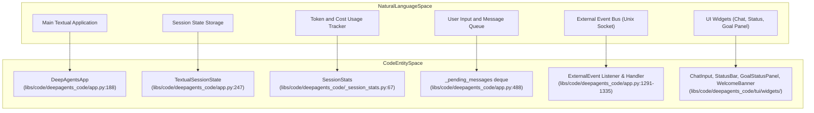
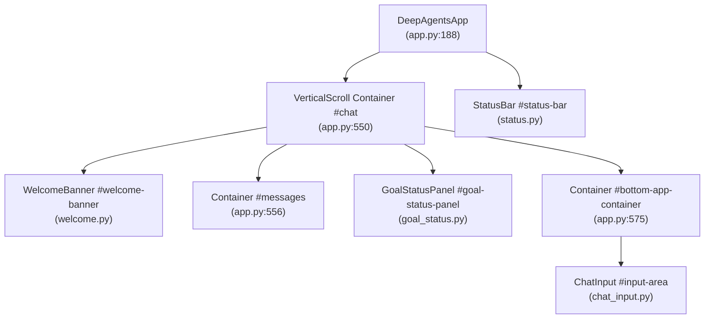
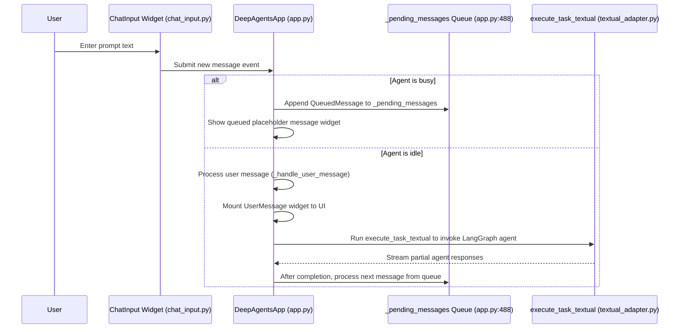

# Interactive Mode and DeepAgentsApp

Relevant source files

The following files were used as context for generating this wiki page:

- [libs/code/COMMANDS.md](libs/code/COMMANDS.md)
- [libs/code/deepagents_code/app.py](libs/code/deepagents_code/app.py)
- [libs/code/deepagents_code/command_registry.py](libs/code/deepagents_code/command_registry.py)
- [libs/code/deepagents_code/tui/modals/_cost_breakdown.py](libs/code/deepagents_code/tui/modals/_cost_breakdown.py)
- [libs/code/deepagents_code/tui/modals/cost_breakdown.py](libs/code/deepagents_code/tui/modals/cost_breakdown.py)
- [libs/code/deepagents_code/tui/modals/mcp_servers.py](libs/code/deepagents_code/tui/modals/mcp_servers.py)
- [libs/code/deepagents_code/tui/modals/mcp_servers.tcss](libs/code/deepagents_code/tui/modals/mcp_servers.tcss)
- [libs/code/deepagents_code/tui/widgets/debug_console.py](libs/code/deepagents_code/tui/widgets/debug_console.py)
- [libs/code/deepagents_code/tui/widgets/startup_tip.py](libs/code/deepagents_code/tui/widgets/startup_tip.py)
- [libs/code/deepagents_code/tui/widgets/welcome.py](libs/code/deepagents_code/tui/widgets/welcome.py)
- [libs/code/tests/unit_tests/test_app.py](libs/code/tests/unit_tests/test_app.py)
- [libs/code/tests/unit_tests/test_command_registry.py](libs/code/tests/unit_tests/test_command_registry.py)
- [libs/code/tests/unit_tests/test_cost_breakdown.py](libs/code/tests/unit_tests/test_cost_breakdown.py)
- [libs/code/tests/unit_tests/test_debug_console.py](libs/code/tests/unit_tests/test_debug_console.py)
- [libs/code/tests/unit_tests/test_thread_naming_app.py](libs/code/tests/unit_tests/test_thread_naming_app.py)
- [libs/code/tests/unit_tests/tui/widgets/test_startup_tip.py](libs/code/tests/unit_tests/tui/widgets/test_startup_tip.py)
- [libs/code/tests/unit_tests/tui/widgets/test_welcome.py](libs/code/tests/unit_tests/tui/widgets/test_welcome.py)

This document covers the `DeepAgentsApp` class [libs/code/deepagents_code/app.py:188-273](), the core Textual application that provides the interactive terminal UI for the `deepagents-code` package. It details the app lifecycle, server startup, event handling, message queuing, incognito shell mode, onboarding flow, event bus integration, and embedded tips shown during startup.

For a more comprehensive understanding of associated widgets and subsystems, refer to these related pages:
- [3.3 Chat Input and Autocomplete]()
- [3.4 Message Display and Virtualization]()
- [3.5 Thread and Session Management]()

---

## Purpose and Scope

`DeepAgentsApp` orchestrates the interactive CLI experience of deepagents-code by managing UI components, user input queuing, agent execution, state persistence, and event handling. Its responsibilities include:

- **Widget composition:** Configures the TUI widget hierarchy with chat message area, input field, status bar, onboarding dialogs, and info banners [libs/code/deepagents_code/app.py:532-621]().

- **Message queueing:** Manages a `_pending_messages` deque to buffer user prompts when the agent is busy, ensuring sequential execution and preventing concurrency issues [libs/code/deepagents_code/app.py:488]().

- **Agent task execution:** Runs LangGraph agents asynchronously through the `execute_task_textual` adapter, streaming partial results and handling user interruptions [libs/code/deepagents_code/app.py:1525-1565]().

- **Interrupt and cancellation:** Processes escape or Ctrl+C triggers to cancel in-flight agents, dismiss modals or autocomplete, clear queues, and reset app state gracefully [libs/code/deepagents_code/app.py:1828-1908]().

- **Thread/session management:** Supports thread switching and persistence, enabling the user to resume previous conversations and share context across sessions [libs/code/deepagents_code/app.py:1567-1631]().

- **Human-in-the-Loop (HITL) approvals:** Integrates decision UIs and approval cycles for tool calls via `TextualUIAdapter` for safety and manual control [libs/code/deepagents_code/app.py:1218-1230]().

- **Incognito shell mode (:: `!!` prefix):** Allows direct shell command execution without recording state in agent context, isolating transient commands [libs/code/deepagents_code/app.py:1406-1460]().

- **Event bus ingestion:** Listens for external events over UNIX sockets, converting them into conversation inputs to enrich the interaction flow [libs/code/deepagents_code/app.py:1291-1335]().

- **Onboarding and startup tips:** Presents welcome banners with context info and randomized tips to aid user orientation and discoverability [libs/code/deepagents_code/tui/widgets/startup_tip.py:1-143](), [libs/code/deepagents_code/tui/widgets/welcome.py:1-202]().

Sources: [libs/code/deepagents_code/app.py:1-1908](), [libs/code/deepagents_code/_session_stats.py:67-71](), [libs/code/deepagents_code/tui/widgets/startup_tip.py:1-143]()

---

## Application Architecture

### Natural Language to Code Entity Mapping

This diagram explains the mapping from user-facing system concepts to the concrete code entities implementing them within `DeepAgentsApp` and its dependencies.

Sources: [libs/code/deepagents_code/app.py:188-273](), [libs/code/deepagents_code/_session_stats.py:67-71](), [libs/code/deepagents_code/tui/widgets/welcome.py:1-202]()

### Widget Hierarchy and UI Composition

The `compose()` method in `DeepAgentsApp` builds the main UI structure. This includes the vertically scrollable chat message panel, a welcome banner at the top, the goal status panel, the chat input field, and the status bar.

Sources: [libs/code/deepagents_code/app.py:532-621](), [libs/code/deepagents_code/tui/widgets/welcome.py:1-202]()

---

## Core Data Structures

- **TextualSessionState**: A dataclass encapsulating the current session state such as active threads, auto-approval flags, and resume information for conversations [libs/code/deepagents_code/app.py:247-273]().
  
- **QueuedMessage**: Represents a user's message waiting in the queue while another agent invocation is active. It stores prompt text and metadata [libs/code/deepagents_code/app.py:196-207]().
  
- **SessionStats**: Tracks tokens usage, cost estimates, and other statistics related to the session with aggregation and formatting utilities [libs/code/deepagents_code/_session_stats.py:67-71]().

Sources: [libs/code/deepagents_code/app.py:196-273](), [libs/code/deepagents_code/_session_stats.py:67-71]()

---

## Message Flow and Agent Execution

The typical flow for user messages submitted in interactive mode proceeds as follows:

This ensures user inputs are serialized and agent executions do not overlap.

### Incognito Shell Mode (Prompt prefix: `!!`)

When the user prefixes input with `!!`, `DeepAgentsApp` routes execution to an incognito shell task runner (`_run_incognito_shell_task`) that executes commands locally on the user's shell environment without recording the inputs or outputs into the LangGraph session history. This mode is primarily used for transient commands such as local shell inspection or quick experiments without polluting agent context [libs/code/deepagents_code/app.py:1406-1460]().

### External Event Bus

`DeepAgentsApp` features a background Unix domain socket listener that ingests external events represented as `ExternalEvent` objects. These events are translated into `ExternalInput` instances and enqueued for processing, enabling extensibility for automated or system-triggered conversations [libs/code/deepagents_code/app.py:1291-1335]().

Sources: [libs/code/deepagents_code/app.py:1231-1460](), [libs/code/deepagents_code/app.py:1525-1565]()

---

## Onboarding and Server Startup Lifecycle

### Onboarding Flow

At startup, the app checks if the workspace is configured with necessary provider credentials and tools. If missing, it triggers an onboarding flow involving modal screens such as `LaunchDependenciesScreen` to guide the user through provider selection and authentication steps [libs/code/deepagents_code/app.py:102-105](), [libs/code/deepagents_code/tui/widgets/launch_init.py:113-118]().

### Server Startup and Handshake

The `WelcomeBanner` widget displays version info, model details, working directory, and any pending MCP tool statuses. While bootstrapping, the app launches a server process for LangGraph and performs a handshake to confirm readiness. Once the backend and tool bindings are resolved, it transitions the UI to interactive mode [libs/code/deepagents_code/app.py:1102-1120](), [libs/code/deepagents_code/tui/widgets/welcome.py:165-181]().

Sources: [libs/code/deepagents_code/app.py:102-120](), [libs/code/deepagents_code/tui/widgets/launch_init.py:113-118](), [libs/code/deepagents_code/tui/widgets/welcome.py:165-181]()

---

## Interrupt Handling

The `action_interrupt` method is bound to the Escape key and Ctrl+C signals to manage cancellation and UI state resets:

1. Dismisses any active modal or autocomplete input popups to avoid leaving orphaned overlays [libs/code/deepagents_code/app.py:1830-1835]().

2. Cancels any running Textual workers executing agent or shell tasks by aborting async coroutines and cleaning up [libs/code/deepagents_code/app.py:1845]().

3. Clears the message queue `_pending_messages` to block further task processing, ensuring clean state [libs/code/deepagents_code/app.py:1850]().

This robust interrupt pipeline ensures quick recovery from stuck prompts or unexpected execution stalls.

Sources: [libs/code/deepagents_code/app.py:1828-1908]()

---

## Persistent Session and Threads

`DeepAgentsApp` manages multiple concurrent conversation threads. It loads thread histories into cache at startup, enabling fast switching and persistence via its `TextualSessionState`. Users can safely switch, clear, or rename threads, preserving their interaction histories for contextual continuity [libs/code/deepagents_code/app.py:1567-1631]().

---

## On-Screen Starter Tips and Welcome Banner

### Startup Tips

A weighted collection of user tips and discoverability hints display randomly above the chat input as a `StartupTip` widget. The tips include usage recommendations for common slash commands, special input modes (`!!` incognito shell), and feature pointers like Shift+Tab approval mode cycling [libs/code/deepagents_code/tui/widgets/startup_tip.py:23-143]().

### Welcome Banner

The `WelcomeBanner` widget presents contextual metadata such as:

- Active LLM model and provider
- Current working directory (opt-in)
- Thread ID with clickable LangSmith project trace links (debug mode)
- MCP tool counts and authentication status
- Editable installation tags `(local)`
- Debug and experimental mode indicators

The banner visually structures this data in a bordered box atop the chat scroll region to orient users upon launch [libs/code/deepagents_code/tui/widgets/welcome.py:165-202]().

Sources: [libs/code/deepagents_code/tui/widgets/startup_tip.py:1-143](), [libs/code/deepagents_code/tui/widgets/welcome.py:165-202]()

---

## Lifecycle and Workarounds

- **iTerm2 Cursor Guide**: On app shutdown, it calls `restore_iterm_cursor_guide()` to reset terminal cursor states, avoiding artifacts from alternate screen buffers [libs/code/deepagents_code/app.py:134](), [libs/code/deepagents_code/iterm_cursor_guide.py:1-50]().

- **Initial Prompt Dispatch**: If the CLI invoked `dcode` with `-m` to supply an initial prompt, the app automatically submits that prompt after mounting to streamline typical startup workflows [libs/code/deepagents_code/app.py:532-612]().

Sources: [libs/code/deepagents_code/app.py:134](), [libs/code/deepagents_code/app.py:532-621](), [libs/code/deepagents_code/iterm_cursor_guide.py:1-50]()

---

# Summary

`DeepAgentsApp` forms the backbone of the textual interactive mode in the deepagents-code package, integrating user input queuing, asynchronous LangGraph execution, stateful thread management, and dynamic UI updates. It gracefully handles onboarding, server startup, and shell command execution modes. The embedded event listener and startup tips enhance extensibility and user experience.

# References

- `DeepAgentsApp` main class and session state: [libs/code/deepagents_code/app.py:188-273, 488, 532-621, 1291-1335, 1406-1460, 1525-1565, 1828-1908]()
- Session statistics and token tracking: [libs/code/deepagents_code/_session_stats.py:67-71]()
- Startup tips widget: [libs/code/deepagents_code/tui/widgets/startup_tip.py:1-143]()
- Welcome banner widget: [libs/code/deepagents_code/tui/widgets/welcome.py:165-202]()