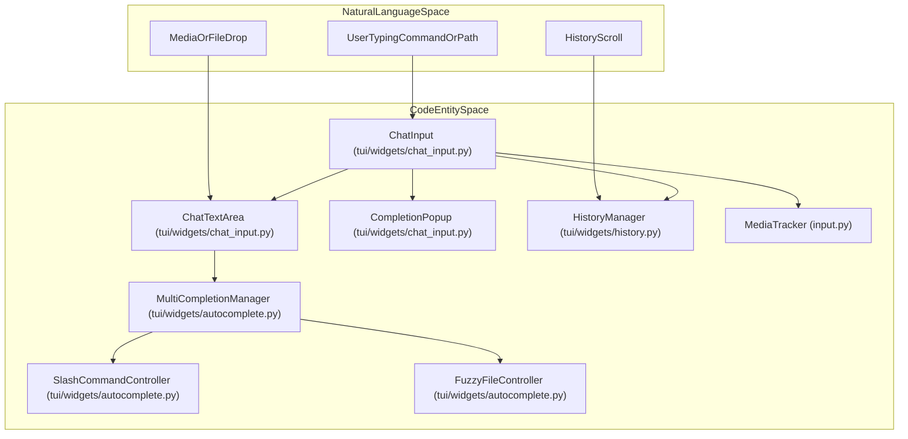
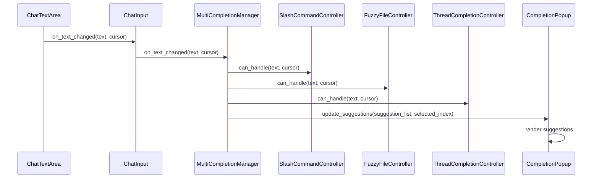
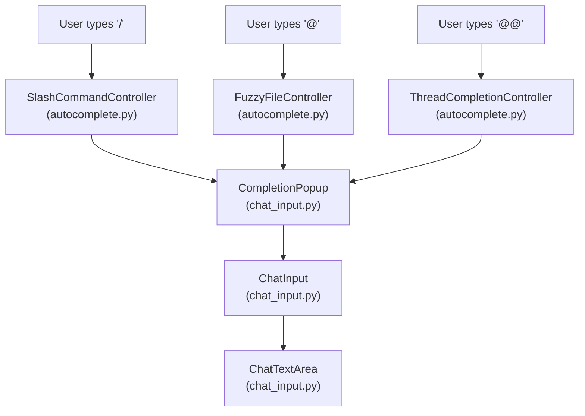

# Chat Input and Autocomplete

<details>
<summary>Relevant source files</summary>

The following files were used as context for generating this wiki page:

- [libs/code/deepagents_code/app.tcss](libs/code/deepagents_code/app.tcss)
- [libs/code/deepagents_code/tui/modals/prompt_clipboard.py](libs/code/deepagents_code/tui/modals/prompt_clipboard.py)
- [libs/code/deepagents_code/tui/modals/resume_compact.py](libs/code/deepagents_code/tui/modals/resume_compact.py)
- [libs/code/deepagents_code/tui/widgets/_inline_prompt.py](libs/code/deepagents_code/tui/widgets/_inline_prompt.py)
- [libs/code/deepagents_code/tui/widgets/_paste_textarea.py](libs/code/deepagents_code/tui/widgets/_paste_textarea.py)
- [libs/code/deepagents_code/tui/widgets/ask_user.py](libs/code/deepagents_code/tui/widgets/ask_user.py)
- [libs/code/deepagents_code/tui/widgets/autocomplete.py](libs/code/deepagents_code/tui/widgets/autocomplete.py)
- [libs/code/deepagents_code/tui/widgets/chat_input.py](libs/code/deepagents_code/tui/widgets/chat_input.py)
- [libs/code/deepagents_code/tui/widgets/goal_review.py](libs/code/deepagents_code/tui/widgets/goal_review.py)
- [libs/code/deepagents_code/tui/widgets/prompt_search.py](libs/code/deepagents_code/tui/widgets/prompt_search.py)
- [libs/code/deepagents_code/tui/widgets/thread_selector.py](libs/code/deepagents_code/tui/widgets/thread_selector.py)
- [libs/code/tests/integration_tests/test_pending_work_recovery.py](libs/code/tests/integration_tests/test_pending_work_recovery.py)
- [libs/code/tests/unit_tests/test_app_thread_ownership.py](libs/code/tests/unit_tests/test_app_thread_ownership.py)
- [libs/code/tests/unit_tests/test_resume_compaction_recovery.py](libs/code/tests/unit_tests/test_resume_compaction_recovery.py)
- [libs/code/tests/unit_tests/test_threads_resume.py](libs/code/tests/unit_tests/test_threads_resume.py)
- [libs/code/tests/unit_tests/tui/modals/test_prompt_clipboard.py](libs/code/tests/unit_tests/tui/modals/test_prompt_clipboard.py)
- [libs/code/tests/unit_tests/tui/widgets/test_ask_user.py](libs/code/tests/unit_tests/tui/widgets/test_ask_user.py)
- [libs/code/tests/unit_tests/tui/widgets/test_autocomplete.py](libs/code/tests/unit_tests/tui/widgets/test_autocomplete.py)
- [libs/code/tests/unit_tests/tui/widgets/test_chat_input.py](libs/code/tests/unit_tests/tui/widgets/test_chat_input.py)
- [libs/code/tests/unit_tests/tui/widgets/test_goal_review.py](libs/code/tests/unit_tests/tui/widgets/test_goal_review.py)
- [libs/code/tests/unit_tests/tui/widgets/test_inline_prompt.py](libs/code/tests/unit_tests/tui/widgets/test_inline_prompt.py)

</details>


This page documents the `ChatInput` widget and its supporting systems in the `deepagents-code` package. The chat input system provides a multi-line text area with mode detection (normal, shell, command), a fuzzy autocomplete system for slash commands and file paths, persistent command history, and specialized handling for media attachments, large paste collapsing, `ask_user` prompts, and external editor support.

Sources: [libs/code/deepagents_code/tui/widgets/chat_input.py:1-185]()

## Widget Architecture

The chat input system is implemented as a composition of several Textual widgets and modular controller classes to manage interaction complexity effectively. The `ChatInput` widget is the main orchestrator managing draft text input, autocomplete logic, history navigation, media tracking, and special prompt handling.

### Component Hierarchy & Entity Bridge

The following diagram bridges user interactions in the "Natural Language Space" to the underlying code entities in the `deepagents_code.tui.widgets` package and related modules.

#### Chat Input Component Architecture Bridge


Sources: [libs/code/deepagents_code/tui/widgets/chat_input.py:30-68](), [libs/code/deepagents_code/tui/widgets/autocomplete.py:311-313]()

### Key Classes and Their Roles

| Class | Location | Description |
|-------|----------|-------------|
| `ChatInput` | [libs/code/deepagents_code/tui/widgets/chat_input.py:641-680]() | Container widget managing input, submission, mode switching, paste collapsing, and external editor integration. |
| `ChatTextArea` | [libs/code/deepagents_code/tui/widgets/chat_input.py:240-280]() | Extends `TextArea` with custom keybindings for history traversal, paste handling, media token management, and submitting the input text. |
| `CompletionPopup` | [libs/code/deepagents_code/tui/widgets/chat_input.py:1210-1230]() | Scrollable dropdown displaying autocomplete suggestions, built from individual clickable `CompletionOption` widgets. |
| `HistoryManager` | [libs/code/deepagents_code/tui/widgets/history.py:10-110]() | Maintains command history with durable append-only JSON lines storage, excluding certain commands like `/`-prefixes and incognito shell commands. |
| `MultiCompletionManager` | [libs/code/deepagents_code/tui/widgets/autocomplete.py:310-345]() | Coordinates multiple autocomplete controllers (slash commands, file paths, thread references) and dispatches key events to the appropriate controller. |
| `SlashCommandController` | [libs/code/deepagents_code/tui/widgets/autocomplete.py:140-270]() | Provides fuzzy matching and completion for slash commands starting with `/`, prioritizing prefix and substring matches over description search. |
| `FuzzyFileController` | [libs/code/deepagents_code/tui/widgets/autocomplete.py:420-520]() | Autocompletes file paths triggered by the `@` prefix, leveraging `git ls-files` when available and implementing a fuzzy scoring heuristic to rank files. |
| `MediaTracker` | [libs/code/deepagents_code/input.py:105-155]() | Tracks media attachment placeholders in the input text and manages their insertion and deletion behavior reliably as atomic tokens. |
| `PasteBurstTextArea` | [libs/code/deepagents_code/tui/widgets/_paste_textarea.py:45-100]() | Detects rapid burst pastes typically seen from terminals without bracketed paste support, buffering keystrokes and suppressing premature submit keypresses. |
| `InlinePromptTextArea` | [libs/code/deepagents_code/tui/widgets/_inline_prompt.py:110-160]() | Base textarea class for in-line prompts such as goal review or question answering, with paste collapsing and media support. |
| `CollapsingPasteTextArea` | [libs/code/deepagents_code/tui/widgets/_paste_textarea.py:820-880]() | Implements large paste-collapse logic, converting multi-line pasted content into concise placeholders, expanded on submission. |

Sources: [libs/code/deepagents_code/tui/widgets/chat_input.py:240-680](), [libs/code/deepagents_code/tui/widgets/autocomplete.py:140-520](), [libs/code/deepagents_code/tui/widgets/history.py:10-110](), [libs/code/deepagents_code/input.py:105-155](), [libs/code/deepagents_code/tui/widgets/_paste_textarea.py:45-100,820-880](), [libs/code/deepagents_code/tui/widgets/_inline_prompt.py:110-160]()

---

## Input Modes and Detection

The chat input supports multiple modes that affect how input is interpreted and rendered. The mode is detected based on the leading characters typed by the user.

### Supported Input Modes

| Mode              | Trigger Prefix | Glyph shown in UI | Description                                         |
|-------------------|----------------|-------------------|-----------------------------------------------------|
| Normal            | (no prefix)    | `>`               | Standard chat input for conversational agents       |
| Shell             | `!`            | `$`               | Shell command execution                               |
| Shell Incognito   | `!!`           | `$`               | Shell commands that do not get saved to history      |
| Command           | `/`            | `/`               | Internal slash commands for the TUI (e.g., `/model`) |

This mode detection is facilitated by the utility functions `detect_mode_prefix` and related constants `MODE_PREFIXES` and `MODE_DISPLAY_GLYPHS`.

The UI visually shows a mode-specific glyph at the start of the input area, replaced from the raw prefix to keep the input text clean for user editing.

### Mode Detection and Prefix Handling Flow

1. User input changes trigger `_on_text_area_changed`.
2. Detect mode prefix using `detect_mode_prefix` (e.g., leading `!`, `!!`, `/`).
3. Strip the prefix from the visible text area to not clutter the typing area.
4. Internally track the mode and prefix separately for later usage.
5. Upon submission (`Enter`), re-add the prefix before sending the text to the underlying agent.

This ensures user input is clean but also that mode semantics are preserved for backend interpretation.

Sources: [libs/code/deepagents_code/config.py:27-38](), [libs/code/deepagents_code/tui/widgets/chat_input.py:800-1128]()

---

## Autocomplete System

`ChatInput` provides an autocomplete popup powered by a multiplexed system that manages multiple completion controllers each specialized in different domains.

### Data Flow for Autocomplete Suggestions

The user input text and cursor position are forwarded to `MultiCompletionManager`, which delegates matching and suggestion generation to one or more specialized controllers (`SlashCommandController`, `FuzzyFileController`, and `ThreadCompletionController`). The matched suggestions are rendered in the `CompletionPopup`.

#### Autocomplete Suggestion Data Flow


---

### Completion Controllers Overview

- **SlashCommandController**

  Designed for inputs starting with `/`. Matches commands from the registered command entries via prefix and fuzzy matching weighted by command name, description, and keywords. Results are capped and sorted by score.

- **FuzzyFileController**

  Activated on `@` typed prefixes. It lists project files (using `git ls-files` if available or fallback scans) and applies fuzzy matching to the file paths to suggest completions. Uses a custom scoring function reflecting name match, folder boundaries, and path depth.

- **ThreadCompletionController**

  Handles `@@` prefix for referencing existing recent threads durably. Filters threads by metadata and labels and inserts thread ID tokens.

These controllers cleanly separate concerns, allowing flexible expansion and asynchronous cache warming (e.g., file scan warmers).

Sources: [libs/code/deepagents_code/tui/widgets/autocomplete.py:130-520](), [libs/code/deepagents_code/tui/widgets/autocomplete.py:650-750]()

---

## History Navigation and Prompt Search

### Inline History Search Panel

- Triggered by Ctrl+R inside the input widget.
- Opens an inline `PromptSearchPanel` that filters user past prompts in real-time.
- Supports navigation with arrow keys and insertion with Tab or Enter.
- Efficient rendering by windowing to a limited number of rows.

### History Persistence

- History is stored append-only at `~/.deepagents/.state/history.jsonl`.
- Commands starting with `/` or shell incognito commands starting with `!!` are excluded from history persistence.
- HistoryManager handles load, append, and navigation logic.

Sources: [libs/code/deepagents_code/tui/widgets/prompt_search.py:1-180](), [libs/code/deepagents_code/tui/widgets/history.py:10-110](), [libs/code/deepagents_code/tui/modals/prompt_clipboard.py:1-150]()

---

## Paste Handling, Media Placeholders, and External Editor

### Large Paste Collapsing

To avoid overwhelming the UI with large pasted text blocks, the input system collapses them into placeholders like `[Pasted text #1 +5 lines]`. The full original pasted content is stored internally and expanded transparently upon submission. This improves usability in terminals without bracketed paste support by buffering burst keystrokes.

This logic is layered in `PasteBurstTextArea` and `CollapsingPasteTextArea`, and supported by utilities in `paste_collapse.py`.

### Media Attachment Parsing and Tracking

Pasted or mentioned media files (images/videos) are represented as atomic placeholders (`[image 1]`, `[video 2]`) within the input. The `MediaTracker` supports insertion and removal, and `ChatTextArea` overrides keypress handlers to ensure deletion removes an entire placeholder.

Unsupported media paste or drop is intercepted early in specialized prompt textareas (e.g., goal reviewing or ask_user prompts) and results in user notification toast messages.

### Path Parsing and External Editor Integration

- The system detects Windows drive-letter paths and unusual Unicode spaces common in macOS file dialogs.
- Users can open the current prompt text in their configured system editor via `Ctrl+X` or `/editor` command, improving efficiency for complex multi-line input.

Sources: [libs/code/deepagents_code/tui/widgets/chat_input.py:400-580](), [libs/code/deepagents_code/paste_collapse.py:1-80](), [libs/code/deepagents_code/input.py:70-160](), [libs/code/deepagents_code/tui/widgets/_paste_textarea.py:45-120](), [libs/code/deepagents_code/tui/widgets/_inline_prompt.py:20-60]()

---

## Ask User Prompts and Inline Inputs

Within the interactive flow, the agent may issue structured `ask_user` prompts or goal reviews requiring user feedback, handled by dedicated widgets extending from the shared `InlinePromptTextArea`.

- **AskUserTextArea** supports multi-select and free-form questions, including custom "Other" options. It carefully manages keyboard bindings for escape to deselect custom options and preserves paste collapsing for input cleanliness.

- **GoalReviewMenu** wraps a text input for reviewing acceptance criteria, featuring commands for accept, reject with feedback, editing in an external editor, and cancellation. It reuses paste collapsing behavior ensuring large feedback inputs are manageable.

These input modes integrate seamlessly into the chat input lifecycle, with event forwarding and submission via futures allowing synchronous user response capture.

Sources: [libs/code/deepagents_code/tui/widgets/ask_user.py:80-120](), [libs/code/deepagents_code/tui/widgets/goal_review.py:80-140]()

---

# Summary

The chat input system in `deepagents-code` is a comprehensive solution meeting advanced terminal UI needs for an agent framework. It combines multi-mode input handling, a rich autocomplete ecosystem, persistent history, paste and media management, and extensible inline prompt widgets. This layered architecture allows the TUI to remain responsive and user-friendly while supporting complex workflows like slash commands, file references, and multi-turn, interactive user queries.

---

# Additional Diagrams

### Autocomplete Responsibility Flow Bridging Natural Language Triggers and Code Modules


### ChatInput Event and State Flow When User Sends a Message
```mermaid
stateDiagram-v2
    [*] --> Idle

    Idle --> Typing : User types text
    Typing --> Autocompleting : input triggers autocomplete
    Autocompleting --> Typing : autocomplete applied or dismissed
    Typing --> SubmitReady : user presses Enter with valid input
    SubmitReady --> Sending : input sent to agent backend
    Sending --> Idle : response received or error

    note right of Autocompleting
        MultiCompletionManager delegates to
        SlashCommandController/FuzzyFileController
    end note

    note left of ChatInput: Tracks mode prefix\nStrips/Re-adds mode prefix on submit
```

Sources: [libs/code/deepagents_code/tui/widgets/chat_input.py:640-785](), [libs/code/deepagents_code/tui/widgets/autocomplete.py:130-310](), [libs/code/deepagents_code/tui/widgets/history.py:10-110]()

# End of "3.3 Chat Input and Autocomplete"