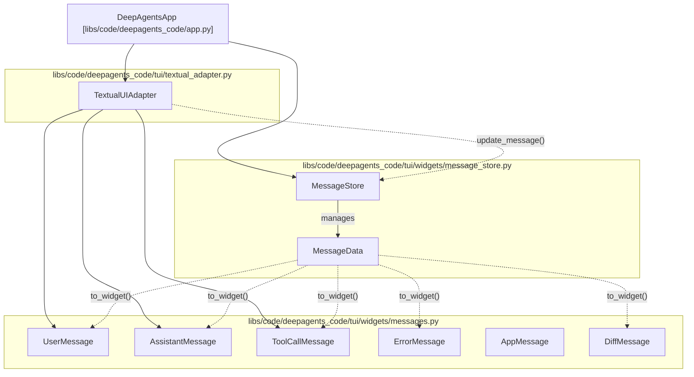
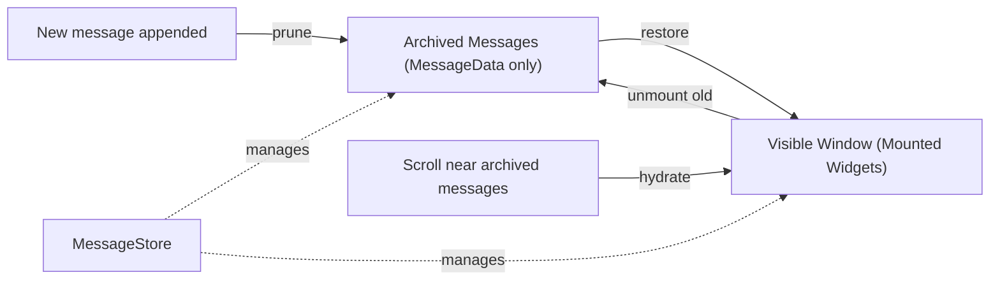
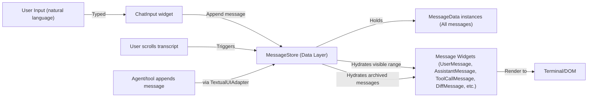
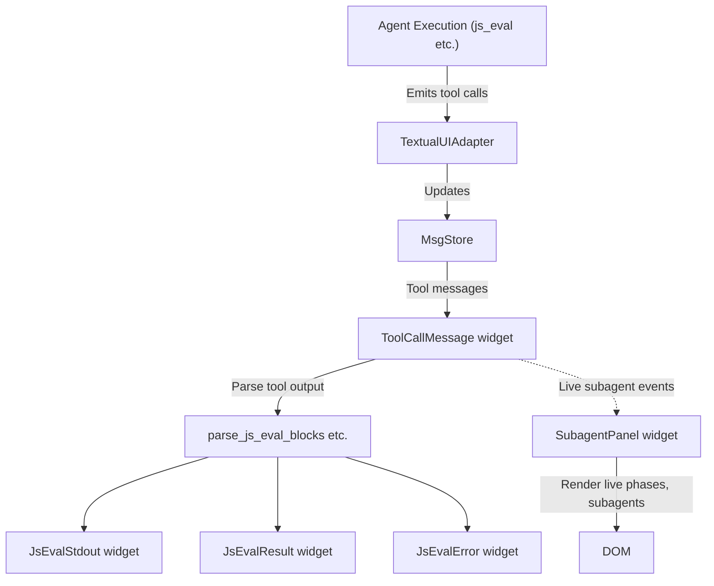

# Message Display and Virtualization

Relevant source files

The following files were used as context for generating this wiki page:

- [libs/code/deepagents_code/file_ops.py](libs/code/deepagents_code/file_ops.py)
- [libs/code/deepagents_code/tui/widgets/context_usage.py](libs/code/deepagents_code/tui/widgets/context_usage.py)
- [libs/code/deepagents_code/tui/widgets/diff.py](libs/code/deepagents_code/tui/widgets/diff.py)
- [libs/code/deepagents_code/tui/widgets/message_store.py](libs/code/deepagents_code/tui/widgets/message_store.py)
- [libs/code/deepagents_code/tui/widgets/messages.py](libs/code/deepagents_code/tui/widgets/messages.py)
- [libs/code/deepagents_code/tui/widgets/subagent_panel.py](libs/code/deepagents_code/tui/widgets/subagent_panel.py)
- [libs/code/deepagents_code/tui/widgets/tool_renderers.py](libs/code/deepagents_code/tui/widgets/tool_renderers.py)
- [libs/code/deepagents_code/tui/widgets/tool_widgets.py](libs/code/deepagents_code/tui/widgets/tool_widgets.py)
- [libs/code/tests/unit_tests/test_charset.py](libs/code/tests/unit_tests/test_charset.py)
- [libs/code/tests/unit_tests/test_file_ops.py](libs/code/tests/unit_tests/test_file_ops.py)
- [libs/code/tests/unit_tests/test_js_cost_tracking.py](libs/code/tests/unit_tests/test_js_cost_tracking.py)
- [libs/code/tests/unit_tests/test_transcript_virtualization.py](libs/code/tests/unit_tests/test_transcript_virtualization.py)
- [libs/code/tests/unit_tests/tui/widgets/test_diff.py](libs/code/tests/unit_tests/tui/widgets/test_diff.py)
- [libs/code/tests/unit_tests/tui/widgets/test_message_store.py](libs/code/tests/unit_tests/tui/widgets/test_message_store.py)
- [libs/code/tests/unit_tests/tui/widgets/test_messages.py](libs/code/tests/unit_tests/tui/widgets/test_messages.py)
- [libs/code/tests/unit_tests/tui/widgets/test_subagent_panel.py](libs/code/tests/unit_tests/tui/widgets/test_subagent_panel.py)
- [libs/code/tests/unit_tests/tui/widgets/test_thread_selector.py](libs/code/tests/unit_tests/tui/widgets/test_thread_selector.py)
- [libs/code/tests/unit_tests/tui/widgets/test_tool_renderers.py](libs/code/tests/unit_tests/tui/widgets/test_tool_renderers.py)

This page documents the `deepagents-code` message display and virtualization subsystem, which enables efficient handling and rendering of large conversation histories in the TUI. It maintains a sliding window of live DOM message widgets while storing the entire message history as lightweight `MessageData` dataclasses. This design supports seamless streaming updates, virtualization to limit rendered widgets, and specialized rendering for tool outputs including diffs and subagent fan-out monitoring.

**Purpose**: To explain the implementation of message rendering, streaming layout, virtualization techniques, the `MessageStore` abstraction, and specialized UI renderers including tool output and diffs. Also covers the subagent fan-out panel and various performance optimizations.

**Scope**: Covers message-layer architecture, `MessageStore` and `MessageData` design, widget types (`UserMessage`, `AssistantMessage`, `ToolCallMessage`, `DiffMessage`, etc.), streaming interactions, layout, virtualization window management, tool output formatting, diff rendering, subagent panel, and safe markup handling.

---

## Architecture Overview

The message rendering system is a layered architecture separating message data management, widget presentation, and streaming flow.

- **Data Layer**: `MessageStore` holds all `MessageData` objects representing the entire transcript efficiently.
- **Widget Layer**: Message types like `UserMessage`, `AssistantMessage`, `ToolCallMessage`, `DiffMessage` render each message data instance into DOM widgets.
- **Streaming Layer**: The `TextualUIAdapter` handles streaming content from the agent and updates the `MessageStore`, also coordinating UI updates.

Sources: `[libs/code/deepagents_code/tui/widgets/message_store.py:129-208]()`, `[libs/code/deepagents_code/tui/widgets/messages.py:20-200]()`, `[libs/code/deepagents_code/tui/textual_adapter.py:30-65]()`, `[libs/code/deepagents_code/tui/textual_adapter.py:120-165]()`

---

## Message Virtualization

### Overview

Virtualization allows the TUI to handle very large message histories by only mounting a fixed-size window of message widgets in the DOM at a time. Older messages remain in memory as lightweight `MessageData` dataclasses and get hydrated (re-mounted) when the user scrolls near them.

### MessageStore and MessageData

- **MessageStore**: Core data structure managing the full list of messages, tracking which messages are currently visible, protected from pruning, or archived. Implements pruning and hydration strategies to maintain a sliding window of mounted widgets.
- **MessageData**: Lightweight dataclass holding all metadata and text to recreate a specific message widget, including fields for tool calls, diffs, subagents, timestamps, statuses, and expansion states. Uses full 128-bit UUID hex strings for message IDs to avoid collisions.

| MessageData Field       | Description                                                                                     |
|------------------------|-------------------------------------------------------------------------------------------------|
| `type`                 | Message category, enumerated in `MessageType` (`USER`, `ASSISTANT`, `TOOL`, `DIFF`, `ERROR`, etc.). |
| `content`              | The main text content of the message, usually plain strings for tool output or chat text.       |
| `tool_status`          | Tool execution status (`PENDING`, `RUNNING`, `SUCCESS`, `ERROR`, etc.), enables streaming display. |
| `tool_output`          | Captured textual output of a tool call, possibly truncated for performance.                      |
| `is_streaming`         | Marks messages currently streaming/receiving live updates, protected from pruning.                |

### Virtualization Flow: Hydration and Pruning

- **Hydration**: When the user scrolls near archived messages, `MessageStore` uses `MessageData.to_widget()` to recreate the corresponding message widgets for display.
- **Pruning**: New messages appended cause older messages outside the window to be pruned from the DOM to maintain performance.

Sources: `[libs/code/deepagents_code/tui/widgets/message_store.py:1-70]()`, `[libs/code/deepagents_code/tui/widgets/message_store.py:100-180]()`, `[libs/code/tests/unit_tests/test_transcript_virtualization.py:1-140]()`

---

## Message Widget Types and Rendering

### UserMessage

- Displays user input with styling based on the input mode (`shell`, `command`, `incognito`).
- Uses color schemes from `_mode_color` resolving to terminal theme colors.
- Handles bracketed content safely to avoid markup crashes.
- Highlights command-like patterns and email prefixes.
- Tested to safely render arbitrary bracketed content without `MarkupError`.

### AssistantMessage

- Renders agent responses as Markdown, using a streaming Markdown rendering mechanism.
- Pointer shape management ensures text-selection cursors only appear over rendered text and link pointers over links.
- Uses a muted markdown style wrapper to ensure stability and selection capability in the terminal UI.

### ToolCallMessage

- Displays tool invocation, arguments, execution status, and output.
- Uses `format_tool_display` for consistent output formatting and possible truncation.
- Tool outputs can embed user question transcripts, rendered with `render_ask_user_transcript_for_display`.

### DiffMessage

- Renders file diffs line-by-line using syntax highlighting.
- Shows unified diff with gutter, plus/minus markers, and word-level emphasis for changes.
- Uses `compose_diff_lines` to generate rows and `DiffStats` for change summaries.

### Subagent Fan-out Panel

- Dedicated panel for live status of subagents spawned from `js_eval` calls inside tool executions.
- Tracks lifecycle events (`start`, `complete`, `error`, `cancel`), status, durations, and error messages.
- Updates dynamically as events arrive, showing labels sanitized against control characters for security.

Sources: `[libs/code/deepagents_code/tui/widgets/messages.py:115-201]()`, `[libs/code/tests/unit_tests/tui/widgets/test_messages.py:60-90]()`, `[libs/code/deepagents_code/tui/widgets/diff.py:1-200]()`, `[libs/code/deepagents_code/tui/widgets/subagent_panel.py:1-191]()`

---

## Tool Output Display and Specialized Renderers

- JS eval tool outputs are parsed into structured blocks (`JsEvalStdout`, `JsEvalResult`, `JsEvalError`) via `parse_js_eval_blocks` for rich display.
- Tool outputs include truncation metadata (`FormattedOutput`) describing omitted content, avoiding performance degradation when rendering large outputs.
- Ask User questions and answers are rendered inline with transcripts allowing clear interaction history display.
- Diff rendering includes highlighted source prefixes and contexts, with configurable max lines and syntax-aware emphasis.
- Subagent panel consumes live subagent events and renders a dedicated docked fan-out UI with live timing and status indicators.

Sources: `[libs/code/deepagents_code/tui/widgets/messages.py:55-68]()`, `[libs/code/deepagents_code/tui/widgets/messages.py:191-200]()`, `[libs/code/deepagents_code/tui/widgets/diff.py:1-176]()`, `[libs/code/deepagents_code/tui/widgets/subagent_panel.py:1-190]()`

---

## Performance and Layout Optimizations

### Streaming Layout and Update Flow

- The `TextualUIAdapter` integrates with the `DeepAgentsApp` and agent execution to stream assistant responses and tool outputs incrementally.
- Tool status and output updates push incremental patches to `MessageStore`, preventing full re-renders and minimizing flicker.
- Active streaming messages are marked and protected (`is_streaming` and `_ACTIVE_REASON`) from pruning until complete.

### Message Protection and Virtualization Window

- The active streaming message is kept in the DOM even if outside the nominal window to avoid visual glitches.
- The `WINDOW_SIZE` constant controls the maximum number of mounted messages, with hydration buffers around scroll edges to prefetch neighboring messages.
- Pruning carefully preserves messages flagged as active or live.

### Markup Safety and Unicode Security

- All user-controlled text is sanitized of control and bidirectional override characters to prevent terminal escape and injection attacks.
- Dangerous Unicode characters are rendered with unicode markers visually exposing them.
- The `_MutedRichMarkdown` wrapper for markdown messages catches rendering exceptions and falls back to plain text output to avoid breaking the UI.

Sources: `[libs/code/deepagents_code/tui/widgets/message_store.py:20-65]()`, `[libs/code/deepagents_code/tui/widgets/messages.py:75-80]()`, `[libs/code/tests/unit_tests/tui/widgets/test_messages.py:120-144]()`, `[libs/code/deepagents_code/tui/textual_adapter.py:140-160]()`

---

# Diagrams Bridging Natural Language System to Code Entities

### Diagram 1: Message Virtualization Data Flow

### Diagram 2: Tool Output and Subagent Fan-out Rendering

---

# Summary

The message display and virtualization system in `deepagents-code` extensively decouples message data management from DOM representation. The `MessageStore` efficiently retains large histories as dataclasses, while mounted widgets represent only a sliding window. Streaming and tool outputs are incrementally updated through specialized renderers supporting markdown, diffs, and subagent activity. The architecture and implementation ensure scalable, performant chat interfaces with rich tool integration, precise virtualization, and security against markup injection.

Sources:  
- `[libs/code/deepagents_code/tui/widgets/message_store.py:1-180]()`  
- `[libs/code/deepagents_code/tui/widgets/messages.py:20-200]()`  
- `[libs/code/deepagents_code/tui/widgets/diff.py:1-176]()`  
- `[libs/code/deepagents_code/tui/widgets/subagent_panel.py:1-190]()`  
- `[libs/code/deepagents_code/tui/textual_adapter.py:30-65]()`  
- `[libs/code/tests/unit_tests/tui/widgets/test_message_store.py:1-182]()`  
- `[libs/code/tests/unit_tests/test_transcript_virtualization.py:1-140]()`  
- `[libs/code/tests/unit_tests/tui/widgets/test_messages.py:60-144]()`