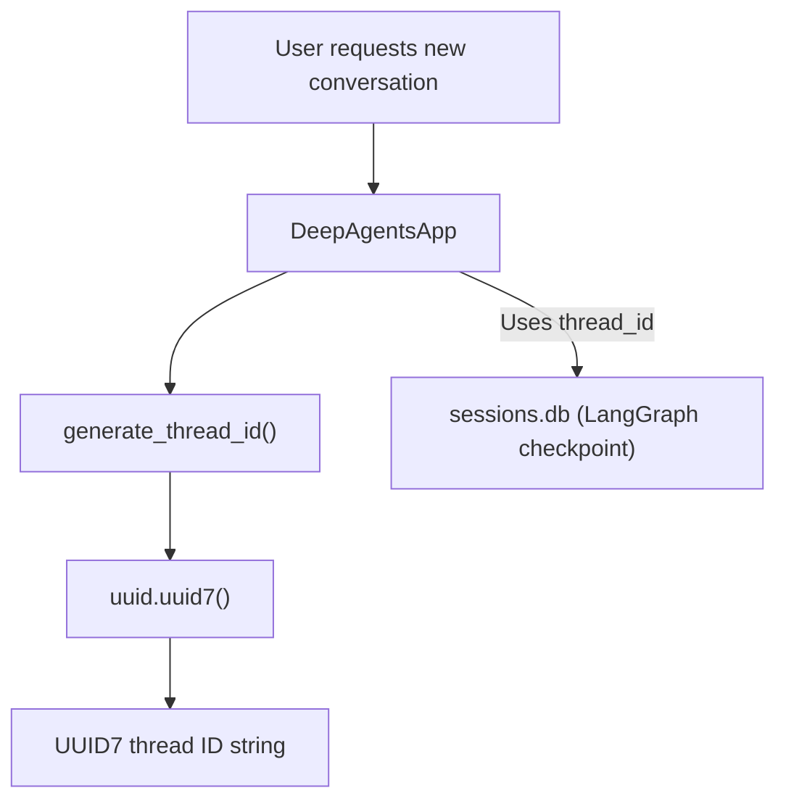
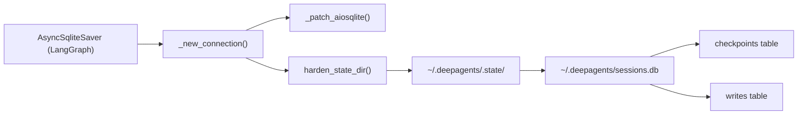
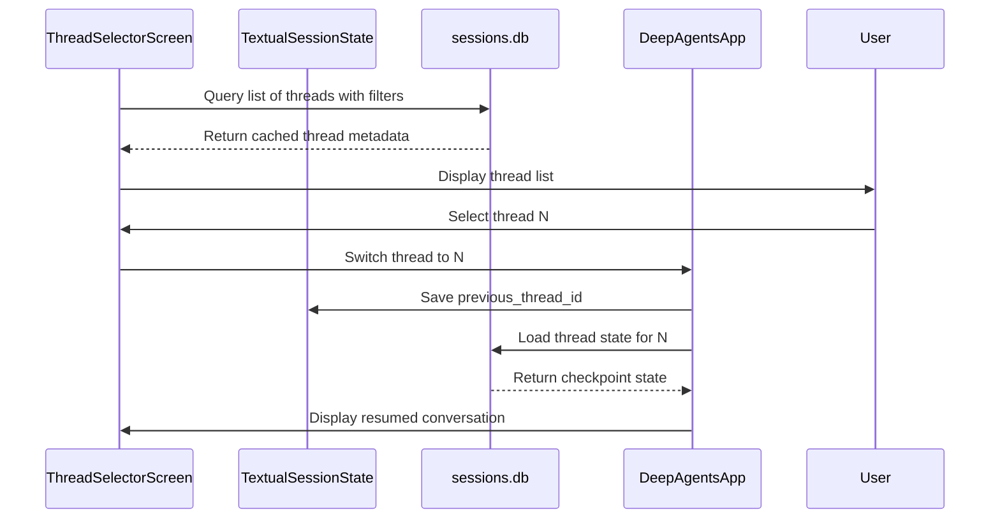

# Thread and Session Management

Relevant source files

The following files were used as context for generating this wiki page:

- [libs/code/deepagents_code/_cli_context.py](libs/code/deepagents_code/_cli_context.py)
- [libs/code/deepagents_code/_session_stats.py](libs/code/deepagents_code/_session_stats.py)
- [libs/code/deepagents_code/client/non_interactive.py](libs/code/deepagents_code/client/non_interactive.py)
- [libs/code/deepagents_code/cold_cache.py](libs/code/deepagents_code/cold_cache.py)
- [libs/code/deepagents_code/configurable_model.py](libs/code/deepagents_code/configurable_model.py)
- [libs/code/deepagents_code/cost_tracking.py](libs/code/deepagents_code/cost_tracking.py)
- [libs/code/deepagents_code/offload.py](libs/code/deepagents_code/offload.py)
- [libs/code/deepagents_code/plugins/store.py](libs/code/deepagents_code/plugins/store.py)
- [libs/code/deepagents_code/resume_state.py](libs/code/deepagents_code/resume_state.py)
- [libs/code/deepagents_code/sessions.py](libs/code/deepagents_code/sessions.py)
- [libs/code/deepagents_code/tui/modals/cold_cache.py](libs/code/deepagents_code/tui/modals/cold_cache.py)
- [libs/code/deepagents_code/tui/textual_adapter.py](libs/code/deepagents_code/tui/textual_adapter.py)
- [libs/code/tests/integration_tests/benchmarks/test_thread_loading_benchmarks.py](libs/code/tests/integration_tests/benchmarks/test_thread_loading_benchmarks.py)
- [libs/code/tests/unit_tests/test_cache_expiry.py](libs/code/tests/unit_tests/test_cache_expiry.py)
- [libs/code/tests/unit_tests/test_cold_cache.py](libs/code/tests/unit_tests/test_cold_cache.py)
- [libs/code/tests/unit_tests/test_configurable_model.py](libs/code/tests/unit_tests/test_configurable_model.py)
- [libs/code/tests/unit_tests/test_cost_tracking.py](libs/code/tests/unit_tests/test_cost_tracking.py)
- [libs/code/tests/unit_tests/test_non_interactive.py](libs/code/tests/unit_tests/test_non_interactive.py)
- [libs/code/tests/unit_tests/test_offload.py](libs/code/tests/unit_tests/test_offload.py)
- [libs/code/tests/unit_tests/test_resume_state.py](libs/code/tests/unit_tests/test_resume_state.py)
- [libs/code/tests/unit_tests/test_session_stats.py](libs/code/tests/unit_tests/test_session_stats.py)
- [libs/code/tests/unit_tests/test_sessions.py](libs/code/tests/unit_tests/test_sessions.py)
- [libs/code/tests/unit_tests/tui/modals/test_cold_cache.py](libs/code/tests/unit_tests/tui/modals/test_cold_cache.py)
- [libs/code/tests/unit_tests/tui/test_textual_adapter.py](libs/code/tests/unit_tests/tui/test_textual_adapter.py)

This document covers thread (conversation) persistence, session state tracking, resume state, session statistics, and the interactive thread browser UI in `deepagents-code`. For general CLI app lifecycle, see [Interactive Mode and DeepAgentsApp](3.2). For message rendering and storage, see [Message Display and Virtualization](3.4). For thread display preferences and configuration, see [Configuration and Model Management](3.6).

## Purpose and Scope

The application persists all conversations as **threads** in a SQLite database (`~/.deepagents/sessions.db`), leveraging LangGraph's checkpoint mechanism. Each thread has a unique identifier and stores metadata such as agent name, timestamps, git branch, and working directory. The thread selector UI (`ThreadSelectorScreen`) allows users to browse, resume, delete, and rename past conversations with features like fuzzy search, customizable columns, and keyboard navigation.

This page describes the full technical detail of:

- Thread ID generation and uniqueness guarantees
- Database persistence using async SQLite with LangGraph checkpoints
- Internal state migration and management of checkpoint files
- Resume state implementation to rehydrate model and goal contexts on load
- Thread switching operations in the UI
- Persistence and querying of session cost and usage statistics
- In-memory caching strategies for improved UI responsiveness

---

## Thread Identifier Generation

Each conversation thread in `deepagents-code` is identified by a unique string generated by the function `generate_thread_id()`. This function produces a **UUID7** string, providing:

- Monotonic time-based ordering based on generation timestamp
- Natural lexical sort order corresponding to creation time
- 36-character standard UUID string format with embedded instants

This timestamped ID ensures threads are ordered by creation without needing additional timestamp indexing.

The system supports backward compatibility with older 8-character hex thread IDs when looking up checkpoint records, supporting legacy data [libs/code/deepagents_code/sessions.py:235-265](), [libs/code/tests/unit_tests/test_sessions.py:25-60]().

### Thread ID Generation Flow

---

## Database Persistence and State Migration

### Storage Location and Structure

All thread data is persisted in a SQLite database located at `~/.deepagents/sessions.db`, managed by LangGraph's `AsyncSqliteSaver` checkpointing driver. This advanced integration enables reliable async transactional storage with versioning and concurrency support.

### Asynchronous SQLite Access

The app uses `aiosqlite` for asynchronous DB connections. A monkey patch `_patch_aiosqlite()` adds a missing `is_alive()` method required by LangGraph checkpoint version 2.1.0+ [libs/code/deepagents_code/sessions.py:40-73]().

Connections are opened via `_new_connection()` which:

- Applies monkey patches
- Ensures the worker thread cleans up correctly by joining after close
- Guards against asyncio cancellation races that could leak handles and cause warnings [libs/code/deepagents_code/sessions.py:74-162]()

### State Migration

To isolate internal state files, the system moves persistence artifacts into a `.state/` subdirectory within the `~/.deepagents/` configuration directory.

The directory is created and hardened with file permission restricted to the current user to enhance security [libs/code/deepagents_code/sessions.py:14]().

### Database Schema Highlights

Key tables include:

- `checkpoints`: stores serialized thread state and metadata keyed by `thread_id`
- `writes`: manages transaction history and atomic updates for checkpoint durability

The checkpoint mechanism integrates with agent execution, persisting conversation turns and session metadata automatically.

Diagram: Database Architecture & Migration Flow

---

## Resume State and Middleware

### Purpose

Resuming a thread requires restoring the agent's internal state such as the exact model used, token tracking, and goal progression without replaying the entire conversation history.

This functionality is implemented via a combination of:

- Private checkpointed state channels persisted with LangGraph
- Middleware to interpret and update resume state in process

### Checkpointed Channels

The following private channels are saved inside thread checkpoints:

- `_model_spec` and `_model_params`: record the exact model spec (provider:model) and model parameters used in the last turn [libs/code/deepagents_code/resume_state.py:1-56]()
- `_context_tokens`: tracks total tokens used from the last `AIMessage.usage_metadata`
- `_goal_objective`, `_goal_status`, `_goal_rubric`: capture the current task description, status, and acceptance criteria for ongoing goal evaluation

These channels use `PrivateStateAttr` to maintain isolated, non-mergeable state critical to resumption correctness.

---

## Thread Switching and ThreadSelectorScreen

### ThreadSelectorScreen Functionality

The user interface for thread management is the `ThreadSelectorScreen`, a modal dialog allowing:

- Viewing a list of threads with customizable columns
- Fuzzy searching across thread names and metadata
- Sorting and filtering by recency, activity, or message counts
- Resuming (selecting) a thread to continue interaction
- Deleting or renaming threads directly from the UI

This screen uses cached thread metadata for performant render cycles and reacts to user keyboard/mouse input to manage session state [libs/code/deepagents_code/tui/widgets/thread_selector.py:21-41]().

### Switching and Thread Resume Logic

- Switching to a thread records the outgoing thread ID as `previous_thread_id` in the `TextualSessionState`, enabling toggling back with a simple `/threads -r` command [libs/code/tests/unit_tests/test_threads_resume.py:20-35]()
- If a thread ID is requested but not found, near miss search heuristics provide an alternative selection
- Thread metadata updates (last updated timestamp, message counts) are refreshed live and cached for quick UI responsiveness

Diagram: Thread Switching Flow in the UI

---

## Cost and Session Statistics

### SessionStats

The system tracks detailed session consumption statistics for each thread, including:

- Total tokens consumed (input/output)
- Number of requests made (per kind: user turn, subagent calls)
- Estimated API cost in USD for the session's lifetime, updated incrementally with each turn

These statistics are persisted in checkpoint metadata and updated live during streaming completions in the client UI [libs/code/tests/unit_tests/test_resume_state.py:8-11]().

### Streamed and Checkpointed Synchronization

- The client UI reads session cost updates from the durable checkpoint metadata on load
- Streaming completions report incremental token counts and provisional costs live, allowing the UI to reflect usage before checkpoint persistence

---

## Caching and Performance

To maintain responsive thread browsing in the UI despite large numbers of threads and messages, several caches are used:

- `_message_count_cache`: Maps `thread_id` to the approximate number of messages in the thread (max cache size 4096 entries) [libs/code/deepagents_code/sessions.py:30-33]()
- `_initial_prompt_cache`: Stores the first human message (initial prompt) text for display purposes, also limited to 4096 entries [libs/code/deepagents_code/sessions.py:34-35]()
- `_recent_threads_cache`: Caches the list of recently queried threads by `(agent_name, limit)` key with a max of 16 keys cached, preventing frequent DB hits for the most commonly requested views

These caches significantly improve the speed of filtering, sorting, and searching threads in the ThreadSelectorScreen.

---

# Summary

Thread and session management in `deepagents-code` is built on robust, async SQLite checkpoint persistence with LangGraph, using UUID7 time-ordered identifiers for sorting and recovery. Rich metadata and cost statistics are maintained and cached for performant UI browsing. Resume state middleware ensures consistent rehydration of model contexts, token counts, and goal progress across sessions. The `ThreadSelectorScreen` UI serves as the primary user interface for thread operations, allowing seamless switching and management of conversation sessions.

---

Sources:  
- [libs/code/deepagents_code/sessions.py:14-162, 224-265]()  
- [libs/code/deepagents_code/resume_state.py:1-56]()  
- [libs/code/deepagents_code/tui/widgets/thread_selector.py:21-41]()  
- [libs/code/tests/unit_tests/test_sessions.py:27-97]()  
- [libs/code/tests/unit_tests/test_threads_resume.py:15-40]()  
- [libs/code/tests/unit_tests/test_resume_state.py:5-15]()