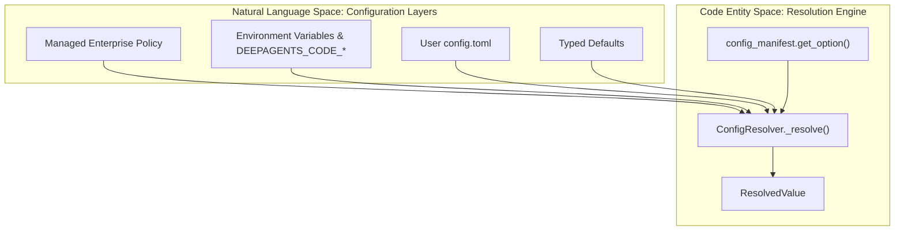
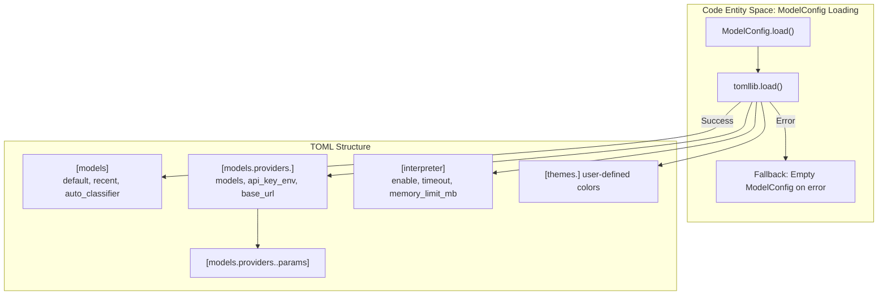
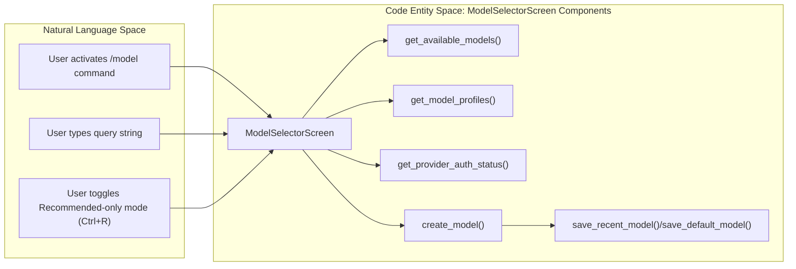

# Configuration and Model Management

Relevant source files

The following files were used as context for generating this wiki page:

- [libs/code/deepagents_code/_env_vars.py](libs/code/deepagents_code/_env_vars.py)
- [libs/code/deepagents_code/client/commands/config.py](libs/code/deepagents_code/client/commands/config.py)
- [libs/code/deepagents_code/config.py](libs/code/deepagents_code/config.py)
- [libs/code/deepagents_code/config_manifest.py](libs/code/deepagents_code/config_manifest.py)
- [libs/code/deepagents_code/configuration/provider.py](libs/code/deepagents_code/configuration/provider.py)
- [libs/code/deepagents_code/configuration/providers.py](libs/code/deepagents_code/configuration/providers.py)
- [libs/code/deepagents_code/configuration/resolver.py](libs/code/deepagents_code/configuration/resolver.py)
- [libs/code/deepagents_code/configuration/service.py](libs/code/deepagents_code/configuration/service.py)
- [libs/code/deepagents_code/configuration/types.py](libs/code/deepagents_code/configuration/types.py)
- [libs/code/deepagents_code/configuration/writer.py](libs/code/deepagents_code/configuration/writer.py)
- [libs/code/deepagents_code/model_config.py](libs/code/deepagents_code/model_config.py)
- [libs/code/deepagents_code/reasoning_effort.py](libs/code/deepagents_code/reasoning_effort.py)
- [libs/code/deepagents_code/tui/widgets/auth.py](libs/code/deepagents_code/tui/widgets/auth.py)
- [libs/code/deepagents_code/tui/widgets/model_selector.py](libs/code/deepagents_code/tui/widgets/model_selector.py)
- [libs/code/tests/unit_tests/conftest.py](libs/code/tests/unit_tests/conftest.py)
- [libs/code/tests/unit_tests/test_config.py](libs/code/tests/unit_tests/test_config.py)
- [libs/code/tests/unit_tests/test_config_manifest.py](libs/code/tests/unit_tests/test_config_manifest.py)
- [libs/code/tests/unit_tests/test_configuration.py](libs/code/tests/unit_tests/test_configuration.py)
- [libs/code/tests/unit_tests/test_configuration_resolution.py](libs/code/tests/unit_tests/test_configuration_resolution.py)
- [libs/code/tests/unit_tests/test_configuration_resolver.py](libs/code/tests/unit_tests/test_configuration_resolver.py)
- [libs/code/tests/unit_tests/test_model_config.py](libs/code/tests/unit_tests/test_model_config.py)
- [libs/code/tests/unit_tests/test_reasoning_effort.py](libs/code/tests/unit_tests/test_reasoning_effort.py)
- [libs/code/tests/unit_tests/tui/widgets/test_auth_widgets.py](libs/code/tests/unit_tests/tui/widgets/test_auth_widgets.py)
- [libs/code/tests/unit_tests/tui/widgets/test_model_selector.py](libs/code/tests/unit_tests/tui/widgets/test_model_selector.py)

This page documents the configuration system, model management, authentication store, ranked resolution, reasoning effort controls, runtime model switching, and themes within `deepagents-code`. The system relies on a multi-tiered configuration framework comprising `config.toml`, project/global dotenv files, managed config providers, and a ranked `ConfigResolver`, supplemented by a secure in-TUI credential store for provider keys.

---

## Configuration Manifest and Ranked Resolver

### Overview
Central to the configuration system is the `config_manifest.py` module that acts as the canonical manifest and resolver for every user-tunable scalar config option. It specifies the full configuration *surface*: option keys, types, typed defaults, associated environment variables, and their locations in `config.toml`. Typed defaults (especially for internal interpreter options) are defined as module constants, ensuring a single source of truth [libs/code/deepagents_code/config_manifest.py:1-32]().

The runtime configuration resolution is performed by the shared `ConfigResolver` class. It merges values from multiple sources in a strict precedence order:

1. **Managed Configuration (Managed TOML)** – Enterprise/admin overrides from a management server or service (`configuration.service`), labeled `"managed config"` in provenance.
2. **Environment Variables** – Including variables with a `DEEPAGENTS_CODE_` prefix that override canonical environment variables (e.g., `OPENAI_API_KEY`) [libs/code/deepagents_code/config.py:70-140]().
3. **User Configuration File** – User edits in the TOML file at `~/.deepagents/config.toml`.
4. **Typed Defaults** – Hardcoded defaults defined in the manifest module constants.

Resolution tolerates invalid values at any layer by logging errors and falling back to the next available source, preventing a bad entry from discarding valid others [libs/code/deepagents_code/config_manifest.py:13-18](). This cascading ensures a robust and predictable configuration environment.

### Data Flow and Classes

- `ConfigOption` objects represent individual configuration options with metadata such as types, default values, linked environment variables, and redaction flags.
- The `ConfigResolver` is the runtime engine that, given a config key, looks up the option, applies validation, merges sources with precedence, and returns a `ResolvedValue` including the effective value and provenance.
- Managed configuration snapshots are loaded and merged centrally, exposing health diagnostics for override status.
- `configuration.service` and `configuration.provider` modules coordinate the loading of managed configuration and provider-authentication integration.

**Diagram: Configuration resolution flow bridging configuration layers to `ConfigResolver`**

**Sources:**  
[libs/code/deepagents_code/config_manifest.py:1-18](),  
[libs/code/deepagents_code/config.py:70-140]()

---

## Configuration File Structure and ModelConfig

### Location and Format
User-level configuration is cached and parsed from a single TOML file, typically at `~/.deepagents/config.toml`. The `ModelConfig` class in `model_config.py` manages this structured model and provider configuration. It uses the standard-library TOML parser `tomllib` for reading, and `tomli_w` for writing [libs/code/deepagents_code/model_config.py:15-52]().

The core sections include:

- `[models]`: Contains keys like `default`, `recent`, and `auto_classifier` for controlling model selection.
- `[models.providers.<provider>]`: Defines individual providers with their API keys, known models, base URLs, and nested `[params]` for provider-specific options.
- `[interpreter]`: Options controlling the interpreter middleware (e.g., `enable`, `timeout`, `memory_limit_mb`).
- `[themes.<name>]`: Custom user themes for UI customization.

This layout supports flexible declaration of available models, their grouping by provider, and rich typed options controlling interpreter behavior and UI theming.

### ModelConfig Loading Flow

**Diagram: `ModelConfig` parsing and TOML section mapping**

**Sources:**  
[libs/code/deepagents_code/model_config.py:15-52](),  
[libs/code/deepagents_code/config_manifest.py:70-80]()

---

## Credential Store, Authentication, and `/auth`

### Credential Management Overview
Provider API keys and other credentials are handled with a layered approach:

- Environment variables, resolved via the `resolve_env_var` function which prioritizes `DEEPAGENTS_CODE_`-prefixed overrides over canonical names [libs/code/deepagents_code/model_config.py:101-148]().
- Persistent credential storage in a secure, user-specific JSON file at `~/.deepagents/.state/auth.json` managed by the `auth_store` module.
- The `/auth` TUI command modifies and manages credential storage within the terminal UI, allowing interactive login/logout of provider API keys [libs/code/deepagents_code/config.py:30-55]().

### Runtime Environment Reload and Bootstrapping
The `Credentials` class facilitates lazy and thread-safe bootstrap of dotenv loading and environment capture. It can reload the environment at runtime, merging launch-time and project `.env` file values while avoiding partial state via atomic replacements, and protecting secrets [libs/code/deepagents_code/config.py:80-140]().

This coordination prevents configuration drift during live sessions in the TUI or CLI, especially for LangSmith tracing environment variables and other sensitive keys. It uses internal locking and stored bootstrap state to synchronize reloads.

**Sources:**  
[libs/code/deepagents_code/config.py:70-140](),  
[libs/code/deepagents_code/model_config.py:28-48](),  
[libs/code/deepagents_code/client/commands/config.py:190-360]()

---

## Model Selection and Runtime Switching

### ModelSelectorScreen

The interactive model selector is exposed via the `/model` TUI command implemented by the `ModelSelectorScreen` class in `tui/widgets/model_selector.py` [libs/code/deepagents_code/tui/widgets/model_selector.py:1-140]().

Key features of `ModelSelectorScreen`:

- Displays available models grouped by provider.
- Includes a "Recent" pseudo-provider section, surfacing the most recently used models.
- Curates a frontier-tier "Recommended" list toggleable by the user.
- Supports fuzzy filtering and keyboard navigation for quick model search.
- Shows authentication status for each provider using `ProviderAuthStatus`.
- Invokes `create_model()` to instantiate selected models and validate credentials.
- Persists recent and default model selections with `save_recent_model()` and `save_default_model()`.

### User Interaction and Data Flow

**Diagram: Interaction flow within `ModelSelectorScreen`**

### Runtime Model Switching and Validation

- Upon model selection, the screen verifies provider credentials via `get_provider_auth_status()`.
- It safely creates a new model instance using the `create_model()` factory function.
- Successful selections update persistent recent/default history via `save_recent_model()` and `save_default_model()`.
- If a large context window or potentially expensive model switch occurs, the system can enforce user confirmation before switching [libs/code/deepagents_code/tui/widgets/model_selector.py:35-100]().

This system facilitates runtime switching of the active agent model for the current session within `deepagents-code`, supporting model experimentation, multi-provider support, and tracking of user preferences.

**Sources:**  
[libs/code/deepagents_code/tui/widgets/model_selector.py:1-140](),  
[libs/code/deepagents_code/model_config.py:50-70](),  
[libs/code/deepagents_code/config.py:30-50]()

---

## Reasoning Effort Configuration

DeepAgents supports adjustment of "reasoning effort" or thinking intensity, leveraging reasoning effort levels from LangChain model profiles.

- The system tracks persistent user choices of effort per model using `load_effort_for_model(model_spec)` and `save_effort_for_model(model_spec, effort)` in `model_config.py` [libs/code/deepagents_code/model_config.py:49-58]().
- This integrates with UI widgets like `EffortSelectorScreen` for interactive adjustment.
- The `DeepAgentsApp` synchronizes model, provider, and effort state on startup and restoration, overlaying persisted effort overrides onto startup config [libs/code/tests/unit_tests/test_reasoning_effort.py:60-190]().

This mechanism supports dynamic control over LLM resource usage or model response characteristics in interactive sessions.

**Sources:**  
[libs/code/deepagents_code/model_config.py:49-58](),  
[libs/code/tests/unit_tests/test_reasoning_effort.py:60-190]()

---

## Theme and UI Customization

Users can configure custom UI color themes under `[themes.<name>]` sections within `config.toml`.

- Theme definitions are loaded and applied via internal theme resolution utilities [libs/code/deepagents_code/app.py:105-109]().
- UI-related configuration options controlled via the `ConfigResolver` include:
  - `cursor_style`: Cursor visual style, either `block` or `underline` [libs/code/deepagents_code/config_manifest.py:160-170]().
  - `cursor_blink`: Whether the cursor blinks, defaults to enabled, overridable by environment variables [libs/code/deepagents_code/_env_vars.py:85-102]().
  - `collapse_pastes`: Controls collapsing of large chat pastes into placeholders for UI compactness [libs/code/deepagents_code/_env_vars.py:80-92]().

These theming capabilities enable users to tailor the terminal UI appearance and behavior for comfort and accessibility.

**Sources:**  
[libs/code/deepagents_code/app.py:105-109](),  
[libs/code/deepagents_code/config_manifest.py:160-170](),  
[libs/code/deepagents_code/_env_vars.py:80-92]()

---

## Session Statistics and Cost Tracking

The configuration and runtime model management system also integrates cost and token tracking:

- `SessionStats` aggregates token usage and cost per session, with thresholds triggering warnings [libs/code/deepagents_code/app.py:85-93]().
- `TokenTrackingState` records detailed counts of tokens consumed for different roles.
- Cost warning thresholds such as `SESSION_COST_WARNING_THRESHOLD_USD_DEFAULT` (default $50) are configurable [libs/code/deepagents_code/config_manifest.py:139-141]().
- These metrics allow monitoring and managing usage expenses in interactive and automated workflows.

**Sources:**  
[libs/code/deepagents_code/app.py:85-93](),  
[libs/code/deepagents_code/config.py:40-60](),  
[libs/code/deepagents_code/config_manifest.py:139-141]()

---

# Summary

The configuration and model management framework in `deepagents-code` is a comprehensive, layered system:

- The **configuration manifest** offers a typed, documented surface and consistent defaults.
- The **ranked `ConfigResolver`** merges managed policies, environment variables, user configs, and typed defaults robustly.
- **`ModelConfig`** loads and saves structured model and provider configurations including credentials, auto-classifier choices, and interpreter settings.
- A secure **credential store** combined with layered environment resolution protects API keys and provider credentials, accessible via the `/auth` interface.
- Interactive **model selection** is implemented by the `ModelSelectorScreen` enabling quick searching, switching, and credential validation on the fly.
- Persistent **reasoning effort** settings adjust model resource usage tailored to user sessions.
- UI **themes and behavior flags** are exposed as configuration options for UI customization.
- Session-level **tracking of tokens and costs** provides operational feedback and usage control.

This tightly integrated system supports runtime flexibility and extensibility while maintaining a consistent user experience and security model.

---

**Sources:**  
- [libs/code/deepagents_code/config_manifest.py:1-32]()  
- [libs/code/deepagents_code/config.py:70-140]()  
- [libs/code/deepagents_code/model_config.py:15-70]()  
- [libs/code/deepagents_code/tui/widgets/model_selector.py:1-140]()  
- [libs/code/tests/unit_tests/test_reasoning_effort.py:60-190]()  
- [libs/code/deepagents_code/_env_vars.py:80-92]()  
- [libs/code/deepagents_code/client/commands/config.py:150-360]()