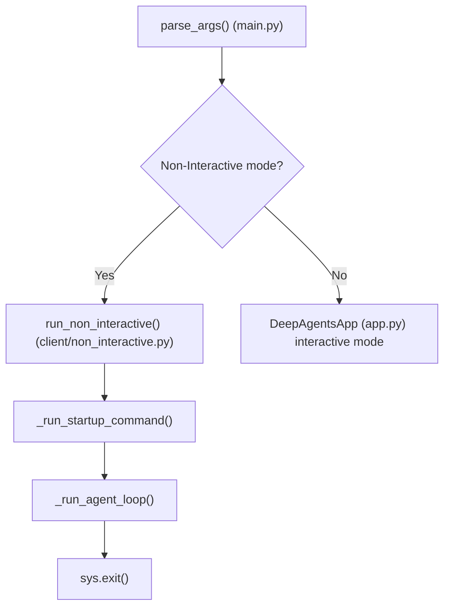
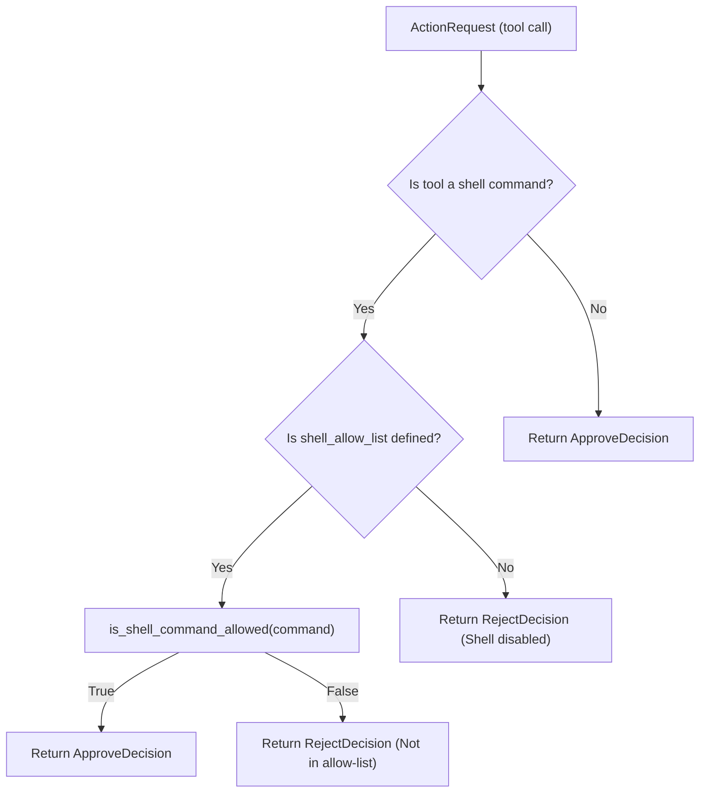
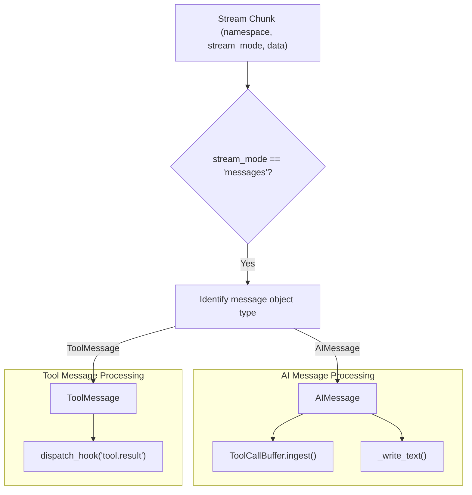

# Non-Interactive Mode

<details>
<summary>Relevant source files</summary>

The following files were used as context for generating this wiki page:

- [libs/code/THREAT_MODEL.md](libs/code/THREAT_MODEL.md)
- [libs/code/deepagents_code/_session_stats.py](libs/code/deepagents_code/_session_stats.py)
- [libs/code/deepagents_code/client/non_interactive.py](libs/code/deepagents_code/client/non_interactive.py)
- [libs/code/deepagents_code/cost_tracking.py](libs/code/deepagents_code/cost_tracking.py)
- [libs/code/deepagents_code/main.py](libs/code/deepagents_code/main.py)
- [libs/code/deepagents_code/tui/textual_adapter.py](libs/code/deepagents_code/tui/textual_adapter.py)
- [libs/code/deepagents_code/ui.py](libs/code/deepagents_code/ui.py)
- [libs/code/deepagents_code/update_check.py](libs/code/deepagents_code/update_check.py)
- [libs/code/tests/unit_tests/test_args.py](libs/code/tests/unit_tests/test_args.py)
- [libs/code/tests/unit_tests/test_cost_tracking.py](libs/code/tests/unit_tests/test_cost_tracking.py)
- [libs/code/tests/unit_tests/test_main.py](libs/code/tests/unit_tests/test_main.py)
- [libs/code/tests/unit_tests/test_main_args.py](libs/code/tests/unit_tests/test_main_args.py)
- [libs/code/tests/unit_tests/test_non_interactive.py](libs/code/tests/unit_tests/test_non_interactive.py)
- [libs/code/tests/unit_tests/test_session_stats.py](libs/code/tests/unit_tests/test_session_stats.py)
- [libs/code/tests/unit_tests/test_update_check.py](libs/code/tests/unit_tests/test_update_check.py)
- [libs/code/tests/unit_tests/test_version.py](libs/code/tests/unit_tests/test_version.py)
- [libs/code/tests/unit_tests/tui/test_textual_adapter.py](libs/code/tests/unit_tests/tui/test_textual_adapter.py)

</details>


This leaf page covers headless execution in `deepagents-code`, detailing the implementation and usage of `run_non_interactive()`. It explains automated Human-in-the-Loop (HITL) evaluation, shell allow-lists, piped input, JSON output formatting, execution limits such as `--max-turns` and `--timeout`, and process exit codes. Non-interactive mode enables running a single user task headlessly with proper streaming of output and status management [libs/code/deepagents_code/client/non_interactive.py:1-19]().

For integration workflows requiring interactive approvals, refer to [ACP Integration (5.1)]().

---

## Overview

Non-interactive mode activates when the CLI detects headless execution flags (e.g., `-n`, `--non-interactive`) or piped `stdin` input. Instead of running the usual interactive TUI via `DeepAgentsApp`, it executes a single headless agent session using `run_non_interactive()` [libs/code/deepagents_code/client/non_interactive.py:3-8]().

**Key Traits:**

- Runs a single user task synchronously with no persistent interactive session.
- Connects to an ephemeral LangGraph subprocess server via a `RemoteAgent` HTTP+SSE client.
- Shell tool execution is gated by an optional shell allow-list and automated HITL policy.
- Supports quiet mode to suppress streaming diagnostics.
- Can produce machine-readable JSON output for programmatic consumption.
- Enforces turn limits (`--max-turns`) and wall-clock timeouts (`--timeout`).
- Returns standard Unix exit codes reflecting execution outcome.

Overall, non-interactive mode is suited for automation, scripts, and editor integrations needing automated execution without manual intervention [libs/code/deepagents_code/client/non_interactive.py:3-19](). 

### Architecture and Data Flow

```mermaid
flowchart TB
    subgraph User Input Layer
        input["CLI Invocation: Non-Interactive Run (e.g. `dcode -n <prompt>`)"]
    end

    subgraph CLI Main Entry Point (libs/code/deepagents_code/main.py)
        parse_args["parse_args()"]
        is_non_interactive{"Is non-interactive mode?"}
    end

    subgraph Non-Interactive Mode (libs/code/deepagents_code/client/non_interactive.py)
        run_non_interactive["run_non_interactive()"]
        startup_cmd["_run_startup_command()"]
        agent_loop["_run_agent_loop()"]
        process_stream["_process_stream_chunk()"]
        hitl_decision["_make_hitl_decision()"]
    end

    subgraph LangGraph Server & Agent
        dev_server["LangGraph dev server subprocess"]
        remote_agent["RemoteAgent HTTP+SSE Client"]
        agent["LangGraph Agent"]
    end

    subgraph Output Layer
        stdout["Agent response → stdout"]
        json_out["JSON Output (if --json)"]
        exit_code["sys.exit(exit_code)"]
    end

    input --> parse_args
    parse_args --> is_non_interactive
    is_non_interactive -->|No| interactive["Interactive TUI: DeepAgentsApp (app.py)"]
    is_non_interactive -->|Yes| run_non_interactive
    run_non_interactive --> startup_cmd
    run_non_interactive --> agent_loop
    agent_loop --> remote_agent
    remote_agent --> dev_server
    dev_server --> agent
    agent --> remote_agent
    remote_agent --> process_stream
    process_stream --> hitl_decision
    hitl_decision --> agent_loop
    process_stream --> stdout
    process_stream --> json_out
    run_non_interactive --> exit_code
```

*Figure: Natural language CLI input flow to agent execution in non-interactive mode, highlighting connections to key code entities.*

Sources: [libs/code/deepagents_code/main.py:44-51](), [libs/code/deepagents_code/client/non_interactive.py:1-100]()

---

## Basic Usage and Invocation

### Invocation Examples

```bash
# Run a single task headless
dcode -n "summarize README.md"

# Limit agent execution turns (to avoid runaway loops)
dcode -n "refactor module" --max-turns 5

# Run a shell command before first agent prompt
dcode -n "fix tests" --startup-cmd "npm install"

# Emit JSON output for thread list
dcode threads list --json
```

The CLI entry point parses arguments and triggers `run_non_interactive()` for these headless runs, managing lifecycle from startup commands to final exit status [libs/code/deepagents_code/client/non_interactive.py:584-663]().

### Non-Interactive Mode Flowchart



*Figure: Decision logic linking CLI argument parsing to launching non-interactive mode.*

Sources: [libs/code/deepagents_code/main.py:44-51](), [libs/code/deepagents_code/client/non_interactive.py:584-663]()

---

## Shell Command Execution and Allow-Lists

### Shell Allow-List Configuration

Non-interactive mode controls shell commands via the `shell_allow_list` setting, which can be:

- **Not set (`None`)**: Shell commands are disabled; non-shell tools auto-approved.
- **`recommended` or explicit list (e.g., `ls,cat,grep`)**: Shell enabled and only commands in allow-list approved.
- **`all`**: Full shell access granted, all tools auto-approved.

This logic restricts potentially dangerous shell calls during unattended runs while permitting safe commands [libs/code/deepagents_code/client/non_interactive.py:9-15]().

### Allow-List Decision Matrix

| Shell Allow-List Setting | Shell Enabled | Shell Commands Auto-Approved | Automated HITL Triggered |
|--------------------------|---------------|------------------------------|--------------------------|
| `None`                   | No            | N/A                          | No                       |
| `recommended` or list    | Yes           | No                           | Yes                      |
| `all`                    | Yes           | Yes                          | No                       |

### HITL Decision Logic in `_make_hitl_decision()`



Shell execution requests denied by the allow-list receive a clear rejection with a message including allowed commands [libs/code/deepagents_code/client/non_interactive.py:133-190]().

Sources: [libs/code/deepagents_code/client/non_interactive.py:9-15](), [libs/code/deepagents_code/client/non_interactive.py:133-190](), [libs/code/deepagents_code/config.py:72-79]()

---

## Output Control and Quiet Mode

### Quiet Mode (`-q` / `--quiet`)

Quiet mode suppresses all streaming diagnostics such as tool call markers and file operation updates. Only the agent’s response text is emitted on `stdout`. This is ideal for scripting or when the output should be minimal [libs/code/deepagents_code/client/non_interactive.py:16-19]().

Text output is written directly:

```python
def _write_text(text: str) -> None:
    """Write agent response text to stdout without trailing newline."""
    sys.stdout.write(text)
    sys.stdout.flush()
```

This ensures consistent UTF-8 console encoding without accidental truncation in quiet sessions [libs/code/deepagents_code/client/non_interactive.py:178-190]().

Sources: [libs/code/deepagents_code/client/non_interactive.py:16-19](), [libs/code/deepagents_code/client/non_interactive.py:178-190]()

---

## Startup Commands, Turn Limits, and Timeouts

### Startup Shell Command (`--startup-cmd`)

An optional shell command can run before the start of the agent execution. This runs via an asynchronous shell subprocess (`asyncio.create_subprocess_shell`) and is **not subject to shell allow-list gating**, to allow initialization setup [libs/code/deepagents_code/client/non_interactive.py:192-204]().

### Execution Turn Limits (`--max-turns`)

`run_non_interactive()` enforces a maximum number of agentic turns to prevent runaway repetitive loops or spiraling token costs. Surpassing this limit raises an error with a clear message and terminates execution [libs/code/deepagents_code/client/non_interactive.py:460-538]().

### Timeout (`--timeout`)

A hard wall-clock timer aborts agent execution if the elapsed time exceeds the configured timeout. The CLI exits with status code `124` to signal timeout termination [libs/code/deepagents_code/client/non_interactive.py:657-658]().

Sources: [libs/code/deepagents_code/client/non_interactive.py:192-204](), [libs/code/deepagents_code/client/non_interactive.py:460-538](), [libs/code/deepagents_code/client/non_interactive.py:657-658](), [libs/code/deepagents_code/ui.py:173-174]()

---

## Stream Processing Architecture

### Stream Processing Dataflow

Non-interactive mode consumes a stream of events from the remote LangGraph agent, using the `StreamState` class to accumulate fragments and track progress [libs/code/deepagents_code/client/non_interactive.py:231-255]().



*Figure: Internal message dispatching flow within `_process_stream_chunk()`.*

This approach allows controlled emission of partial messages, tool output, and decision events for structured processing and optional JSON output [libs/code/deepagents_code/client/non_interactive.py:411-440]().

Sources: [libs/code/deepagents_code/client/non_interactive.py:231-255](), [libs/code/deepagents_code/client/non_interactive.py:411-440]()

---

## Exit Codes

`run_non_interactive()` concludes by calling `sys.exit()` with a status code reflecting the run result [libs/code/deepagents_code/client/non_interactive.py:584-663]():

| Exit Code | Meaning                                                       | Notes                              |
|-----------|---------------------------------------------------------------|----------------------------------|
| `0`       | Success: Task completed with no critical errors              | Normal completion                 |
| `1`       | General error: configuration failures, model errors, crashes | Non-recoverable failures         |
| `124`     | Timeout: Hard wall-clock limit reached                        | Indicates timeout termination     |
| `130`     | Keyboard interrupt: User aborted with Ctrl+C                 | Signals graceful user termination |

This conveys success/failure status to calling scripts or workflows in the standard Unix manner [libs/code/deepagents_code/client/non_interactive.py:657-662]().

Sources: [libs/code/deepagents_code/client/non_interactive.py:584-663]()

---

# Summary

The non-interactive mode in `deepagents-code` provides a robust and secure mechanism for headless AI agent execution supporting diverse use cases from automation and CI pipelines to editor integration. It enforces controls over shell command execution via allow-lists, offers output control with quiet and JSON modes, and supports safe execution bounds by applying turn and timeouts. Its integrated streaming processing enables rich output handling and automated decision-making for HITL workflows without manual user intervention.

---

# Key Code Components

| Symbol                  | Role/Description                                                             | Location/Lines                       |
|-------------------------|------------------------------------------------------------------------------|------------------------------------|
| `run_non_interactive()` | Runs the lifecycle of the headless agent session, manages exit codes         | `client/non_interactive.py:584-663`|
| `_make_hitl_decision()` | Automated approval/rejection of tool and shell commands based on policy      | `client/non_interactive.py:133-190`|
| `_run_agent_loop()`     | Core asynchronous event loop driving agent execution and stream consumption   | `client/non_interactive.py:460-538`|
| `_run_startup_command()`| Runs optional shell command on startup before first turn                      | `client/non_interactive.py:192-204`|
| `StreamState`           | Tracks stream progress, manages aggregated tokens/usage, and buffering       | `client/non_interactive.py:231-255`|
| `is_shell_command_allowed()` | Checks if a shell command matches the allow-list policy                    | `config.py:72-79`                   |

---

# References and Sources

- [libs/code/deepagents_code/client/non_interactive.py:1-663]()
- [libs/code/deepagents_code/main.py:44-51]()
- [libs/code/deepagents_code/ui.py:21-21]()
- [libs/code/deepagents_code/config.py:72-79]()
- [libs/code/deepagents_code/client/non_interactive.py:133-190]()
- [libs/code/deepagents_code/client/non_interactive.py:192-204]()
- [libs/code/deepagents_code/client/non_interactive.py:231-255]()
- [libs/code/deepagents_code/client/non_interactive.py:411-440]()