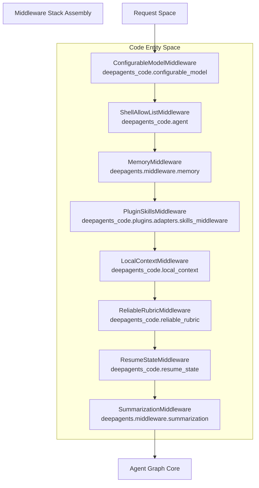
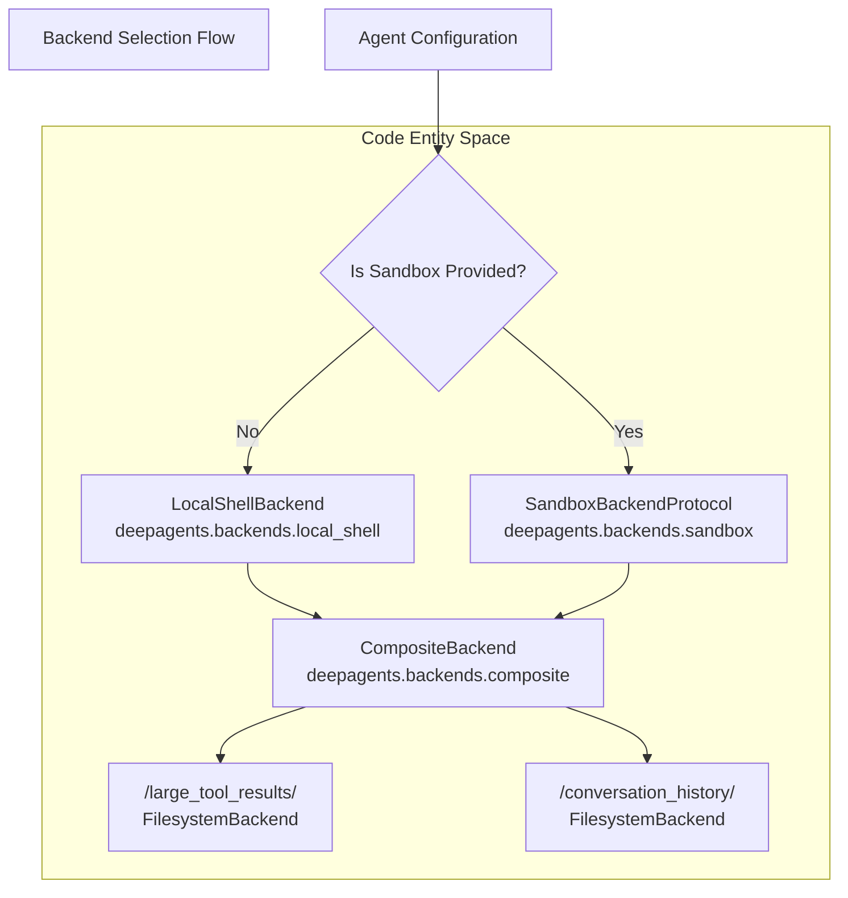

# Agent Creation (create_cli_agent)

<details>
<summary>Relevant source files</summary>

The following files were used as context for generating this wiki page:

- [libs/code/deepagents_code/_server_config.py](libs/code/deepagents_code/_server_config.py)
- [libs/code/deepagents_code/agent.py](libs/code/deepagents_code/agent.py)
- [libs/code/deepagents_code/server_graph.py](libs/code/deepagents_code/server_graph.py)
- [libs/code/tests/unit_tests/test_agent.py](libs/code/tests/unit_tests/test_agent.py)
- [libs/code/tests/unit_tests/test_server_config.py](libs/code/tests/unit_tests/test_server_config.py)
- [libs/code/tests/unit_tests/test_server_graph.py](libs/code/tests/unit_tests/test_server_graph.py)

</details>


This document covers the `create_cli_agent()` function, which is the primary entry point for creating CLI-configured agents in the `deepagents-code` package. This function assembles the complete agent graph with terminal-specific middleware, backend routing, and Human-in-the-Loop (HITL) approval gates.

For the core SDK agent creation, see [Agent Creation (create_deep_agent)]().

---

## Function Overview

The `create_cli_agent()` function is defined in [libs/code/deepagents_code/agent.py:489-774]() and serves as the main factory for CLI agents. It orchestrates assembling several disparate systems into a unified LangGraph `Pregel` object.

Key responsibilities include:  
1. **Agent directory setup:** Ensures `~/.deepagents/agents/{assistant_id}/` exists and contains an `agent.md` file [libs/code/deepagents_code/agent.py:539-548]().  
2. **Middleware assembly:** Builds a stack including `ConfigurableModelMiddleware`, `MemoryMiddleware`, `PluginSkillsMiddleware`, `LocalContextMiddleware`, and `ReliableRubricMiddleware` [libs/code/deepagents_code/agent.py:917-1052]().  
3. **Backend resolution:** Configures a `CompositeBackend` that routes local shell or remote sandbox execution, plus temporary storage for large results and persistent conversation history [libs/code/deepagents_code/agent.py:643-739]().  
4. **HITL configuration:** Sets up `interrupt_on` gates for destructive or expensive tools like `execute`, `write_file`, and `web_search`, including a predicate honoring the user's `ApprovalMode` [libs/code/deepagents_code/agent.py:686-701]().  
5. **System prompt generation:** Dynamically generates a base prompt adapting to interactive or non-interactive modes and includes specialized memory guidelines [libs/code/deepagents_code/agent.py:348-477]().

---

## Function Signature and Parameters

```python
def create_cli_agent(
    model: str | BaseChatModel,
    assistant_id: str,
    *,
    tools: Sequence[BaseTool | Callable | dict[str, Any]] | None = None,
    sandbox: SandboxBackendProtocol | None = None,
    sandbox_type: str | None = None,
    system_prompt: str | None = None,
    interactive: bool = True,
    approval_mode: ApprovalMode | None = None,
    shell_allow_list: list[str] | None = None,
    enable_ask_user: bool = False,
    enable_memory: bool = True,
    enable_skills: bool = True,
    enable_shell: bool = True,
    checkpointer: BaseCheckpointSaver | None = None,
    mcp_server_info: list[MCPServerInfo] | None = None,
    cwd: str | Path | None = None,
    project_context: ProjectContext | None = None,
    async_subagents: list[AsyncSubAgent] | None = None,
    enable_rubric: bool = True,
) -> tuple[Pregel, CompositeBackend]:
```

### Key Parameters

| Parameter            | Type                                               | Description                                                                                     |
|---------------------|----------------------------------------------------|-------------------------------------------------------------------------------------------------|
| `model`             | `str \| BaseChatModel`                             | The LLM to use. Can be a string identifier (e.g., `anthropic:claude-3-5-sonnet`) or model instance. [libs/code/deepagents_code/agent.py:490]() |
| `assistant_id`      | `str`                                              | Unique identifier for the agent, used for directory paths and persistence. [libs/code/deepagents_code/agent.py:491]() |
| `interactive`       | `bool`                                             | If `True`, the system prompt and behavior is tailored for a human operator. [libs/code/deepagents_code/agent.py:497]() |
| `approval_mode`     | `ApprovalMode`                                      | Controls HITL behavior (e.g., `manual`, `auto`, `yolo`). If no explicit value, defaults are derived from environment/config. [libs/code/deepagents_code/agent.py:498]() |
| `shell_allow_list`  | `list[str]`                                        | List of allowed shell commands that bypass HITL in non-interactive runs. [libs/code/deepagents_code/agent.py:500]() |
| `sandbox`           | `SandboxBackendProtocol \| None`                   | Optional remote sandbox backend to execute shell commands in. [libs/code/deepagents_code/agent.py:652-665]() |
| `project_context`   | `ProjectContext \| None`                            | Provides context about the current git repository and project root, used for local context injection. [libs/code/deepagents_code/agent.py:508]() |

Sources: [libs/code/deepagents_code/agent.py:489-511]()

---

## Middleware Stack Assembly

The CLI agent uses a middleware stack arranged to ensure correct context injection, tool gating, and lifecycle handling. The stack is constructed as a list of `AgentMiddleware` instances passed to `create_deep_agent`.

### Middleware sequence in `create_cli_agent`

1. **ConfigurableModelMiddleware**: Manages runtime overrides and dynamic switching of the model backend. Supports `/model` commands.  
2. **ShellAllowListMiddleware**: In non-interactive mode, this middleware intercepts shell `execute` tool calls and allows execution without HITL approval if commands are on the allow-list.  
3. **MemoryMiddleware**: Loads persistent agent memory from files (`~/.deepagents/agents/` and project memory files). Includes readonly system prompt that guides how to interpret this memory.  
4. **PluginSkillsMiddleware**: Loads plugin-based skills alongside user-level and project-level skills, supporting the extensible skill ecosystem.  
5. **LocalContextMiddleware**: Injects local context information (working directory tree, git status, environment snapshot) into system prompts.  
6. **ReliableRubricMiddleware** (optional): Adds goal-tracking, rubric evaluation, and self-reflection tools for goal-driven agent execution.  
7. **ResumeStateMiddleware**: Maintains and restores checkpoint state, including token usage and model configurations.  
8. **SummarizationMiddleware**: Adds conversation compaction tools to manage context window size automatically.  

### Diagram: Middleware Flow Mapping Natural Language Space to Code Entity Space



Sources: [libs/code/deepagents_code/agent.py:184-206](), [libs/code/deepagents_code/agent.py:917-1052](), [libs/code/deepagents_code/local_context.py:121-216](), [libs/code/deepagents_code/resume_state.py:61-68]()

---

## Backend and Sandbox Resolution

The agent backend encapsulates how and where tools execute, whether in a local shell or in a remote sandbox.

- When no sandbox backend is passed, `LocalShellBackend` is used, configured to inherit the current environment but restoring the original `LANGSMITH_PROJECT` environment variable if modified, ensuring accurate LangSmith tracing [libs/code/deepagents_code/agent.py:643-662]().  
- When a sandbox backend is provided, it is integrated as the main shell backend.  
- A `CompositeBackend` is composed to route paths for persistent data such as large tool results (`/large_tool_results/`) and conversation history (`/conversation_history/`) to dedicated `FilesystemBackend` instances on the host filesystem to maintain state durability [libs/code/deepagents_code/agent.py:713-739]().

### Diagram: Backend Selection Mapping Natural Language Space to Code Entity Space



Conversation history routing to `/conversation_history/` is designed so it survives server restarts and persists for the user [libs/code/tests/unit_tests/test_agent.py:155-183](). This ensures continuity and retrospection over multiple sessions.

Sources: [libs/code/deepagents_code/agent.py:643-739](), [libs/code/tests/unit_tests/test_agent.py:155-183]()

---

## System Prompt Generation

The `get_system_prompt()` function generates the base instructions for the agent. It loads a template from a `system_prompt.md` file and applies variable substitution depending on context, enabling a flexible, project-aware prompt foundation.

Key dynamically injected sections:

- **Memory Guidelines:** Appends a readonly memory section with instructions on memory trust model [libs/code/deepagents_code/agent.py:119-145]().  
- **Ambiguity Instructions:** Different text blocks for interactive mode (where the agent asks clarifying questions if ambiguous) vs non-interactive mode (where it makes reasonable assumptions) [libs/code/deepagents_code/agent.py:386-396]().  
- **Model Identity:** Injects information about the model name and maximal context window size via `build_model_identity_section()` [libs/code/deepagents_code/agent.py:403-414]().  
- **Working Directory:** Interpolates the agent’s absolute working directory or sandbox workspace path [libs/code/deepagents_code/agent.py:416-453]().

This design supports transparent, adaptable system prompts for different runtime environments, improving the agent's reliability and user guidance.

Sources: [libs/code/deepagents_code/agent.py:348-477](), [libs/code/deepagents_code/agent.py:119-145]()

---

## Human-in-the-Loop (HITL) Configuration and ShellAllowListMiddleware

For sensitive tooling, the agent uses an `interrupt_on` configuration that defines triggers causing the agent to pause for human approval. This is critical for destructive or expensive operations.

### Tools with Custom Interrupt Descriptions

| Tool        | Description Formatter              | Behavior                                                         |
| ----------- | -------------------------------- | ----------------------------------------------------------------|
| write_file  | `_format_write_file_description` | Detects if operation is create or overwrite; counts lines.       |
| execute     | `_format_execute_description`    | Displays the exact shell command and directory where it runs.   |
| web_search  | `_format_web_search_description` | Warns that the agent will call an internet search API.           |
| task        | `_format_task_description`       | Shows the sub-agent description and instructions.               |

These formatters enhance transparency during HITL prompt messages [libs/code/deepagents_code/agent.py:177-271]().

### Interrupt Predicate Logic

The `_should_interrupt_tool_call()` function determines if a tool call triggers an interrupt pause, based on:

- The current `ApprovalMode`, stored in the agent's `Store` object (e.g., manual approval, auto approve, YOLO mode).
- Whether the tool is destructive and not read-only.
- The `ApprovalMode` allows some tools to bypass approval if in an automated or "yolo" mode [libs/code/deepagents_code/agent.py:274-302]().

### ShellAllowListMiddleware Details

In non-interactive or automated runs, it’s preferable to skip human approval on known safe shell commands. The `ShellAllowListMiddleware` intercepts shell `execute` tool calls and:

- Checks if the command matches the configured allow-list.
- If on the allow-list, allows execution without HITL prompts, even if `interrupt_on` normally triggers.
- Otherwise, forwards the call to the next middleware where it may be gated or approved.

This middleware works in tandem with the HITL system to balance security and automation [libs/code/deepagents_code/agent.py:184-206]().

Sources: [libs/code/deepagents_code/agent.py:177-302](), [libs/code/deepagents_code/agent.py:686-701]()

---

## Custom Subagent Loading

`deepagents-code` supports creating and managing custom subagents, represented as Markdown files with YAML frontmatter metadata. These subagents are specialized agents launched via the `task` tool inside the main agent.

### Subagent Discovery

Custom subagents are loaded from the following directories:

1. **User-level agents:** `~/.deepagents/agents/{agent_name}/AGENTS.md`  
2. **Project-level agents:** `.deepagents/agents/{agent_name}/AGENTS.md`

The function `list_subagents()` scans these profiles and combines them, with project-level overrides taking precedence over user-level definitions [libs/code/deepagents_code/subagents.py:220-244]().

### YAML Frontmatter Schema

Each subagent Markdown file begins with `---` delimited YAML containing metadata fields such as:

| Field       | Type  | Required | Description                                             |
| ----------- | ----- | -------- | -------------------------------------------------------|
| `name`      | str   | No       | Unique ID for the subagent, used by the `task` tool; defaults to folder basename. [libs/code/deepagents_code/subagents.py:48-49]() |
| `description`| str  | Yes      | Short summary describing the subagent's role—aids the main agent in delegation decisions. [libs/code/deepagents_code/subagents.py:51-52]() |
| `model`     | str   | No       | Optional model override for the subagent, e.g. `anthropic:claude-3-haiku`. [libs/code/deepagents_code/subagents.py:57-58]() |

The Markdown body after the frontmatter serves as the subagent's **system prompt**, providing instructions and context [libs/code/deepagents_code/subagents.py:54-55]().

This extensible design allows users and projects to extend the agent's capabilities with custom, isolated subagents loaded dynamically at runtime.

Sources: [libs/code/deepagents_code/subagents.py:1-174](), [libs/code/deepagents_code/subagents.py:220-244]()

---

## Integration with SDK

The `create_cli_agent()` function ultimately calls `create_deep_agent()` from the core SDK, passing the fully constructed middleware stack, composite backend, system prompt, and discovered custom subagents.

Additional details:

- **FilesystemMiddleware tool description extension:** The CLI agent merges custom filesystem tool descriptions derived from SDK harness profiles into the filesystem middleware for consistent documentation in CLI usage [libs/code/deepagents_code/agent.py:151-176]().  
- **HITL and shells:** Configured approval modes and shell allow-lists are honored and injected as middleware interceptors for tooling calls.  
- **Async subagents:** Passed through to support async subagent behaviors if configured.

This layered design cleanly separates CLI-specific concerns from the core SDK agent creation logic, facilitating reuse and consistency across interfaces [libs/code/deepagents_code/agent.py:894-913](), [libs/code/deepagents_code/agent.py:1054-1076]().

Sources: [libs/code/deepagents_code/agent.py:894-913](), [libs/code/deepagents_code/agent.py:1054-1076](), [libs/code/deepagents_code/agent.py:151-176]()

---

# Summary Mermaid Diagram

```mermaid
graph TD
    NL1["Natural Language Space: User config & CLI flags"]
    NL2["Custom Subagents (Markdown with YAML)"]

    Code1["create_cli_agent()"]
    Code2["Middleware Stack:<br/>ConfigurableModelMiddleware<br/>ShellAllowListMiddleware<br/>MemoryMiddleware<br/>PluginSkillsMiddleware<br/>LocalContextMiddleware<br/>ReliableRubricMiddleware<br/>ResumeStateMiddleware<br/>SummarizationMiddleware"]
    Code3["Backends:<br/>LocalShellBackend or SandboxBackend<br/>CompositeBackend routes /large_tool_results/ and /conversation_history/"]
    Code4["System Prompt Generation:<br/>Interactive mode adjustments<br/>Memory guidelines"]
    Code5["HITL Configuration:<br/>interrupt_on tools with approval predicate"]
    Code6["Custom Subagent Loading:<br/>list_subagents() with project/user precedence"]
    Code7["Calls create_deep_agent() with full config"]

    NL1 --> Code1
    NL2 --> Code6
    Code1 --> Code2
    Code1 --> Code3
    Code1 --> Code4
    Code1 --> Code5
    Code6 --> Code7
    Code2 --> Code7
    Code3 --> Code7
    Code4 --> Code7
    Code5 --> Code7
    Code7 --> "Pregel graph instance with CompositeBackend"
```

---

# References

- middleware and backend assembly: [libs/code/deepagents_code/agent.py:489-774]()  
- system prompt generation: [libs/code/deepagents_code/agent.py:348-477]()  
- shell allow list middleware: [libs/code/deepagents_code/agent.py:184-206]()  
- HITL interrupt predicate and custom descriptions: [libs/code/deepagents_code/agent.py:177-302]()  
- backend selection and composite backend: [libs/code/deepagents_code/agent.py:643-739]()  
- custom subagent loading: [libs/code/deepagents_code/subagents.py:1-174](), [libs/code/deepagents_code/subagents.py:220-244]()  
- integration with core SDK create_deep_agent: [libs/code/deepagents_code/agent.py:894-913](), [libs/code/deepagents_code/agent.py:1054-1076]()

---

This page fully documents the purpose, implementation, data flows, and key components involved in `create_cli_agent`, linking natural language configuration inputs through careful middleware layering and backend routing into a sophisticated agent runtime graph.