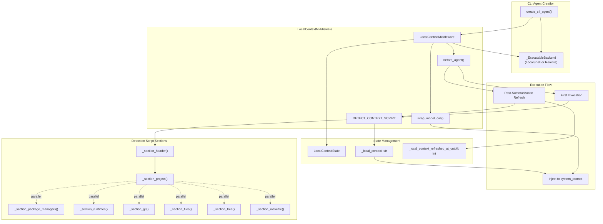
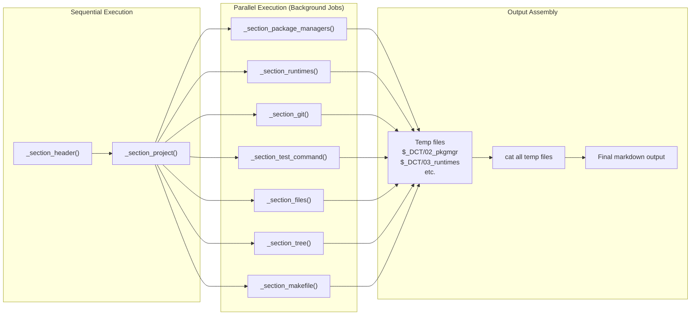
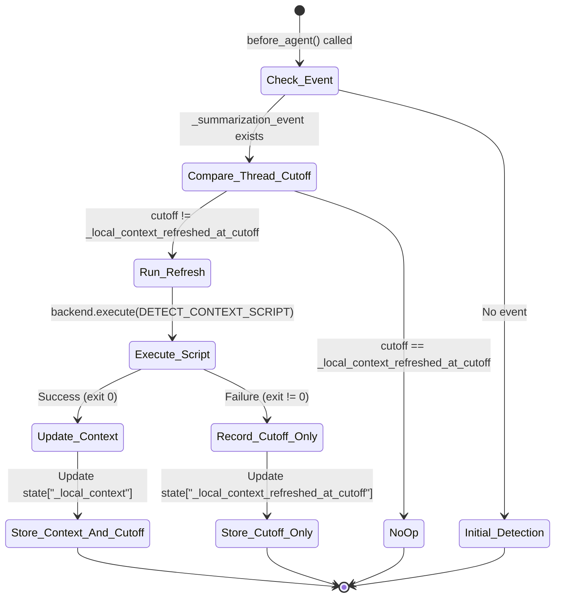
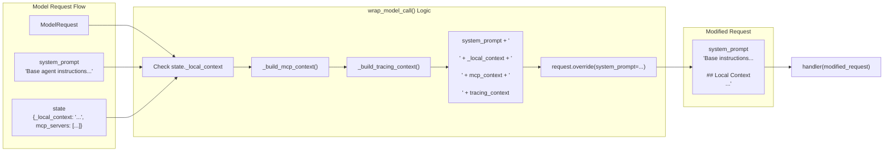

# Local Context Injection

Relevant source files

The following files were used as context for generating this wiki page:

- [libs/code/deepagents_code/built_in_skills/deepagents-plugin-discovery/SKILL.md](libs/code/deepagents_code/built_in_skills/deepagents-plugin-discovery/SKILL.md)
- [libs/code/deepagents_code/local_context.py](libs/code/deepagents_code/local_context.py)
- [libs/code/deepagents_code/system_prompt.md](libs/code/deepagents_code/system_prompt.md)
- [libs/code/tests/integration_tests/benchmarks/test_local_context_benchmarks.py](libs/code/tests/integration_tests/benchmarks/test_local_context_benchmarks.py)
- [libs/code/tests/integration_tests/test_compact_resume.py](libs/code/tests/integration_tests/test_compact_resume.py)
- [libs/code/tests/integration_tests/test_offload_server_side.py](libs/code/tests/integration_tests/test_offload_server_side.py)
- [libs/code/tests/unit_tests/skills/test_load.py](libs/code/tests/unit_tests/skills/test_load.py)
- [libs/code/tests/unit_tests/smoke_tests/snapshots/system_prompt_headless_local.md](libs/code/tests/unit_tests/smoke_tests/snapshots/system_prompt_headless_local.md)
- [libs/code/tests/unit_tests/smoke_tests/snapshots/system_prompt_interactive_local.md](libs/code/tests/unit_tests/smoke_tests/snapshots/system_prompt_interactive_local.md)
- [libs/code/tests/unit_tests/smoke_tests/test_system_prompt.py](libs/code/tests/unit_tests/smoke_tests/test_system_prompt.py)
- [libs/code/tests/unit_tests/test_local_context.py](libs/code/tests/unit_tests/test_local_context.py)
- [libs/code/tests/unit_tests/test_reload.py](libs/code/tests/unit_tests/test_reload.py)
- [libs/code/tests/unit_tests/test_server_helpers.py](libs/code/tests/unit_tests/test_server_helpers.py)

Local Context Injection is a CLI-specific middleware (`LocalContextMiddleware`) that automatically detects and injects detailed environment information into the agent's system prompt. This enables the agent to have up-to-date awareness of the user's local project and development environment, improving response relevance in interactive coding and analysis tasks.

This page provides a full technical walkthrough of the middleware's implementation, key functions, data flows, the detection script's structure, system prompt snapshot tests, and relevant state schemas.

For related details on CLI-specific agent creation, see [3.8 Agent Creation (create_cli_agent)](). For broader middleware architecture, see [2.2 Middleware System]().

---

## Overview

`LocalContextMiddleware` runs an environment detection script inside the backend's shell environment (local shell or remote sandbox) to gather rich metadata about the project and system [libs/code/deepagents_code/local_context.py:4-7](). This script introspects:

- **Current Directory**: Absolute path and basic workspace info.
- **Project Type**: Languages and monorepo patterns (Python, JavaScript, Rust, Go, Java; monorepo detection).
- **Package Managers**: Detection of uv, poetry, npm, yarn, pnpm, bun.
- **Runtimes**: Python and Node.js versions installed.
- **Git Status**: Branch name, availability of main/master branches, and count of uncommitted changes.
- **Filesystem Overview**: Top-level directory listing and a partial directory tree.
- **Makefile Content**: First lines of Makefile if present.
- **Test Command Discovery**: Known test commands like make test, pytest, npm test.
- **Connected MCP Servers**: Model Context Protocol server and tool inventory.
- **Tracing Context**: Current LangSmith project names for agent and user contexts.

This metadata is returned as a markdown-formatted block stored as private state in the agent and appended to the system prompt every model call, giving the agent situational awareness of the local environment [libs/code/deepagents_code/local_context.py:680-838](), [libs/code/deepagents_code/local_context.py:38-188]().

The environment detection runs initially on the first user message and refreshes post summarization compactions to reflect changes in the local environment [libs/code/deepagents_code/local_context.py:482-522]().

**Sources:** [libs/code/deepagents_code/local_context.py:1-237](), [libs/code/deepagents_code/local_context.py:680-838]()

---

## Middleware Architecture

### Components and Flow

The core middleware class is `LocalContextMiddleware` which derives from `AgentMiddleware` and manages local context detection and injection into the model request [libs/code/deepagents_code/local_context.py:412-576]().

Key methods:

- `before_agent(state, handler)`: Executes the detection script on the first run or when a new summarization cutoff triggers a context refresh. Updates internal state with fresh context or refresh markers.
- `wrap_model_call(request, state, handler)`: Augments the system prompt in the outgoing model request with the collected local context, MCP server details, and LangSmith tracing context.

The detection script (`DETECT_CONTEXT_SCRIPT`) is a large bash script assembled from modular Python helper functions that generate sections of the output in parallel subshell jobs, writing to temp files and concatenating results.

### Class and Flow Diagram

**Sources:** [libs/code/deepagents_code/local_context.py:412-576](), [libs/code/deepagents_code/local_context.py:38-188]()

---

## Detection Script Construction

### Script Architecture

The detection script is composed of labeled bash functions that execute sequentially or in parallel background jobs. It is designed so the initial setup sections run in sequence configuring working directory and git root, then independent environment probes run concurrently writing outputs to temporary files. Finally, all sections are concatenated into a single markdown output.

Key points:

- Uses a dynamic temp directory `$_DCT` to write intermediate outputs.
- Runs detection of package managers, runtimes, git state, tests, directory files, and trees concurrently.
- Uses shell-builtins and common CLI tools (`git`, `node`, `python3`, `tree`, `ls`) with timeout protections.
- Outputs are wrapped with markdown headers and formatting to be suitable for injection into the system prompt.

This parallel-execution model maximizes efficiency while supporting local or remote sandboxes identically, since the shell environment is the definitive source of truth for file presence and versions.

### Parallel Execution Diagram

### Detection Script Sections Summary

| Section          | Function                 | Information Gathered                                      | Example Output                            |
|------------------|--------------------------|----------------------------------------------------------|------------------------------------------|
| Header           | `_section_header()`      | Detect current directory, flag git presence              | `**Current Directory**: /home/user/project` |
| Project          | `_section_project()`     | Detect language (python, js, rust), monorepo patterns    | `**Project**: python (uv), monorepo`      |
| Package Managers | `_section_package_managers()` | Detect uv, poetry, npm, yarn, pnpm, bun                  | `**Package Manager**: Python: uv`         |
| Runtimes         | `_section_runtimes()`    | Check python3, node versions                              | `**Runtimes**: Python 3.12.4, Node 20.11.0` |
| Git              | `_section_git()`         | Current branch, main/master presence, uncommitted changes | `**Git**: Current branch main, 1 uncommitted change` |
| Test Command     | `_section_test_command()`| Presence of test commands like `make test`, `pytest`      | `**Run Tests**: pytest`                    |
| Files            | `_section_files()`       | List visible directory contents (capped at 20 entries)    | `- README.md`, `- src/`                    |
| Tree             | `_section_tree()`        | Generate a 3-level directory tree output                   | Multi-line structural tree view           |
| Makefile         | `_section_makefile()`    | Show first 20 lines of Makefile if present                 | Makefile snippet lines                     |

**Sources:** [libs/code/deepagents_code/local_context.py:674-852]()

---

## Context Lifecycle and Refresh Logic

### Logic Flow

- On the **first agent invocation**, if no prior context snapshot exists (`_local_context` is empty), the middleware runs the detection script synchronously and stores the output [libs/code/deepagents_code/local_context.py:515-522]().
- When a **summarization compaction event** occurs (reported by `SummarizationMiddleware` with a cutoff index), `before_agent()` compares the cutoff with the last refresh index (`_local_context_refreshed_at_cutoff`) [libs/code/deepagents_code/local_context.py:494-513]().
- If the cutoff has advanced, a **post-summarization refresh** runs the detection script again to update context with any environment changes.
- This prevents redundant script executions within the same summarization window while ensuring environment drifts (like git status changes or new files) are picked up promptly.

### Refresh State Machine Diagram

**Sources:** [libs/code/deepagents_code/local_context.py:482-522]()

---

## System Prompts and system_prompt.md Snapshots

### System Prompt Template

The base system prompt for the CLI agent is stored as a markdown file `deepagents_code/system_prompt.md` which outlines core behavior, formatting rules, git safety policies, debugging advice, and CLI command use standards [libs/code/deepagents_code/system_prompt.md:1-137]().

At runtime, `create_cli_agent()` loads this prompt and applies interpolations based on interactive vs non-interactive modes, and then the `LocalContextMiddleware` appends the markdown block generated by the detection script alongside memory and skills data [libs/code/deepagents_code/agent.py](), [libs/code/deepagents_code/local_context.py:524-576]().

This clean separation allows snapshot tests to verify prompt stability independently.

### Snapshot Smoke Testing

Snapshot tests verify that the system prompt with injected local context remains stable to prevent unintentional prompt drift:

- A special `_SnapshotChatModel` fake model captures the initial system prompt during the first model call for snapshot comparison.
- Fixed environment values (`_FIXED_CWD`, `_FIXED_LOCAL_CONTEXT`) reproduce a predictable prompt content across different machines.
- Snapshots reside in `libs/code/tests/unit_tests/smoke_tests/snapshots/` as markdown files like `system_prompt_interactive_local.md`.

This testing guards prompts against unexpected formatting or content regressions that degrade prompt quality or model behavior [libs/code/tests/unit_tests/smoke_tests/test_system_prompt.py:1-185](), [libs/code/tests/unit_tests/smoke_tests/snapshots/system_prompt_interactive_local.md:1-131]().

**Sources:** [libs/code/deepagents_code/system_prompt.md:1-137](), [libs/code/tests/unit_tests/smoke_tests/test_system_prompt.py:1-185](), [libs/code/tests/unit_tests/smoke_tests/snapshots/system_prompt_interactive_local.md:1-131]()

---

## System Prompt Injection & Security

### Sanitization Functions

The local context fields may contain untrusted user input such as git branch names, MCP server error messages, or LangSmith project names which could be crafted to inject prompt lines or cause log forging.

To mitigate this:

- `_sanitize_error_detail()` removes hidden, control unicode characters and newlines, restricts length, and collapses whitespace for MCP error strings to one safe line [libs/code/deepagents_code/local_context.py:67-88]().
- `_sanitize_tracing_project_name()` similarly operates on LangSmith project names, bounding length and flattening to a single line [libs/code/deepagents_code/local_context.py:90-106]().
- The `sanitize_control_chars()` utility strips BiDi unicode directional overrides and illegal control characters [libs/code/deepagents_code/unicode_security.py:176-202]().
  
This sanitization protects the integrity of the system prompt.

### Prompt Augmentation Data Flow

The `wrap_model_call()` hook combines the base system prompt with the local context and MCP/tracing information before the model call. This logic flow:

The final prompt given to the model includes live local context, enabling it to reason with accurate knowledge of the user's environment.

**Sources:** [libs/code/deepagents_code/local_context.py:67-237](), [libs/code/deepagents_code/local_context.py:524-576](), [libs/code/deepagents_code/unicode_security.py:176-202]()

---

## State Schema and Backend Requirements

### `LocalContextState`

The middleware defines private state attributes to hold the local context and the summarization cutoff index when it was last refreshed. These are marked as `PrivateStateAttr` to exclude them from public trace payloads and checkpoint outputs [libs/code/deepagents_code/local_context.py:32]().

| Field                          | Type                         | Visibility | Purpose                                                   |
|--------------------------------|------------------------------|------------|-----------------------------------------------------------|
| `_local_context`               | `Annotated[str, PrivateStateAttr]` | Private    | Markdown text of the detected local environment context injected into system prompts. [libs/code/deepagents_code/local_context.py:397]() |
| `_local_context_refreshed_at_cutoff` | `Annotated[int, PrivateStateAttr]` | Private    | Summarization event cutoff index when the context was refreshed. [libs/code/deepagents_code/local_context.py:401-404]()       |

### Backend Compatibility

To execute the environment detection script, the middleware requires a backend implementing the `_ExecutableBackend` protocol, which demands a synchronous `execute(command: str) -> ExecuteResponse` method. An asynchronous counterpart `_AsyncExecutableBackend` is also defined for async support [libs/code/deepagents_code/local_context.py:24]().

Runtime verification using `@runtime_checkable` ensures backend compatibility before executing the detection script [libs/code/deepagents_code/local_context.py:101-106]().

**Sources:** [libs/code/deepagents_code/local_context.py:24](), [libs/code/deepagents_code/local_context.py:101-106](), [libs/code/deepagents_code/local_context.py:390-404](), [libs/code/tests/unit_tests/test_local_context.py:139-150]()

---

# Summary

`LocalContextMiddleware` is a critical component in the deepagents-code CLI agent stack that detects detailed project and environment metadata by running a comprehensive bash script within the agent's configured backend shell environment. This context is stored privately and injected into every system prompt, ensuring the LLM is aware of git status, runtimes, package managers, and MCP server states without manual intervention.

Its modular script design balances sequential and parallelism for efficiency and reusability across local and remote backends. Tight sanitization and snapshot tests ensure robustness against prompt injection vulnerabilities and regression.

This middleware exemplifies how domain-specific environment knowledge is tightly integrated into the agent runtime for effective interactive code assistance.

---

**All source code and test citations:**

- [libs/code/deepagents_code/local_context.py:1-237]()
- [libs/code/deepagents_code/local_context.py:390-404]()
- [libs/code/deepagents_code/local_context.py:412-576]()
- [libs/code/deepagents_code/local_context.py:674-895]()
- [libs/code/deepagents_code/system_prompt.md:1-137]()
- [libs/code/tests/unit_tests/smoke_tests/test_system_prompt.py:1-185]()
- [libs/code/tests/unit_tests/smoke_tests/snapshots/system_prompt_interactive_local.md:1-131]()
- [libs/code/tests/unit_tests/test_local_context.py:139-150]()
- [libs/code/deepagents_code/unicode_security.py:176-202]()