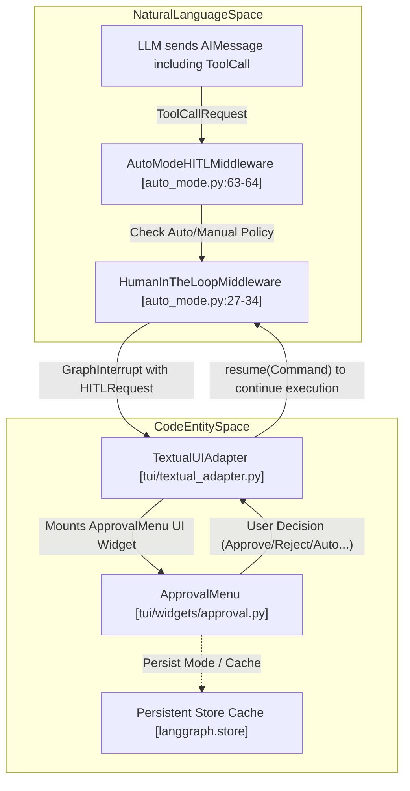
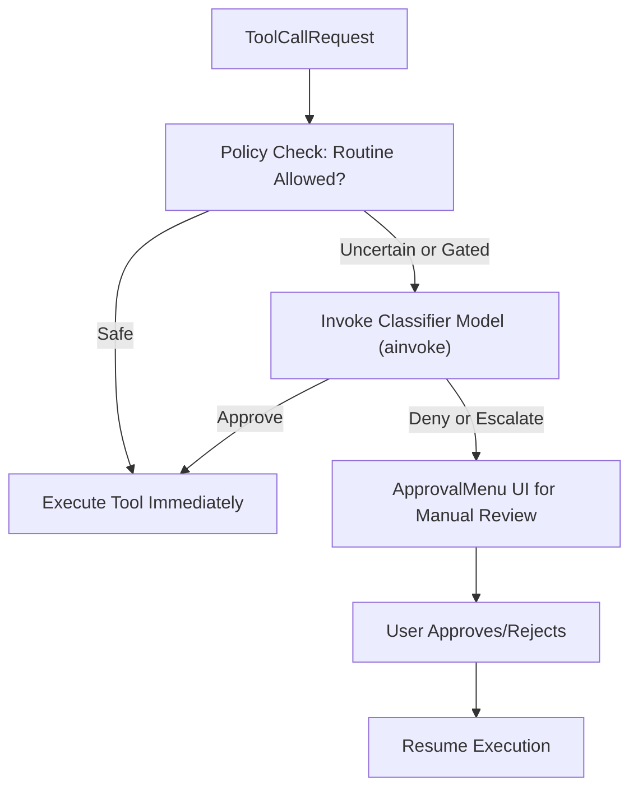

# Human-in-the-Loop (HITL) Approval and Auto Mode

Relevant source files

The following files were used as context for generating this wiki page:

- [libs/code/deepagents_code/_ask_user_types.py](libs/code/deepagents_code/_ask_user_types.py)
- [libs/code/deepagents_code/ask_user.py](libs/code/deepagents_code/ask_user.py)
- [libs/code/deepagents_code/auto_mode.py](libs/code/deepagents_code/auto_mode.py)
- [libs/code/deepagents_code/tui/widgets/approval.py](libs/code/deepagents_code/tui/widgets/approval.py)
- [libs/code/deepagents_code/tui/widgets/auto_mode_notice.py](libs/code/deepagents_code/tui/widgets/auto_mode_notice.py)
- [libs/code/deepagents_code/tui/widgets/yolo_mode_notice.py](libs/code/deepagents_code/tui/widgets/yolo_mode_notice.py)
- [libs/code/tests/unit_tests/test_ask_user_middleware.py](libs/code/tests/unit_tests/test_ask_user_middleware.py)
- [libs/code/tests/unit_tests/test_ask_user_types.py](libs/code/tests/unit_tests/test_ask_user_types.py)
- [libs/code/tests/unit_tests/test_auto_mode.py](libs/code/tests/unit_tests/test_auto_mode.py)
- [libs/code/tests/unit_tests/tui/widgets/test_approval.py](libs/code/tests/unit_tests/tui/widgets/test_approval.py)

## Purpose and Scope

The Human-in-the-Loop (HITL) approval system in Deep Agents provides an interactive checkpoint for gating potentially impactful agent operations, such as executing shell commands, editing files, or accessing the network. This ensures user oversight over actions that may be destructive or require clarification. 

Key components include the `HumanInTheLoopMiddleware` integrating with a specialized `AutoModeHITLMiddleware` classifier for automation, and the `ApprovalMenu` widget in the `deepagents-code` terminal UI for user interaction. The system implements security safeguards including Unicode homograph warnings, shell allow-lists, deferred approvals, and a YOLO mode for unrestricted execution with explicit acknowledgment.

Sources: [libs/code/deepagents_code/auto_mode.py:27-44](), [libs/code/deepagents_code/auto_mode.py:63-64](), [libs/code/deepagents_code/tui/widgets/approval.py:102-112]()

---

## System Architecture and Data Flow

The HITL approval workflow engages at the intersection of natural language-driven agent execution (LangGraph plus middleware) and the TUI-based user interaction framework.

This graph reveals the key middleware classes (`AutoModeHITLMiddleware`, `HumanInTheLoopMiddleware`) and UI components (`TextualUIAdapter`, `ApprovalMenu`) that orchestrate approval. The persistent `Store` caches approval modes and deferred approval state. A tool call from the LLM triggers the policy middleware which either auto-approves or sends an approval request to the UI via `GraphInterrupt`. The user response resumes agent execution.

Sources: [libs/code/deepagents_code/auto_mode.py:27-44](), [libs/code/deepagents_code/tui/widgets/approval.py:102-146](), [libs/code/deepagents_code/approval_mode.py:70-75]()

---

## Interrupt Configuration and Tool Gating

The core mechanism for human interaction is configured via `interrupt_on` flags (an instance of `InterruptOnConfig`), specifying which tool calls require explicit approval.

### Gated Tools and Conditions

- **Filesystem Write Tools** (`write_file`, `edit_file`): Always gated by default to protect codebase integrity.
- **Shell Execution (`execute`)**: Typically gated unless overridden (e.g., non-interactive with allow-lists).
- **Manual Clarifications (`ask_user`)**: Special interrupt that triggers a prompt to the user to clarify ambiguous contexts before proceeding.
- **Security Warnings**: Any tool call argument containing suspicious Unicode (zero-width spaces, control characters) or URLs with dangerous homographs triggers additional warning UI.

The HITL middleware examines every tool call against these configurations and security heuristics, issuing a `GraphInterrupt` with a `HITLRequest` that pauses execution and awaits an approval command.

Sources: [libs/code/deepagents_code/auto_mode.py:32-34](), [libs/code/deepagents_code/tui/widgets/approval.py:27-35](), [libs/code/deepagents_code/ask_user.py:26-27]()

---

## Approval Modes and Workflow

Deep Agents supports three approval modes configured via `ApprovalMode` and controlled persistently.

| Mode      | Description                                                    | Behavior                                      | Activation                                                      |
|-----------|----------------------------------------------------------------|-----------------------------------------------|----------------------------------------------------------------|
| Manual    | Default mode requiring the user to explicitly approve each gated action. | Every action triggers `ApprovalMenu`.         | Default on startup or when disabling automation.                |
| Auto      | Uses an LLM classifier to automatically approve safe routine actions. | Actions passing classifier test auto-execute; else fallback to manual. | Enabled explicitly; shows a first-run notice summarizing behavior. |
| YOLO      | Unrestricted execution with no approval gating.                | All tool calls pass immediately; potentially risky. | One-time explicit acknowledgement via YOLO notice before activation. |

### The `ApprovalMenu` Widget

The UI widget `ApprovalMenu` (in `deepagents_code.tui.widgets.approval`) implements the interactive menu for user approval.

Key implementation details include:

- **Key Bindings**: Up/down arrows and `j/k` to navigate options; `y` or `enter` to approve; `n` to reject; `a` for auto-approve all subsequent calls; `e` to expand long commands for full view; `tab` to reject with feedback [libs/code/deepagents_code/tui/widgets/approval.py:119-133]().
- **Expandable Commands**: Shell commands longer than 120 characters or more than 5 lines are truncated in display with ellipsis; users can expand them inline [libs/code/deepagents_code/tui/widgets/approval.py:40-84]().
- **Deferred Approval**: The widget returns a `Decided` message carrying the user's decision back to the middleware. Execution is resumed with a `Command` object that encodes the approval or rejection [libs/code/deepagents_code/tui/widgets/approval.py:135-146]().

Sources: [libs/code/deepagents_code/approval_mode.py:70-75](), [libs/code/deepagents_code/tui/widgets/approval.py:40-46](), [libs/code/deepagents_code/tui/widgets/approval.py:102-146]()

---

## Security: Unicode and Homograph Inspections

Before showing tool arguments for approval, the system performs security inspections to prevent homograph attacks and other Unicode-based spoofing.

### Checks Implemented

- **Detect Dangerous Unicode**: Invisible or deceptive characters like zero-width, bidirectional overrides, or homoglyphs are scanned and flagged [libs/code/deepagents_code/tui/widgets/approval.py:27-30]().
- **URL Safety**: Domain names in arguments are analyzed for suspicious Unicode that could impersonate legitimate sites (e.g., cyrillic 'а' instead of latin 'a'). These trigger explicit warnings in the approval dialog.
- **User Warnings**: Any detected issues accumulate in the `_security_warnings` attribute of `ApprovalMenu`, which renders explicit banners highlighting these risks, ensuring the user is fully informed before approving [libs/code/deepagents_code/tui/widgets/approval.py:133-140]().

This safeguard critically mitigates risks from malicious or malformed agent outputs.

Sources: [libs/code/deepagents_code/tui/widgets/approval.py:27-35](), [libs/code/deepagents_code/tui/widgets/approval.py:133-140]()

---

## Classifier-Backed Auto Mode

The `AutoModeHITLMiddleware` layer embodies an AI classifier policy for automatic gating decisions, using a secondary classifier LLM distinct from the primary agent model. This enables "Auto" mode, which balances safety and convenience.

### Key Concepts and Implementation

- **Classifier Model**: The classifier is instantiated or reused per session/model spec and invoked asynchronously to predict the safety of a tool call. It outputs `decision` categories for the middle middleware to act upon [libs/code/deepagents_code/auto_mode.py:60-70]().
- **Decision Categories**: Enum `AutoDecisionCategory` partitions calls into states like `approve`, `deny`, or `escalate`. The middleware enforces run-time limits on denials to avoid overly frequent forced human reviews [libs/code/deepagents_code/auto_mode.py:62-64]().
- **Fallback Logic**: After exceeding configured thresholds of consecutive or total denials, the system switches back to manual mode escalation to safeguard against excessive automatic blocking [libs/code/deepagents_code/auto_mode.py:121-130]().
- **Model Caching**: A small cache bound by `_MAX_CLASSIFIER_MODEL_CACHE` holds classifier client instances to optimize repeated classifier invocations especially during dynamic model switching [libs/code/deepagents_code/auto_mode.py:150-150]().

This flow shows how tool calls are routed through policy, classified for safety, and escalated to manual approval if uncertain.

Sources: [libs/code/deepagents_code/auto_mode.py:60-70](), [libs/code/deepagents_code/auto_mode.py:121-150](), [libs/code/deepagents_code/tui/widgets/approval.py:102-112]()

---

## Shell Allow-Lists and Non-Interactive Mode

In non-interactive contexts (e.g., scripts, CI), Deep Agents can operate headlessly with approvals handled programmatically via a shell allow-list strategy.

### Allow-List Behavior

- **Empty List / None**: The shell is effectively disabled; tool calls with shell commands are blocked; non-shell tools auto-approve.
- **Explicit Lists**: Commands are validated against an allow-list. Approved commands run automatically, unrecognized ones get rejected without UI.
- **Allow All (`all`)**: Enables all shell commands without restriction, effectively instantaneous approval for all tool calls.
- **Iteration Limits**: To avoid infinite loops due to repeated rejected inputs, non-interactive runs enforce a max of 50 approval iterations per task.

This allows safe automation with explicit command control in sensitive environments.

Sources: [libs/code/deepagents_code/client/non_interactive.py:9-15](), [libs/code/deepagents_code/client/non_interactive.py:152-168]()

---

## YOLO Mode

YOLO mode ("You Only Live Once") disables all approval gates, allowing the agent to execute commands and modify files immediately without confirmation. Entry to YOLO mode requires an explicit acknowledgment from the user to emphasize the extreme trust and potential risk.

### YOLO Notice Screen

A dedicated `YoloModeNoticeScreen` modal screen confirms the user's consent to the risks of YOLO mode before enabling it [libs/code/deepagents_code/tui/widgets/yolo_mode_notice.py:7-184](). It provides details on mode behavior and key bindings to switch back or cancel.

---

# Summary Table of Key Code Entities

| Component                        | Description                                                      | Code Location                             |
|---------------------------------|------------------------------------------------------------------|-------------------------------------------|
| `HumanInTheLoopMiddleware`      | Core HITL middleware implementing interrupt and resume          | `deepagents_code/auto_mode.py:27-34`      |
| `AutoModeHITLMiddleware`         | Classifier-based automatic approval middleware                  | `deepagents_code/auto_mode.py:63-64`      |
| `ApprovalMenu`                  | Interactive Textual UI widget for user approval                  | `deepagents_code/tui/widgets/approval.py` |
| `interrupt_on` (`InterruptOnConfig`) | Configuration controlling gating of tool calls               | `deepagents_code/auto_mode.py` (config)   |
| Unicode/Homograph Checks        | Detect deception in tool call arguments                           | `deepagents_code/tui/widgets/approval.py` |
| Shell Allow-Lists               | Programmatic command filtering for non-interactive environments  | `client/non_interactive.py`                |
| YOLO Mode                     | Unrestricted execution mode with explicit opt-in                  | `tui/widgets/yolo_mode_notice.py`          |
| Ask User Interrupt (Clarification) | Middleware for interactive agent clarification prompts         | `deepagents_code/ask_user.py`              |

---

This detailed Leaf page explains how the Human-in-the-Loop system combines interactive approval, automatic classification, security validations, and flexible modes to ensure safe and user-controlled Deep Agents operation.

Sources:  
[libs/code/deepagents_code/auto_mode.py:27-44,63-70,121-150](),  
[libs/code/deepagents_code/tui/widgets/approval.py:27-60,102-146](),  
[libs/code/deepagents_code/ask_user.py:25-27](),  
[libs/code/deepagents_code/client/non_interactive.py:9-15,152-168](),  
[libs/code/deepagents_code/tui/widgets/yolo_mode_notice.py:7-184]()