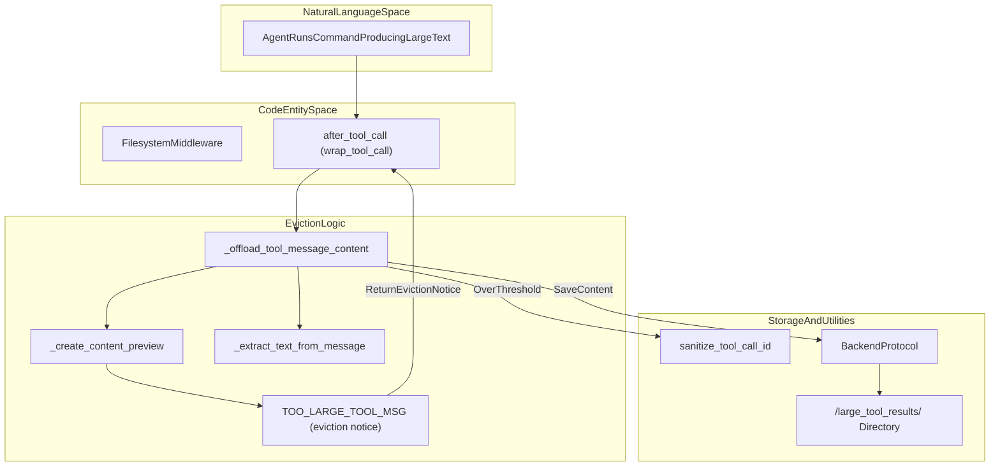
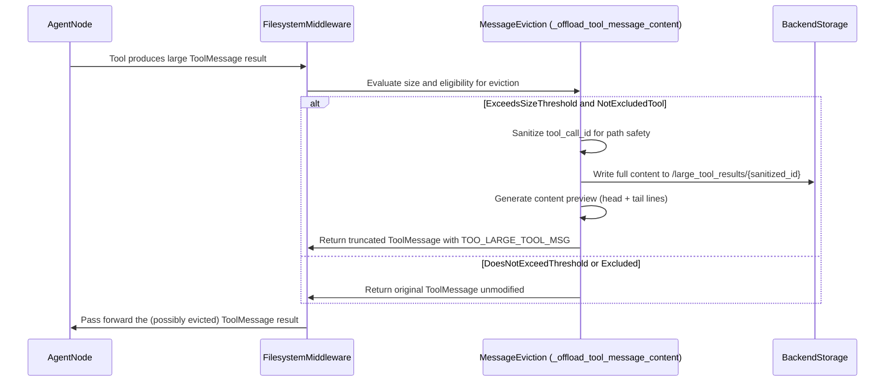
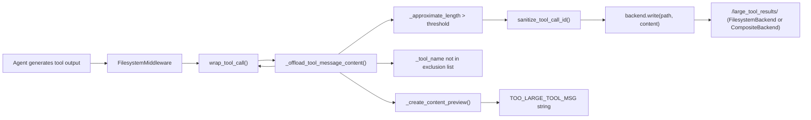
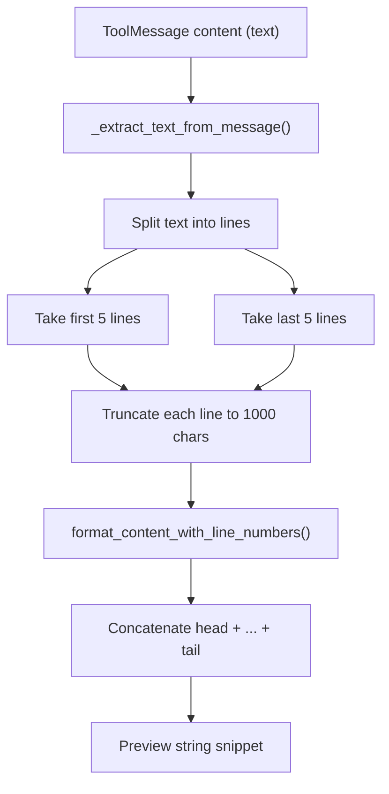

# Tool Result Eviction

<details>
<summary>Relevant source files</summary>

The following files were used as context for generating this wiki page:

- [libs/code/deepagents_code/managed_tools.py](libs/code/deepagents_code/managed_tools.py)
- [libs/code/deepagents_code/offload_middleware.py](libs/code/deepagents_code/offload_middleware.py)
- [libs/code/tests/unit_tests/test_compact_tool.py](libs/code/tests/unit_tests/test_compact_tool.py)
- [libs/code/tests/unit_tests/test_end_to_end.py](libs/code/tests/unit_tests/test_end_to_end.py)
- [libs/code/tests/unit_tests/test_managed_tools.py](libs/code/tests/unit_tests/test_managed_tools.py)
- [libs/deepagents/deepagents/middleware/_blob_offload.py](libs/deepagents/deepagents/middleware/_blob_offload.py)
- [libs/deepagents/deepagents/middleware/_parent_notifier.py](libs/deepagents/deepagents/middleware/_parent_notifier.py)
- [libs/deepagents/deepagents/middleware/async_subagents.py](libs/deepagents/deepagents/middleware/async_subagents.py)
- [libs/deepagents/tests/unit_tests/middleware/test_blob_offload.py](libs/deepagents/tests/unit_tests/middleware/test_blob_offload.py)
- [libs/deepagents/tests/unit_tests/middleware/test_filesystem_middleware_init.py](libs/deepagents/tests/unit_tests/middleware/test_filesystem_middleware_init.py)
- [libs/deepagents/tests/unit_tests/test_async_subagents.py](libs/deepagents/tests/unit_tests/test_async_subagents.py)

</details>


## Purpose and Scope

Tool Result Eviction is an automatic mechanism implemented primarily within the `FilesystemMiddleware` [[libs/deepagents/deepagents/middleware/filesystem.py:440-445]]() designed to manage large tool outputs that may exceed LLM context limits. When a tool's response is massive—often producing thousands of lines—the middleware intercepts it, offloads the complete result to a backend filesystem directory named `/large_tool_results/`, and replaces the original message content with a concise preview coupled with a file path pointer.

This selective eviction preserves agent context space, reduces noise in conversations, and enables targeted retrieval of large outputs through explicit `read_file` usage by the model, with controlled pagination (offset and limit).

---

## Overview

In practical agent workflows, some tools (notably `execute`) frequently yield voluminous outputs—log dumps, command results, or large data blobs—that can overwhelm the LLM context window. The eviction system addresses this by:

1. **Interception**: Detecting message sizes post-tool call via a character-to-token approximation.
2. **Offloading**: Persisting full tool results to a backend storage system under a defined directory prefix.
3. **Proxy Preview**: Returning to the model a truncated preview containing only the first and last few lines, annotated with line numbers.
4. **Guided Retrieval**: Injecting an eviction notice directing the model to selectively request full data segments via `read_file` with an `offset` and `limit`.

The eviction applies selectively: some tools are exempt because their outputs are already succinct or truncated internally, or evicting them risks recursive data loss.

---

## Implementation Details

### Eviction Threshold and Size Estimation

- The core heuristic for eviction size limits uses a character-based approximation:
  - `NUM_CHARS_PER_TOKEN` is set to 4 [[libs/deepagents/deepagents/middleware/_message_eviction.py:10-10]]().
  - The default eviction threshold `tool_token_limit_before_evict` is 20,000 tokens [[libs/deepagents/deepagents/middleware/filesystem.py:440-440]]().
  - This implies an approximate maximum of 80,000 characters (20,000 tokens × 4 chars/token) before eviction triggers.
- This heuristic avoids the overhead of tokenizing large strings repeatedly.
- The threshold corresponds with `TOOL_RESULT_TOKEN_LIMIT` defined in `backends/utils.py`, ensuring consistent backend and middleware logic [[libs/deepagents/deepagents/backends/utils.py:89-89]]().

### Excluded Tools from Eviction

To prevent recursive or inefficient trimming, certain tools are exempt:

| Tool Name       | Reason for Exclusion                                                   |
| --------------- | -------------------------------------------------------------------- |
| `ls`, `glob`, `grep` | Return filtered or inherently limited outputs; truncation signals improved query rather than raw eviction [[libs/deepagents/deepagents/middleware/filesystem.py:126-130]](). |
| `read_file`     | Has built-in backend truncation and slicing utilities to safely handle large files [[libs/deepagents/deepagents/backends/utils.py:21-21]](). |
| `edit_file`, `write_file` | Return brief confirmation messages, no risk of huge output [[libs/deepagents/deepagents/middleware/filesystem.py:131-132]](). |

---

## Data Flow and Logic

### Logical Architecture: Eviction from Large Tool Results



This diagram maps the key steps between natural language concepts (agent generating large output) and code functions/classes handling the eviction:

- The `FilesystemMiddleware` intercepts tool calls after execution (`after_tool_call`).
- The core eviction function `_offload_tool_message_content` evaluates size and manages offload.
- Content preview creation occurs with helper functions.
- The backend stores the full output under `/large_tool_results/`, organized by sanitized `tool_call_id`.
- An eviction notice containing instructions and preview is returned to the agent.

Sources: [[libs/deepagents/deepagents/middleware/filesystem.py:840-878]](), [[libs/deepagents/deepagents/middleware/_message_eviction.py:100-143]](), [[libs/deepagents/deepagents/backends/utils.py:78-78]]()

---

### Execution Sequence: From Tool Output to Eviction



This sequence details the interception flow:

- Upon receiving the raw tool message, the middleware invokes eviction logic.
- If eviction criteria are met, the content is offloaded, and a fallback preview message is returned.
- Otherwise, the original message passes through unmodified.

Sources: [[libs/deepagents/deepagents/middleware/filesystem.py:852-878]](), [[libs/deepagents/deepagents/middleware/_message_eviction.py:100-143]](), [[libs/deepagents/deepagents/middleware/_message_eviction.py:56-82]]()

---

## Content Preview Generation

When evicting content, a concise preview is generated to aid agent comprehension without flooding the context.

- The preview extraction is performed by `_create_content_preview` [[libs/deepagents/deepagents/middleware/_message_eviction.py:56-82]]().
- It includes:
  - The **first 5 lines** of the output (head).
  - The **last 5 lines** of the output (tail).
- Each line is formatted with a line number prefix using `format_content_with_line_numbers` [[libs/deepagents/deepagents/backends/utils.py:36-36]]().
- Individual lines are truncated to 1000 characters to avoid single-line overloads [[libs/deepagents/deepagents/middleware/_message_eviction.py:71-71]]().
- The preview is embedded in a standard eviction notice `TOO_LARGE_TOOL_MSG` that instructs how the agent can retrieve full data by calling `read_file` with offset and limit parameters [[libs/deepagents/deepagents/middleware/_message_eviction.py:12-23]]().

---

## Configuration and Customization

The eviction system is controlled through parameters in the `FilesystemMiddleware` constructor:

```python
# Constructor snippet from libs/deepagents/deepagents/middleware/filesystem.py:440-445
def __init__(
    self,
    ...,
    tool_token_limit_before_evict: int | None = 20000,
    ...,
):
```

- Setting `tool_token_limit_before_evict` to `None` disables eviction entirely, allowing unbounded tool message sizes [[libs/deepagents/deepagents/middleware/filesystem.py:852-852]]().
- The threshold can be lowered for agents with smaller context windows by passing a smaller integer (e.g., 4000 tokens).
- The middleware's `backend` is responsible for storage of evicted outputs [[libs/deepagents/deepagents/middleware/filesystem.py:441-441]]().
- When using a `CompositeBackend` [[libs/deepagents/deepagents/backends/composite.py:41-41]](), the `/large_tool_results/` prefix can route to a specific storage backend dedicated for these large blobs.

---

## Summary

The Tool Result Eviction system implemented in `FilesystemMiddleware` is a vital context management enhancement for Deep Agents:

- It uses content length heuristics and token approximations to detect large tool outputs.
- Eligible results are offloaded to the backend filesystem under `/large_tool_results/`.
- Evicted messages are replaced with a structured preview and retrieval instructions to keep conversation contexts manageable.
- This process integrates transparently into the agent execution lifecycle, preserving full data integrity while keeping LLM context consumption under control.
- Configurable thresholds and backend routing support flexible deployments and agent profiles.

---

# Additional Mermaid Diagrams Bridging Natural Language to Code Entities

### Diagram 1: FilesystemMiddleware Eviction Integration



This highlights how the eviction logic builds on the agent's received tool call, processes size/exclusion logic, offloads results to storage, and returns a preview in place of the full result.

---

### Diagram 2: Eviction Preview Generation Workflow



This diagram outlines the transformation from full text content to a final line-numbered preview snippet displayed in the eviction notice.

---

## Sources

- `libs/deepagents/deepagents/middleware/filesystem.py:1-135, 440-462, 840-878`  
- `libs/deepagents/deepagents/middleware/_message_eviction.py:10-143`  
- `libs/deepagents/deepagents/backends/utils.py:21-21, 36-36, 78-78, 89-90`  
- `libs/deepagents/deepagents/middleware/_blob_offload.py:1-154`  
- `libs/deepagents/deepagents/middleware/filesystem.py:126-135`  
- `libs/deepagents/deepagents/backends/composite.py:41-41`