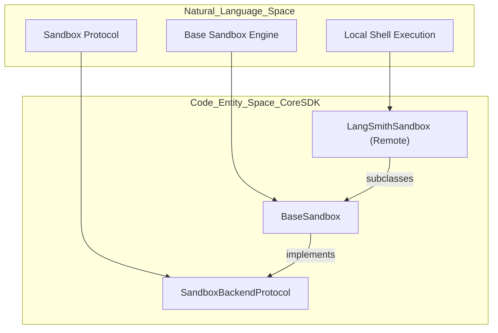
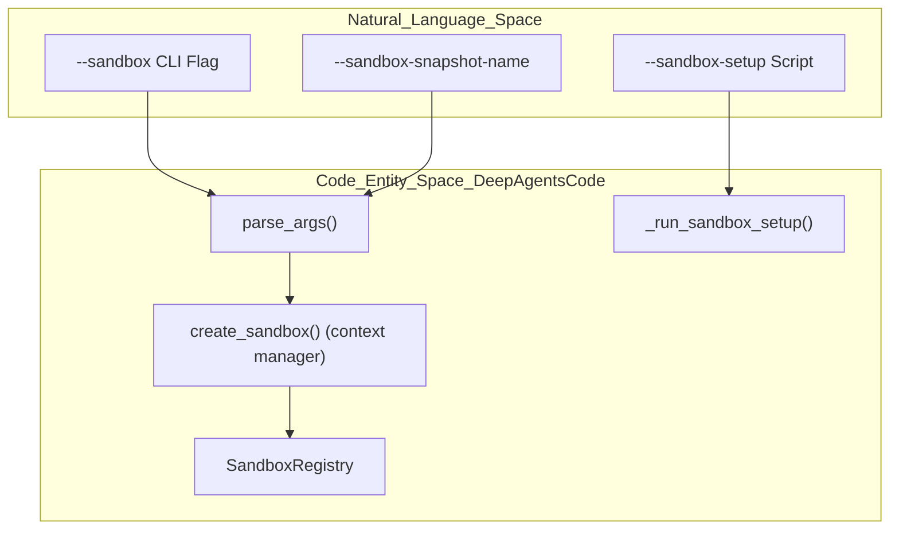
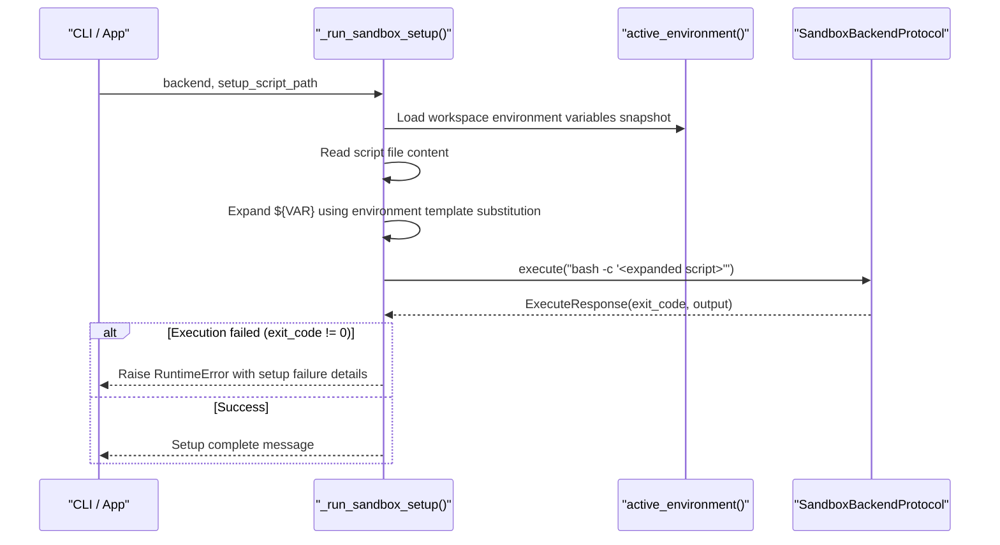
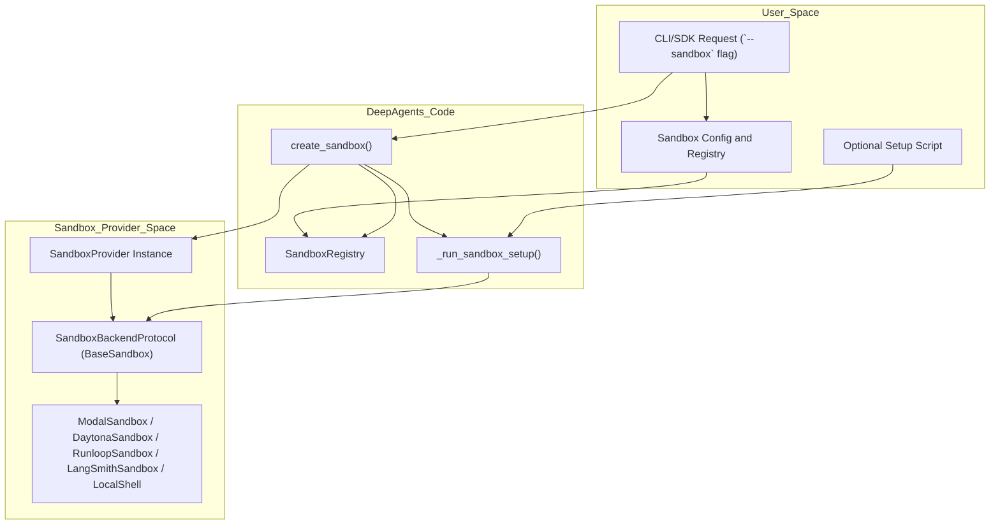

# Sandbox Integration

Relevant source files

The following files were used as context for generating this wiki page:

- [libs/code/deepagents_code/integrations/sandbox_factory.py](libs/code/deepagents_code/integrations/sandbox_factory.py)
- [libs/code/deepagents_code/integrations/sandbox_provider.py](libs/code/deepagents_code/integrations/sandbox_provider.py)
- [libs/code/deepagents_code/integrations/sandbox_registry.py](libs/code/deepagents_code/integrations/sandbox_registry.py)
- [libs/code/tests/unit_tests/test_sandbox_factory.py](libs/code/tests/unit_tests/test_sandbox_factory.py)
- [libs/code/tests/unit_tests/test_sandbox_provider.py](libs/code/tests/unit_tests/test_sandbox_provider.py)
- [libs/code/tests/unit_tests/test_sandbox_registry.py](libs/code/tests/unit_tests/test_sandbox_registry.py)
- [libs/partners/daytona/LICENSE](libs/partners/daytona/LICENSE)
- [libs/partners/daytona/README.md](libs/partners/daytona/README.md)
- [libs/partners/daytona/langchain_daytona/__init__.py](libs/partners/daytona/langchain_daytona/__init__.py)
- [libs/partners/daytona/langchain_daytona/sandbox.py](libs/partners/daytona/langchain_daytona/sandbox.py)
- [libs/partners/daytona/tests/__init__.py](libs/partners/daytona/tests/__init__.py)
- [libs/partners/daytona/tests/test_import.py](libs/partners/daytona/tests/test_import.py)
- [libs/partners/daytona/tests/unit_tests/__init__.py](libs/partners/daytona/tests/unit_tests/__init__.py)
- [libs/partners/daytona/tests/unit_tests/test_import.py](libs/partners/daytona/tests/unit_tests/test_import.py)
- [libs/partners/modal/LICENSE](libs/partners/modal/LICENSE)
- [libs/partners/modal/README.md](libs/partners/modal/README.md)
- [libs/partners/modal/langchain_modal/sandbox.py](libs/partners/modal/langchain_modal/sandbox.py)
- [libs/partners/runloop/README.md](libs/partners/runloop/README.md)
- [libs/partners/runloop/langchain_runloop/__init__.py](libs/partners/runloop/langchain_runloop/__init__.py)
- [libs/partners/runloop/langchain_runloop/sandbox.py](libs/partners/runloop/langchain_runloop/sandbox.py)
- [libs/partners/runloop/tests/unit_tests/test_import.py](libs/partners/runloop/tests/unit_tests/test_import.py)

## Purpose and Scope

This page documents the sandbox integration system within the Deep Agents framework. It details how code execution and file operations are isolated and managed via sandbox providers, including local shell, LangSmith, Daytona, Modal, Runloop, and Vercel. It covers key abstractions such as `SandboxBackendProtocol` and `BaseSandbox`, lifecycle management via the sandbox factory and registry, plus the mechanism for executing user setup scripts. The content is targeted at developers extending or maintaining sandbox backends or integrating new providers.

---

## 1. Sandbox Protocol and Base Implementation

All sandbox backends conform to the `SandboxBackendProtocol` interface [libs/deepagents/deepagents/backends/protocol.py:43-65](), which extends the core `BackendProtocol` by adding the critical `execute()` method for running shell commands inside the sandbox environment.

The abstract class `BaseSandbox` [libs/deepagents/deepagents/backends/sandbox.py:34-46]() provides a robust foundation implementing file system operations (`read`, `write`, `edit`, `ls`, `grep`, `glob`, etc.) on top of `execute()` calls. It translates complex operations into scripts executed inside the sandbox, mitigating environment limits such as shell argument size and permissions.

### Core Components Mapping: Protocol and BaseSandbox

### Key Methods and Data Flow
- `execute(command: str, *, timeout: int | None = None) -> ExecuteResponse`: Runs shell commands inside the sandbox. An essential override for each concrete provider.
- File operations in `BaseSandbox` use on-the-fly scripts and robust streaming to work around platform limits (e.g., `ARG_MAX`) and simplify cross-provider differences.
- The implementation of `glob` uses a Python inline script with limits on recursive expansion and runtime to avoid runaway searches.
- Editing operations (`edit()`) patch file content safely by uploading chunks and executing controlled replacement scripts.

**Sources:** [libs/deepagents/deepagents/backends/protocol.py:43-65](), [libs/deepagents/deepagents/backends/sandbox.py:34-135]()

---

## 2. Sandbox Factory, Registry, and Configuration

The `deepagents-code` CLI and SDK unify sandbox lifecycle management via a registry of known providers and a factory method to create or reuse sandboxes.

### Components Mapping: CLI to Sandbox Factory and Registry

### Registry and Factory Details

- `SandboxRegistry` merges configurations from three sources:
  1. Built-in curated providers (e.g., AgentCore, Daytona, LangSmith).
  2. Third-party providers discovered via the `deepagents_code.sandbox_providers` entry point group.
  3. Providers declared in user config files `[sandboxes.providers]` for extensibility or private packages.

- Registry precedence merges these: config overrides entry points, which override built-in providers.

- `create_sandbox()` is a Python context manager that:
  - Obtains the provider instance from the registry.
  - Calls `provider.get_or_create()` to start or reuse a sandbox.
  - Optionally runs a user-supplied setup script inside the sandbox.
  - Yields the sandbox backend to the caller.
  - Cleans up the sandbox on context exit (unless it was reused by ID).

- Setup script execution expands environment variables from the current workspace environment snapshot before running the script inside the sandbox.

**Sources:** [libs/code/deepagents_code/integrations/sandbox_factory.py:42-185](), [libs/code/deepagents_code/integrations/sandbox_registry.py:1-194]()

---

## 3. Sandbox Providers

Deep Agents support multiple sandbox backends, each tailored for different execution environments.

| Provider Name | Source Package / Module                | Core Class              | Notes & Capabilities                                    |
|---------------|-------------------------------------|-------------------------|--------------------------------------------------------|
| `local`       | Host shell (subprocess)              | Subclass of `BaseSandbox` | Executes commands on local machine, useful for testing.|
| `langsmith`   | `deepagents.backends.langsmith`     | `LangSmithSandbox`      | AWS-integrated, SDK-backed remote execute & file ops.  |
| `daytona`     | `langchain_daytona`                  | `DaytonaSandbox`        | Wraps Daytona sandbox sessions; uses polling for logs. |
| `modal`       | `langchain_modal`                   | `ModalSandbox`          | Modal serverless containers, supports waiting, file IO.|
| `runloop`     | `langchain_runloop`                 | `RunloopSandbox`        | Controls Runloop devbox with snapshot/blueprint support.|
| `vercel`      | `deepagents_code` integration       | Vercel provider adapter | Serverless sandbox integration with ID support.        |

### DaytonaSandbox Overview

- Wraps an existing Daytona sandbox instance.
- Implements `execute()` by creating session commands, polling logs until completion or timeout.
- Provides file upload/download support [libs/partners/daytona/langchain_daytona/sandbox.py:23-186]()

### ModalSandbox Overview

- Wraps a Modal sandbox session.
- Executes commands with bash inside the sandbox.
- Supports file read/write with exception handling for directories and permissions [libs/partners/modal/langchain_modal/sandbox.py:16-113]()

### RunloopSandbox Overview

- Wraps a Runloop devbox.
- Executes commands and handles file transfers via Runloop SDK.
- Supports snapshotting via blueprints [libs/partners/runloop/langchain_runloop/sandbox.py:18-78]()

**Sources:**  
- [libs/partners/daytona/langchain_daytona/sandbox.py:23-186]()  
- [libs/partners/modal/langchain_modal/sandbox.py:16-113]()  
- [libs/partners/runloop/langchain_runloop/sandbox.py:18-78]()  
- [libs/code/deepagents_code/integrations/sandbox_registry.py:38-80]()

---

## 4. Setup Script Execution

Users can specify a shell script to run inside the sandbox immediately after creation (or connection). This bootstraps environment configuration such as dependency installation or environment variable setup.

### Setup Execution Flow

- The script supports shell variable expansion using `string.Template.safe_substitute()` with workspace environment variables.
- Execution failure interrupts sandbox creation and triggers cleanup if the sandbox was newly created.
- Setup progress and errors are printed to the console with rich markup formatting.

**Sources:** [libs/code/deepagents_code/integrations/sandbox_factory.py:44-84]()

---

## 5. Summary Diagram: Sandbox Provider Flow and Setup

This diagram bridges the natural language CLI and configuration with the internal `create_sandbox` factory and sandbox backend implementations, including how the setup script is injected into sandbox provisioning.

---

## 6. Additional Technical Details

- **Dependency Management and Installation:** Each built-in provider metadata includes a `SandboxInstallHint` describing how to install required packages as extras or standalone packages. For example, the `daytona` provider is installed as the `daytona` extra in the `deepagents-code` package. This is surfaced during CLI error messages when dependencies are missing.

- **Snapshot / Blueprint Support:** Some providers (LangSmith, Daytona, Runloop) support snapshot names or blueprints allowing reproducible sandbox states for faster initialization.

- **Sandbox ID Reuse:** Factories allow reuse of existing sandboxes by ID, toggling cleanup ownership. Snapshots must not be combined with the reuse of an existing sandbox ID to avoid conflicts.

**Sources:**  
- [libs/code/deepagents_code/integrations/sandbox_provider.py:1-137]()  
- [libs/code/deepagents_code/integrations/sandbox_registry.py:1-194]()  
- [libs/code/deepagents_code/integrations/sandbox_factory.py:87-185]()

---

### Summary Table of Sandbox Provider Metadata (Excerpt from `SandboxRegistry`)

| Provider    | Working Dir      | Install Hint           | Supports ID | Supports Snapshot | Backend Module          |
|-------------|------------------|------------------------|-------------|-------------------|------------------------|
| `agentcore` | `/tmp`           | extra: `agentcore`     | False       | False             | `langchain_agentcore_codeinterpreter` |
| `daytona`   | `/home/daytona`  | extra: `daytona`       | True        | True              | `langchain_daytona`    |
| `langsmith` | `/root`          | bundled                | True        | True              | None (bundled)         |
| `modal`     | `/workspace`     | extra: `modal`         | True        | False             | `langchain_modal`      |
| `runloop`   | `/home/user`     | extra: `runloop`       | True        | True              | `langchain_runloop`    |
| `vercel`    | `/vercel/sandbox`| extra: `vercel`        | True        | False             | `langchain_vercel_sandbox`|

---

# References

- `SandboxBackendProtocol` interface and `BaseSandbox` abstract class: [libs/deepagents/deepagents/backends/protocol.py:43-65](), [libs/deepagents/deepagents/backends/sandbox.py:34-135]()
- Sandbox factory and setup: [libs/code/deepagents_code/integrations/sandbox_factory.py:1-185]()
- Sandbox registry and provider metadata: [libs/code/deepagents_code/integrations/sandbox_registry.py:1-194]()
- Daytona sandbox backend: [libs/partners/daytona/langchain_daytona/sandbox.py:23-186]()
- Modal sandbox backend: [libs/partners/modal/langchain_modal/sandbox.py:16-113]()
- Runloop sandbox backend: [libs/partners/runloop/langchain_runloop/sandbox.py:18-78]()
- Sandbox provider interface: [libs/code/deepagents_code/integrations/sandbox_provider.py:1-137]()

---

# End of Sandbox Integration Documentation