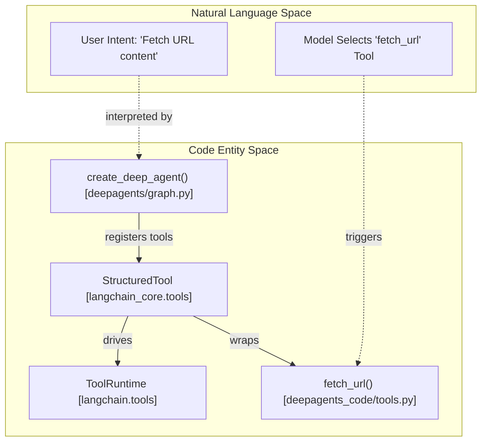
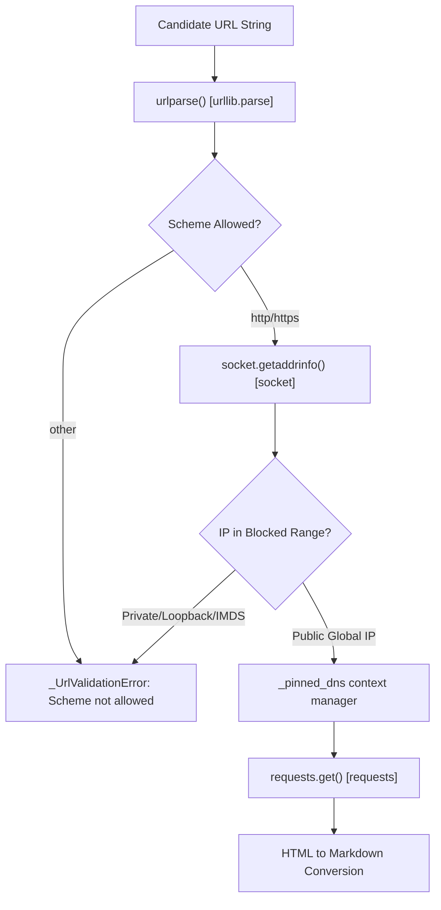
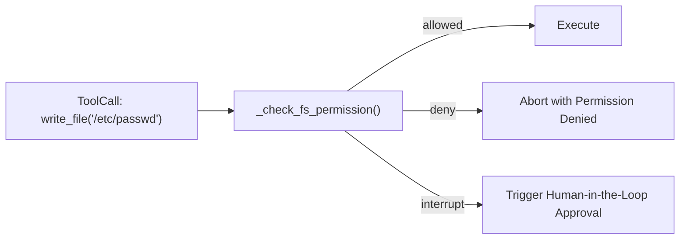
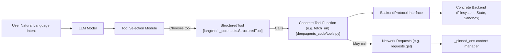

# Custom Tools Development

<details>
<summary>Relevant source files</summary>

The following files were used as context for generating this wiki page:

- [libs/code/deepagents_code/managed_tools.py](libs/code/deepagents_code/managed_tools.py)
- [libs/code/deepagents_code/offload_middleware.py](libs/code/deepagents_code/offload_middleware.py)
- [libs/code/tests/unit_tests/test_compact_tool.py](libs/code/tests/unit_tests/test_compact_tool.py)
- [libs/code/tests/unit_tests/test_end_to_end.py](libs/code/tests/unit_tests/test_end_to_end.py)
- [libs/code/tests/unit_tests/test_managed_tools.py](libs/code/tests/unit_tests/test_managed_tools.py)
- [libs/deepagents/deepagents/backends/filesystem.py](libs/deepagents/deepagents/backends/filesystem.py)
- [libs/deepagents/deepagents/backends/protocol.py](libs/deepagents/deepagents/backends/protocol.py)
- [libs/deepagents/deepagents/backends/sandbox.py](libs/deepagents/deepagents/backends/sandbox.py)
- [libs/deepagents/deepagents/backends/utils.py](libs/deepagents/deepagents/backends/utils.py)
- [libs/deepagents/deepagents/middleware/_fs_interrupt.py](libs/deepagents/deepagents/middleware/_fs_interrupt.py)
- [libs/deepagents/deepagents/middleware/filesystem.py](libs/deepagents/deepagents/middleware/filesystem.py)
- [libs/deepagents/deepagents/middleware/permissions.py](libs/deepagents/deepagents/middleware/permissions.py)
- [libs/deepagents/tests/unit_tests/backends/test_filesystem_backend.py](libs/deepagents/tests/unit_tests/backends/test_filesystem_backend.py)
- [libs/deepagents/tests/unit_tests/backends/test_protocol.py](libs/deepagents/tests/unit_tests/backends/test_protocol.py)
- [libs/deepagents/tests/unit_tests/backends/test_sandbox_backend.py](libs/deepagents/tests/unit_tests/backends/test_sandbox_backend.py)
- [libs/deepagents/tests/unit_tests/backends/test_utils.py](libs/deepagents/tests/unit_tests/backends/test_utils.py)
- [libs/deepagents/tests/unit_tests/test_end_to_end.py](libs/deepagents/tests/unit_tests/test_end_to_end.py)
- [libs/deepagents/tests/unit_tests/test_local_sandbox_operations.py](libs/deepagents/tests/unit_tests/test_local_sandbox_operations.py)
- [libs/deepagents/tests/unit_tests/test_middleware.py](libs/deepagents/tests/unit_tests/test_middleware.py)
- [libs/deepagents/tests/unit_tests/test_middleware_async.py](libs/deepagents/tests/unit_tests/test_middleware_async.py)
- [libs/deepagents/tests/unit_tests/test_permissions.py](libs/deepagents/tests/unit_tests/test_permissions.py)

</details>


This page provides a detailed technical guide for developing custom tools within the Deep Agents framework and the `deepagents-code` CLI. It explains the usage of the `StructuredTool` interface, tool parameter schemas and validation, built-in dcode tools like `fetch_url` with strong SSRF and DNS rebinding protections, managed auxiliary tools (like auto-installing ripgrep), interaction with various backends, and recommended best practices for developing secure and robust custom tools.

---

## Tool Creation and StructuredTool Interface

Deep Agents builds on LangChain's tooling abstraction, enabling both simple function-based tools and complex structured tools integrated tightly with agent internal state and backend storage.

### Integration Flow: From User Intent to Tool Execution



- `StructuredTool` wraps a function (e.g., `fetch_url`) and provides structured parameter validation and schema.
- At runtime, the `ToolRuntime` provides context (state, backend, tool call metadata) to the tool.
- Tools are registered as part of middleware added during agent creation via `create_deep_agent`.

**Sources:** [libs/deepagents/deepagents/middleware/types.py:19-27](), [libs/code/deepagents_code/tools.py:1-25](), [libs/deepagents/deepagents/graph.py:30-70]()

---

## Tool Schemas and Validation

Custom tools must define explicit parameters with Python type annotations, ideally using `Annotated` to embed user-friendly descriptions. This enhances LLM understanding and improves prompt tooling.

- **Synchronous and Asynchronous Parity**: Both sync and async implementations must be fully defined, e.g., `invoke()` and `ainvoke()` implementations.

- **Path Parameter Validation**: Filesystem-related tools rigorously validate user-provided paths to prevent traversal or sandbox escapes using utilities like `validate_path` and functions in `deepagents.backends.utils` to ensure security and correctness.

- **Parameter Descriptions via `Annotated`**: Parameters use `typing.Annotated[T, "description"]` to provide metadata used both for validation and for prompt generation.

Example snippet for argument annotation (conceptual):

```python
from typing import Annotated

def read_file(
    file_path: Annotated[str, "The path to the file to read, relative to workspace root"],
    offset: Annotated[int, "The byte offset from which to start reading"],
    limit: Annotated[int, "The maximum number of bytes to read"]
) -> str:
    ...
```

**Sources:** [libs/deepagents/deepagents/middleware/filesystem.py:15-20](), [libs/deepagents/deepagents/backends/utils.py:70-90]()

---

## Built-in dcode Tools: `fetch_url`

`deepagents-code` provides a suite of useful prebuilt tools. Among them, `fetch_url` allows an agent to retrieve the content of remote web resources securely.

### SSRF and DNS Pinned Resolution

Given the risk of Server-Side Request Forgery (SSRF) attacks — where an attacker might induce an agent to fetch internal or sensitive IP addresses — `fetch_url` implements strict URL validation via `_validate_url`:



#### Key Security Features:

- **Scheme Restriction**: Only `http` and `https` URLs are allowed.
- **Blocked IP Ranges**: Private, loopback, link-local (including cloud IMDS `169.254.169.254`), multicast, and reserved IPs are blocked. This is checked for both IPv4 and IPv6 addresses.
- **Pinned DNS Resolution**: The `_pinned_dns` context manager patches `urllib3.util.connection.create_connection` to hardcode the IP to the vetted DNS lookup result, shielding against DNS rebinding attacks that swap resolved IPs between DNS lookup and TCP connect. This closes the TOCTOU gap in URL resolution.

This defense is crucial for any tool that fetches URLs from possibly untrusted inputs.

**Sources:** [libs/code/deepagents_code/tools.py:60-185]()

---

## Managed Tools (Auto-Installing Auxiliary Binaries)

The `deepagents-code` package optionally includes "managed tools", which automatically provision command-line dependencies to enable advanced capabilities without requiring user setup.

### Example: `ripgrep` (Fast grep utility)

- The package pins a specific `ripgrep` version (`RIPGREP_VERSION`) and downloads precompiled binaries (`RIPGREP_ASSETS`) per platform [libs/code/deepagents_code/managed_tools.py:40-75]().
- Binaries are checksum-verified against hardcoded SHA256 hashes (`RIPGREP_BINARY_SHA256`) before installation to avoid supply chain issues [libs/code/deepagents_code/managed_tools.py:78-98]().
- The managed tool directory (`BIN_DIR` or user home profile fallback) is prepended to `os.environ["PATH"]` so subprocess invocations of `rg` use the managed binary transparently [libs/code/deepagents_code/managed_tools.py:100-114]().

This ensures consistent tool execution regardless of host environment tool availability.

**Sources:** [libs/code/deepagents_code/managed_tools.py:1-114]()

---

## Interacting with Backends and Security

Custom tools operate in contexts with backends implementing `BackendProtocol`. The most common backends include:

- `StateBackend` - in-memory or ephemeral state store.
- `FilesystemBackend` - direct host filesystem access.
- `StoreBackend` - key-value store abstraction.
- `SandboxBackendProtocol` - remote or container sandbox execution environments.

Tools use the `ToolRuntime` interface to access these backends.

### Filesystem Permissions and Enforcement

One of the critical complexities in exposing filesystem tools is enforcing per-path, per-operation permissions defined as `FilesystemPermission` rules (`allow` / `deny` / `interrupt`):



- Permissions are central to safe tooling: denying writes to sensitive paths or requiring user intervention on dangerous operations.
- The middleware integrates permission checks at the tool call boundary (`wrap_tool_call`), rejecting or interrupting calls based on rules.

### Large Result Eviction

Middleware monitors tool outputs for size to avoid overwhelming model context windows. Large outputs are automatically offloaded and replaced with filesystem references.

**Sources:** [libs/deepagents/deepagents/backends/protocol.py:1-60](), [libs/deepagents/deepagents/middleware/filesystem.py:50-90]()

---

## Best Practices for Custom Tools

1. **Robust Error Handling:** Instead of raising uncaught exceptions, tools should catch errors and return structured error messages. This allows LLM agents to interpret failures and self-correct. For example, filesystem tools return error payloads such as `{"error": "file_not_found"}` rather than throwing.

2. **Async Support:** Long-running or I/O-bound tool operations should implement asynchronous coroutines (`ainvoke`) to prevent blocking the LangGraph event loop. This improves concurrency and scalability.

3. **Use SSRF Guards for Network Tools:** Always validate URLs including scheme and IP address ranges, and use DNS pinning when making external requests from tools exposed to untrusted inputs. This prevents security vulnerabilities.

4. **Normalize and Validate Paths:** Use `PurePosixPath` and backend validation utilities to handle paths consistently across platforms and prevent traversal or escapes. Always check that paths stay within allowed roots or mount points.

5. **Leverage Middleware and Managed Tooling:** Use existing middleware components (e.g., `FilesystemMiddleware`) that wire in permissions, logging, context, and result eviction to reduce boilerplate and improve integration.

---

This page provides a concise yet detailed overview of how to create and manage custom tools within the Deep Agents ecosystem, focusing on secure, type-safe, and robust implementations that interact well with the agent runtime and backend abstractions.

---

# Mermaid Diagram: Tool Invocation Flow from Natural Language to Code



**Sources:** [libs/deepagents/deepagents/middleware/types.py:19-27](), [libs/code/deepagents_code/tools.py:1-185](), [libs/deepagents/deepagents/backends/protocol.py:1-60]()

---

# Mermaid Diagram: Mapping Language Constructs to Code Entities in FilesystemMiddleware

```mermaid
graph TB
    "Agent Model Prompt" -->|"Includes" Filesystem_SysPrompt["FilesystemMiddleware System Prompt [middleware/filesystem.py]"]
    Filesystem_SysPrompt --> FilesystemMiddleware["FilesystemMiddleware Class"]
    FilesystemMiddleware -->|Adds| FilesystemTools["Tools: ls, read_file, write_file, edit_file, glob, grep, delete"]
    FilesystemTools -->|Wrap| ToolCallRequest["ToolCallRequest (Tool Invocation)"]
    ToolCallRequest -->|Validates| FilesystemPermissionChecks["_check_fs_permission()"]
    FilesystemPermissionChecks --> BackendProtocol["BackendProtocol Methods: read(), write(), delete(), grep(), glob()"]
    BackendProtocol --> FilesystemBackend["FilesystemBackend Implementation"]
```

**Sources:** [libs/deepagents/deepagents/middleware/filesystem.py:40-165](), [libs/deepagents/deepagents/backends/protocol.py:1-60](), [libs/deepagents/deepagents/backends/filesystem.py:1-180]()

---

# Summary Table: Key Classes and Functions for Custom Tools

| Concept                      | Code Symbol / Location                          | Description                                            |
|-----------------------------|------------------------------------------------|--------------------------------------------------------|
| Tool Interface              | `StructuredTool` [langchain_core.tools]         | Base class for structured tools with schema validation.|
| Tool Execution Context      | `ToolRuntime` [langchain.tools]                  | Context object passed to tools for state and backend.  |
| Filesystem Tool Middleware  | `FilesystemMiddleware` [middleware/filesystem.py]| Middleware that provides built-in filesystem tools and permissions enforcement. |
| Network Tool Example        | `fetch_url()` [deepagents_code/tools.py]         | Built-in tool that fetches URL content with SSRF defense. |
| DNS Pinned Context Manager  | `_pinned_dns` [deepagents_code/tools.py]          | Context manager patching DNS resolution to pin IPs.     |
| Managed Tool Infrastructure | managed_tools.py                                 | Auto-installation and verification of auxiliary tools like ripgrep. |
| Backend Protocol Interface  | `BackendProtocol` [backends/protocol.py]          | Defines standard backend file and command APIs.        |
| Filesystem Backend          | `FilesystemBackend` [backends/filesystem.py]     | Local filesystem implementation of backend protocol.    |
| Tool Permission Checks      | `_check_fs_permission` [middleware/permissions.py]| Enforces filesystem operation rules per path and operation. |

---

# Notes

- Many filesystem tools are implemented as structured tools in the `FilesystemMiddleware` with carefully defined Inputs/Outputs, path validation, permission checks, and async coroutine support.
- `fetch_url` is an example of a network-facing tool designed with layered security.
- Managed tool support reduces external dependencies, improving portability and user experience.
- Middleware enforces uniform patterns for error handling, human-in-the-loop approvals, and result offloading.
- Consistency in path handling and validation is vital for security.

---

**Sources:**  
- [libs/deepagents/deepagents/middleware/types.py:19-27](),  
- [libs/code/deepagents_code/tools.py:1-185](),  
- [libs/code/deepagents_code/managed_tools.py:1-114](),  
- [libs/deepagents/deepagents/middleware/filesystem.py:1-193](),  
- [libs/deepagents/deepagents/backends/protocol.py:1-60](),  
- [libs/deepagents/deepagents/backends/filesystem.py:1-180]()