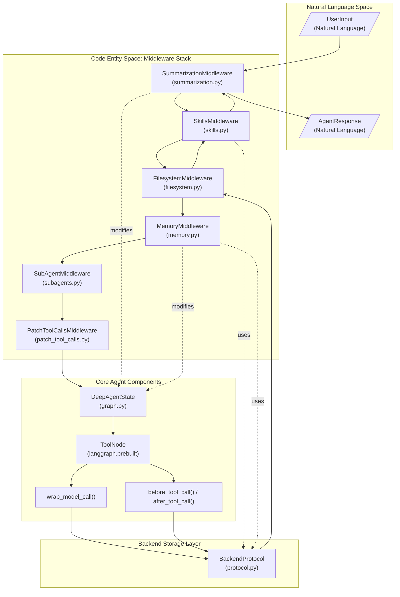
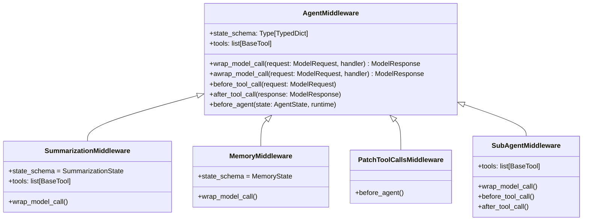
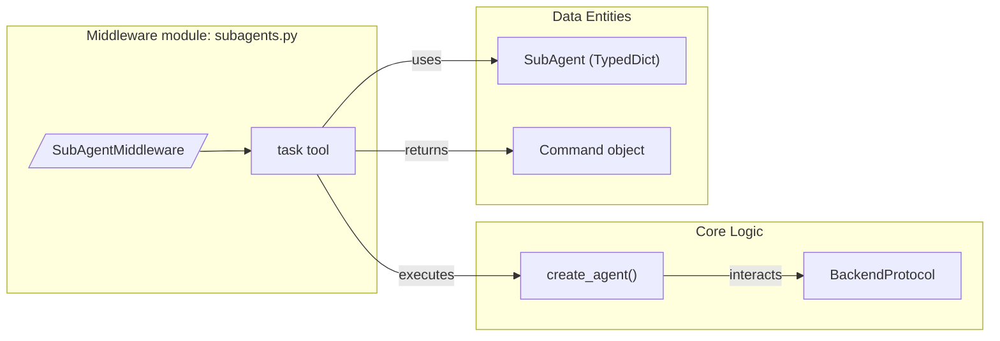

# Custom Middleware Development

<details>
<summary>Relevant source files</summary>

The following files were used as context for generating this wiki page:

- [libs/deepagents/deepagents/__init__.py](libs/deepagents/deepagents/__init__.py)
- [libs/deepagents/deepagents/graph.py](libs/deepagents/deepagents/graph.py)
- [libs/deepagents/deepagents/middleware/__init__.py](libs/deepagents/deepagents/middleware/__init__.py)
- [libs/deepagents/deepagents/middleware/patch_tool_calls.py](libs/deepagents/deepagents/middleware/patch_tool_calls.py)
- [libs/deepagents/deepagents/middleware/subagents.py](libs/deepagents/deepagents/middleware/subagents.py)
- [libs/deepagents/tests/integration_tests/test_filesystem_middleware.py](libs/deepagents/tests/integration_tests/test_filesystem_middleware.py)
- [libs/deepagents/tests/integration_tests/test_subagent_middleware.py](libs/deepagents/tests/integration_tests/test_subagent_middleware.py)
- [libs/deepagents/tests/unit_tests/middleware/test_subagent_middleware_init.py](libs/deepagents/tests/unit_tests/middleware/test_subagent_middleware_init.py)
- [libs/deepagents/tests/unit_tests/test_eviction_replay.py](libs/deepagents/tests/unit_tests/test_eviction_replay.py)
- [libs/deepagents/tests/unit_tests/test_graph.py](libs/deepagents/tests/unit_tests/test_graph.py)
- [libs/deepagents/tests/unit_tests/test_subagents.py](libs/deepagents/tests/unit_tests/test_subagents.py)

</details>


This page documents the API and best practices for developing custom middleware components in DeepAgents. Middleware extends agent capabilities by adding new tools, modifying system prompts, intercepting model and tool calls, and managing internal state across turns.

For usage of built-in middleware, see [section 2.2](). For the full middleware API reference, see [section 7.3]().

---

## Overview

Middleware in DeepAgents wraps the agent's model call and tool execution cycle, enabling actions such as:

- **Dynamic tool filtering**: e.g., `FilesystemMiddleware` removes the `execute` tool at call-time if the backend lacks support [libs/deepagents/deepagents/middleware/filesystem.py:123-132](), [libs/deepagents/deepagents/middleware/filesystem.py:1584-1590]().
- **Injecting system-prompt context**: e.g., `MemoryMiddleware` and `SkillsMiddleware` add instructions into the system message per LLM call to inform the model of context and tool usage [libs/deepagents/deepagents/middleware/memory.py:103-106](), [libs/deepagents/deepagents/middleware/_utils.py:23]().
- **Messages transformation**: e.g., `SummarizationMiddleware` manages token counts, truncates large tool arguments via configuration, and replaces conversation history with compact summaries to stay within context window limits [libs/deepagents/deepagents/middleware/summarization.py:161-171](), [libs/deepagents/deepagents/middleware/summarization.py:226-235]().
- **Cross-turn state management**: Middleware reads/writes a typed state dictionary persisted across turns, such as tracking summarization events or loaded memories [libs/deepagents/deepagents/middleware/summarization.py:135-147](), [libs/deepagents/deepagents/middleware/memory.py:88-97]().
- **Permission enforcement**: `FilesystemMiddleware` validates requested file paths against `FilesystemPermission` rules and constructs `InterruptOnConfig` for human-in-the-loop controls [libs/deepagents/deepagents/middleware/filesystem.py:77-78](), [libs/deepagents/deepagents/middleware/_fs_interrupt.py:45-45]().
- **Execution patching**: `PatchToolCallsMiddleware` scans message history for dangling tool calls (calls without results due to cancellation or error) and injects explanatory `ToolMessage` entries [libs/deepagents/deepagents/middleware/patch_tool_calls.py:11-18]().

Middleware subclasses `AgentMiddleware` and the stack executes as a chain wrapping the model and tool executions in sequence.

**Sources:**  
[libs/deepagents/deepagents/middleware/summarization.py:1-60](),  
[libs/deepagents/deepagents/middleware/filesystem.py:1-78](),  
[libs/deepagents/deepagents/graph.py:1-66](),  
[libs/deepagents/deepagents/middleware/patch_tool_calls.py:1-12]()

---

## Middleware Architecture

Middleware forms the core extensibility and interception layer in Deep Agents, bridging user natural language inputs to the underlying agent code and backends.

The diagram below shows how middleware wraps model calls and tool execution, annotating key middleware components with their code files:

### Middleware Interaction Flow



Multiple middleware layers can contribute to the agent’s persistent state schema and toolset. Model calls and tool executions flow through the middleware chain, allowing interception and augmentation.

**Sources:**  
[libs/deepagents/deepagents/middleware/summarization.py:191-205](),  
[libs/deepagents/deepagents/graph.py:73-76](),  
[libs/deepagents/deepagents/middleware/memory.py:88-97](),  
[libs/deepagents/deepagents/middleware/filesystem.py:1335-1355]()

---

## AgentMiddleware Interface

Custom middleware must subclass `AgentMiddleware` [libs/deepagents/deepagents/middleware/summarization.py:84-84]() and can override several lifecycle hooks to insert behavior.

### Core Interface and Inheritance



### Key Methods and Properties

- **`wrap_model_call(request: ModelRequest, handler)`**:  
  Intercept and optionally modify every model invocation. This allows injecting or rewriting the system prompt, filtering tools, adjusting call parameters, or post-processing the model's `ModelResponse`. Both synchronous and async versions (`awrap_model_call`) exist.  
  This hook wraps every call to the underlying LLM.  
  [libs/deepagents/tests/unit_tests/test_end_to_end.py:54-61]()

- **`before_tool_call(request: ModelRequest)` and `after_tool_call(response: ModelResponse)`**:  
  Intercept tool execution before and after the tool runs. This enables pre-processing inputs, logging, handling large or invalid tool results, or dispatching subagents.  
  For example, `FilesystemMiddleware` uses these hooks to evict large result data to auxiliary storage and extract media references.  
  [libs/deepagents/deepagents/middleware/filesystem.py:1552-1560]()

- **`before_agent(state: AgentState, runtime)`**:  
  Called prior to the agent execution loop. Middleware such as `PatchToolCallsMiddleware` uses this to detect and patch dangling tool calls from prior interactions in the message history, injecting cancellation notices as `ToolMessage` entries.  
  [libs/deepagents/deepagents/middleware/patch_tool_calls.py:17-49]()

- **`state_schema`**:  
  A `TypedDict` subclass that defines typed state attributes this middleware adds to the agent state. Middleware can read and write these fields to maintain cross-turn information.  
  For instance, `MemoryMiddleware` defines `memory_contents` to store loaded agent memories [libs/deepagents/deepagents/middleware/memory.py:88-97]().

- **`tools`**:  
  A list of `BaseTool` instances that the middleware provides to the agent’s tool registry.  
  For example, `SubAgentMiddleware` provides tooling such as `task` for delegating subtasks to subagents.  
  [libs/deepagents/deepagents/middleware/subagents.py:58-59]()

**Sources:**  
[libs/deepagents/deepagents/middleware/summarization.py:191-205](),  
[libs/deepagents/deepagents/middleware/memory.py:88-97](),  
[libs/deepagents/deepagents/middleware/subagents.py:58-59](),  
[libs/deepagents/tests/unit_tests/test_end_to_end.py:48-71](),  
[libs/deepagents/deepagents/middleware/patch_tool_calls.py:17-21]()

---

## State Management

Middleware can augment the agent's persistent state schema. DeepAgents uses LangGraph's state management, where middleware state fields are stored in the `DeepAgentState` (a subclass of `AgentState`) and persisted across agent turns via checkpoints.

Middleware state fields can be annotated with `PrivateStateAttr` to mark them as private internal state that should be persisted but not exposed to the LLM in prompts.

### Example: Memory Middleware State Schema

```python
from langchain.agents.middleware.types import AgentState, NotRequired, PrivateStateAttr
from typing import Annotated

class MemoryState(AgentState):
    """State schema for MemoryMiddleware."""

    memory_contents: NotRequired[Annotated[dict[str, str], PrivateStateAttr]]
```

Middleware updates typically return partial state dictionaries from hooks which LangGraph merges into the `DeepAgentState` for the subsequent invocation.

**Sources:**  
[libs/deepagents/deepagents/middleware/memory.py:88-97](),  
[libs/deepagents/deepagents/middleware/summarization.py:191-205](),  
[libs/deepagents/deepagents/graph.py:73-76]()

---

## Tool Creation and Data Flow

Middleware adds tools by assigning a list of `BaseTool` objects to `self.tools`. These tools represent callable commands the LLM can invoke.

Tools often receive a `runtime` argument that exposes agent internals such as current state, config, and environment.

### Example: SubAgent `task` Tool

`SubAgentMiddleware` provides the `task` tool to delegate to configured subagents by creating new sub-agent instances via `create_agent`. The tool interprets arguments to identify which subagent to invoke and manages passing state and receiving results.

### Middleware Tools and Data Domain Diagram



This pattern enables recursive delegation and complex workflows with nested agents.

**Sources:**  
[libs/deepagents/deepagents/middleware/subagents.py:55-62](),  
[libs/deepagents/deepagents/middleware/summarization.py:131-134]()

---

## Specialized Middleware Examples

### Memory Middleware

`MemoryMiddleware` loads agent memories from configured sources using a `BackendProtocol` backend. It injects these memories into the system prompt, guiding the agent's behavior per the AGENTS.md spec including instructions on when to update memories, e.g., via `edit_file` tool calls.  
[libs/deepagents/deepagents/middleware/memory.py:2-53]()  
[libs/deepagents/deepagents/middleware/memory.py:118-140]()

### Summarization Middleware

`SummarizationMiddleware` compacts conversation history automatically based on configurable triggers such as token count thresholds or message counts. It offloads historic messages to a backend in markdown format and separately handles media references.  
[libs/deepagents/deepagents/middleware/summarization.py:155-167]()  
[libs/deepagents/deepagents/middleware/summarization.py:42-51]()

**Sources:**  
[libs/deepagents/deepagents/middleware/memory.py:1-53](),  
[libs/deepagents/deepagents/middleware/summarization.py:1-60]()

---

## System Prompt Modification

Middleware can modify the system prompt dynamically to inject context or instructions relevant to their domain. This is done primarily in the `wrap_model_call` hook by rewriting or augmenting the `system_message` field in the `ModelRequest`.

For example, `MemoryMiddleware` uses the utility `append_to_system_message` to embed memory contents and behavioral guidelines as prompt blocks:

```python
from deepagents.middleware._utils import append_to_system_message

def wrap_model_call(self, request: ModelRequest, handler):
    prompt = append_to_system_message(
        request.system_message,
        "<agent_memory>",
        self._format_agent_memory(),
        "<memory_guidelines>",
        self._behavior_guidelines(),
    )
    new_request = request.override(system_message=prompt)
    return handler(new_request)
```

**Sources:**  
[libs/deepagents/deepagents/middleware/memory.py:103-154](),  
[libs/deepagents/deepagents/middleware/_utils.py:23]()

---

## Testing Middleware

Comprehensive middleware testing ensures that tool registration, system message injections, and state extensions behave correctly.

### Unit Testing Hook Execution

Middleware that modifies the outgoing `ModelRequest` can be tested with a capturing middleware that records the final system prompt or tool list during invocation, verifying state changes or prompt modifications.

Example usage is in tests that verify `MemoryMiddleware` and `SummarizationMiddleware` hooks [libs/deepagents/tests/unit_tests/test_end_to_end.py:48-71]().

### Memory Formatting Testing

Tests for `MemoryMiddleware` validate the formatting of agent memories from various sources, including empty inputs, single memory items, and multi-source concatenation with correct ordering and prefixing in the final prompt string.

These tests confirm that context injection behaves as expected for diverse configurations [libs/deepagents/tests/unit_tests/middleware/test_memory_middleware.py:107-188]().

**Sources:**  
[libs/deepagents/tests/unit_tests/test_end_to_end.py:48-71](),  
[libs/deepagents/tests/unit_tests/middleware/test_memory_middleware.py:107-188]()

---

# Summary

Custom middleware in Deep Agents operates by subclassing `AgentMiddleware` and overriding hooks like `wrap_model_call`, `before_tool_call`, and `after_tool_call` to influence the agent's functioning. Middleware layers work in a stack to filter toolsets, augment system prompts, transform messages, manage permissions, and maintain persistent state across agent turns. Middleware can also provide new tools to the agent, enabling advanced features like subagent delegation.

This architecture enables developers to extend the DeepAgents framework with rich, stateful, and context-aware behaviors that integrate tightly with the agent's lifecycle and runtime environment.

---

# Additional Mermaid Diagram

## Middleware Role Bridging Natural Language Input to Agent Code Entities and Tools

```mermaid
graph TD
    NL["User Input (Natural Language)"]
    NL --> MiddlewareStack["Middleware Stack (AgentMiddleware)"]
    
    subgraph Middleware
        MSW["wrap_model_call()"]
        MTC["before_tool_call()/after_tool_call()"]
        MST["tools (e.g., task, ls, memory)"]
    end
    
    MiddlewareStack --> MSW --> MTC --> MST
    
    MST --> AgentCore["Core Agent Logic (create_agent, DeepAgentState)"]
    AgentCore --> Backend["BackendProtocol (FilesystemBackend, StateBackend)"]
    
    Backend --> Storage["Persistent Storage (FileSystem, Memory)"]
    Storage --> Backend
    Backend --> AgentCore
    
    AgentCore --> MiddlewareStack  # state update loop
    
    MiddlewareStack --> NL["Model/Tool Output (Natural Language)"]
```

This diagram shows how the middleware stack encompasses both input interception (wrap_model_call) and tool execution interception, providing a rich API for custom middleware development and integration with agent internals and storage backends.

**Sources:**  
[libs/deepagents/deepagents/middleware/__init__.py:3-48](),  
[libs/deepagents/deepagents/middleware/subagents.py:1-176](),  
[libs/deepagents/deepagents/middleware/patch_tool_calls.py:11-50](),  
[libs/deepagents/deepagents/graph.py:1-156]()