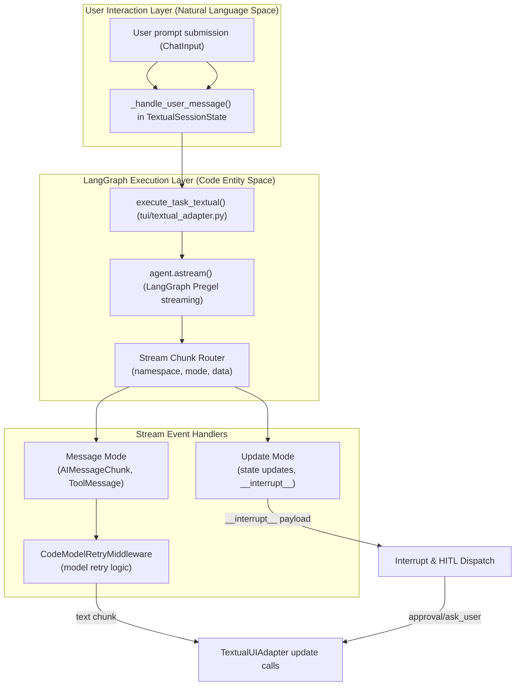
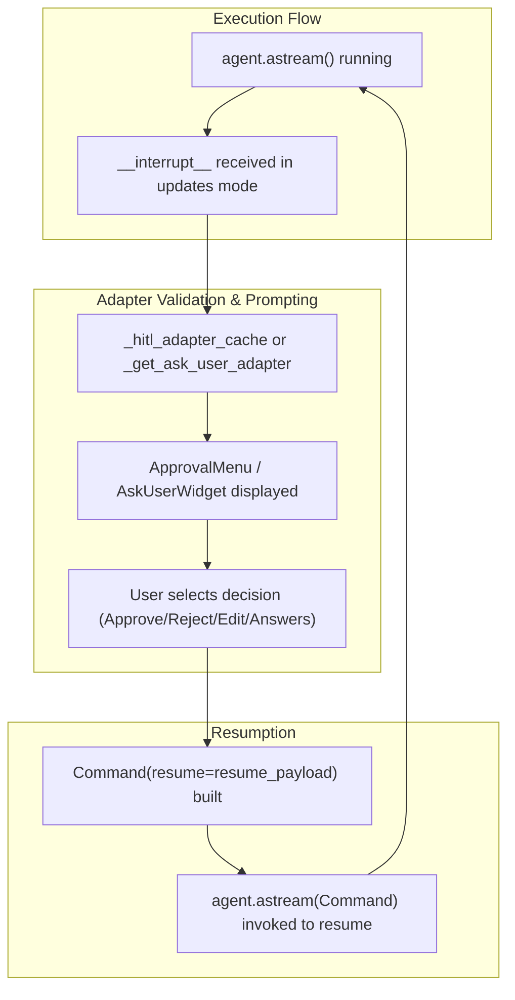
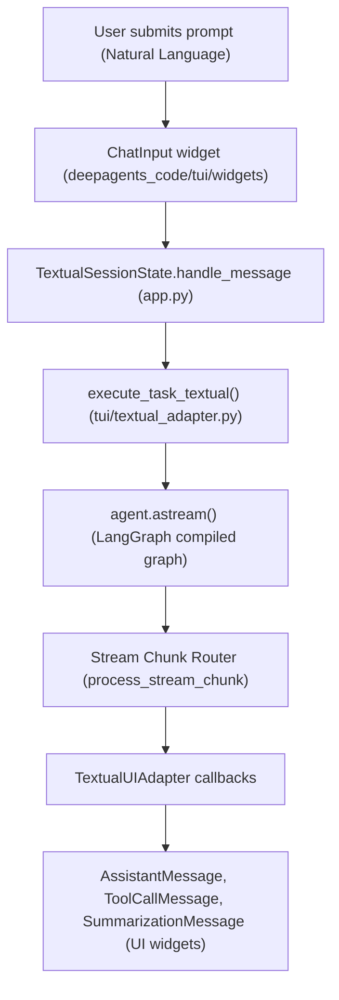
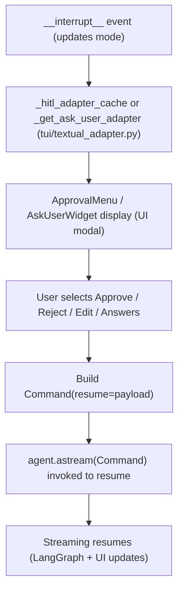

# Streaming and Execution Flow

<details>
<summary>Relevant source files</summary>

The following files were used as context for generating this wiki page:

- [libs/code/DEVELOPMENT.md](libs/code/DEVELOPMENT.md)
- [libs/code/deepagents_code/_debug.py](libs/code/deepagents_code/_debug.py)
- [libs/code/deepagents_code/_debug_buffer.py](libs/code/deepagents_code/_debug_buffer.py)
- [libs/code/deepagents_code/_session_stats.py](libs/code/deepagents_code/_session_stats.py)
- [libs/code/deepagents_code/_tool_stream.py](libs/code/deepagents_code/_tool_stream.py)
- [libs/code/deepagents_code/client/non_interactive.py](libs/code/deepagents_code/client/non_interactive.py)
- [libs/code/deepagents_code/cost_tracking.py](libs/code/deepagents_code/cost_tracking.py)
- [libs/code/deepagents_code/tui/textual_adapter.py](libs/code/deepagents_code/tui/textual_adapter.py)
- [libs/code/scripts/install.sh](libs/code/scripts/install.sh)
- [libs/code/tests/unit_tests/test__tool_stream.py](libs/code/tests/unit_tests/test__tool_stream.py)
- [libs/code/tests/unit_tests/test_cost_tracking.py](libs/code/tests/unit_tests/test_cost_tracking.py)
- [libs/code/tests/unit_tests/test_debug.py](libs/code/tests/unit_tests/test_debug.py)
- [libs/code/tests/unit_tests/test_debug_buffer.py](libs/code/tests/unit_tests/test_debug_buffer.py)
- [libs/code/tests/unit_tests/test_install_script.py](libs/code/tests/unit_tests/test_install_script.py)
- [libs/code/tests/unit_tests/test_non_interactive.py](libs/code/tests/unit_tests/test_non_interactive.py)
- [libs/code/tests/unit_tests/test_session_stats.py](libs/code/tests/unit_tests/test_session_stats.py)
- [libs/code/tests/unit_tests/tui/test_textual_adapter.py](libs/code/tests/unit_tests/tui/test_textual_adapter.py)

</details>


This page documents the agent execution process, focusing on streaming modes in LangGraph, UI adaptation in `TextualUIAdapter`, how tool streams are handled, chunk processing, model retry logic, and interrupt handling including HITL (Human-in-the-Loop) approvals and user prompts. It covers detailed data flow, key classes/functions, and provides diagrams to bridge the natural language user experience and the code entity architecture.

---

## Purpose and Scope

The execution of Deep Agents in `deepagents-code` ties together asynchronous agent graph streaming provided by LangGraph with user experience elements in the interactive Textual terminal UI as well as a non-interactive headless mode. The intent of this page is to elucidate how streaming data from agent executions is managed efficiently and reliably through a layered, event-driven pipeline:

- **LangGraph streaming** produces multi-mode event tuples (messages, updates, interrupts).
- The **TextualUIAdapter** abstracts streaming events into reactive UI updates and interaction flows.
- **Tool Call Buffers** reconstruct fragmented tool execution outputs before rendering.
- **Model retry middleware** ensures robust handling of transient provider errors.
- Interrupts trigger prompt-based approval or user input cycles, supporting pause/resume semantics.
- Session metrics track token usage, model calls, and costs live during execution.
  
This page is a leaf-level technical documentation section describing code anatomy, interactions, and processing flow.

---

## LangGraph Streaming Architecture

Agent execution streams rely on LangGraph's underlying Pregel graph runtime, which exposes a streaming interface via asynchronous iteration over the compiled agent graph's state.

### Key Streaming Configurations

- **Streaming Modes**: Agent streams use `stream_mode=["messages", "updates"]` to receive:
  - **Messages** — chunked AI and tool messages (including partial text).
  - **Updates** — state/durability metadata, also used for interrupts.
- **Subgraphs**: The stream has `subgraphs=True` enabled, allowing nested sub-agent executions (e.g., tasks spawned via the `task` tool) to be streamed as hierarchical namespaces.
- **Durability**: Managed with `durability="exit"` ensuring consistent graph state checkpoints and facilitating resumption after failures.

### Execution Streaming Flow

The async iterator over `agent.astream()` yields tuples:

```python
(namespace: tuple[str, ...], stream_mode: Literal["messages", "updates"], data: Any)
```

Namespaces isolate main agent from subagents; empty tuple `()` is root agent namespace, and subagents get hierarchical tuple namespaces.

Sources:  
- [libs/code/deepagents_code/tui/textual_adapter.py:2702-2735]()  
- [libs/code/deepagents_code/config.py:37-38]()

---

## Streaming Execution Pipeline

### Diagram: Streaming Execution Pipeline Architecture



Sources:  
- [libs/code/deepagents_code/tui/textual_adapter.py:2605-2850]()  
- [libs/code/deepagents_code/client/non_interactive.py:100-200]()  
- [libs/code/deepagents_code/model_retry.py:35-70]()

---

## Core Execution Components

### execute_task_textual Function

- Located in `tui/textual_adapter.py` around lines 2605-2750.
- Serves as the entry point to execute an agent task asynchronously within the interactive Textual UI.
- Accepts the prompt and context, resolves multimodal payloads (media/images) with `MediaTracker` and `create_multimodal_content`.
- Parses textual file mentions (`@filename`) through `parse_file_mentions`.
- Drives streaming from the agent via `agent.astream()`:
  - Receives stream chunks in multiplexed `(namespace, mode, data)` tuples.
  - Routes chunks based on mode (`messages`, `updates`) and namespace (root agent or sub-agents).
- Accumulates session statistics such as token counts and timing using `SessionStats` and helper functions like `record_message_usage`.
- Marshals and coordinates UI updates through `TextualUIAdapter` callbacks.

Sources:  
- [libs/code/deepagents_code/tui/textual_adapter.py:2605-2750]()  
- [libs/code/deepagents_code/_session_stats.py:46-178]()

---

### TextualUIAdapter Class

- Defined early in `tui/textual_adapter.py` (lines 53-460).
- Abstracts UI side-effects away from streaming code.
- Provides async callbacks and hooks for UI widget actions such as:
  - `mount_message` — inserts widgets into UI scroll containers.
  - `update_status` — updates live status bars (showing token counts, progress).
  - `request_approval` — displays approval modals upon interrupts.
  - `request_ask_user` — user prompt widgets for clarifications.
  - `set_spinner` — show/hide progress spinners.
  - `set_active_message` — track active streaming chunk widget.

This decoupling allows isolation of pure streaming logic from concrete UI implementations, enabling testability and modularity.

Sources:  
- [libs/code/deepagents_code/tui/textual_adapter.py:53-460]()

---

## Model Retry Logic

`CodeModelRetryMiddleware` is responsible for intelligently retrying model calls on transient provider errors.

- Wrapped narrowly around just the model invocation node in the graph, not the whole turn, to prevent re-executing completed tool calls during retries.
- Uses exponential backoff with jitter and surfaces transient status messages as a spinner in the UI.
- Inserts stream separators `RETRY_BOUNDARY_LINE` in case of retry after a dropped connection mid-chunk.
- Recognizes HTTP 429, 503, and connection/tls errors for retry eligibility.

This middleware ensures robustness without re-executing already finished tools, maintaining integrity of tool state.

Sources:  
- [libs/code/deepagents_code/model_retry.py:1-165]()

---

## Chunk Processing

### Message Stream Processing

In `stream_mode="messages"`, chunks received are `(message, metadata)` tuples where:

- For **AIMessageChunk**:
  - Extracts incremental text tokens from `content_blocks`.
  - Streams incremental tokens to `AssistantMessage` UI widgets.
- For **ToolCallBuffer**:
  - Buffers fragmented streaming tool outputs to assemble full JSON payloads before mounting or updating `ToolCallMessage` widgets.
  - Supports chunked incremental tool output handling robustly.
- For **ToolMessage**:
  - Matches tool calls by `tool_call_id` with mounted tool widgets.
  - Updates tool status (success, error) on result reception.

This supports incremental rendering of both natural language responses and non-trivial tool outputs.

Sources:  
- [libs/code/deepagents_code/tui/textual_adapter.py:2850-3080]()

---

## Interrupt and Resume Flow

The system supports interactive approval and user prompts via interrupts detected in `updates` mode with payload `__interrupt__`.

### Interrupt Handling and Command Resume Cycle



- Upon receiving an interrupt in the streaming updates channel, the system marshals a validated UI adapter for HITL or `ask_user` interactions.
- It mounts interactive approval or question widgets for user decisions.
- User inputs (approval, rejection, edits, answer submissions) construct a resume payload.
- This resumes the `agent.astream()` with the command to continue execution respecting user decisions.

Sources:  
- [libs/code/deepagents_code/tui/textual_adapter.py:2763-2805]()  
- [libs/code/deepagents_code/tui/textual_adapter.py:3133-3243]()

---

## Namespace Isolation

LangGraph streaming uses hierarchical namespace tuples for event isolation.

- The main/root agent runs in namespace `()`.
- Sub-agents run in namespaces like `("sub_task", "<unique-id>")`.

This hierarchical namespace system isolates streams, enabling concurrent nested subagent execution without event collisions.

Sources:  
- [libs/code/deepagents_code/tui/textual_adapter.py:2702-2746]()

---

## UI Feedback States

- The UI status bar reflects live token consumption and request state, updated via `_on_tokens_update` callbacks.
- Summarization triggers detected in stream cause mounting of specific `SummarizationMessage` UI components to notify users.
- Tool rows and assistant messages update dynamically as token chunks and tool results arrive.

Sources:  
- [libs/code/deepagents_code/tui/textual_adapter.py:351-358]()  
- [libs/code/deepagents_code/tui/textual_adapter.py:510-516]()

---

## Error Handling and Cleanup

- When a streaming session is interrupted or encounters errors, `finalize_pending_tools_with_error` iterates pending tool widgets and flags appropriate failure states.
- `_handle_interrupt_cleanup` manages synchronized cleaning of token ledgers and partial execution state on interrupts or user-initiated cancels.
- The system ensures no inconsistent states remain and prepares UI for possible stream resumption or clean exit.

Sources:  
- [libs/code/deepagents_code/tui/textual_adapter.py:485-506]()  
- [libs/code/deepagents_code/tui/textual_adapter.py:3133-3195]()

---

# Summary

This chapter outlined how Deep Agents orchestrate streaming execution flows using LangGraph's multi-mode streams coupled with the `TextualUIAdapter` to deliver interactive and robust agent experiences. It described the data flow paths from user prompt submission through asynchronous stream chunk processing, tool output assembly, interrupt handling with HITL approval or user prompts, and model retry logic preserving execution integrity. Namespace isolation enables nested subagent workflows, while session stats track usage and cost metrics live.

Together, these mechanisms form the backbone for scalable, reliable, and interactive AI agent executions embedded in the `deepagents-code` terminal UI and headless operation modes.

---

# Diagram: Mapping Natural Language Agent Execution to Code Components



Sources:  
- [libs/code/deepagents_code/tui/textual_adapter.py:1-460,2605-2850]()  
- [libs/code/deepagents_code/app.py:various]() (implicit from code references)

---

# Diagram: Mapping Interrupt Handling (HITL & Ask User) to Code Entities



Sources:  
- [libs/code/deepagents_code/tui/textual_adapter.py:2763-2805]()  
- [libs/code/deepagents_code/tui/textual_adapter.py:3133-3243]()

---

# References

- `TextualUIAdapter` class, including callback definitions and usage, in `libs/code/deepagents_code/tui/textual_adapter.py` (lines 53-460)  
- `execute_task_textual` function implementing streaming loop, chunk routing, and session stats, in `libs/code/deepagents_code/tui/textual_adapter.py` (lines 2605-2750)  
- Non-interactive streaming and chunk processing in `libs/code/deepagents_code/client/non_interactive.py`  
- Transient model error retry middleware in `libs/code/deepagents_code/model_retry.py`  
- Session cost and token stats in `libs/code/deepagents_code/_session_stats.py`  
- Interrupt detection and cleanup handling in `libs/code/deepagents_code/tui/textual_adapter.py` (lines 3133-3195)