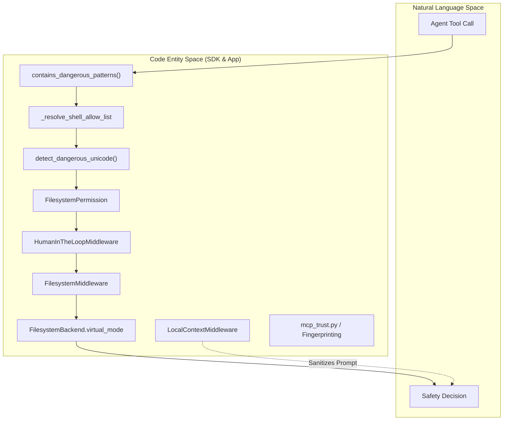
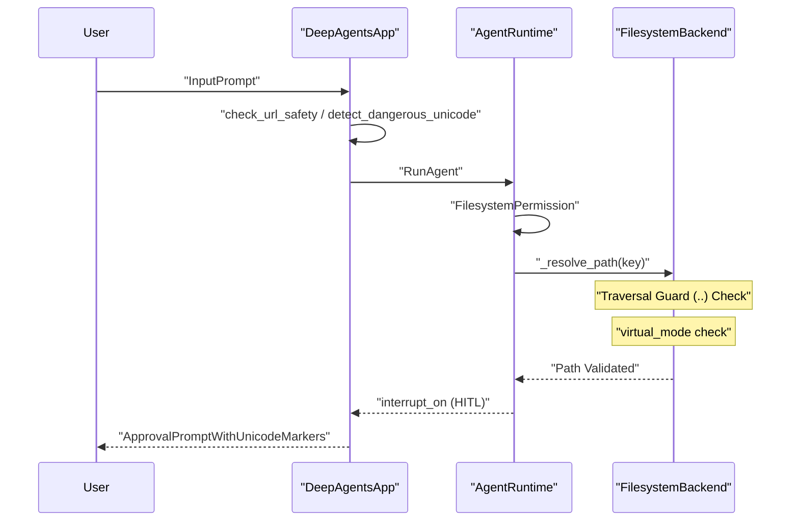

# Security and Path Validation

Relevant source files

The following files were used as context for generating this wiki page:

- [libs/code/THREAT_MODEL.md](libs/code/THREAT_MODEL.md)
- [libs/code/deepagents_code/main.py](libs/code/deepagents_code/main.py)
- [libs/code/deepagents_code/ui.py](libs/code/deepagents_code/ui.py)
- [libs/code/deepagents_code/update_check.py](libs/code/deepagents_code/update_check.py)
- [libs/code/tests/unit_tests/test_args.py](libs/code/tests/unit_tests/test_args.py)
- [libs/code/tests/unit_tests/test_main.py](libs/code/tests/unit_tests/test_main.py)
- [libs/code/tests/unit_tests/test_main_args.py](libs/code/tests/unit_tests/test_main_args.py)
- [libs/code/tests/unit_tests/test_update_check.py](libs/code/tests/unit_tests/test_update_check.py)
- [libs/code/tests/unit_tests/test_version.py](libs/code/tests/unit_tests/test_version.py)
- [libs/deepagents/deepagents/backends/filesystem.py](libs/deepagents/deepagents/backends/filesystem.py)
- [libs/deepagents/deepagents/backends/protocol.py](libs/deepagents/deepagents/backends/protocol.py)
- [libs/deepagents/deepagents/backends/sandbox.py](libs/deepagents/deepagents/backends/sandbox.py)
- [libs/deepagents/deepagents/backends/utils.py](libs/deepagents/deepagents/backends/utils.py)
- [libs/deepagents/deepagents/middleware/_fs_interrupt.py](libs/deepagents/deepagents/middleware/_fs_interrupt.py)
- [libs/deepagents/deepagents/middleware/filesystem.py](libs/deepagents/deepagents/middleware/filesystem.py)
- [libs/deepagents/deepagents/middleware/permissions.py](libs/deepagents/deepagents/middleware/permissions.py)
- [libs/deepagents/tests/unit_tests/backends/test_filesystem_backend.py](libs/deepagents/tests/unit_tests/backends/test_filesystem_backend.py)
- [libs/deepagents/tests/unit_tests/backends/test_protocol.py](libs/deepagents/tests/unit_tests/backends/test_protocol.py)
- [libs/deepagents/tests/unit_tests/backends/test_sandbox_backend.py](libs/deepagents/tests/unit_tests/backends/test_sandbox_backend.py)
- [libs/deepagents/tests/unit_tests/backends/test_utils.py](libs/deepagents/tests/unit_tests/backends/test_utils.py)
- [libs/deepagents/tests/unit_tests/test_end_to_end.py](libs/deepagents/tests/unit_tests/test_end_to_end.py)
- [libs/deepagents/tests/unit_tests/test_local_sandbox_operations.py](libs/deepagents/tests/unit_tests/test_local_sandbox_operations.py)
- [libs/deepagents/tests/unit_tests/test_middleware.py](libs/deepagents/tests/unit_tests/test_middleware.py)
- [libs/deepagents/tests/unit_tests/test_middleware_async.py](libs/deepagents/tests/unit_tests/test_middleware_async.py)
- [libs/deepagents/tests/unit_tests/test_permissions.py](libs/deepagents/tests/unit_tests/test_permissions.py)

This page documents the security mechanisms and validation systems in the Deep Agents monorepo. It covers shell command filtering, path validation, dangerous pattern detection, Unicode security checks, trust boundaries from `THREAT_MODEL.md`, dotenv key denylists, and Model Context Protocol (MCP) trust enforcement. These systems implement defense-in-depth to protect users from malicious agent behavior and accidental destructive operations.

For information about HITL approval UI and user interaction, see [4.1](). For tool execution internals, see [2.6]().

---

## Overview and Trust Boundaries

Deep Agents enforces security through multiple validation layers that intercept and validate tool calls before they are executed. The primary security concerns addressed are:

1. **Shell command injection** – Prevent arbitrary command execution via pattern matching and allow-lists.
2. **Path traversal** – Validate filesystem paths, agent names, and skill locations to avoid unauthorized access.
3. **Unicode attacks** – Detect hidden characters and homograph attacks in tool arguments.
4. **Unintended destructive operations** – Require explicit approval for dangerous tools via Human-in-the-Loop (HITL) middleware.
5. **Environment and configuration isolation** – Prevent project-local files (like `.env` or `.mcp.json` in a cloned repo) from escalating privileges or auto-approving malicious capabilities.

This layered approach provides defense-in-depth by combining static validation, runtime permission checking, explicit user confirmation, and environment restrictions.

### Security Pipeline Diagram

This diagram bridges natural language security concepts to the specific code entities responsible for enforcement.

**Sources:**  
[libs/deepagents/deepagents/middleware/filesystem.py:126-135](), [libs/code/deepagents_code/agent.py:144-152](), [libs/code/deepagents_code/_env_vars.py:105-126]()

---

## Shell Command Security

### Shell Allow-Lists and Command Signature Extraction

The system enforces shell command security by maintaining allow-lists on commands agents may invoke at the shell level. Rather than checking just the base binary name, it extracts *command signatures* including subcommands and flags critical to execution semantics. This prevents "over-permissioning" where allowing `python` alone could enable unrestricted execution of arbitrary inline code (`python -c "malicious_code"`).

Examples of signature extraction logic include:

| Tool          | Signature Logic                            | Example Command             | Extracted Signature    |
|---------------|------------------------------------------|----------------------------|-----------------------|
| **Python**    | Includes `-m` module or `-c` flag        | `python -m pytest tests/`  | `python -m pytest`     |
| **Node**      | Includes `-e` or `-p` flags               | `node -e 'console.log(1)'` | `node -e`             |
| **NPM / UV**  | Includes subcommand and target            | `uv run pytest`             | `uv run pytest`        |
| **Others**    | Base command only                         | `ls -la`                   | `ls`                  |

This signature extraction occurs centrally in the CLI and server startup configuration layers to enforce allowed shell commands consistently. [libs/deepagents/deepagents/middleware/filesystem.py:126-135]()

### Environment Variable Protection and Denylists

Security further restricts environment variables:

- The server interpreter startup enforces scrubbing of launch-time environment variables like `PYTHONPATH` to prevent untrusted import paths. These are stripped from main server processes (`server._SERVER_ENV_DENYLIST`) and only reapplied inside approval-gated shell subprocesses with special carrier variables such as `_INHERITED_PYTHONPATH_ENV`. This avoids clients injecting malicious module paths invisibly. [libs/code/deepagents_code/config.py:134-142]()

- Project-level `.env` files are prevented from overriding sensitive user configuration keys. Keys controlling authorization or classifier behavior (e.g., `AUTO_CLASSIFIER_MODEL`, `DANGEROUSLY_ENABLE_PROJECT_MCP_SERVERS`) are denylisted, ensuring repository control over environment cannot escalate privileges or bypass security reviews. [libs/code/deepagents_code/_env_vars.py:37-54](), [libs/code/deepagents_code/_env_vars.py:105-126]()

**Sources:**  
[libs/deepagents/deepagents/middleware/filesystem.py:126-135](), [libs/code/deepagents_code/config.py:134-142](), [libs/code/deepagents_code/_env_vars.py:37-54]()

---

## Filesystem Permissions and Path Validation

### FilesystemPermission Rules

The core SDK enforces filesystem access controls through `FilesystemMiddleware` by wrapping filesystem-related tools and intercepting tool calls:

- Permissions are categorized as `read` or `write` operations per tool, and separate rules apply for sensitive mutating commands (e.g., `delete`, `edit_file`). [libs/deepagents/deepagents/middleware/filesystem.py:171-183]()

- Recursive delete safety is enforced: when deleting recursively, the system refuses if the deletion pattern overlaps with protected subtrees, preventing large-scale accidental data loss. This is implemented by checking subtree overlaps via utility functions like `_paths_overlap`. [libs/deepagents/deepagents/backends/utils.py:74-81]()

- Before exposing `execute` tools for shell command execution, the backend is verified to support execution to avoid unintentional capability grants. [libs/deepagents/deepagents/middleware/filesystem.py:58-59]()

### Path Validation Logic

All paths used in filesystem tools go through strict validation routines:

- `validate_path()` rejects forbidden patterns such as `..` (parent directory traversal) or `~` (user home shortcuts) to prevent escaping the intended root. [libs/deepagents/deepagents/backends/utils.py:80-81]()

- Paths are normalized to prevent equivocation across platforms or input forms. [libs/deepagents/deepagents/backends/filesystem.py:178-179]()

- When `FilesystemBackend` is active with `virtual_mode=True`, all paths are anchored to a configured `root_dir`. Path traversal is blocked, and absolute paths are disallowed from escaping the root, enforcing sandboxing semantics. When `virtual_mode=False`, absolute paths bypass restrictions, allowing unrestricted filesystem access (intended only for trusted environments). [libs/deepagents/deepagents/backends/filesystem.py:161-172]()

**Sources:**  
[libs/deepagents/deepagents/middleware/filesystem.py:53-135](), [libs/deepagents/deepagents/backends/filesystem.py:155-184](), [libs/deepagents/deepagents/backends/utils.py:74-81]()

---

## Unicode and Content Safety

### Unicode Security Checks

The `deepagents-code` package offers utilities that detect potentially dangerous Unicode patterns in user inputs and tool arguments, guarding against homograph attacks and invisible character exploits:

- Functions such as `detect_dangerous_unicode()` flag characters used for spoofing or obfuscation inside prompts or tool arguments. [libs/code/deepagents_code/agent.py:144-152]()

- The system can sanitize or annotate these suspicious characters so the TUI or HITL interface can visually warn operators about potential spoofing.

- URL inputs are specifically validated for homograph and phishing indicators to avoid exfiltration or command injection via crafted URLs.

### Sandbox-Side Safety

For remote sandbox backends, Python guard scripts are used for globbing and pattern matching:

- These include strict limits on max expansions (`MAX_EXPANSIONS = 1000`), max matches (`MAX_MATCHES = 10000`), and execution time budgets (`TIME_BUDGET = 5.0 seconds`) to prevent resource exhaustion or denial of service from pathological glob patterns such as repeated `**/**/**` recursion. [libs/deepagents/deepagents/backends/sandbox.py:62-70]()

**Sources:**  
[libs/code/deepagents_code/agent.py:144-152](), [libs/deepagents/deepagents/backends/sandbox.py:51-70]()

---

## Managed Configuration Constraints and MCP Trust

### Managed Configuration Constraints

The `config_manifest.py` module establishes enforceable safety bounds and limits on configurable parameters to prevent hostile or accidental resource exhaustion:

- For example, the graph recursion limit is strictly bounded between `RECURSION_LIMIT_FLOOR = 25` and `RECURSION_LIMIT_CEILING = 100000`. Settings outside these bounds are either rejected or clamped. [libs/code/deepagents_code/config_manifest.py:105-112]()

- The Auto approval classifier has a bound of 300 seconds on its timeout (and a floor of 1.0 second) to prevent indefinite hangs during automatic evaluation steps. [libs/code/deepagents_code/config_manifest.py:80-103]()

### MCP Trust and Fingerprinting

Trust for project-local Model Context Protocol (MCP) servers is controlled with explicit environment variables and user consent:

- The flag `DEEPAGENTS_CODE_DANGEROUSLY_ENABLE_PROJECT_MCP_SERVERS` can allow pre-approved project MCP servers by name, but this approval must come from process-level environment variables and **cannot** be overridden by project-local `.env` files to prevent privilege escalation from untrusted repos. [libs/code/deepagents_code/_env_vars.py:105-126]()

- MCP server URLs, tokens, and metadata are fingerprinted per session to detect tampering or unauthorized changes.

### Security Data Flow Diagram

This sequence diagram illustrates the flow of validation from user input to backend execution and HITL interruption:

**Sources:**  
[libs/code/deepagents_code/config_manifest.py:80-112](), [libs/code/deepagents_code/_env_vars.py:105-126](), [libs/deepagents/deepagents/backends/filesystem.py:161-179]()

---

# Summary

The Deep Agents framework's security and path validation involve tight correlation of allow-lists, pattern matching, permission objects, environment variable filtering, and runtime enforcement with HITL gating to provide robust safeguards against malicious or accidental misuse. The design separates trusted (interactive human or controlled environment) and untrusted (agent runtime) boundaries clearly, enforcing strong validation and explicit approvals appropriately. These measures align with the `THREAT_MODEL.md` trust boundaries and provide a comprehensive defense-in-depth security posture.

# Appendix: Key Classes and Functions

| Component                      | Description                                                                             | Location                                      |
|-------------------------------|-----------------------------------------------------------------------------------------|-----------------------------------------------|
| `FilesystemMiddleware`         | Middleware wrapping filesystem tools, enforcing permission and validation gating.       | `deepagents/middleware/filesystem.py:145-175` |
| `FilesystemPermission`         | Defines read/write access rules and path restrictions for filesystem operations.        | Same as above                                  |
| `validate_path()`              | Validates and normalizes paths to prevent traversal and escaping sandbox root.          | `deepagents/backends/utils.py:74-81`           |
| `detect_dangerous_unicode()`  | Detect dangerous Unicode and visually suspicious characters in inputs.                  | `deepagents_code/agent.py:144-152`              |
| `_resolve_shell_allow_list()` | Parses and enforces shell allow-list for command invocations, extracting signatures.    | `deepagents_code/config.py:134-142`             |
| MCP Trust / Fingerprinting     | Validates project MCP server trust and prevents hidden authorizations from repos.       | `deepagents_code/_env_vars.py:105-126`          |
| `FilesystemBackend._resolve_path()` | Resolves and validates filesystem paths with traversal checks and anchoring to root. | `deepagents/deepagents/backends/filesystem.py:161-170` |

---

This page should be referenced for in-depth understanding and auditing of Deep Agents security controls related to path and command validation.

# End of 4.7 - Security and Path Validation