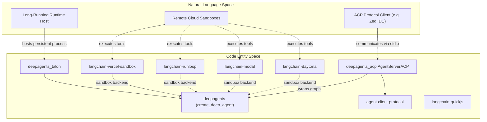
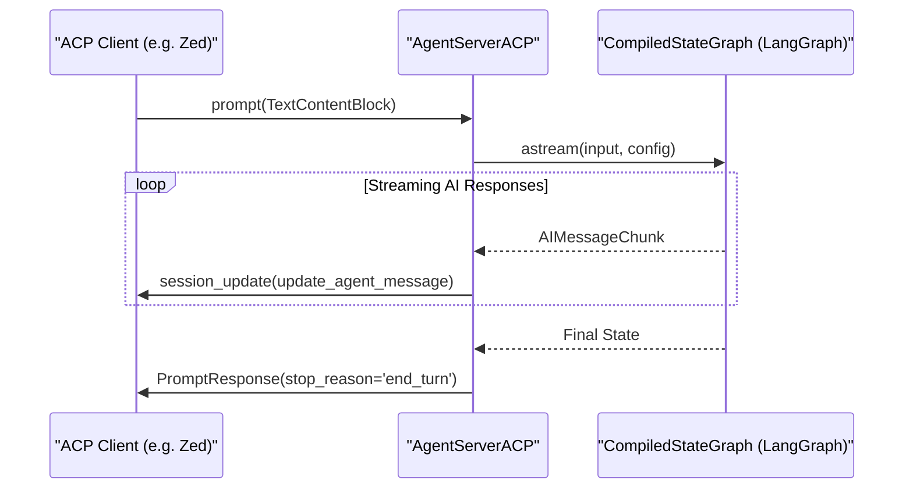
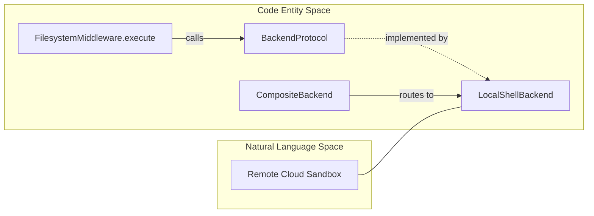

# Integrations

Relevant source files

The following files were used as context for generating this wiki page:

- [libs/acp/.env.example](libs/acp/.env.example)
- [libs/acp/README.md](libs/acp/README.md)
- [libs/acp/deepagents_acp/__main__.py](libs/acp/deepagents_acp/__main__.py)
- [libs/acp/deepagents_acp/server.py](libs/acp/deepagents_acp/server.py)
- [libs/acp/deepagents_acp/utils.py](libs/acp/deepagents_acp/utils.py)
- [libs/acp/examples/__init__.py](libs/acp/examples/__init__.py)
- [libs/acp/examples/demo_agent.py](libs/acp/examples/demo_agent.py)
- [libs/acp/examples/local_context.py](libs/acp/examples/local_context.py)
- [libs/acp/run_demo_agent.sh](libs/acp/run_demo_agent.sh)
- [libs/acp/tests/test_agent.py](libs/acp/tests/test_agent.py)
- [libs/acp/tests/test_command_allowlist.py](libs/acp/tests/test_command_allowlist.py)
- [libs/acp/tests/test_dangerous_patterns.py](libs/acp/tests/test_dangerous_patterns.py)
- [libs/acp/tests/test_model_switching.py](libs/acp/tests/test_model_switching.py)
- [libs/acp/tests/unit_tests/__init__.py](libs/acp/tests/unit_tests/__init__.py)
- [libs/acp/tests/unit_tests/test_execute_permissions.py](libs/acp/tests/unit_tests/test_execute_permissions.py)
- [libs/acp/tests/unit_tests/test_local_context.py](libs/acp/tests/unit_tests/test_local_context.py)

This section covers the integration packages and protocols that extend Deep Agents functionality. These integrations enable additional execution environments, communication protocols, and evaluation frameworks. For information about the core SDK middleware and tools, see [Core SDK](#2). For CLI-specific configuration and usage, see [deepagents-code Application](#3).

The Deep Agents ecosystem includes five categories of integrations:
1. **Protocol Integrations**: `deepagents-acp` for Agent Client Protocol communication.
2. **Evaluation Framework**: `deepagents-harbor` for Harbor-based evaluation with LangSmith tracing.
3. **Sandbox Providers**: Partner packages (`langchain-daytona`, `langchain-modal`, `langchain-runloop`, `langchain-vercel-sandbox`) for remote code execution.
4. **REPL Middleware**: `langchain-quickjs` for embedded QuickJS execution and parallel tool calls.
5. **Runtime Hosts**: `deepagents-talon` for long-running agents with channel adapters (e.g., WhatsApp).

---

## Integration Package Architecture

The integration packages build on top of the core `deepagents` library to provide specialized functionality and connectivity to external clients, runtime environments, and evaluation systems.

### Monorepo Integration Structure

This diagram shows how the various integration packages relate to the core SDK and the external natural language spaces they serve. The ACP server acts as a protocol adapter communicating over stdio. The remote sandbox providers serve as backend execution environments for tools. The Talon runtime host manages long-running agent processes with external channel adapters.

**Sources**:  
[libs/acp/deepagents_acp/server.py:58-61]()

---

## ACP (Agent Client Protocol)

The `deepagents-acp` package provides integration with the [Agent Client Protocol (ACP)](https://agentclientprotocol.com/), enabling Deep Agents to be embedded within ACP-compatible text editors such as [Zed](https://zed.dev/) [libs/acp/README.md:1-3]().

### `AgentServerACP`

At the core is the `AgentServerACP` class, which adapts a Deep Agents graph (`CompiledStateGraph`) to the ACP server interface [libs/acp/deepagents_acp/server.py:58-400+]().

Features include:
- **Session Management**: Supports multiple parallel agent sessions via `new_session`, preserving working directories and session states [libs/acp/deepagents_acp/server.py:98-115]().
- **Streaming Responses**: Handles streaming AI message chunks to clients using ACP’s `session_update` protocol [libs/acp/deepagents_acp/server.py:126-190]().
- **Dynamic Configuration**: Supports changing agent models and modes mid-session through ACP `SessionConfigOptionSelect` objects, with automatic adaptation by the agent factory [libs/acp/examples/demo_agent.py:23-121]().
- **Security Enforcement**: Implements command allowlisting and detects dangerous shell patterns to prevent injection attacks in shell tool invocations [libs/acp/deepagents_acp/utils.py:126-148]().
- **Persistent Memory**: Supports session load/persist when configured with durable LangGraph checkpointers [libs/acp/README.md:113-126]().

### ACP Protocol Communication Flow

This flow depicts the interaction where the ACP client prompts the agent, the Deep Agent graph streams messages back, and the server relays those to the client with real-time updates.

### Model Switching and Modes

`AgentServerACP` supports multiple models and session modes exposed via `SessionModeState` objects [libs/acp/examples/demo_agent.py:80-119](). The user can dynamically switch models and modes through session config options, causing the server to rebuild the agent instance with the new configuration transparently.

For complete usage details and configuration, see [ACP (Agent Client Protocol)](#5.1).

**Sources**:  
[libs/acp/deepagents_acp/server.py:58-192](),  
[libs/acp/examples/demo_agent.py:23-121](),  
[libs/acp/README.md:1-207]()

---

## Harbor Evaluation Framework

`deepagents-harbor` package integrates evaluation workflows with the Harbor framework for rigorous agent evaluation and benchmarking.

- Converts agent execution traces to LangSmith datasets for persistent experiment tracking.
- Enables reward feedback and trajectory scoring via integrated Rust LLM judges.
- Automates evaluation workflows for multiple models, datasets, and sandbox backends.
- Supports detailed analysis and visualization of evaluation results for research and CI/CD.

For technical details and usage, see [Harbor Evaluation Framework](#5.2).

---

## Remote Sandbox Providers

Deep Agents supports multiple remote sandbox providers through partner integrations:

| Provider      | Package                    | Description                              |
|---------------|----------------------------|------------------------------------------|
| **Daytona**   | `langchain-daytona`         | Persistent cloud dev workspaces          |
| **Modal**     | `langchain-modal`           | Serverless containerized execution       |
| **Runloop**   | `langchain-runloop`         | API-managed remote sandboxes             |
| **QuickJS**   | `langchain-quickjs`         | Embedded QuickJS JS sandbox              |
| **Vercel**    | `langchain-vercel-sandbox`  | Sandbox optimized for Vercel platform    |

These providers offer specialized environments for tools like `execute`, enabling isolated and scalable code execution. The system uses a factory pattern (`sandbox_factory`) to dynamically instantiate sandboxes based on configuration, allowing seamless switching between local and remote backends [libs/acp/examples/demo_agent.py:58-69]().

### Sandbox Backend Mapping

This diagram illustrates how the `execute` tool calls into a backend protocol implementation, which may be local or remote sandbox backed.

For complete information, see [Remote Sandbox Providers](#5.3).

**Sources**:  
[libs/acp/examples/demo_agent.py:58-69]()

---

## REPL Middleware (langchain-quickjs)

The `langchain-quickjs` package introduces an embedded QuickJS interpreter as middleware in the agent stack.

- Implements a `ReplMiddleware` tool that executes JavaScript blocks in a persistent embedded context.
- Provides primitives within JS for dispatching subagents and orchestrating multi-step workflows programmatically.
- Enables parallel execution and swarm task patterns through REPL tool orchestration.
- Supports snapshots, prompt modes, and benchmarks for REPL performance and execution characteristics.

For detailed usage and API reference, see [REPL Middleware (langchain-repl / langchain-quickjs)](#5.4).

---

## Talon Runtime Host

The `deepagents-talon` package is designed as an experimental long-running runtime host for Deep Agents.

Key features:
- Runs persistent agent processes that maintain state and history.
- Supports channel adapters for communication platforms such as Slack, WhatsApp (with Node.js QR pairing), Telegram, and Discord.
- Includes a cron scheduler for persistent background jobs.
- Manages agent fleets and configuration loading from environment variables.
- Integrates LangSmith tracing for observability of channel-driven agent runs.
- Stores conversation history and embeddings with vector and relational DB backends (e.g., Voyage, Postgres).

For more comprehensive details, see [Talon Runtime Host](#5.5).

---

## Shared Development Standards

All integration packages follow consistent development policies:

- Use `hatchling` as the build backend.
- Enforce strict linting with `ruff` using the `ALL` category.
- Adopt `ty` for type checking and `pytest` with `asyncio_mode="auto"` for testing.
- Include comprehensive automated test coverage for isolation and protocol compliance.

These standards maintain quality and interoperability across integration packages.

**Sources**:  
[libs/acp/pyproject.toml:1-90]()

---

For detailed technical documentation and examples, consult the respective child pages:

- [ACP (Agent Client Protocol)](#5.1)  
- [Harbor Evaluation Framework](#5.2)  
- [Remote Sandbox Providers](#5.3)  
- [REPL Middleware (langchain-repl / langchain-quickjs)](#5.4)  
- [Talon Runtime Host](#5.5)