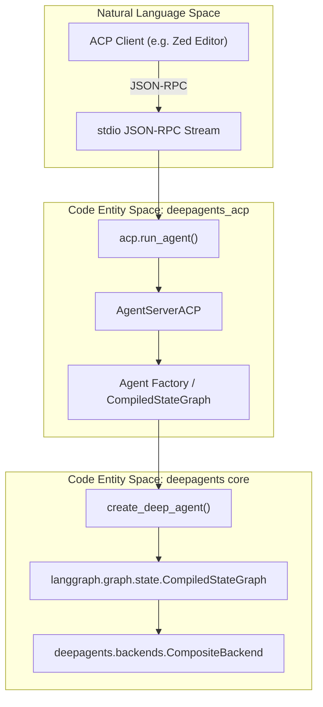
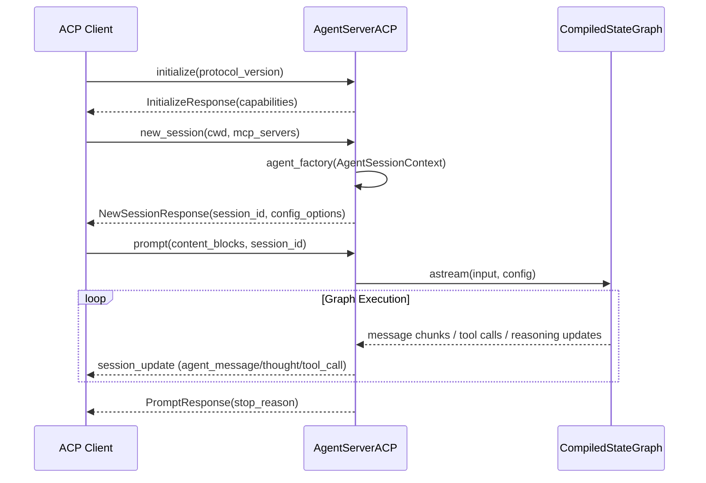

# ACP (Agent Client Protocol)

<details>
<summary>Relevant source files</summary>

The following files were used as context for generating this wiki page:

- [libs/acp/.env.example](libs/acp/.env.example)
- [libs/acp/README.md](libs/acp/README.md)
- [libs/acp/deepagents_acp/__main__.py](libs/acp/deepagents_acp/__main__.py)
- [libs/acp/deepagents_acp/server.py](libs/acp/deepagents_acp/server.py)
- [libs/acp/deepagents_acp/utils.py](libs/acp/deepagents_acp/utils.py)
- [libs/acp/examples/__init__.py](libs/acp/examples/__init__.py)
- [libs/acp/examples/demo_agent.py](libs/acp/examples/demo_agent.py)
- [libs/acp/examples/local_context.py](libs/acp/examples/local_context.py)
- [libs/acp/pyproject.toml](libs/acp/pyproject.toml)
- [libs/acp/run_demo_agent.sh](libs/acp/run_demo_agent.sh)
- [libs/acp/tests/test_agent.py](libs/acp/tests/test_agent.py)
- [libs/acp/tests/test_command_allowlist.py](libs/acp/tests/test_command_allowlist.py)
- [libs/acp/tests/test_dangerous_patterns.py](libs/acp/tests/test_dangerous_patterns.py)
- [libs/acp/tests/test_model_switching.py](libs/acp/tests/test_model_switching.py)
- [libs/acp/tests/unit_tests/__init__.py](libs/acp/tests/unit_tests/__init__.py)
- [libs/acp/tests/unit_tests/test_execute_permissions.py](libs/acp/tests/unit_tests/test_execute_permissions.py)
- [libs/acp/tests/unit_tests/test_local_context.py](libs/acp/tests/unit_tests/test_local_context.py)

</details>


The `deepagents-acp` package integrates Deep Agents with the [Agent Client Protocol (ACP)](https://agentclientprotocol.com/overview/introduction), enabling Deep Agents to interoperate with ACP-compatible IDEs/editors and run over standard input/output (stdio) JSON-RPC streams. This facilitates embedding AI coding agents, like the prebuilt Deep Agents Code agent or fully custom Deep Agents, into development environments such as [Zed](https://zed.dev/). It supports command allowlists, session persistence, dynamic model switching, and integration with sandbox backends [libs/acp/pyproject.toml:5-29](), [libs/acp/README.md:1-8, 10-10, 137-175]().

---

## Overview

ACP is a JSON-RPC based protocol designed for embedding AI agents into development platforms. The `deepagents-acp` implementation wraps Deep Agents' core LangGraph-based agent graphs in an ACP server that communicates over JSON-RPC streams on stdio or similar transport layers.

**Core Components:**

| Component          | Code Entity                                   | Role                                                                                   |
|--------------------|----------------------------------------------|----------------------------------------------------------------------------------------|
| `AgentServerACP`   | `libs/acp/deepagents_acp/server.py`          | ACP server class bridging ACP requests to the LangGraph agent; manages ACP sessions, modes, and model selection |
| `AgentSessionContext` | `libs/acp/deepagents_acp/server.py`          | Session context carrying cwd, mode, and model info passed to agent factories            |
| `run_agent`        | Provided by `acp` package                     | Entrypoint to start ACP event loop, handling stdio communication and stream lifecycle  |
| `create_deep_agent`| `deepagents` package                          | Factory function to create LangGraph compiled state graphs representing Deep Agents    |
| `CompositeBackend`, `LocalShellBackend` | `deepagents.backends`                     | Backend implementations used by agents for filesystem and shell command execution      |

The ACP adapter enables:

- Running Deep Agents inside ACP-enabled editors (like Zed) or any JSON-RPC stdio channel.
- Session lifecycle management including persistent loading with durable checkpointers.
- Dynamic LLM model switching mid-session.
- Interaction mode selection influencing agent interrupt behavior.
- Command allowlisting with granularity on shell commands executed by tools.
- Rich content streaming (text, images, reasoning chunks) to ACP clients.

### ACP Integration Architecture



---

## AgentServerACP Implementation and Session Lifecycle

`AgentServerACP` is the key class implementing the ACP server interface by extending `ACPAgent` from the `acp` library. It wraps a LangGraph `CompiledStateGraph` or an agent factory function, managing client sessions and translating ACP protocol messages into LangChain/DeepAgents invocations.

Core session lifecycle methods:

| Method          | Description                                                                                                    |
|-----------------|----------------------------------------------------------------------------------------------------------------|
| `initialize`    | Exchanges server capabilities with ACP client, advertising features like prompt accessory support, tool calls, and content blocks [libs/acp/deepagents_acp/server.py:12-57]() |
| `new_session`   | Creates a new session, invoking the underlying Deep Agent factory with `AgentSessionContext` (cwd, mode, model). Normalizes arguments including legacy MCP server config. Returns session ID and config options [libs/acp/deepagents_acp/server.py:98-117, 123-124]() |
| `prompt`        | Receives a prompt (content blocks), converts them to LangChain message format, and runs the agent graph asynchronously via `astream()`. Streams updates (agent messages, thought chunks, tool calls) back to the client [libs/acp/deepagents_acp/server.py:15-74](), [libs/acp/tests/test_agent.py:126-127]() |

`AgentSessionContext` structure provides:

- `cwd`: working directory for the session, guiding backend filesystem root.
- `mode`: interaction mode (e.g., "ask_before_edits") affecting interrupt handling.
- `model`: LLM model identifier for dynamic model selection.

### ACP Interaction Sequence Diagram



---

## Model, Mode, and Persistent Session Management

### Dynamic Model Switching

`AgentServerACP` supports dynamic LLM model selection by exposing a list of models as ACP `SessionConfigOptionSelect` options. Users can switch models mid-session without losing conversation history. The server applies the chosen model in the `AgentSessionContext` passed to the agent factory, enabling hot swaps of backend providers or LLMs [libs/acp/README.md:177-206]().

### Interaction Modes

Modes represent different agent interrupt/approval policies controlling tool execution behavior:

| Mode ID          | Description                                           | Interrupt Configuration Detail               |
|------------------|-------------------------------------------------------|----------------------------------------------|
| `ask_before_edits`| Asks for permission before all edits, writes, shell commands, and plans | Full interrupt allowlists enabled             |
| `accept_edits`    | Auto-accept edits, ask before shell and plans         | Partial interrupt allowlist                    |
| `accept_everything` | Accepts all operations without prompts               | No interrupt checks enabled                     |

This is configured by mapping ACP `SessionMode` states to DeepAgents `interrupt_on` configuration passed during agent construction [libs/acp/examples/demo_agent.py:23-38, 80-99]().

### Persistent Sessions

Using a durable LangGraph checkpointer (e.g., `MemorySaver`), the ACP server can implement `session/load` to restore previous sessions across process restarts. It rehydrates the LangGraph state, verifies the original working directory matches, and replays conversation history and reasoning updates to the client using ACP `session/update` events [libs/acp/README.md:113-126]().

---

## Data Transformation and Shell Security

### ACP-LangChain Content Conversion

The server translates ACP protocol content blocks to LangChain internal message content and vice versa:

| Content Type           | Conversion Function                                             | Notes                                                            |
|------------------------|-----------------------------------------------------------------|------------------------------------------------------------------|
| Text blocks            | `convert_text_block_to_content_blocks` [libs/acp/deepagents_acp/utils.py:19-21]() | Converts ACP text block to LangChain block with `"type": "text"` |
| Image blocks           | `convert_image_block_to_content_blocks` [libs/acp/deepagents_acp/utils.py:24-33]() | Encodes base64 images with data uris                             |
| Audio blocks           | `convert_audio_block_to_content_blocks` (raises NotImplementedError) [libs/acp/deepagents_acp/utils.py:35-42]() | Audio content not currently supported                            |
| Resource blocks        | `convert_resource_block_to_content_blocks` [libs/acp/deepagents_acp/utils.py:45-71]() | Converts file URIs relative to session working directory          |
| Embedded resource block| `convert_embedded_resource_block_to_content_blocks` [libs/acp/deepagents_acp/utils.py:74-99]() | Processes embedded text or blobs                                  |

Visible reasoning chunks in assistant outputs are streamed as `AgentThoughtChunk` ACP blocks alongside text chunks to represent LLM internal thought processes transparently [libs/acp/deepagents_acp/server.py:167-193]().

### Shell Command Security and Allowlist Extraction

The agent’s `execute` tool uses the following mechanisms to ensure safe shell command execution under ACP:

- **Dangerous Pattern Detection**: `contains_dangerous_patterns(command: str) -> bool` scans shell input strings for injection vectors like command substitution (`$()`), backticks, newlines, redirection (`>`, `<`), and background execution (`&` but not `&&`). Commands containing these are rejected even if on the allowlist [libs/acp/deepagents_acp/utils.py:102-150]().

- **Command Type Extraction**: `extract_command_types(command: str) -> list[str]` parses complex shell expressions potentially containing pipelines and conditional operators, producing normalized command signatures that guard permission granularity. For example, `python -m pytest` differs from `python -m pip`, `npm run build` differs from `npm install` [libs/acp/deepagents_acp/utils.py:151-182]().

| Example Input                     | Extracted Command Signature(s)       |
|---------------------------------|-------------------------------------|
| `python -m pytest tests/`        | `python -m pytest`                   |
| `npm run build`                  | `npm run build`                     |
| `uv run pytest`                  | `uv run pytest`                     |
| `cd dir && ls`                  | `["cd", "ls"]`                      |

This tight control prevents over-permissioning and run-time injection vulnerabilities in shell tooling exposed to ACP clients.

---

## Example Usage and Prebuilt Agents

### Custom ACP Server Script Example

Users can write custom ACP servers by creating an agent using `create_deep_agent`, wrapping it in an `AgentServerACP`, and running it via `run_agent` from the `acp` library:

```python
import asyncio
from acp import run_agent as run_acp_agent
from deepagents import create_deep_agent
from deepagents_acp.server import AgentServerACP

async def main() -> None:
    agent = create_deep_agent(
        system_prompt="You are a helpful assistant",
    )
    server = AgentServerACP(agent)
    await run_acp_agent(server)

if __name__ == "__main__":
    asyncio.run(main())
```

This pattern is demonstrated in `libs/acp/examples/demo_agent.py`, which also shows using a layered backend (`CompositeBackend` with shell and ephemeral backends), local context middleware, and interaction modes [libs/acp/examples/demo_agent.py:41-127](), [libs/acp/README.md:84-111]().

### Prebuilt Deep Agents Code Agent (`dcode --acp`)

For users who prefer not to build their own server, the `deepagents-code` package includes a prebuilt coding agent that can run as an ACP server over stdio simply by passing the `--acp` flag:

```bash
dcode --acp --model anthropic:claude-sonnet-5
```

This prebuilt agent exposes the full suite of filesystem and shell tools, MCP integration, and subagent support out-of-the-box, enabling immediate ACP integration in editors without custom coding [libs/acp/README.md:137-175]().

---

## Package Dependencies and Environment

`deepagents-acp` requires Python 3.11+ and depends primarily on `agent-client-protocol` (ACP library), `deepagents` core SDK, and `python-dotenv` for environment variable loading:

| Dependency          | Version Requirement            |
|---------------------|-------------------------------|
| `agent-client-protocol` | `>=0.10.1`                   |
| `deepagents`        | Local editable via `../deepagents` |
| `python-dotenv`     | `>=1.2.2`                     |

Installation and builds are managed via the `hatchling` build system specified in `pyproject.toml` [libs/acp/pyproject.toml:5-75]().

---

# Summary

The `deepagents-acp` package implements a fully featured ACP server for Deep Agents, exposing standard and advanced agent capabilities over JSON-RPC stdio streams. It allows embedding Deep Agents with context-aware local folders and file systems inside editors, supports dynamic LLM model switching, mode selection with interrupt control, persistent sessions with durable checkpoints, and secure command execution governed by detailed command signature extraction and allowlisting.

This integration is crucial for enabling seamless developer-facing assistant workflows in ACP-enabled IDEs.

---

# Sources

- [libs/acp/pyproject.toml:5-29]()
- [libs/acp/README.md:1-8,10-10,84-111,113-126,137-175,177-206]()
- [libs/acp/deepagents_acp/server.py:11-74,98-117,119-193]()
- [libs/acp/deepagents_acp/utils.py:19-99,102-182]()
- [libs/acp/examples/demo_agent.py:23-38,41-127]()
- [libs/acp/tests/test_agent.py:62-201]()
- [libs/acp/tests/test_command_allowlist.py:1-137]()