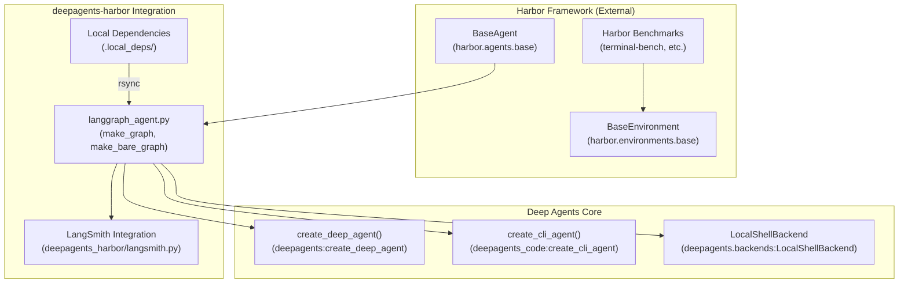
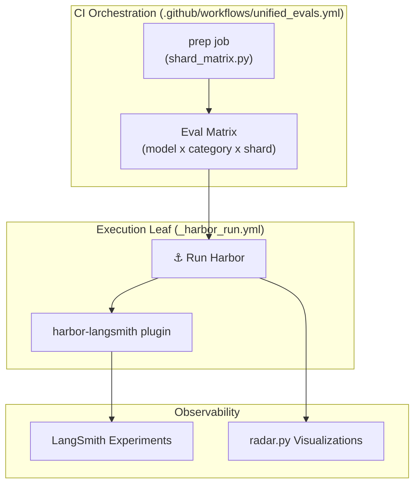

# Harbor Evaluation Framework

<details>
<summary>Relevant source files</summary>

The following files were used as context for generating this wiki page:

- [.github/scripts/tests/evals/test_prune_agent_deps.py](.github/scripts/tests/evals/test_prune_agent_deps.py)
- [.github/workflows/_harbor_run.yml](.github/workflows/_harbor_run.yml)
- [.github/workflows/unified_evals.yml](.github/workflows/unified_evals.yml)
- [libs/evals/deepagents_harbor/__init__.py](libs/evals/deepagents_harbor/__init__.py)
- [libs/evals/deepagents_harbor/langgraph_project/langgraph.json](libs/evals/deepagents_harbor/langgraph_project/langgraph.json)
- [libs/evals/deepagents_harbor/langgraph_project/langgraph_agent.py](libs/evals/deepagents_harbor/langgraph_project/langgraph_agent.py)
- [libs/evals/deepagents_harbor/langsmith.py](libs/evals/deepagents_harbor/langsmith.py)
- [libs/evals/pyproject.toml](libs/evals/pyproject.toml)
- [libs/evals/scripts/harbor_langsmith.py](libs/evals/scripts/harbor_langsmith.py)
- [libs/evals/tests/evals/pytest_reporter.py](libs/evals/tests/evals/pytest_reporter.py)
- [libs/evals/tests/unit_tests/test_analyze_eval_failures.py](libs/evals/tests/unit_tests/test_analyze_eval_failures.py)
- [libs/evals/tests/unit_tests/test_harbor_langgraph_agent.py](libs/evals/tests/unit_tests/test_harbor_langgraph_agent.py)
- [libs/evals/tests/unit_tests/test_harbor_langsmith_integration.py](libs/evals/tests/unit_tests/test_harbor_langsmith_integration.py)
- [libs/evals/tests/unit_tests/test_langsmith.py](libs/evals/tests/unit_tests/test_langsmith.py)
- [libs/evals/tests/unit_tests/test_pytest_reporter.py](libs/evals/tests/unit_tests/test_pytest_reporter.py)

</details>


## Purpose and Scope

The `deepagents-harbor` package provides integration between the Deep Agents AI framework and the Harbor evaluation system, which is a standardized benchmarking platform for autonomous agent tasks. This integration enables Deep Agents to participate in Harbor evaluations by adapting agent interfaces, leveraging LangSmith for tracing and observability, and providing evaluation workflows.

Specifically, the framework includes:
- A LangGraph project adapter to run Deep Agents as Harbor LangGraph agents.
- LangSmith integration for datasets, experiments, and feedback management aligned with Harbor tasks.
- Evaluation workflows that orchestrate model-category-task sharding and track results across multiple benchmarking environments.
- Special handling for model-specific reasoning defaults (e.g., for GLM-5.2).
- Support for local dependency staging and strict dependency management for reproducibility.

**Sources:**  
[libs/evals/deepagents_harbor/langsmith.py:1-9](), [libs/evals/pyproject.toml:4-8](), [libs/evals/deepagents_harbor/langgraph_project/langgraph_agent.py:1-189](), [.github/workflows/_harbor_run.yml:1-171](), [.github/workflows/unified_evals.yml:1-134](), [libs/evals/Makefile:41-60]()

## Architecture Overview

The integration connects the Deep Agents AI SDK with Harbor's environment and agent abstractions, using LangGraph to implement agent logic for Harbor’s LangGraph runner. LangSmith is used for rich tracing of evaluations.



- Harbor’s `BaseEnvironment` runs benchmark tasks.
- The Deep Agents LangGraph entry points (`make_graph`, `make_bare_graph`) instantiate Deep Agents configured for Harbor.
- LangSmith integration instruments dataset and experiment creation, with feedback propagation.
- Local dependencies staged into `.local_deps` ensure the evaluation environment uses current SDK code.
- The Deep Agents SDK and CLI agent creation functions provide flexibility for different agent configurations used within Harbor's sandboxes.

**Sources:**  
[libs/evals/deepagents_harbor/langgraph_project/langgraph_agent.py:15-18](), [libs/evals/deepagents_harbor/langsmith.py:1-9]()


## LangGraph Sandbox Integration

Deep Agents run as LangGraph-based agents under Harbor using the `deepagents_harbor/langgraph_project` adapter.

### Graph Factory Functions

The `langgraph.json` in `deepagents_harbor/langgraph_project` declares multiple graph factories:

| Graph Name  | Description                                              | Factory Function                         |
|-------------|----------------------------------------------------------|----------------------------------------|
| `dcode`     | DeepAgents CLI-based headless agent with LocalShell backend, auto-approval enabled. | `make_graph()` [langgraph_agent.py:18-19]() |
| `bare`      | SDK-based agent created with LocalShell backend (no CLI). | `make_bare_graph()` [langgraph_agent.py:15-16]() |
| `tau3`      | Specialized agent factory using MultiServerMCPClient for tau3-bench. | `make_tau3_graph()` [langgraph_agent.py:22-22]() |

This flexibility allows Harbor to run different variants of Deep Agents, choosing between CLI harness or bare SDK and specialized multi-server evaluation clients.

### Environment Scrubbing

Before agent startup, the `_scrub_shell_env` context manager removes sensitive environment variables like `LANGSMITH_API_KEY` and `OPENAI_API_KEY` temporarily to avoid leaking credentials into sandboxed shell backends.

```python
@contextmanager
def _scrub_shell_env():
    saved = {name: os.environ.pop(name, None) for name in _SHELL_ENV_DENYLIST}
    try:
        yield
    finally:
        for name, value in saved.items():
            if value is None:
                os.environ.pop(name, None)
            else:
                os.environ[name] = value
```

This is crucial since Harbor executes inside containerized or sandboxed environments where environment isolation matters.  
**Source:** [libs/evals/deepagents_harbor/langgraph_project/langgraph_agent.py:45-66](), [libs/evals/deepagents_harbor/langgraph_project/langgraph_agent.py:83-94]()

### Assistant ID Normalization

Harbor provides session IDs that may be too long or contain invalid characters for file system usage in Deep Agents. The method `_harbor_assistant_id` normalizes IDs to be filesystem-safe and capped at 64 characters by:

- Replacing invalid characters with `-`.
- If the sanitized ID exceeds 64 characters, a SHA-256 hash digest is used to create a stable shortened ID prefix.

This normalization ensures stable, valid agent IDs per Harbor session for caching and filesystem-based state.  
**Source:** [libs/evals/deepagents_harbor/langgraph_project/langgraph_agent.py:184-188]()

### GLM-5.2 Model Reasoning Defaults

Some evaluation runs use the GLM-5.2 model family, which requires explicit reasoning effort configuration for best results. The function `_apply_glm_5_2_reasoning_default` sets the reasoning effort to `"high"` on the model configuration if not already specified.

This default is applied during model construction in `_build_model`, ensuring consistent evaluation profiles across runs involving GLM-5.2 models.

**Sources:** [libs/evals/deepagents_harbor/langgraph_project/langgraph_agent.py:126-171]()

## LangSmith Integration and Tracing

The framework provides extensive tools for LangSmith integration that manage evaluation metadata and enable traceability and feedback incorporation.

### Dataset and Experiment Support

- **Deterministic Example IDs:**  
  `create_example_id_from_instruction` deterministically hashes a task instruction string with SHA-256, producing a UUID compatible with LangSmith's example format. This generates consistent example identifiers for tasks across evaluation runs.

- **Dataset Creation and Update:**  
  Harbor dataset tasks are downloaded and parsed to extract:
  - Task instructions from `instruction.md`.
  - Metadata from `task.toml`.
  - Reference solution scripts from `solution/solve.sh`.
  
  This data is collated into LangSmith datasets for trace indexing.

- **Experiment Sessions:**  
  The integration supports experiment creation, including supplying metadata and linking experiments to datasets. This provides a structured way to analyze evaluation sessions inside LangSmith.

- **API Key Resolution:**  
  The `resolve_langsmith_api_key` function checks environment variables in priority order (`LANGSMITH_API_KEY`, then `LANGCHAIN_API_KEY`) to supply authorization headers for API calls.

### Reward Feedback

The module includes functionality to consume Harbor job results and send reward signals back into LangSmith trials, enabling integrated feedback loops for evaluation metrics.

### CLI Wrapper

The `deepagents_evals/scripts/harbor_langsmith.py` CLI script exposes dataset creation, experiment session creation, and feedback addition as command-line commands, acting as a thin wrapper around the core `deepagents_harbor.langsmith` API.

**Sources:** [libs/evals/deepagents_harbor/langsmith.py:119-201](), [libs/evals/deepagents_harbor/langsmith.py:59-69](), [libs/evals/scripts/harbor_langsmith.py:1-195]()

## Unified Evaluation Workflow

Evaluation runs are orchestrated via GitHub Actions workflows that expand model-category-task matrices and distribute evaluation leaf jobs.



- **Matrix Expansion:**  
  The `prep` job parses input models and categories and computes a flattened evaluation matrix that shards categories and tasks across parallel jobs. This expansion considers limits on parallelism and shards to conform to Harbor and GitHub Actions constraints.

- **Harbor Invocation:**  
  Each run leaf executes `harbor run` with the langgraph agent type and passes agent graph and configuration arguments referencing the Deep Agents LangGraph adapter.

- **LangSmith Plugin:**  
  The Harbor-langsmith plugin manages dataset and experiment linkage and routes feedback for traceability.

- **Visualization:**  
  Post-run, results are aggregated and rendered as radar spider charts via `deepagents_evals/radar.py` to compare model performance across categories (e.g., file operations, memory, tool use).

**Sources:**  
[.github/workflows/unified_evals.yml:1-134](), [.github/workflows/_harbor_run.yml:1-171](), [libs/evals/deepagents_evals/radar.py:1-219]()

## Dependency Overrides and Local Staging

### Dependency Management

The `libs/evals/pyproject.toml` pins versions for Harbor and related packages to ensure stable and reproducible runs:

- Harbor packages with LangSmith extra: `harbor[langsmith]>=0.20.0,<0.21.0`  
- Harbor LangSmith integration package pinned at `harbor-langsmith>=0.3.0,<0.4.0` (supports experiment_name without job-id suffix).  
- Filelock pinned to `>=3.30.3` to resolve a deadlock issue during concurrent Docker builds in Harbor.  
- Other pinned dependencies cover model providers, tools, and eval-specific utilities like `datasets` and `nltk`.

This strict dependency management prevents subtle runtime discrepancies or transient failures due to incompatible package versions.

### Local Code Staging

The evaluation Makefile includes a `stage-harbor-local-deps` target that uses `rsync` to mirror local copies of `deepagents`, `deepagents-code`, and other needed sources into `deepagents_harbor/langgraph_project/.local_deps`.

This ensures that Harbor’s sandboxed runs use the exact developer environment code for both SDK and CLI components, avoiding detached published versions which may be stale.

```Makefile
stage-harbor-local-deps:
    rm -rf deepagents_harbor/langgraph_project/.local_deps
    mkdir -p deepagents_harbor/langgraph_project/.local_deps
    rsync -a --delete ../deepagents/ deepagents_harbor/langgraph_project/.local_deps/deepagents/
    rsync -a --delete ../code/ deepagents_harbor/langgraph_project/.local_deps/deepagents-code/
    rsync -a --delete ../acp/ deepagents_harbor/langgraph_project/.local_deps/deepagents-acp/
```

**Sources:**  
[libs/evals/pyproject.toml:19-54](), [libs/evals/pyproject.toml:116-135](), [libs/evals/Makefile:41-60]()

---

This completes the technical overview of the Harbor Evaluation Framework integration in Deep Agents. The framework tightly couples Deep Agents with Harbor’s infrastructure using LangGraph, ensuring well-instrumented, traceable, and scalable evaluation runs across diverse benchmarks and model families.