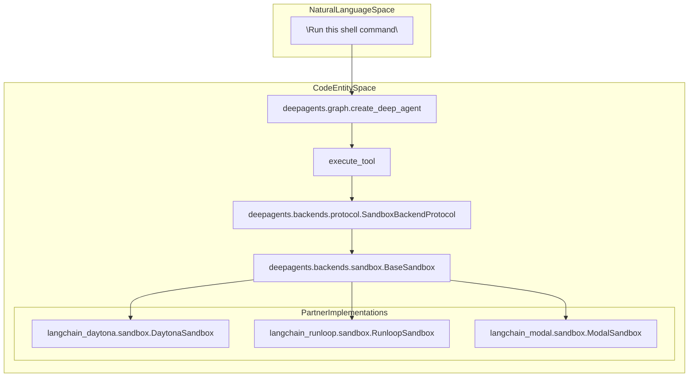
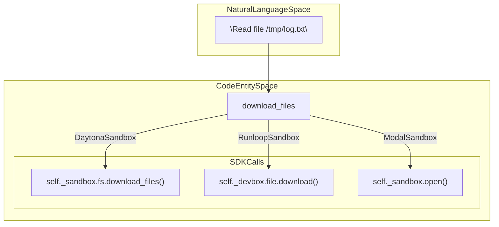

# Remote Sandbox Providers

<details>
<summary>Relevant source files</summary>

The following files were used as context for generating this wiki page:

- [libs/partners/daytona/LICENSE](libs/partners/daytona/LICENSE)
- [libs/partners/daytona/README.md](libs/partners/daytona/README.md)
- [libs/partners/daytona/langchain_daytona/__init__.py](libs/partners/daytona/langchain_daytona/__init__.py)
- [libs/partners/daytona/langchain_daytona/sandbox.py](libs/partners/daytona/langchain_daytona/sandbox.py)
- [libs/partners/daytona/pyproject.toml](libs/partners/daytona/pyproject.toml)
- [libs/partners/daytona/tests/__init__.py](libs/partners/daytona/tests/__init__.py)
- [libs/partners/daytona/tests/test_import.py](libs/partners/daytona/tests/test_import.py)
- [libs/partners/daytona/tests/unit_tests/__init__.py](libs/partners/daytona/tests/unit_tests/__init__.py)
- [libs/partners/daytona/tests/unit_tests/test_import.py](libs/partners/daytona/tests/unit_tests/test_import.py)
- [libs/partners/modal/LICENSE](libs/partners/modal/LICENSE)
- [libs/partners/modal/README.md](libs/partners/modal/README.md)
- [libs/partners/modal/langchain_modal/sandbox.py](libs/partners/modal/langchain_modal/sandbox.py)
- [libs/partners/modal/pyproject.toml](libs/partners/modal/pyproject.toml)
- [libs/partners/runloop/README.md](libs/partners/runloop/README.md)
- [libs/partners/runloop/langchain_runloop/__init__.py](libs/partners/runloop/langchain_runloop/__init__.py)
- [libs/partners/runloop/langchain_runloop/sandbox.py](libs/partners/runloop/langchain_runloop/sandbox.py)
- [libs/partners/runloop/pyproject.toml](libs/partners/runloop/pyproject.toml)
- [libs/partners/runloop/tests/unit_tests/test_import.py](libs/partners/runloop/tests/unit_tests/test_import.py)
- [libs/partners/vercel/uv.lock](libs/partners/vercel/uv.lock)

</details>


## Purpose and Scope

This page documents the remote sandbox execution providers available for Deep Agents. These providers enable agents to execute code and file operations in isolated, remote environments instead of the local machine. This includes dedicated partner packages for **Daytona**, **Modal**, **Runloop**, and specialized **QuickJS** or **Vercel** sandboxes.

For information about the backend protocol specification, see [7.4 Backend Protocol](). For details on how the CLI integrates sandboxes during agent creation, see [3.8 Agent Creation (create_cli_agent)]().

Sources: [libs/partners/daytona/pyproject.toml:6-7](), [libs/partners/modal/pyproject.toml:6-7](), [libs/partners/runloop/pyproject.toml:6-7]()

## Overview

Deep Agents supports several remote sandbox and interpreter providers through dedicated partner packages. These packages implement the `SandboxBackendProtocol` or provide specific middleware to extend agent capabilities.

| Package                | Purpose                       | Key Entity                                                        |
|------------------------|-------------------------------|-------------------------------------------------------------------|
| `langchain-daytona`    | Development environment sandboxes | `DaytonaSandbox` [libs/partners/daytona/langchain_daytona/sandbox.py:23]()              |
| `langchain-modal`      | Serverless container execution    | `ModalSandbox` [libs/partners/modal/langchain_modal/sandbox.py:16]()                      |
| `langchain-runloop`    | API-based sandbox execution        | `RunloopSandbox` [libs/partners/runloop/langchain_runloop/sandbox.py:18]()               |
| `langchain-vercel-sandbox` | Vercel-hosted sandboxes       | `VercelSandbox` (referenced in [libs/partners/vercel/uv.lock:12]())                     |
| `langchain-quickjs`    | In-process JavaScript REPL         | `ReplMiddleware` (via `deepagents[quickjs]`)                                             |

Sources: [libs/partners/daytona/pyproject.toml:6-7](), [libs/partners/modal/pyproject.toml:6-7](), [libs/partners/runloop/pyproject.toml:6-7](), [libs/partners/daytona/langchain_daytona/sandbox.py:23-28](), [libs/partners/vercel/uv.lock:12]()

## Architecture: Natural Language to Code Entity Space

The following diagrams illustrate how natural language concepts map to specific code entities within the partner integrations, bridging natural language intent to concrete execution classes and methods.

### Sandbox Execution Flow

This diagram shows how a request to "execute code" travels from the agent through the partner-specific sandbox implementations and the common protocol interfaces.



Sources: [libs/partners/daytona/langchain_daytona/sandbox.py:23-28](), [libs/partners/runloop/langchain_runloop/sandbox.py:18-19](), [libs/partners/modal/langchain_modal/sandbox.py:16-17]()

### Filesystem Operation Mapping

This diagram maps filesystem requests to the underlying partner SDK calls implemented by each sandbox provider.



Sources: [libs/partners/daytona/langchain_daytona/sandbox.py:153](), [libs/partners/runloop/langchain_runloop/sandbox.py:66](), [libs/partners/modal/langchain_modal/sandbox.py:32]()

## Daytona Integration (`langchain-daytona`)

The `langchain-daytona` package provides a sandbox implementation that wraps an existing Daytona sandbox instance belonging to a development environment.

### Implementation Details

The `DaytonaSandbox` class inherits from `BaseSandbox` and implements the critical `execute` method by creating and polling command sessions within the Daytona environment.

- **Session Management**: A unique UUID-based session is created for every execution using `self._sandbox.process.create_session(session_id)` to isolate command runs safely [libs/partners/daytona/langchain_daytona/sandbox.py:93-94]().
- **Polling Strategy**: The command completion is polled continuously with a configurable `sync_polling_interval` (either a fixed float delay or a callable returning delay based on elapsed time) [libs/partners/daytona/langchain_daytona/sandbox.py:35-59]().
- **File Operations**: Standard file operations are inherited from `BaseSandbox`; however, the `download_files` and `upload_files` methods are overridden to leverage Daytona's filesystem API for batch file transfers [libs/partners/daytona/langchain_daytona/sandbox.py:153-184]().

### Key Class: `DaytonaSandbox`

| Method            | Description                                                                            |
|-------------------|----------------------------------------------------------------------------------------|
| `execute`         | Runs a shell command via session logs with synchronous polling [libs/partners/daytona/langchain_daytona/sandbox.py:66-84]() |
| `download_files`  | Downloads multiple files from the Daytona sandbox filesystem API [libs/partners/daytona/langchain_daytona/sandbox.py:136-184]() |
| `upload_files`    | Uploads files in batch to the sandbox filesystem [libs/partners/daytona/langchain_daytona/sandbox.py:186-194]()                |

Example usage snippet from the package README:

```python
from daytona import Daytona
from langchain_daytona import DaytonaSandbox

sandbox = Daytona().create()
backend = DaytonaSandbox(
    sandbox=sandbox,
    timeout=300,
    sync_polling_interval=0.25,
)
result = backend.execute("echo hello")
print(result.output)
```

Sources: [libs/partners/daytona/langchain_daytona/sandbox.py:23-194](), [libs/partners/daytona/README.md:16-28]()

## Runloop Integration (`langchain-runloop`)

This package provides integration with Runloop's API to manage ephemeral development containers called "devboxes," suitable for orchestrated, API-driven sandbox executions.

### Implementation Details

- **Blueprint Bootstrapping**: Supports starting devboxes based on named blueprints (snapshots) using `provider.get_or_create(snapshot="my-blueprint")` for repeatable environments [libs/partners/runloop/README.md:32-35]().
- **Lifecycle Management**: The provider supports sandbox provisioning and cleanup with explicit deletion via `provider.delete(sandbox_id=sandbox.id)` [libs/partners/runloop/README.md:22-29]().
- **Execution**: Commands execute on the remote devbox via `self._devbox.cmd.exec`, with output including both stdout and stderr merged [libs/partners/runloop/langchain_runloop/sandbox.py:36-60]().

### Key Class: `RunloopSandbox`

| Method           | Description                                                                    |
|------------------|--------------------------------------------------------------------------------|
| `execute`        | Executes shell commands on the devbox and collects output and exit code [libs/partners/runloop/langchain_runloop/sandbox.py:36-60]() |
| `download_files` | Downloads files from the devbox using the SDK's file API [libs/partners/runloop/langchain_runloop/sandbox.py:62-70]()                |
| `upload_files`   | Uploads files to the devbox [libs/partners/runloop/langchain_runloop/sandbox.py:72-78]()                                            |

Example usage snippet from the package README:

```python
import os
from langchain_runloop import RunloopProvider

api_key = os.environ["RUNLOOP_API_KEY"]
provider = RunloopProvider(api_key=api_key)

sandbox = provider.get_or_create()
try:
    result = sandbox.execute("echo hello")
    print(result.output)
finally:
    provider.delete(sandbox_id=sandbox.id)
```

Sources: [libs/partners/runloop/README.md:1-43](), [libs/partners/runloop/langchain_runloop/sandbox.py:18-78]()

## Modal Integration (`langchain-modal`)

This package integrates with Modal’s serverless execution environment allowing ephemeral and scalable container-based sandbox execution.

### Implementation Details

- **Command Execution**: Uses `self._sandbox.exec("bash", "-c", command)` to run shell commands inside the container, waiting synchronously for completion [libs/partners/modal/langchain_modal/sandbox.py:91-99]().
- **File Access**: Implements `_read_file` and `_write_file` by opening files in the Modal sandbox, supporting binary reading/writing and correctly handling errors like missing files or permission issues [libs/partners/modal/langchain_modal/sandbox.py:24-69]().
- **Sandbox ID**: Exposes the sandbox identifier via `self._sandbox.object_id` [libs/partners/modal/langchain_modal/sandbox.py:71-73]().

Example usage snippet from the package README:

```python
import modal
from langchain_modal import ModalSandbox

sandbox = ModalSandbox(modal.Sandbox.create(app=modal.App.lookup("your-app")))
result = sandbox.execute("echo hello")
print(result.output)
```

Sources: [libs/partners/modal/pyproject.toml:1-48](), [libs/partners/modal/langchain_modal/sandbox.py:16-113]()

## Vercel Sandbox Integration (`langchain-vercel-sandbox`)

The `langchain-vercel-sandbox` package integrates with Vercel sandbox infrastructure to provide remote execution contexts hosted on Vercel.

- The package requires the `deepagents` SDK at version 0.7.x [libs/partners/vercel/uv.lock:12-36]() and uses dependencies like `anyio`, `httpx`, and `pydantic` for network and data handling.
- While implementation specifics lie in the package codebase, it exposes a provider conforming to the sandbox backend protocol, allowing it to be plugged into Deep Agents' backend abstraction.

Sources: [libs/partners/vercel/uv.lock:1-80]()

## Comparison of Provider Capabilities

| Feature                | Daytona                                    | Runloop                                   | Modal                                         |
|------------------------|--------------------------------------------|-------------------------------------------|-----------------------------------------------|
| **Environment**        | Remote Dev Environment                      | Ephemeral Devbox                          | Serverless Container                          |
| **Execution Method**   | Session-based command execution with polling | Direct SDK exec                           | Container exec (`sandbox.exec`)                |
| **Default Timeout**    | 30 minutes [libs/partners/daytona/langchain_daytona/sandbox.py:34]() | 30 minutes [libs/partners/runloop/langchain_runloop/sandbox.py:29]() | 30 minutes [libs/partners/modal/langchain_modal/sandbox.py:22]() |
| **File Access**        | Batch FS API for downloads/uploads         | SDK File API for downloads/uploads       | File-like objects opened via sandbox.open()   |
| **Blueprint Support**  | None                                       | Yes [libs/partners/runloop/README.md:35]() | None                                          |

Sources: [libs/partners/daytona/langchain_daytona/sandbox.py:34-153](), [libs/partners/runloop/langchain_runloop/sandbox.py:29-66](), [libs/partners/runloop/README.md:32-35]()

## Testing and Validation

The Deep Agents monorepo enforces quality and compatibility across remote provider packages, aligned to maintain consistent support for Python versions 3.11 through 3.14.

- **Python Version Support**: The partner libraries specify Python >=3.11,<4.0 and test against latest minor versions 3.11-3.14 [libs/partners/daytona/pyproject.toml:15-18](), [libs/partners/runloop/pyproject.toml:15-18](), [libs/partners/modal/pyproject.toml:15-18]().
- **Linting and Type Checking**: Use `ruff` for linting and `ty` for rigorous type checking, ensuring compliance and consistency across codebases [libs/partners/daytona/pyproject.toml:45-46](), [libs/partners/runloop/pyproject.toml:46-47](), [libs/partners/modal/pyproject.toml:45-46]().
- **Asynchronous Support**: Test dependencies include `pytest-asyncio` to enable async testing scenarios, accommodating current synchronous implementations and future async improvements [libs/partners/daytona/pyproject.toml:44](), [libs/partners/runloop/pyproject.toml:45]().
- **CI Coverage**: These packages have comprehensive unit and integration tests validating interface conformance and functional behaviors.

Sources: [libs/partners/daytona/pyproject.toml:15-46](), [libs/partners/runloop/pyproject.toml:15-47](), [libs/partners/modal/pyproject.toml:15-47]()

---

This page summarizes the key partner sandbox integrations enabling remote, isolated execution environments for Deep Agents, highlighting design, implementation, and usage patterns to facilitate developer understanding and contribution.