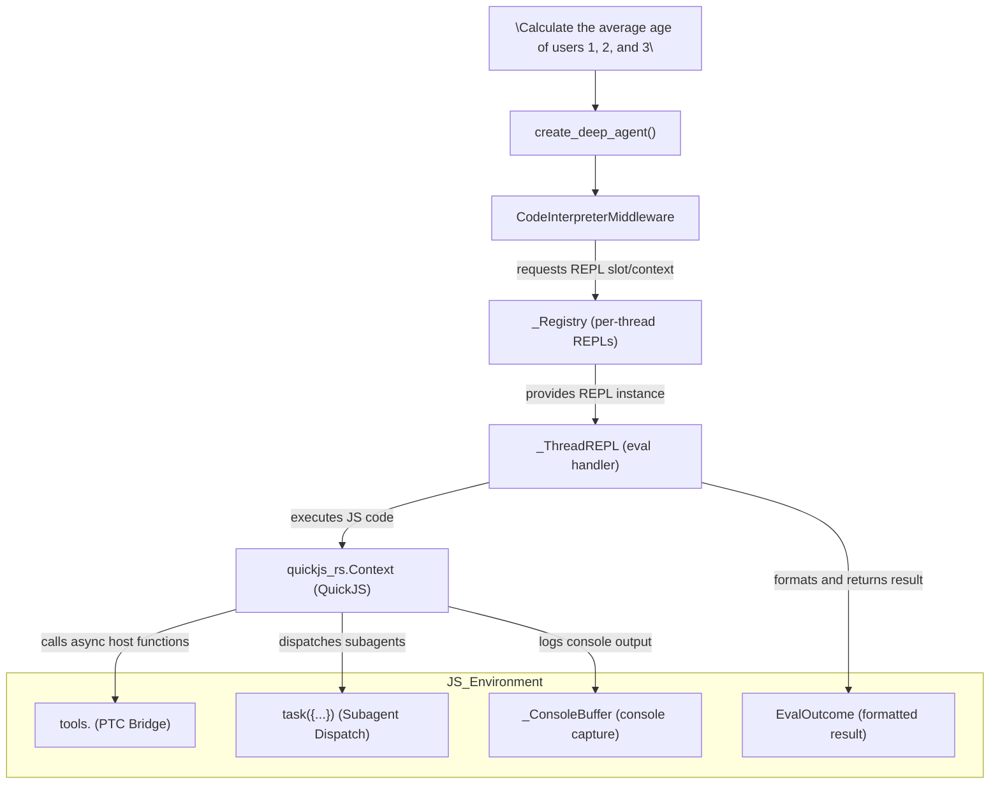

# REPL Middleware (langchain-repl / langchain-quickjs)

<details>
<summary>Relevant source files</summary>

The following files were used as context for generating this wiki page:

- [libs/deepagents/tests/unit_tests/test_timing.py](libs/deepagents/tests/unit_tests/test_timing.py)
- [libs/partners/quickjs/README.md](libs/partners/quickjs/README.md)
- [libs/partners/quickjs/langchain_quickjs/_format.py](libs/partners/quickjs/langchain_quickjs/_format.py)
- [libs/partners/quickjs/langchain_quickjs/_prompt.py](libs/partners/quickjs/langchain_quickjs/_prompt.py)
- [libs/partners/quickjs/langchain_quickjs/_ptc.py](libs/partners/quickjs/langchain_quickjs/_ptc.py)
- [libs/partners/quickjs/langchain_quickjs/_repl.py](libs/partners/quickjs/langchain_quickjs/_repl.py)
- [libs/partners/quickjs/langchain_quickjs/middleware.py](libs/partners/quickjs/langchain_quickjs/middleware.py)
- [libs/partners/quickjs/pyproject.toml](libs/partners/quickjs/pyproject.toml)
- [libs/partners/quickjs/tests/unit_tests/smoke_tests/snapshots/quickjs_system_prompt_mixed_foreign_functions.md](libs/partners/quickjs/tests/unit_tests/smoke_tests/snapshots/quickjs_system_prompt_mixed_foreign_functions.md)
- [libs/partners/quickjs/tests/unit_tests/smoke_tests/snapshots/quickjs_system_prompt_mixed_foreign_functions_call.md](libs/partners/quickjs/tests/unit_tests/smoke_tests/snapshots/quickjs_system_prompt_mixed_foreign_functions_call.md)
- [libs/partners/quickjs/tests/unit_tests/smoke_tests/snapshots/quickjs_system_prompt_mixed_foreign_functions_turn.md](libs/partners/quickjs/tests/unit_tests/smoke_tests/snapshots/quickjs_system_prompt_mixed_foreign_functions_turn.md)
- [libs/partners/quickjs/tests/unit_tests/smoke_tests/snapshots/quickjs_system_prompt_no_tools.md](libs/partners/quickjs/tests/unit_tests/smoke_tests/snapshots/quickjs_system_prompt_no_tools.md)
- [libs/partners/quickjs/tests/unit_tests/smoke_tests/snapshots/quickjs_system_prompt_no_tools_call.md](libs/partners/quickjs/tests/unit_tests/smoke_tests/snapshots/quickjs_system_prompt_no_tools_call.md)
- [libs/partners/quickjs/tests/unit_tests/smoke_tests/snapshots/quickjs_system_prompt_no_tools_turn.md](libs/partners/quickjs/tests/unit_tests/smoke_tests/snapshots/quickjs_system_prompt_no_tools_turn.md)
- [libs/partners/quickjs/tests/unit_tests/smoke_tests/test_system_prompt.py](libs/partners/quickjs/tests/unit_tests/smoke_tests/test_system_prompt.py)
- [libs/partners/quickjs/tests/unit_tests/test_end_to_end.py](libs/partners/quickjs/tests/unit_tests/test_end_to_end.py)
- [libs/partners/quickjs/tests/unit_tests/test_end_to_end_async.py](libs/partners/quickjs/tests/unit_tests/test_end_to_end_async.py)
- [libs/partners/quickjs/tests/unit_tests/test_prompt_modes.py](libs/partners/quickjs/tests/unit_tests/test_prompt_modes.py)
- [libs/partners/quickjs/tests/unit_tests/test_ptc.py](libs/partners/quickjs/tests/unit_tests/test_ptc.py)
- [libs/partners/quickjs/tests/unit_tests/test_repl_middleware.py](libs/partners/quickjs/tests/unit_tests/test_repl_middleware.py)
- [libs/partners/quickjs/tests/unit_tests/test_thread_affinity.py](libs/partners/quickjs/tests/unit_tests/test_thread_affinity.py)

</details>


The `langchain-quickjs` package integrates a fast, embedded QuickJS JavaScript interpreter into Deep Agents, exposing a persistent, sandboxed JavaScript REPL as middleware. This enables agents to evaluate arbitrary JavaScript securely and efficiently, persist state across turns, orchestrate parallel tool invocations, and dispatch subagents—all within a single REPL environment. This capability significantly reduces the number of LLM round-trips and empowers more complex, programmatic workflows.

It is offered as an optional dependency of the core SDK under `deepagents[quickjs]` [libs/partners/quickjs/pyproject.toml:25-32]().

---

## Overview and Purpose

The primary goal of `langchain-quickjs` is to provide a persistent, sandboxed JavaScript interpreter available as a tool within an agent's middleware stack. Instead of multiple separate tool calls, the agent can write one block of JavaScript code that manipulates data, calls tools programmatically using asynchronous promises, and dispatches configured subagents via a `task` function exposed inside the REPL.

### Key Features

- **Embedded QuickJS Interpreter**: Provides a PyO3-wrapped QuickJS runtime with managed worker threads for concurrency and scalability.
- **Persistence Modes**: Supports state persistence across tool calls and turns via QuickJS heap snapshots (`thread`, `turn`, `call` modes).
- **Sandboxed Environment**: No filesystem, network, or real clock access unless injected explicitly via programmatic tool calling (PTC).
- **Console Capture**: Buffers all `console.log/warn/error` output and returns it alongside evaluation results.
- **Programmatic Tool Calling (PTC)**: Async JavaScript calls to LangChain tools exposed under a `tools` global namespace.
- **Subagent Dispatch**: A top-level `task()` function exposed for spawning full subagent runs from inside the REPL.
- **Safety and Resource Limits**: Configurable memory limits (default 64MB), per-eval timeouts (default 5s), and PTC call budgets.
- **Snapshots and Persistence**: Secure snapshot serialization and replay with HMAC signing to persist REPL state across agent turns.

---

## Natural Language to Code Entity Mapping

The following diagram maps how a natural language instruction progresses through Deep Agents to becoming a JavaScript evaluation inside the QuickJS runtime, highlighting the key code entities and their responsibilities.



Sources:  
[libs/partners/quickjs/langchain_quickjs/middleware.py:130-135](),  
[libs/partners/quickjs/langchain_quickjs/_repl.py:73-88](),  
[libs/partners/quickjs/langchain_quickjs/_repl.py:146-153](),  
[libs/partners/quickjs/langchain_quickjs/_repl.py:44-47]()

---

## CodeInterpreterMiddleware, Snapshots, and Persistence

The `CodeInterpreterMiddleware` class is the centerpiece providing the `eval` tool. It manages a per-LangGraph thread QuickJS slot comprising a worker thread, runtime, and context. This slot persists state between calls depending on persistence mode, ensuring isolation between conversations.

### State Management

The middleware maintains a `REPLState` schema storing:

- `_quickjs_slot_id`: A private unique identifier for the QuickJS slot ([libs/partners/quickjs/langchain_quickjs/middleware.py:65-76]())
- `_quickjs_snapshot_payload`: Serialized QuickJS runtime heap snapshot bytes, compressed and encoded with a chain replay algorithm ([libs/partners/quickjs/langchain_quickjs/middleware.py:45-51]())
- `_quickjs_snapshot_hmac`: HMAC signature bytes ensuring snapshot integrity ([libs/partners/quickjs/langchain_quickjs/middleware.py:45-51]())

### Persistence Modes

The middleware supports three modes:

| Mode       | Description                                                                                         | Default                |
|------------|-------------------------------------------------------------------------------------------------|------------------------|
| `thread`   | State persists across calls **and** multiple turns in the same conversation thread.              | Recommended default    |
| `turn`     | State persists only within a single turn's calls, snapshot replayed between turns.               |                        |
| `call`     | A fresh QuickJS context runs each call with no persistence.                                      |                        |

The mode is normalized and validated internally ([libs/partners/quickjs/langchain_quickjs/middleware.py:90-105]()).

---

## Programmatic Tool Calling (PTC)

PTC allows JavaScript code running inside the REPL to directly invoke any configured LangChain tool asynchronously. Tools are exposed under the global `tools` object with camelCased names.

### Configuration and Tool Exposure

The middleware constructor accepts a `ptc` argument, a list of tools or tool names selectively exposed inside the REPL. The middleware uses `filter_tools_for_ptc()` to remove the `eval` tool itself and ensure no recursion ([libs/partners/quickjs/langchain_quickjs/middleware.py:182-183](), [libs/partners/quickjs/langchain_quickjs/_ptc.py:40-42]()).

### Data Marshaling and Invocation

- **Input Marshaling**: JavaScript input objects passed to `tools.foo()` calls are recursively stripped of `undefined` values so Python tool defaults can apply ([libs/partners/quickjs/langchain_quickjs/_repl.py:194-212]()).
- **Invocation**: The call is dispatched to LangChain tools with support for `ToolRuntime` injection, propagating runtime context such as thread ID ([libs/partners/quickjs/langchain_quickjs/_repl.py:125-127]()).
- **Output Marshaling**: Python return types (`list`, `dict`, `int`) are converted back to native JavaScript types transparently ([libs/partners/quickjs/tests/unit_tests/test_end_to_end.py:201-208]()).

### PTC Call Budget

To prevent denial-of-service attacks, the middleware enforces a maximum number of PTC calls per `eval` call (default 256). Exceeding this limit raises a `PTCCallBudgetExceeded` error surfaced back to the JavaScript code ([libs/partners/quickjs/langchain_quickjs/_repl.py:96-109]()).

---

## Subagent Dispatch (`task`)

If the host agent defines a `task` tool (via `SubAgentMiddleware`), the middleware exposes a JavaScript `task()` function that asynchronously dispatches configured subagents with full agentic behavior.

### Subagent Execution Model

- `task()` runs a full agent loop with the provided `description` prompt.
- Supports optional `responseSchema` for JSON Schema-based structured output.
- Each dispatch runs in isolation; subagents are stateless and receive locators, not large payloads ([libs/partners/quickjs/langchain_quickjs/_prompt.py:32-107](), [libs/partners/quickjs/langchain_quickjs/_subagent.py:44-47]()).
- Parent-level HITL (human-in-the-loop) approval is not triggered per subagent dispatch since these dispatches occur inside an already-approved `eval`.

### Concurrency Control

The REPL imposes a configured limit (default 32) on concurrent subagent dispatches. Calls beyond this wait for available capacity before proceeding ([libs/partners/quickjs/langchain_quickjs/_repl.py:57-58]()).

---

## Prompt Modes and System Prompt Assembly

The middleware dynamically generates system prompt snippets describing the REPL environment, persistence, safety boundaries, and usage of `task()` and PTC features using helper render functions:

- `render_repl_system_prompt`: Describes REPL sandbox, persistence, memory, timeout ([libs/partners/quickjs/langchain_quickjs/_prompt.py:20-31]())
- `render_subagent_system_prompt`: Explains `task()` usage, concurrency, and approval model ([libs/partners/quickjs/langchain_quickjs/_prompt.py:32-107]())
- `render_eval_tool_code_doc` and `render_eval_tool_description`: Tool metadata for model consumption ([libs/partners/quickjs/langchain_quickjs/_prompt.py:34-36]())

Snapshot and smoke tests verify system prompt stability across configurations [libs/partners/quickjs/tests/unit_tests/smoke_tests/test_system_prompt.py]().

---

## Execution Model, Safety, and Benchmarks

### Worker Thread Model

The QuickJS runtime executes JavaScript on dedicated worker threads (`quickjs_rs.ThreadWorker`) to avoid blocking the main Python event loop and improve concurrency [libs/partners/quickjs/langchain_quickjs/_repl.py:38]().

### Error Handling and Output Formatting

Errors from QuickJS evaluation produce detailed `EvalOutcome` objects with the following notable error types formatted as XML-like blocks returned to the LLM:

| Error Type           | Description                                              |
|----------------------|----------------------------------------------------------|
| `Timeout`            | Execution time exceeded the configured timeout (default 5s) [libs/partners/quickjs/langchain_quickjs/_repl.py:41]() |
| `OutOfMemory`        | QuickJS heap memory exceeded allowed limit (default 64 MB) [libs/partners/quickjs/langchain_quickjs/_repl.py:34]() |
| `PTCCallBudgetExceeded` | Too many PTC calls in one eval [libs/partners/quickjs/langchain_quickjs/_repl.py:96-109]()    |
| `Deadlock`           | An unresolved top-level promise detected, indicating deadlock [libs/partners/quickjs/langchain_quickjs/_repl.py:30]()|

### Console Capture

The `_ConsoleBuffer` intercepts and accumulates all `console.log/warn/error` calls, returning this output as a separate `<stdout>` block alongside the result. Both output and logs are truncated to a configurable maximum (default 4000 characters) ([libs/partners/quickjs/langchain_quickjs/_repl.py:152-186](), [libs/partners/quickjs/langchain_quickjs/middleware.py:147-150]()).

### Benchmarking

Integrated `pytest-benchmark` and CodSpeed memory benchmarks measure throughput, heap allocation, and GC overhead for the QuickJS interpreter under load in `tests/benchmarks` ([libs/partners/quickjs/pyproject.toml:47-48]()).

---

## Summary Table of Core Classes and Functions

| Class / Function                | Role / Description                                                                         | Location                                      |
|-------------------------------|--------------------------------------------------------------------------------------------|-----------------------------------------------|
| `CodeInterpreterMiddleware`   | Middleware exposing persistent JS REPL as a tool, handles snapshots, PTC, and subagents.  | `langchain_quickjs/middleware.py:113-179`    |
| `REPLState`                   | Private state schema holding QuickJS slot IDs and snapshots for persistence.               | `langchain_quickjs/middleware.py:65-76`      |
| `_Registry`                   | Manages per-thread keyed QuickJS REPL instances (slots/workers/runtimes).                 | `langchain_quickjs/_repl.py:70-80`            |
| `_ThreadREPL`                 | Represents a per-thread REPL runtime instance, handles eval and bridges with host.         | `langchain_quickjs/_repl.py:81-350`          |
| `_ConsoleBuffer`              | Buffers console log output to send alongside eval results.                                 | `langchain_quickjs/_repl.py:159-193`         |
| `filter_tools_for_ptc`        | Filters agent tools exposed for programmatic calling to exclude unsafe tools like `eval`. | `langchain_quickjs/_ptc.py`                   |
| `render_repl_system_prompt`   | Renders system prompt describing the REPL for the LLM.                                    | `langchain_quickjs/_prompt.py`                |
| `render_subagent_system_prompt`| Renders system prompt snippet for subagent dispatch API usage.                           | `langchain_quickjs/_prompt.py`                |

---

# Additional Diagram: Natural Language Space to REPL Middleware Code Entities

```mermaid
graph TD
    NL["User Input: \"Analyze file for SQL injection risks\""]

    Agent["create_deep_agent()"]
    Middleware["CodeInterpreterMiddleware"]
    State["REPLState: slot ID & snapshots"]
    Registry["_Registry: managed REPL instances"]
    REPL["_ThreadREPL: context, eval, console"]
    QJS["quickjs_rs.Context: JS runtime"]

    PTCBridge["Programmatic Tool Calling: `tools.*` async functions"]
    SubagentTask["`task({...})`: subagent dispatch"]
    ConsoleBuffer["_ConsoleBuffer: captures console.log output"]
    EvalResult["EvalOutcome: formatted result & error"]

    NL --> Agent
    Agent --> Middleware
    Middleware --> State
    Middleware --> Registry
    Registry --> REPL
    REPL --> QJS
    QJS --> PTCBridge
    QJS --> SubagentTask
    QJS --> ConsoleBuffer
    REPL --> EvalResult
```

---

# Summary

The `langchain-quickjs` REPL middleware package integrates a persistent, sandboxed QuickJS JavaScript runtime directly into Deep Agents via the `CodeInterpreterMiddleware`. It enables complex orchestration of LangChain tools asynchronously via PTC from inside JavaScript, dispatches concurrent subagents with the `task()` primitive, and carefully manages persistence through efficient signed snapshots. The embedded interpreter runs safely in worker threads with strict resource budgets and console output capture. Prompt engineering support ensures the runtime semantics are clearly communicated to the model for robust execution.

This powerful middleware optimizes multi-step workflows by consolidating stateful logic and tool invocations into single turns, combating LLM round-trip overheads, enabling advanced concurrency, and unlocking sophisticated agent programmatic capabilities.

---

### Sources

- libs/partners/quickjs/pyproject.toml:25-32  
- libs/partners/quickjs/langchain_quickjs/middleware.py:62-76, 113-179  
- libs/partners/quickjs/langchain_quickjs/_repl.py:1-212  
- libs/partners/quickjs/langchain_quickjs/_ptc.py  
- libs/partners/quickjs/langchain_quickjs/_prompt.py  
- libs/partners/quickjs/tests/unit_tests/smoke_tests/test_system_prompt.py  
- libs/partners/quickjs/tests/unit_tests/test_end_to_end.py  
- libs/partners/quickjs/tests/unit_tests/test_ptc.py