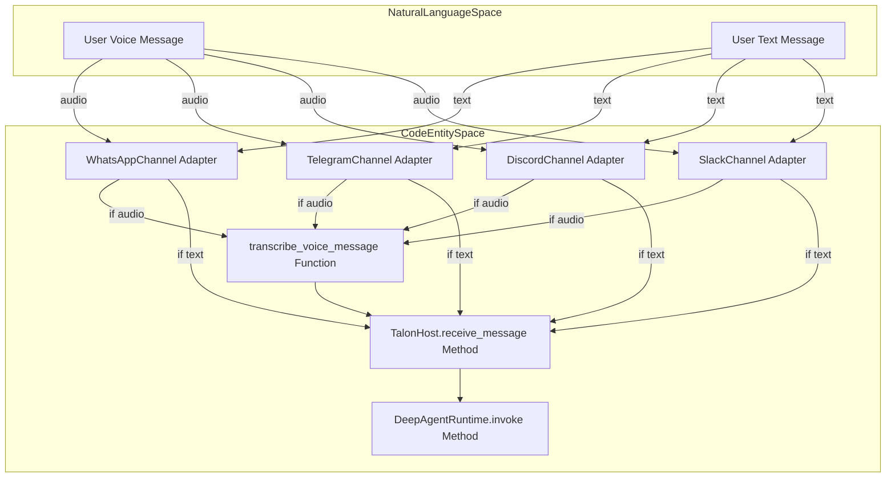
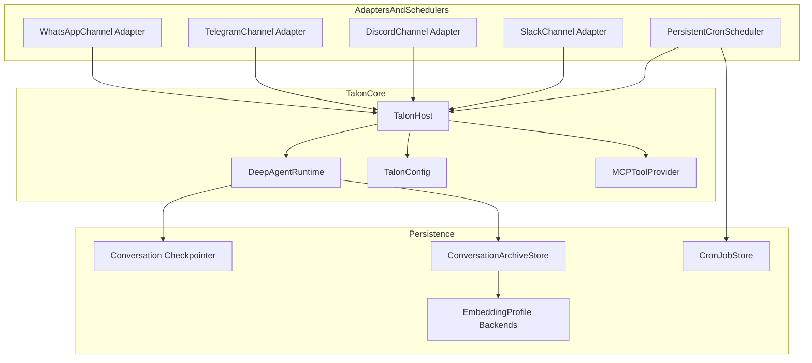

# Talon Runtime Host

Relevant source files

The following files were used as context for generating this wiki page:

- [libs/talon/README.md](libs/talon/README.md)
- [libs/talon/deepagents_talon/__main__.py](libs/talon/deepagents_talon/__main__.py)
- [libs/talon/deepagents_talon/config.py](libs/talon/deepagents_talon/config.py)
- [libs/talon/deepagents_talon/host.py](libs/talon/deepagents_talon/host.py)
- [libs/talon/deepagents_talon/interfaces.py](libs/talon/deepagents_talon/interfaces.py)
- [libs/talon/deepagents_talon/model_selection.py](libs/talon/deepagents_talon/model_selection.py)
- [libs/talon/deepagents_talon/runtime.py](libs/talon/deepagents_talon/runtime.py)
- [libs/talon/tests/test_host.py](libs/talon/tests/test_host.py)
- [libs/talon/tests/test_runtime.py](libs/talon/tests/test_runtime.py)
- [libs/talon/tests/unit_tests/test_model_selection.py](libs/talon/tests/unit_tests/test_model_selection.py)
- [openwiki/.claims/integrations/talon.json](openwiki/.claims/integrations/talon.json)
- [openwiki/integrations/talon.md](openwiki/integrations/talon.md)

The `deepagents-talon` package provides an experimental, long-running runtime host designed for persistent AI agents [libs/talon/README.md:1-16](). Unlike the interactive `deepagents-code` terminal UI, Talon is built for background execution, persistent cron scheduling, and multi-channel communication via adapters like WhatsApp, Telegram, Discord, and Slack [libs/talon/README.md:3-16](). It acts as an integration bridge between the Deep Agents core SDK and asynchronous external event sources, owning the lifecycle of channel adapters, subagents, and cron schedulers all within a single event loop [libs/talon/deepagents_talon/host.py:1-5]().

Because Talon is a parent component, this page provides a high-level architectural overview. Detailed documentation is organized into the following child pages:

- For host process lifecycle management, runtime initialization, background tasks, runtime configuration, subagent handling, MCP tool loading and OAuth, and cron persistent scheduling, see [Talon Host Runtime and Configuration](#5.5.1).
- For channel adapters including WhatsApp (Node.js bridge and QR pairing), Telegram, Discord, Slack, commands, voice transcription and speech processing, and exposure modes, see [Talon Channel Adapters](#5.5.2).
- For conversation history persistence, history adapter abstraction, backend drivers, embeddings, archive search, and vector store integration, see [Talon History, Embeddings and Archive Storage](#5.5.3).

---

## High-Level Architecture and Host Lifecycle

Talon orchestrates diverse asynchronous subsystems within a unified event-driven host process [libs/talon/README.md:3-4](). The central runtime component is the `TalonHost` class, which manages the process lifecycle, per-conversation concurrency serialization, cancellation, and graceful shutdown [libs/talon/deepagents_talon/host.py:120-160]().

On startup, the Talon CLI bootstraps configuration using `TalonConfig`, which reads environment variables and prepares a stable, secure working directory hierarchy under `~/.deepagents/<assistant_id>/` for agent state, manifests, sessions, cron jobs, and channel sessions [libs/talon/deepagents_talon/__main__.py:70-130](), [libs/talon/deepagents_talon/config.py:40-132](). Talon then starts a `DeepAgentRuntime` instance that integrates the Deep Agents core stack for language model-driven agent invocation, tool invocation, memory handling, and middleware composition [libs/talon/deepagents_talon/runtime.py:20-61]().

The host connects channel adapters that receive inbound messages from external platforms and deliver outbound responses. These adapters support text and voice media, with automatic voice transcription pipelines for audio messages [libs/talon/deepagents_talon/speech.py:20-75](), and they convert platform-specific messages into normalized `ChannelMessage` events for processing.

**Message Flow: Natural Language to Code Entity**

Incoming messages from users on various platforms are normalized into internal events by channel adapters. Audio messages undergo transcription before reaching the Talon host's `receive_message` method, which dispatches them to the `DeepAgentRuntime` `invoke` method to invoke the AI agent logic and generate responses.

---

## Subsystem Overview

Talon's architecture is modular, encompassing several core subsystems, each covered in dedicated child pages:

### 1. Host Runtime and Configuration

This subsystem manages the Talon host lifecycle, including startup, graceful shutdown, and interruption/recovery of ongoing agent turns. It handles persistent storage of agent state and conversation checkpoints using LangGraph checkpointing abstractions, such as SQLite and optional PostgreSQL or MongoDB backends. Background work delegation is managed by the `BackgroundSubagents` orchestrator, which runs asynchronous subtasks.

The persistent cron scheduler component enables scheduling of agent tasks via cron-like expressions, with job state persisted across restarts. MCP (Model-Controller-Provider) tools are dynamically loaded from JSON configuration files, supporting multiple server protocols and OAuth authentication flows. The runtime configuration (`TalonConfig`) secures assistant state directories with strict file permissions and permits sandboxed execution of agent tools using external sandbox providers [libs/talon/README.md:30-86](), [libs/talon/deepagents_talon/host.py:1-300+]().

For implementation details on the runtime loop, configuration hardening, asynchronous subagents, MCP OAuth tool loading, and cron persistent job management, see [Talon Host Runtime and Configuration](#5.5.1).

---

### 2. Channel Adapters

Talon supports multiple channel adapters that mediate communication with messaging platforms, translating inbound platform-specific messages and reactions into unified internal events, and vice versa for outbound content.

Adapters presently supported include:

- WhatsApp — backed by a loopback Node.js bridge with QR code pairing and rich media support.
- Telegram — using bot APIs for messaging and reactions.
- Discord — integrating commands and user interactions.
- Slack — supporting slash commands, message reactions, and threaded conversations.

Additional features include real-time voice transcription of audio messages, message exposure modes to restrict access or visibility, and specialized command handling within channels [libs/talon/README.md:9-12](), [libs/talon/deepagents_talon/channels/slack.py:1-80](), [libs/talon/deepagents_talon/channels/whatsapp.py:80-130]().

For comprehensive details on channel adapter protocols, bridging internals, voice transcription pipelines, and channel access control, see [Talon Channel Adapters](#5.5.2).

---

### 3. History, Embeddings and Archive Storage

Talon archives channel conversations and agent interactions into a local SQLite database (`checkpoints.sqlite`) or optionally configurable remote databases like PostgreSQL or MongoDB, enabling persistent reference, bounded paging, and search within past sessions. Conversation offloading and compacting mechanisms preserve text, tool invocations, and distinct message revisions across restarts and compaction events.

Embedding vector stores are integrated via adapter profiles, leveraging Voyage or Postgres vector backends for semantic search capabilities. The system supports archive saver modules to manage conversation exports and indexing, which the agent runtime can query and manipulate [libs/talon/README.md:34-120](), [libs/talon/deepagents_talon/archive.py:1-40]().

For full technical coverage of history adapters, embedding profiles, storage backends, and archive search tooling, see [Talon History, Embeddings and Archive Storage](#5.5.3).

---

**System Component Architecture: Talon Runtime Components**

This diagram depicts the Talon host at the center, integrating with channel adapters that ingest external events, the persistent cron scheduler managing scheduled tasks, MCP tool providers managing external resource access, and backend persistence layers for conversation history and vector embeddings supporting agent memory and search.

---

# Child Pages

- [Talon Host Runtime and Configuration](#5.5.1)  
  Covers the Talon host process lifecycle, runtime components in `runtime.py`, configuration loading and hardening in `config.py`, asynchronous and synchronous subagent handling, MCP tool loading and OAuth flows, and the cron scheduler with persistent job state.

- [Talon Channel Adapters](#5.5.2)  
  Details the channel adapter implementations, including WhatsApp's Node.js bridge, Telegram, Discord, Slack, plus commands, reactions, voice transcription, and exposure management.

- [Talon History, Embeddings and Archive Storage](#5.5.3)  
  Describes conversation history management, profile adapters, backend drivers (SQLite, PostgreSQL, MongoDB), vector stores and embedding mappings (Voyage, Postgres), archive saver logic, and mechanisms for indexed search and archive record handling.

---

# Summary

Talon is an experimental, alpha-stage local runtime host that supports long-running Deep Agents. It integrates multiple communication channels, supports persistent agent state and conversation archiving, includes a persistent cron scheduler, provides MCP tool integration with managed OAuth, and optionally runs agent tools inside remote sandboxes for isolation.

Talon acts as the orchestration boundary between external event sources (channels, schedulers) and the core Deep Agents language-model runtime, managing orchestration, concurrency, authorization, delivery, and state persistence in a secure directory structure with careful environment and configuration management.

This host bridges the world of natural language message exchanges into structured agent runtime invocations, enabling asynchronous AI workflows spanning communication platforms and scheduled background work.

---

**Sources:**  
- [libs/talon/README.md:1-96]()  
- [libs/talon/deepagents_talon/host.py:1-189]()  
- [libs/talon/deepagents_talon/runtime.py:1-205]()  
- [libs/talon/deepagents_talon/__main__.py:1-130]()  
- [libs/talon/deepagents_talon/config.py:1-132]()  
- [libs/talon/deepagents_talon/interfaces.py:1-203]()  
- [openwiki/integrations/talon.md:1-103]()