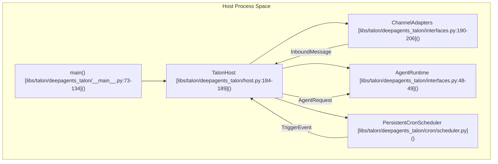
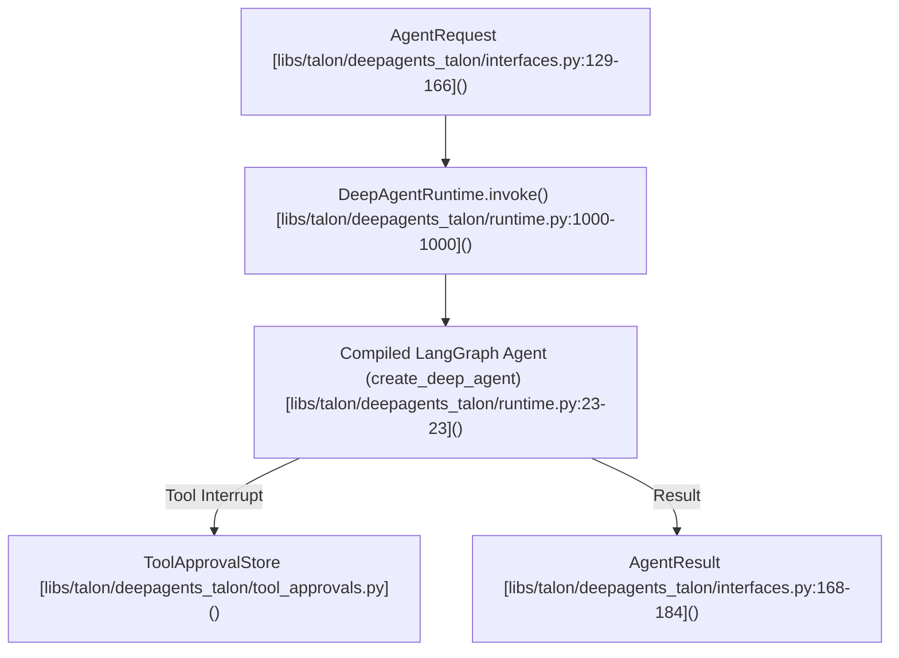
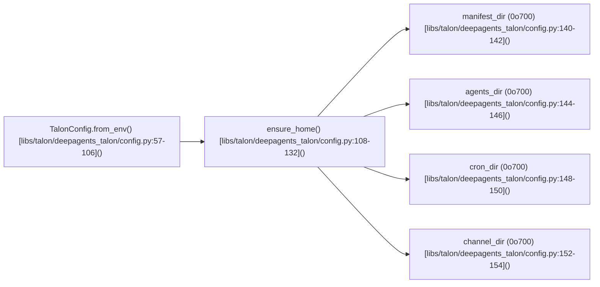
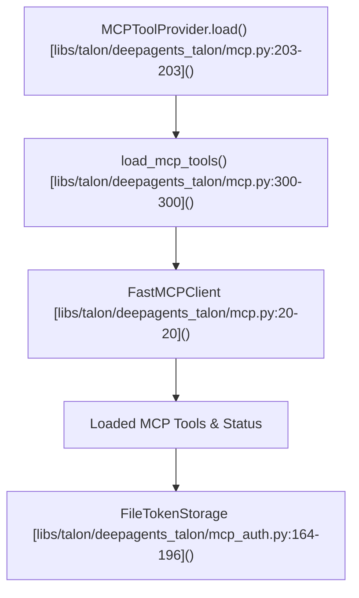

# Talon Host Runtime and Configuration

Relevant source files

The following files were used as context for generating this wiki page:

- [libs/talon/README.md](libs/talon/README.md)
- [libs/talon/deepagents_talon/__main__.py](libs/talon/deepagents_talon/__main__.py)
- [libs/talon/deepagents_talon/authorization.py](libs/talon/deepagents_talon/authorization.py)
- [libs/talon/deepagents_talon/background.py](libs/talon/deepagents_talon/background.py)
- [libs/talon/deepagents_talon/config.py](libs/talon/deepagents_talon/config.py)
- [libs/talon/deepagents_talon/cron/jobs.py](libs/talon/deepagents_talon/cron/jobs.py)
- [libs/talon/deepagents_talon/cron/tools.py](libs/talon/deepagents_talon/cron/tools.py)
- [libs/talon/deepagents_talon/defaults/AGENTS.md](libs/talon/deepagents_talon/defaults/AGENTS.md)
- [libs/talon/deepagents_talon/defaults/skills/configuration-hardening/references/hardening-model.md](libs/talon/deepagents_talon/defaults/skills/configuration-hardening/references/hardening-model.md)
- [libs/talon/deepagents_talon/host.py](libs/talon/deepagents_talon/host.py)
- [libs/talon/deepagents_talon/interfaces.py](libs/talon/deepagents_talon/interfaces.py)
- [libs/talon/deepagents_talon/mcp.py](libs/talon/deepagents_talon/mcp.py)
- [libs/talon/deepagents_talon/mcp_auth.py](libs/talon/deepagents_talon/mcp_auth.py)
- [libs/talon/deepagents_talon/mcp_config.py](libs/talon/deepagents_talon/mcp_config.py)
- [libs/talon/deepagents_talon/mcp_oauth.py](libs/talon/deepagents_talon/mcp_oauth.py)
- [libs/talon/deepagents_talon/model_selection.py](libs/talon/deepagents_talon/model_selection.py)
- [libs/talon/deepagents_talon/runtime.py](libs/talon/deepagents_talon/runtime.py)
- [libs/talon/deepagents_talon/subagents.py](libs/talon/deepagents_talon/subagents.py)
- [libs/talon/tests/cron/test_jobs.py](libs/talon/tests/cron/test_jobs.py)
- [libs/talon/tests/test_host.py](libs/talon/tests/test_host.py)
- [libs/talon/tests/test_mcp.py](libs/talon/tests/test_mcp.py)
- [libs/talon/tests/test_mcp_auth.py](libs/talon/tests/test_mcp_auth.py)
- [libs/talon/tests/test_runtime.py](libs/talon/tests/test_runtime.py)
- [libs/talon/tests/unit_tests/test_background.py](libs/talon/tests/unit_tests/test_background.py)
- [libs/talon/tests/unit_tests/test_background_runtime.py](libs/talon/tests/unit_tests/test_background_runtime.py)
- [libs/talon/tests/unit_tests/test_cron_concurrency.py](libs/talon/tests/unit_tests/test_cron_concurrency.py)
- [libs/talon/tests/unit_tests/test_cron_pinned_skills.py](libs/talon/tests/unit_tests/test_cron_pinned_skills.py)
- [libs/talon/tests/unit_tests/test_mcp_config.py](libs/talon/tests/unit_tests/test_mcp_config.py)
- [libs/talon/tests/unit_tests/test_model_selection.py](libs/talon/tests/unit_tests/test_model_selection.py)
- [libs/talon/tests/unit_tests/test_oauth_transport.py](libs/talon/tests/unit_tests/test_oauth_transport.py)
- [libs/talon/tests/unit_tests/test_research_defaults.py](libs/talon/tests/unit_tests/test_research_defaults.py)
- [libs/talon/tests/unit_tests/test_research_subagents.py](libs/talon/tests/unit_tests/test_research_subagents.py)
- [libs/talon/tests/unit_tests/test_skill_reload.py](libs/talon/tests/unit_tests/test_skill_reload.py)
- [libs/talon/tests/unit_tests/test_subagent_reload.py](libs/talon/tests/unit_tests/test_subagent_reload.py)

## Purpose and Scope

The `deepagents-talon` package provides an experimental local runtime host for long-running Deep Agents. It owns the process lifecycle for channel adapters, cron schedulers, and agent runtimes within a single unified asyncio event loop. This page documents the host architecture, process coordination, runtime execution (`runtime.py`), configuration hardening (`config.py`), subagent and asynchronous subagent execution, MCP tool loading with OAuth, and the persistent cron scheduler.

Sources: `[libs/talon/README.md:1-16]()`, `[libs/talon/deepagents_talon/host.py:1-4]()`

---

## 1. Host Process Lifecycle and Coordinator (`host.py`)

The Talon host coordinates all components—channel adapters, background workers, schedulers, and the agent runtime—within a single process lifecycle managed by `TalonHost` in `libs/talon/deepagents_talon/host.py`. 

The host handles graceful shutdown sequences, per-conversation interrupt-and-continue logic, active run cancellations (`/stop`), and channel-independent turn serialization.

### Key Host Functions and Classes
- **`TalonHost`**: Coordinates startup and tear-down of connected channels, initializes the scheduler, binds message handlers, and manages active conversation locks. `[libs/talon/deepagents_talon/host.py:184-189]()`
- **Signal Handling and Shutdown**: Captures termination signals (SIGINT, SIGTERM) to trigger graceful cancellation of pending tasks, ensuring checkpoints and state are flushed safely. `[libs/talon/deepagents_talon/host.py:22-22]()`
- **Turn Serialization**: Uses per-conversation locks (`_ConversationLock`) to serialize inbound messages, preventing race conditions when channels or cron jobs dispatch simultaneous turns for the same assistant thread. `[libs/talon/deepagents_talon/host.py:184-189]()`

Sources: `[libs/talon/deepagents_talon/host.py:1-2458]()`, `[libs/talon/deepagents_talon/__main__.py:73-134]()`

---

## 2. Runtime Architecture and Agent Execution (`runtime.py`)

The agent runtime is implemented by `DeepAgentRuntime` in `libs/talon/deepagents_talon/runtime.py`. It wraps the core SDK's `create_deep_agent` graph and manages conversation checkpointers, dynamic tool refreshing, tool approvals, and background result reclamation.

### Key Components in `runtime.py`
- **`DeepAgentRuntime`**: Manages execution state, recursion limits (`DEFAULT_RECURSION_LIMIT = 500`), and thread checkpointers (using `ConversationSaver`). `[libs/talon/deepagents_talon/runtime.py:104-104]()`, `[libs/talon/deepagents_talon/archive_saver.py]()`
- **Tool Refreshing**: Periodically re-evaluates available dynamic tools between turns when `refresh_tools` callbacks are supplied. `[libs/talon/deepagents_talon/runtime.py:166-172]()`
- **Echo Placeholder**: Provides `EchoAgentRuntime` for validating host lifecycle wiring and channel communication without requiring active LLM provider credentials. `[libs/talon/deepagents_talon/interfaces.py:220-230]()`

Sources: `[libs/talon/deepagents_talon/runtime.py:1-1957]()`, `[libs/talon/deepagents_talon/interfaces.py:129-184]()`

---

## 3. Configuration Hardening and State Management (`config.py`)

Configuration for a single Talon assistant process is managed by `TalonConfig` in `libs/talon/deepagents_talon/config.py`. It establishes a per-assistant namespaced directory structure and enforces restrictive filesystem permissions to protect operator credentials and workspace history.

### Directory Structure and Permissions
The assistant home directory defaults to `~/.deepagents/<assistant_id>/`. When `TalonConfig.ensure_home()` runs, it provisions subdirectories with explicit POSIX permissions:
- **`manifest_dir`**: Materialized agent manifests (`~/.deepagents/<assistant_id>/`) `[libs/talon/deepagents_talon/config.py:140-142]()`
- **`agents_dir`**: Custom subagent configurations (`agents/`) `[libs/talon/deepagents_talon/config.py:144-146]()`
- **`cron_dir`**: Scheduler state (`cron/`) `[libs/talon/deepagents_talon/config.py:148-150]()`
- **`channel_dir`**: Channel session data (`channels/`) `[libs/talon/deepagents_talon/config.py:152-154]()`

`ensure_home()` enforces restrictive `0o700` permissions on directories and `tools.json` storage files to isolate multi-tenant or multi-operator access on the local host. `[libs/talon/deepagents_talon/config.py:108-132]()`

### Environment Security
`TalonConfig` filters environment variables visible to channels and plugins, limiting them to approved runtime prefixes (`DEEPAGENTS_TALON_`, `AGENT_`, `LANGSMITH_`, `OPENAI_`, `SPEECH_`, `TELEGRAM_`) while scrubbing sensitive injection vectors. `[libs/talon/deepagents_talon/config.py:25-34]()`

Sources: `[libs/talon/deepagents_talon/config.py:1-349]()`

---

## 4. Subagents and Asynchronous Subagents

Talon integrates local subagents and asynchronous background workers to delegate complex or long-running tasks.

- **Local Subagents**: Defined within the assistant's workspace or loaded dynamically through `prepare_subagents`. `[libs/talon/deepagents_talon/subagents.py:81-81]()`
- **Background Subagents**: Managed by `BackgroundSubagents`, allowing asynchronous tasks to execute concurrently with the main assistant conversation. Results are queued and ingested during subsequent agent turns via standard follow-up prompts. `[libs/talon/deepagents_talon/background.py:49-49]()`, `[libs/talon/deepagents_talon/host.py:158-158]()`

Sources: `[libs/talon/deepagents_talon/subagents.py]()`, `[libs/talon/deepagents_talon/background.py]()`, `[libs/talon/deepagents_talon/runtime.py:43]()`

---

## 5. MCP Tool Loading and OAuth Integration (`mcp.py` & `mcp_auth.py`)

Talon loads Model Context Protocol (MCP) tools from configuration files (such as `~/.deepagents/.mcp.json` or custom environment-specified paths) using `MCPToolProvider` in `libs/talon/deepagents_talon/mcp.py`. `[libs/talon/deepagents_talon/mcp.py:187-192]()`

### Authentication and OAuth
- **`FileTokenStorage`**: Persists OAuth bearer and refresh tokens in cleartext within restricted directories, enforcing `0o600` file permissions. `[libs/talon/deepagents_talon/mcp_auth.py:164-196]()`, `[libs/talon/tests/test_mcp_auth.py:115-115]()`
- **Interactive and Device Grants**: Supports authorization flows and device code grants (`_present_device_code`) to authenticate against protected MCP servers when a user session is active. `[libs/talon/deepagents_talon/mcp_auth.py:48-55]()`, `[libs/talon/mcp_auth.py:490-490]()`

Sources: `[libs/talon/deepagents_talon/mcp.py:1-924]()`, `[libs/talon/deepagents_talon/mcp_auth.py:1-1240]()`

---

## 6. Cron Scheduler and Persistent Jobs (`cron/`)

The persistent cron scheduler allows agents to run scheduled tasks across host restarts. 

- **`CronJobStore`**: Manages persistent storage of scheduled jobs inside the assistant's `cron_dir`. `[libs/talon/deepagents_talon/cron/jobs.py:211-218]()`
- **Scheduled Triggers**: Triggers background runs that invoke the agent runtime with configured prompts. If a run outputs the `SILENT_SENTINEL` response, the host suppresses outbound messaging to prevent notification spam. `[libs/talon/deepagents_talon/cron/scheduler.py:100-100]()`, `[libs/talon/deepagents_talon/cron/scheduler.py:100-100]()`

Sources: `[libs/talon/deepagents_talon/cron/scheduler.py]()`, `[libs/talon/deepagents_talon/cron/jobs.py]()`